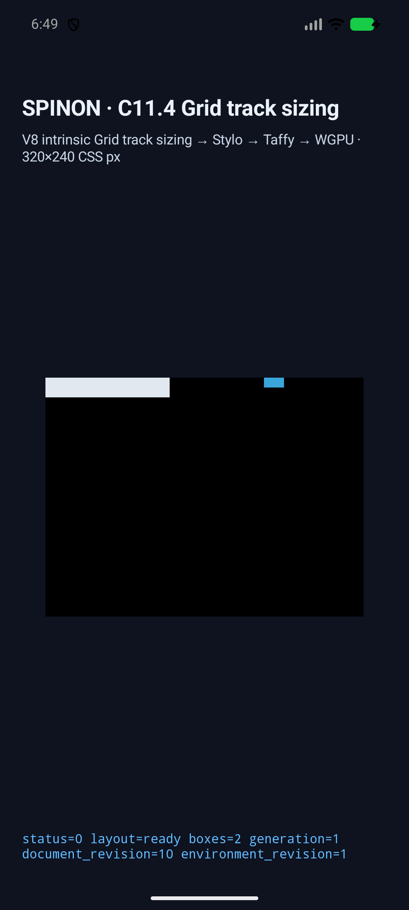
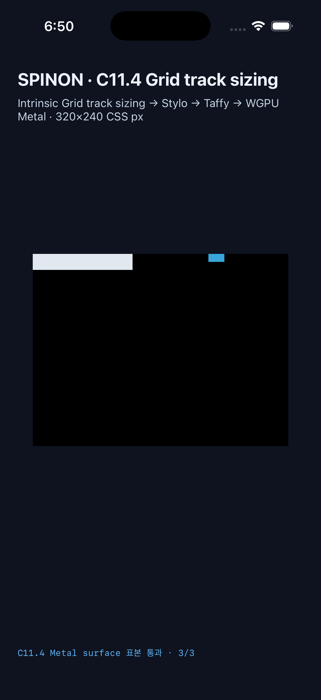

# C11.4 auto-repeat named-line implicit fallback · simulator 실행 근거

이 문서는 [집중 계획](../../../plan/c11-4-auto-repeat-named-line-implicit-fallback.md)의 제한 구현을 최신 source로 실행한 결과다. 계획 PR #533과 구현 PR [#534](https://github.com/ohah/spinon/pull/534)의 범위·근거를 기록한다. 이 결과만으로 C11.4, 일반 CSS admission, 전체 Grid 또는 WPT 적합성을 완료 처리하지 않는다.

## 고정 범위와 기대값

[Chrome 156 사전 비교](../c11-4-auto-repeat-named-line-implicit-fallback-precomparison-2026-10-23/README.md)와 CSS Grid 2025 CRD §8.3의 독립 기대값을 사용했다. 단일 `auto-fill` 축, 반복 `40px` track, implicit `20px` track, gap 0인 10개 scene이다. 양·음수 named integer line, authored occurrence 부족, 정방향·역방향 span 부족, row 축을 포함한다. Root는 `125×20` 또는 `20×125 CSS px`이며 scene에 따라 item을 root 바깥까지 배치한다. 기대 geometry는 사전 비교 fixture를 따른다. Track list와 line placement는 exact, frame 오차 허용치는 `1/64 CSS px`다.

| scene | 축 / 입력 조건 | 관측 item frame (CSS px) | screenshot |
| --- | --- | --- | --- |
| `auto-repeat-named-implicit-positive-missing` | column, 없는 이름, 양수 | `(220,0) 20×10` | `Android: auto-repeat-named-implicit-positive-missing.png`; `iOS: auto-repeat-named-implicit-positive-missing.png` |
| `auto-repeat-named-implicit-positive-insufficient` | column, `cell` occurrence 부족, 양수 | `(140,0) 20×10` | `Android: auto-repeat-named-implicit-positive-insufficient.png`; `iOS: auto-repeat-named-implicit-positive-insufficient.png` |
| `auto-repeat-named-implicit-negative-missing` | column, 없는 이름, 음수 | `(0,0) 20×10` | `Android: auto-repeat-named-implicit-negative-missing.png`; `iOS: auto-repeat-named-implicit-negative-missing.png` |
| `auto-repeat-named-implicit-negative-insufficient` | column, `cell` occurrence 부족, 음수 | `(0,0) 20×10` | `Android: auto-repeat-named-implicit-negative-insufficient.png`; `iOS: auto-repeat-named-implicit-negative-insufficient.png` |
| `auto-repeat-named-implicit-span-forward-missing` | column, 없는 이름의 정방향 span | `(120,0) 20×10` | `Android: auto-repeat-named-implicit-span-forward-missing.png`; `iOS: auto-repeat-named-implicit-span-forward-missing.png` |
| `auto-repeat-named-implicit-span-backward-missing` | column, 없는 이름의 역방향 span | `(0,0) 20×10` | `Android: auto-repeat-named-implicit-span-backward-missing.png`; `iOS: auto-repeat-named-implicit-span-backward-missing.png` |
| `auto-repeat-named-implicit-span-forward-insufficient` | column, occurrence 부족한 정방향 span | `(80,0) 60×10` | `Android: auto-repeat-named-implicit-span-forward-insufficient.png`; `iOS: auto-repeat-named-implicit-span-forward-insufficient.png` |
| `auto-repeat-named-implicit-span-backward-insufficient` | column, occurrence 부족한 역방향 span | `(0,0) 60×10` | `Android: auto-repeat-named-implicit-span-backward-insufficient.png`; `iOS: auto-repeat-named-implicit-span-backward-insufficient.png` |
| `auto-repeat-named-implicit-row-positive-missing` | row, 없는 이름, 양수 | `(0,220) 20×10` | `Android: auto-repeat-named-implicit-row-positive-missing.png`; `iOS: auto-repeat-named-implicit-row-positive-missing.png` |
| `auto-repeat-named-implicit-row-negative-missing` | row, 없는 이름, 음수 | `(0,0) 20×10` | `Android: auto-repeat-named-implicit-row-negative-missing.png`; `iOS: auto-repeat-named-implicit-row-negative-missing.png` |

각 실행 결과에는 10 observation·20 node frame·track trace·draw/present가 있다. 두 simulator의 track 목록과 frame은 서로 같고 fixture 기대값과 일치한다. 표면 표본은 각 scene의 root 안쪽, item 시작 edge, item 끝 또는 root 바깥 edge다. 이 표본은 border 색을 측정하지 않는다.

Android와 iOS의 scene/frame/track/draw 결과를 정렬해 비교한 요약은 `cross-platform-result-check.log`에 있다.

### 대표 동작 화면

Positive missing-name scene에서는 `grid-column-start/end: 5/6 ghost`의 파란 item이 125px grid root 밖의 x=220px에 놓인다. 화면의 grid 바깥은 검은 host surface이며 border stroke로 사용하지 않는다.

| Android API 37 ARM64 AVD | iPhone 17 Pro / iOS 26.2 Simulator |
| --- | --- |
|  |  |

나머지 9 scene screenshot 파일은 위 실행 디렉터리에 있고, 표의 Android/iOS filename이 각각의 캡처를 식별한다.

## 실행 환경과 결과

### Android

- Target: API 37 ARM64 Android Virtual Device, serial `emulator-5558`, model `sdk_gphone64_arm64`, fingerprint `google/sdk_gphone64_arm64/emu64a:17/CE2A.260420.019/15611780:userdebug/dev-keys`.
- Run ID prefix: `c114-android-avd-20261022T214921663Z-8f687ea1`; app SHA-256 `3ba65f987a5e358e274f773895429c7e6a1889030aad2cb0047a7ea40ad4c129`. Installed APK hash equals built APK hash.
- Result: 10/10 scene, 20 node frame, track stage trace and draw/present; PixelCopy 30/30 samples exact. AVD surface renderer is software-backed; this is not a physical-device or Android hardware-GPU result.
- Scene result, simulator metadata, install verification: `android-avd-c114-auto-repeat-named-implicit-fallback-android-avd-20261022T214921663Z-8f687ea1/` 아래의 `result.json`, `simulator.json`, `installed-apk-verification.json`.

### iOS

- Target: iPhone 17 Pro / iOS 26.2 Simulator, UDID `ACA7BF91-E2D5-4CF7-909A-08D1AD95FF3D`.
- Run ID prefix: `c114-ios-simulator-20261022T215027836Z-a5ce2bc7`; app executable SHA-256 `2ddfb6f9c2db783b63d3b2cb9eaa42fc75c451c6ce3382a175777d8dd2644416`.
- Result: 10/10 scene, 20 node frame, track stage trace and draw/present; Metal drawable 30/30 samples exact before OS compositor submission. This does not measure the final compositor output.
- Scene result and simulator metadata: `ios-simulator-c114-auto-repeat-named-implicit-fallback-ios-simulator-20261022T215027836Z-a5ce2bc7/` 아래의 `result.json`과 `simulator.json`.

Both runs use source commit `5b7b2be667b298c2a927c0c9bf3135ebf6752b4b`, source tree `8759ff36abc83cd19510f1ae6262a809c98a50fa`, and tracked implementation diff SHA-256 `f172120401195f2938932b4f6f129b6a6295f945e7a0f91074c7d115d768e6f2`. These values identify the implementation source before documentation and review artifacts were added.

## Artifact boundary

The iOS Simulator `spinon-ffi` release static archive was built twice with the same target. Product/core uses `--no-default-features --features c04-runtime-gpu`; the fixture positive control uses `--no-default-features --features c04-runtime-gpu-fixture-test,c11-grid-metal-surface-pixels-test`.

| archive | size | SHA-256 | marker / symbol result |
| --- | ---: | --- | --- |
| product/core | 74,805,848 bytes | `ec94b572eab8f32a76b799f4837c70a54b37675b4de1051bb46ac9d75f2be4a9` | Scene/source/error markers absent; C11.4 fixture host create/eval symbols absent |
| fixture-test | 77,853,280 bytes | `163a09bc12c861ef07d689fa0a821ed858ea1f07968474185dddee05cba6ed1d` | Scene/source markers and both fixture host symbols present |

심벌 검사는 Rust toolchain `llvm-nm`으로 수행했다. Xcode 기본 `nm`은 LLVM 22가 만든 일부 object attribute를 읽지 못해 최종 부재 판정에 사용하지 않았다. Build log와 marker/symbol scan 출력은 `artifact-boundary/` 아래에 둔다. 이 static archive 검사는 Android APK, iOS app bundle 또는 release bundle 크기 감사를 대신하지 않는다.

## Local checks

- `mise exec -- cargo test --locked -p spinon-layout`: 235 passed.
- `mise exec -- cargo test --locked -p spinon-style-to-layout`: 218 passed.
- `mise exec -- cargo test --locked -p spinon-ffi --no-default-features --features c04-runtime-gpu-fixture-test`: 108 passed, 2 ignored.
- `mise exec -- node --test tools/css-reference/fixture-module-boundary.test.mjs`: 6/6 passed.
- `mise exec -- cargo fmt --all -- --check`: passed.
- `mise exec -- cargo clippy --locked --workspace --all-targets -- -D warnings`: passed.

The original AVD evidence group also preserves resolved attempts: an early installed APK predated the new scene inventory, one CSS fixture used unsupported `align-self`, and one Android sample expectation had the wrong root background RGB. The successful run above uses the rebuilt APK and corrected fixture/sample definitions. These attempts are not counted as successful runs.

## Limits

This evidence does not cover physical Android hardware, Android hardware GPU, WPT/Spinon conformance, `auto-fit`, multiple auto-repeat fragments, areas, subgrid, writing modes, arbitrary author CSS, CSS border stroke, iOS output after compositor submission, or complete C11.4 support. Official status remains unchecked and `77/213`; internal contract numeric version remains `0.1.0`.
