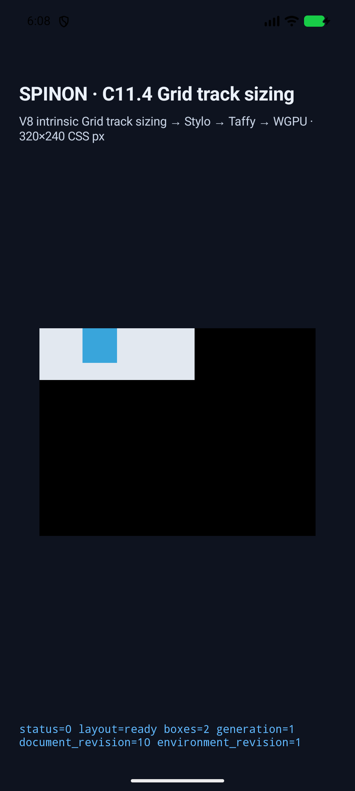
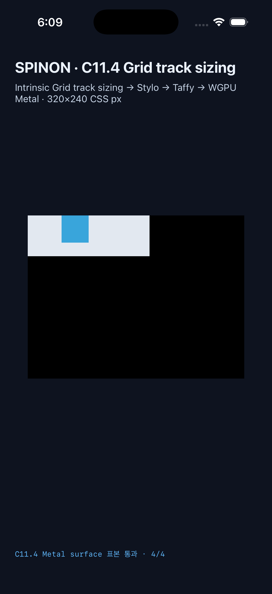

# C11.4 auto-repeat named line runtime evidence

## 판정 범위

`auto-fill`/`auto-fit` auto-repeat의 authored line names와 해당 축 named placement를 제한 profile에 보존했다. positive·bare·negative occurrence, named span, `auto-fit` collapse, fixed neighbor, repeat 경계 병합과 row axis를 여덟 고정 scene으로 비교했다. CSS Grid 2025 CRD의 독립 계산과 Chrome 156 사전 관측은 [사전 비교 기록](../c11-4-auto-repeat-named-lines-precomparison-2026-10-23/README.md)에 둔다.

각 simulator의 최신 소스 실행은 8/8 frame·track·trace·draw/present를 통과했다. Android PixelCopy와 iOS Metal drawable 표본은 scene별 3~4개, 각 29/29 exact다. 이 fixture renderer가 그리는 것은 item fill과 배경이며 border stroke 결과는 비교하지 않는다.

## 장면별 결과

`*`는 auto-fit으로 접힌 0px track이다. 좌표와 크기는 root 기준 CSS px다.

| Scene | Android item / columns / rows | iOS item / columns / rows |
| --- | --- | --- |
| `positive` | `(50,0) 40×40` / `[40,40,40]` / `[40]` | `(50,0) 40×40` / `[40,40,40]` / `[40]` |
| `bare` | `(0,0) 40×40` / `[40,40,40]` / `[40]` | `(0,0) 40×40` / `[40,40,40]` / `[40]` |
| `negative` | `(100,0) 40×40` / `[40,40,40]` / `[40]` | `(100,0) 40×40` / `[40,40,40]` / `[40]` |
| `span` | `(0,0) 90×40` / `[40,40,40]` / `[40]` | `(0,0) 90×40` / `[40,40,40]` / `[40]` |
| `fit` | `(0,0) 40×40` / `[0*,40,0*]` / `[40]` | `(0,0) 40×40` / `[0*,40,0*]` / `[40]` |
| `neighbors` | `(120,0) 80×40` / `[20,40,30,40,30,10]` / `[40]` | `(120,0) 80×40` / `[20,40,30,40,30,10]` / `[40]` |
| `merge` | `(20,0) 80×40` / `[10,20,20,20,10]` / `[40]` | `(20,0) 80×40` / `[10,20,20,20,10]` / `[40]` |
| `row` | `(0,50) 100×40` / `[100]` / `[40,40,40]` | `(0,50) 100×40` / `[100]` / `[40,40,40]` |

Every scene recorded `drawPresented=true`. The runtime validators also matched the expected repeat and stage trace; iOS emits more trace chunks than Android because its logging is more granular.

## Android API 37 AVD

- AVD: `emulator-5558`, API 37, `arm64-v8a`, `sdk_gphone64_arm64`; QEMU guest, Android 17 userdebug image.
- Built with `SPINON_ENABLE_C04_RUNTIME_GPU_FIXTURE_TEST=1`; final APK SHA-256 `77c8b6963631fb926a0ebd9171d0adbe777799087acd89884256a170661bdd34` matches the installed APK.
- Final run: [`android-avd-c114-auto-repeat-named-lines-android-avd-20261022T210827271Z-63f781fe`](./android-avd-c114-auto-repeat-named-lines-android-avd-20261022T210827271Z-63f781fe/); all eight PixelCopy summaries report matched. Screenshot: [positive occurrence](./android-avd-c114-auto-repeat-named-lines-android-avd-20261022T210827271Z-63f781fe/auto-repeat-named-positive.png).

## iOS Simulator

- Device: iPhone 17 Pro, iOS 26.2 Simulator, UDID `ACA7BF91-E2D5-4CF7-909A-08D1AD95FF3D`.
- Built with `SPINON_ENABLE_C04_RUNTIME_GPU=1`, `SPINON_ENABLE_C04_RUNTIME_GPU_FIXTURE_TEST=1`, and `SPINON_ENABLE_C11_GRID_METAL_SURFACE_PIXELS_TEST=1`; app SHA-256 `d01610134d840bdd63a0a9f390544eb2c4715679a45e0f0ed732bc917528ad4a`.
- Final run: [`ios-simulator-c114-auto-repeat-named-lines-ios-simulator-20261022T210914707Z-5c3b8d3a`](./ios-simulator-c114-auto-repeat-named-lines-ios-simulator-20261022T210914707Z-5c3b8d3a/); all eight Metal summaries report matched. These samples are read from the drawable before compositor submission. Screenshot: [positive occurrence](./ios-simulator-c114-auto-repeat-named-lines-ios-simulator-20261022T210914707Z-5c3b8d3a/auto-repeat-named-positive.png).

## Source binding and checks

Both final `simulator.json` files bind the captures to base commit `f4bd2a76c240771ee9c1d7a59d65bccabdc9519c` and tracked diff SHA-256 `9ae428a32fe0a9a3debe0b753feb152f8d7e9c23b57fd8ee5d028950ee895a78`. The Android installed APK hash equals its build hash.

| Check | Result |
| --- | --- |
| `cargo test --locked -p spinon-style` | 192 passed |
| `cargo test --locked -p spinon-layout` | 234 passed |
| `cargo test --locked -p spinon-style-to-layout` | 218 passed |
| FFI fixed-scene exposure test with `c04-runtime-gpu-fixture-test` | 1 passed |
| `cargo clippy --locked --workspace --all-targets -- -D warnings` | passed |
| `cargo fmt --all -- --check` and `git diff --check` | passed |
| `node --test tools/css-reference/fixture-module-boundary.test.mjs` | 6 passed |
| Android/iOS simulator app builds | passed; logs beside this README |

Static archive boundary was checked separately. `--no-default-features --features c04-runtime-gpu` produced SHA-256 `89555cc2d0e72aa7d972172a8d8f72a09355dae175b49bcfa072622604261ffc`, with no `auto-repeat-named-positive` string. `--no-default-features --features c04-runtime-gpu-fixture-test` produced SHA-256 `87228a1ec30a1e1c0e70bdee5edfeafbb650aeadd966de0112f535609eb0baf9`, with the marker present. This proves static archive feature isolation only; it does not prove exclusion from final APK/IPA bundles.

The first capture attempts are retained as diagnostics in this evidence directory and are not counted as successful runs. The final captures listed above were rebuilt and rerun after fixing the Android sample color table, scene allowlist, and the iOS Metal pixel feature flag.

## 제한

This remains an opt-in fixed-scene profile. It does not establish general CSS admission, all Grid repeat grammar, template-areas with auto-repeat, missing-name implicit-line fallback, WPT conformance, physical Android behavior, Android hardware-GPU behavior, or pixels after the iOS compositor. Pixel samples compare item/background colors, not border strokes. C11.4 stays incomplete and the official count stays `77/213`.
