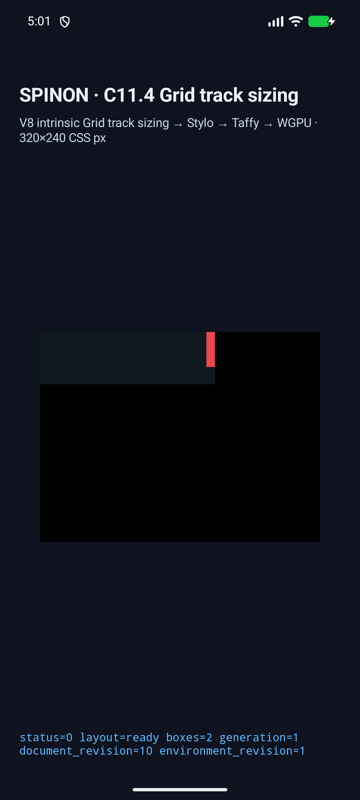
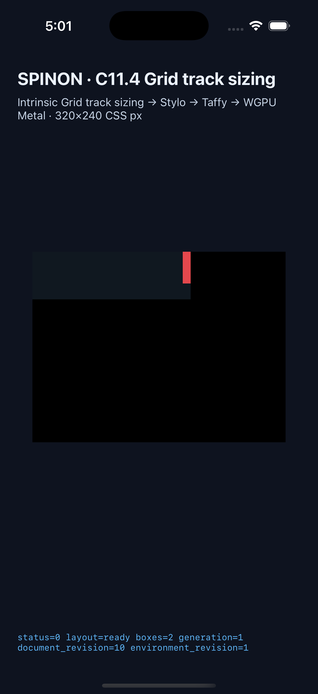
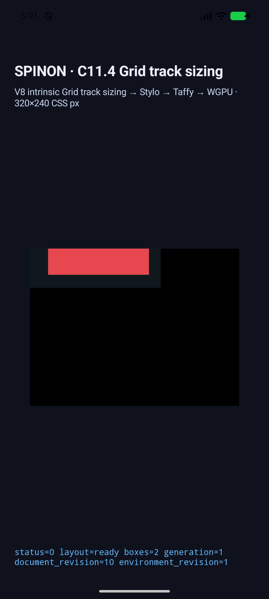
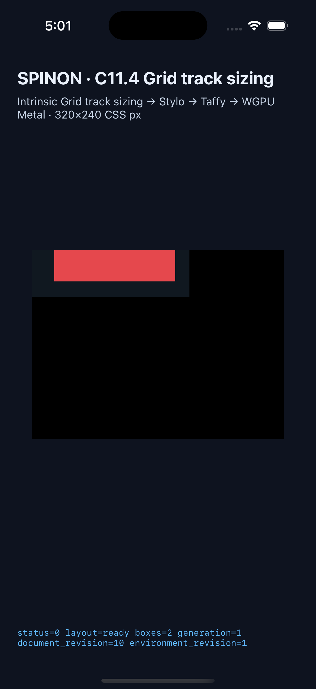
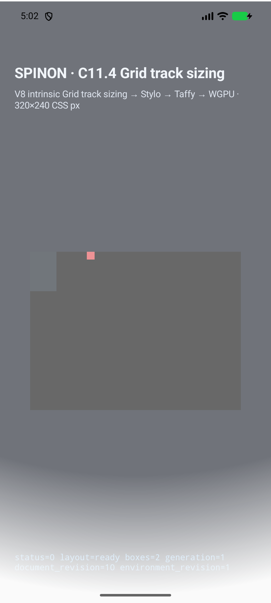
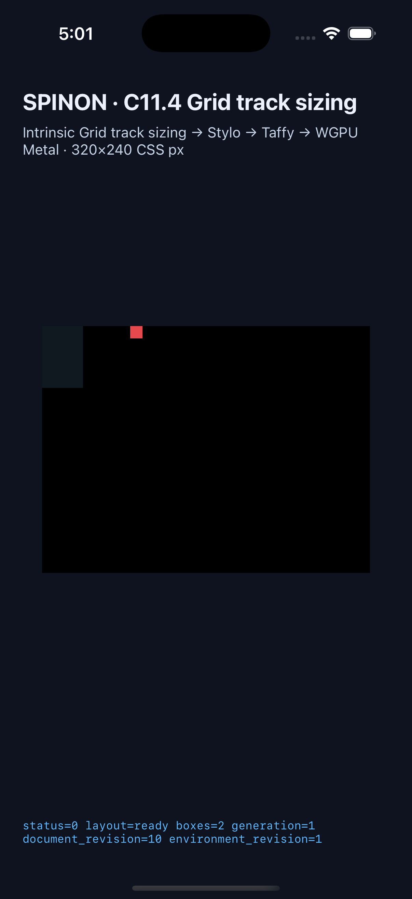

# C11.4 explicit-neighbor auto-repeat 실행 근거

**날짜:** 2026-10-20
**범위:** 한 track axis의 단일 `auto-fill`/`auto-fit` 반복 component 앞뒤에 유한·0 이상 `px` track을 둔 제한 후보
**상태:** 제한 구현·시뮬레이터 검증 완료. [구현 PR #362](https://github.com/ohah/spinon/pull/362)은 2026-10-20 KST Rebase and merge됐다(merge SHA `033ea09badbf61100675df485679c6e7959d1974`). C11.4와 C11 상위는 미완료.

## 고정 Chrome oracle과 Rust 비교

[Chrome 155 사전 비교](../c11-4-auto-repeat-explicit-neighbors-precomparison-2026-10-20/README.md)의 13개 고정 case를 사용했다. Rust matrix는 columns/rows, prefix·suffix·양쪽 explicit neighbor, 한·두 track repeat fragment, `auto-fill`·`auto-fit`, empty·occupied·span occupied 반복 track, indefinite·min/max size와 over-constrained 경계를 모두 비교한다. 최종 used track 폭과 collapse flag, root frame, 각 item의 x/y/width/height를 검사한다. Track 크기 허용차는 1/64 CSS px, root/item frame 허용차는 0.05 CSS px다.

Chrome은 oracle 관찰값이고, CSS Grid 반복 횟수·gutter·collapse 규칙은 CSS Grid Level 1 §7.2.3.1–7.2.3.2에서 독립적으로 도출했다. WPT 파일은 실행하지 않았다.

## Android/iOS Simulator 전 장면 실행

양 플랫폼에서 같은 13개 장면을 전부 실행했다. 캡처 스크립트는 emulator/Simulator 식별, 각 장면의 root/item frame, 전체 `node_frames_css_px`, trace chunk 누락 여부, 마지막 Columns/Rows stage의 used track 폭과 collapse flag, WGPU draw/present marker를 검증하고 화면과 실행 로그를 저장한다.

- [Android API 37 ARM64 AVD run](android-avd-c114-neighbors-android-avd-20261019T200155402Z-b056005f/result.json): **13/13 통과**. `emulator-5554`, `qemu=1`, `sdk_gphone16k_arm64`로 확인했다.
- [iPhone 17 Pro / iOS 26.2 Simulator run](ios-simulator-c114-neighbors-ios-simulator-20261019T200134871Z-55dee0f1/result.json): **13/13 통과**.

| 장면 | 축 | 최종 used track (CSS px) | 접힌 track | Simulator frame 확인 |
| --- | --- | --- | --- | --- |
| `auto-fill-fixed-neighbors` | columns | `20, 46, 46, 46, 10` | 없음 | root `200×60`; item `(190,0) 10×40` |
| `auto-fit-fixed-neighbors` | columns | `20, 154, 0, 0, 10` | 3·4 | root `200×60`; item `(28,0) 154×40` |
| `auto-fill-pattern-neighbors` | columns | `20, 45, 20, 45, 20, 10` | 없음 | root `200×60`; item `(190,0) 10×40` |
| `auto-fit-span-neighbors` | columns | `20, 73, 73, 0, 10` | 4 | root `200×60`; items `(28,0) 12×12`, `(190,0) 12×12` |
| `auto-fit-empty-neighbors` | columns | `20, 0, 0, 0, 10` | 2·3·4 | root `200×60`; item 없음 |
| `auto-fill-prefix-neighbors` | columns | `20, 52, 52, 52` | 없음 | root `200×60`; item `(28,0) 12×12` |
| `auto-fill-suffix-neighbors` | columns | `55.328125, 55.328125, 55.328125, 10` | 없음 | root `200×60`; item `(190,0) 12×12` |
| `auto-fill-indefinite-neighbors` | columns | `20, 40, 10` | 없음 | root `86×60`; item `(76,0) 12×12` |
| `auto-fill-max-size-neighbors` | columns | `20, 40, 40, 40, 10` | 없음 | root `182×60`; item 없음 |
| `auto-fill-min-size-neighbors` | columns | `20, 40, 40, 40, 40, 10` | 없음 | root `230×60`; item 없음 |
| `auto-fill-overflow-neighbors` | columns | `30, 40, 20` | 없음 | root width `40`; item x=`86`, width `12`, so item right edge is `98` |
| `auto-fill-row-neighbors` | rows | `20, 46, 46, 46, 10` | 없음 | root height `200`; item y=`190`, height `12`, so item bottom is `202` |
| `auto-fit-row-neighbors` | rows | `20, 154, 0, 0, 10` | 3·4 | root `50×200`; item `(0,28) 12×12` |

Overflow scene의 두 simulator 로그는 root/item 좌표를 전체 node frame으로 비교한다. 화면에서도 item 색 영역이 root의 painted background 영역을 넘어 표시되는 것을 확인했다. [Android overflow 화면](android-avd-c114-neighbors-android-avd-20261019T200155402Z-b056005f/auto-fill-overflow-neighbors.png) · [iOS overflow 화면](ios-simulator-c114-neighbors-ios-simulator-20261019T200134871Z-55dee0f1/auto-fill-overflow-neighbors.png). 이는 geometry와 화면 표시 확인이며 CSS border stroke의 표면 pixel 비교는 아니다.

| 장면 | Android AVD | iOS Simulator |
| --- | --- | --- |
| `auto-fill-fixed-neighbors` |  |  |
| `auto-fit-fixed-neighbors` |  |  |
| `auto-fill-overflow-neighbors` |  |  |

## 재현

이 실행은 고정 V8 source revision `7b50b62cb18f28617959e8452e2cd18195b38bcf`의 기존 checkout을 `SPINON_V8_DIR`로 읽기 전용 지정했다. 새 worktree에는 V8 source가 없었다.

```sh
export SPINON_V8_DIR=/Users/yoonhb/Documents/workspace/spinon/build/v8-source/v8
mise exec -- env SPINON_V8_DIR="$SPINON_V8_DIR" SPINON_ENABLE_C04_RUNTIME_GPU=1 SPINON_ENABLE_C04_RUNTIME_GPU_FIXTURE_TEST=1 bun run build:ios-sim
mise exec -- env SPINON_V8_DIR="$SPINON_V8_DIR" SPINON_ENABLE_C04_RUNTIME_GPU=1 SPINON_ENABLE_C04_RUNTIME_GPU_FIXTURE_TEST=1 bun run build:android
mise exec -- node --check tools/css-reference/capture-c11-4-auto-repeat-neighbors-simulator.mjs
mise exec -- node tools/css-reference/capture-c11-4-auto-repeat-neighbors-simulator.mjs ios-simulator ACA7BF91-E2D5-4CF7-909A-08D1AD95FF3D
mise exec -- node tools/css-reference/capture-c11-4-auto-repeat-neighbors-simulator.mjs android-avd emulator-5554
```

## 지원 한계

- Explicit neighbor는 유한·0 이상 `px`만 허용한다. 한 축에 repeat 하나만 둘 수 있고 두 axis 동시 반복, line names, template areas, non-px neighbor, repeat fragment 밖 integer `repeat()` 및 list 안의 추가 repeat은 fail-closed다.
- Repeated fragment는 기존 fixed-minimum subset만 허용한다. 전체 CSS Grid auto-repeat grammar·placement/span/gutter 조합과 10,000-track 경계는 검증하지 않았다.
- WPT, 실기기, Android hardware GPU, iOS compositor 이후 surface pixel은 미검증이다. C11.4와 C11 완료 판정은 바뀌지 않는다.

## 적대적 검토

- [구현 실패 관점 20개](./implementation-review-20.md)는 cascade, typed projection, Taffy adapter, placement, 앱 fixture, simulator capture 경계를 서로 다른 실패 경로로 다시 확인했다. 차단 결함은 찾지 못했다.
- [PR #362](https://github.com/ohah/spinon/pull/362)는 Android/iOS overflow 화면을 본문에서 렌더링하며, 두 원본과 연결한 [PR diff 적대 검토 30개](./pr-diff-review-30.md)를 포함한다. Agent Browser에서 이미지 두 개가 모두 로드된 것을 확인했다.
- 현재 `main` 보호 설정에는 required status check가 없고 PR check rollup도 비어 있다. 이를 CI 통과로 세지 않는다.

## 해시

이 directory의 실행 JSON·trace log·screenshot과 README는 [SHA256SUMS](./SHA256SUMS)에 고정한다.
