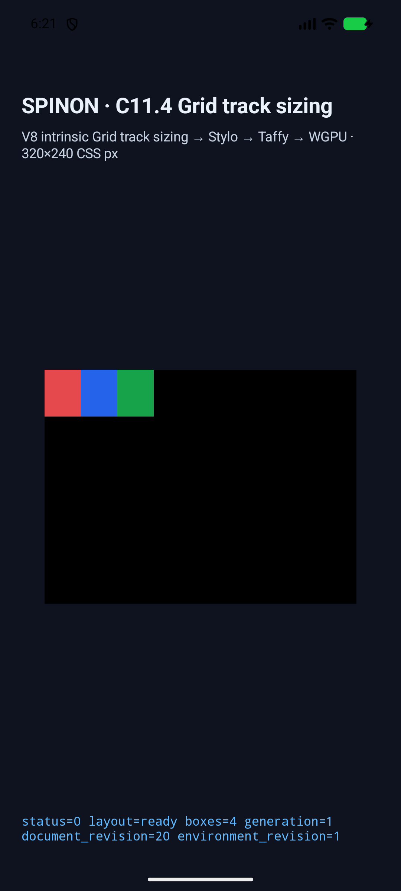
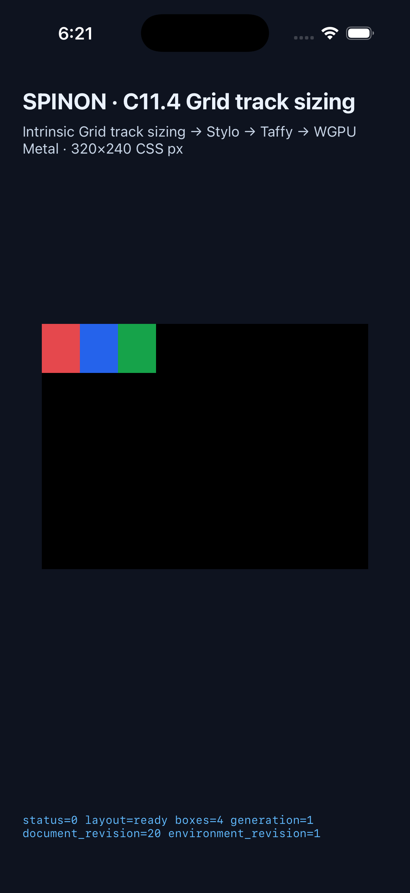
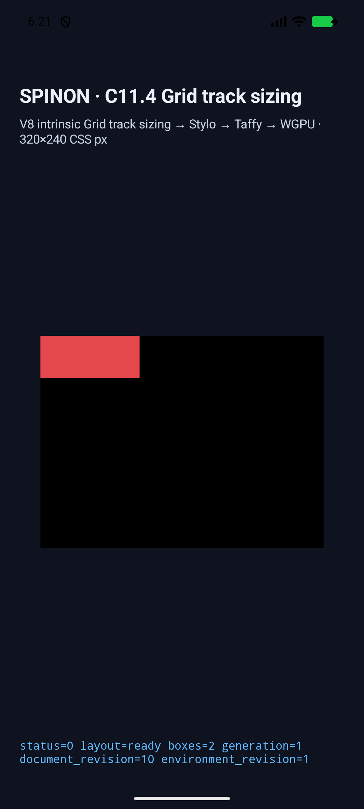
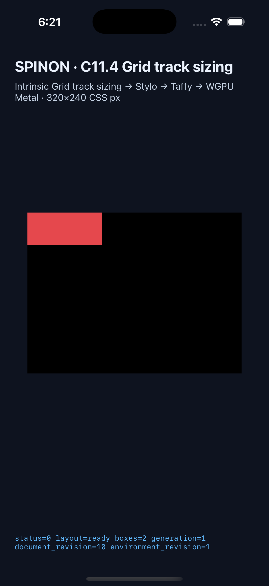

# C11.4 definite auto-repeat percentage `calc()` minimum runtime

이 실행은 기존 opt-in `RuntimeBlockFlexGridTrackSizingV1` 경로에 `minmax(calc(20px + 10%), 1fr)`의 제한 fixed-minimum 입력을 추가한다. cascade는 positive·유한 `LengthPx`와 nonnegative·유한 `Percentage` 항으로 된 정확한 2항 sum만 보존하고, layout은 같은 grid/property의 math binding과 definite percentage basis를 요구한다. 일반 CSS author admission, 임의 calc 문법, WPT 적합성 또는 C11.4 전체 완료를 뜻하지 않는다. [계획](https://github.com/ohah/spinon/blob/main/plan/c11-4-auto-repeat-percentage-calc-minimum.md) · [Chrome 156 사전 비교](../c11-4-auto-repeat-percentage-calc-minimum-precomparison-2026-10-23/README.md) · [내부 계약 0059](../../0059-c11-grid-layout.md).

## 대상과 결과

| 대상 | 런타임 | scenes | 결과 |
| --- | --- | ---: | --- |
| Android | API 37 ARM64 AVD `emulator-5558`, `sdk_gphone64_arm64` | 6/6 | 통과 |
| iOS | iPhone 17 Pro, iOS 26.2 Simulator `ACA7BF91-E2D5-4CF7-909A-08D1AD95FF3D` | 6/6 | 통과 |

각 platform에서 columns/rows의 auto-fill calc minimum과 `31.2px` fixed control, auto-fit collapse를 확인했다. 모든 node frame·used tracks·collapsed state·stage trace가 있고 draw/present가 성공했다. platform 간 관찰 frame과 track 값은 6개 장면 모두 exact match다. 각 auto-fill track은 `112/3px` 독립 기대값에서 1/64 CSS px 이내다. `auto-fit`은 pre-collapse 세 반복 중 빈 두 track을 `[112, 0, 0]px`로 접고 item을 112px에 배치한다. [교차 비교 결과](https://github.com/ohah/spinon/blob/main/spec/internal/evidence/c11-4-auto-repeat-percentage-calc-minimum-runtime-2026-10-23/cross-platform-comparison.json)와 Android/iOS run folder의 `result.json`을 참조한다.

| 화면 | Android API 37 AVD | iPhone 17 Pro Simulator |
| --- | --- | --- |
| columns auto-fill calc |  |  |
| columns auto-fit calc |  |  |

전체 12개 screenshot의 SHA-256은 `screenshot-sha256.txt`에 있다. 화면은 앱 전체 캡처이며 PixelCopy/Metal drawable의 표본별 픽셀 동일성을 검사한 것은 아니다. iOS는 Simulator 결과이고 Android AVD는 ARM64 software-emulator 경로다. Android 실기기, Android hardware GPU, iOS compositor 이후 pixel equality는 확인하지 않았다.

## 구현·빌드·artifact

- Taffy 0.15의 `TrackSizingFunction::has_fixed_component()`가 calc breadth를 세지 않아 auto-repeat이 한 번만 반복되던 결함을 수정했다. calc feature에서 plain calc component를 인식하며, vendored Taffy unit test는 112px axis의 `31.2px` calc minimum으로 3 repetitions를 확인한다.
- Android APK SHA-256 `01c4504be59bfe6f08b6af7b81e81065e2df25ae97737620ca206bd8980cca28`; 설치된 APK SHA-256도 같다. iOS Simulator app SHA-256 `2511d0300fe84c8065294d71b008fc82c0bf8c6bc4a3743291d9fe5a5ac97e53`.
- `c04-runtime-gpu` default/product static archive에서는 신규 scene marker와 fixture-module symbol이 없고, `c04-runtime-gpu-fixture-test` positive-control archive에는 있다. 결과 JSON은 `ffi-product-archive.json`과 `ffi-fixture-archive.json`에 있다. 이는 static archive 경계이며 APK/IPA 전체 exclusion은 검증하지 않았다.
- `cargo fmt --all -- --check`, focused Rust tests (`spinon-layout` 30, `spinon-style` 9, `spinon-style-to-layout` 11), vendored Taffy unit test 1, opt-in FFI scene validator 1, fixture-module boundary Node tests 7/7, workspace all-target Clippy `-D warnings`, Android build와 iOS Simulator build가 통과했다.
- iOS build에는 기존 Swift deprecation/cast 및 duplicate-symbol/debug-map warnings가 있었지만 빌드는 성공했다. Android의 deprecated Java API warning도 기존 항목이며 빌드는 성공했다.
- `cargo clean`은 이 continuation의 앞선 단계에서 81,057 files / 29.1 GiB를 정리했다. 최종 빌드 뒤 root `target`은 9.3 GiB로 다시 생성됐으며 한 번 더 지우지 않았다.

초기 Android 캡처는 native expected-frame 문자열에서 Float 표기와 auto-fit 잔여폭 계산을 잘못 가정해 실패했다. 두 독립 문제를 고치고 두 simulator에서 최종 6/6 결과를 다시 얻었다. 실패 로그는 run folder에 보존했다.

## 실행 근거

- Android: `android-build-final-guard.log`, `android-capture-final-guard.log`, and the run folder's `simulator.json`.
- iOS: `ios-build-final-guard.log`, `ios-capture-final-guard.log`, and the run folder's `simulator.json`.
- Rust/Node/formatting: `focused-rust-tests.log`, `taffy-calc-auto-repeat-test.log`, `ffi-fixture-test.log`, `fixture-module-boundary.log`, and `cargo-fmt.log`.
- Clippy/archive/screenshots: `workspace-clippy.log`, `ffi-product-archive-build.log`, `ffi-fixture-archive-build.log`, and `screenshot-sha256.txt`.
- `mise exec -- bun run docs:build` was also attempted. The final build is blocked by 811 dead-link groups in other existing documentation/evidence pages. The first build caught local artifact links in this slice; those were fixed, and the final output had no dead-link entry for this slice's plan, precomparison README, runtime README, or implementation/runtime review. See [the concise build result](docs-build-result.md); verbose generated output is retained outside the checkout.

공식 C11.4 checkbox는 미완료이고, 최신 공식 완료 집계 `72/213`은 그대로 유지한다. 내부 계약 0059는 `0.1.0`이다.
