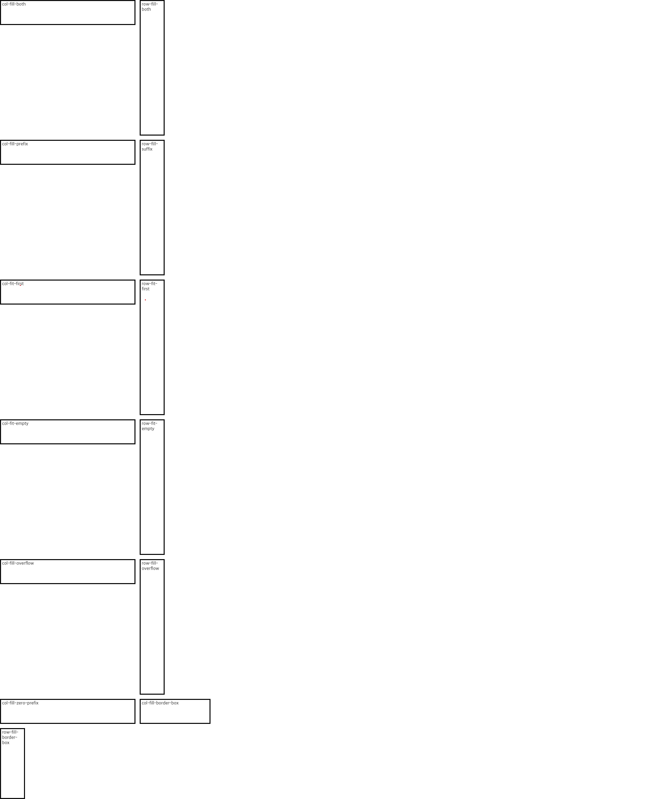

# C11.4 definite percentage auto-repeat neighbors 사전 비교

## 범위와 기준

이 자료는 repeat fragment 앞뒤에 definite percentage track을 둔 제한 auto-repeat 입력의 CSS Grid 기대값과 Chrome 관측만 기록한다. Spinon runtime 결과나 지원 완료 선언이 아니다.

- 규범 기준: [CSS Grid Layout Module Level 1, 2025 CRD §7.2.1, §7.2.3.1–§7.2.3.2](https://www.w3.org/TR/2025/CRD-css-grid-1-20250326/#auto-repeat). Auto-repeat count는 content box의 definite size, non-repeating tracks와 gutter를 포함해 계산한다. 이 fixture의 percentage neighbors는 각 axis의 definite content size를 basis로 삼는다.
- 기준 브라우저: Agent Browser의 Chrome 156.0.8078.48 (HeadlessChrome/156.0.0.0), macOS 26.5.1 ARM64, DPR 1. Browser metadata와 raw observation은 같은 디렉터리에 둔다.
- 고정 입력: oracle.html. Definite content size는 240px이며 default gap은 4px. Border-box scene은 136px outer size, 8px padding과 2px border로 content basis 116px을 만든다.
- 13개의 scene 각각에서 CSSOM used track list를 exact track order로 보존한다. Item이 있는 auto-fit 장면은 grid border origin 기준 2×2px item frame도 기록한다.
- chrome156-percentage-neighbors.png는 1280×633 viewport screenshot이다. chrome156-percentage-neighbors-full.png는 1280×1532 전체 matrix screenshot이다.
- validate-precomparison.py는 scene 수, 반복 횟수, used track 값과 auto-fit item frame을 기록된 허용치로 검사한다.

## 독립 계산과 관측

W3C repeat-to-fill 식에 따라 each repeated track을 definite sizing function으로 계산하고 non-repeating percentage tracks 및 모든 gutters를 합산했다. Count는 양의 정수 중 content box를 넘지 않는 가장 큰 값이며, 최소 1회 조건은 별도로 둔다.

| Scene | 독립 기대값 | Chrome CSSOM 관측 |
|---|---|---|
| col-fill-both | count 4, [24,46,46,46,46,12] | 동일 |
| row-fill-both | count 4, [24,46,46,46,46,12] | 동일 |
| col-fill-prefix | count 4, [30,48.5,48.5,48.5,48.5] | 동일 |
| row-fill-suffix | count 4, [48.5,48.5,48.5,48.5,30] | 동일 |
| col-fit-first | count 4, [24,196,0,0,0,12] | 동일; item (38,10) 2×2 |
| row-fit-first | count 4, [24,196,0,0,0,12] | 동일; item (10,38) 2×2 |
| col-fit-empty | count 4, [24,0,0,0,0,12] | 동일 |
| row-fit-empty | count 4, [24,0,0,0,0,12] | 동일 |
| col-fill-overflow | count 1, [192,40,72] | 동일 |
| row-fill-overflow | count 1, [192,40,72] | 동일 |
| col-fill-zero-prefix | count 5, [0,40.8×5,12] | [0,40.796875×5,12] |
| col-fill-border-box | content basis 116, count 2, [11.6,43.3,43.3,5.8] | [11.59375,43.296875,43.296875,5.796875] |
| row-fill-border-box | content basis 116, count 2, same as above | same as above |

Count, track order, auto-fit collapse and item placement must match exactly. Fractional used values are compared within 1/64 CSS px. The 136px outer box is not used as the percentage basis; the 116px content axis is.

## 해석 한계

- 한 고정 Chrome 156/macOS ARM64 관측이다. 다른 browser engine, WPT, Android/iOS app runtime은 이 자료에서 확인하지 않았다.
- Scope is fixed percentage neighbors around a single auto-repeat. It does not cover percentage calc, intrinsic tracks, indefinite/cyclic basis, multiple auto-repeat, general author CSS or C11.4 completion.
- Auto-fit track widths prove post-placement collapse only in the two fixed scenes; they do not prove general auto-placement behavior.
