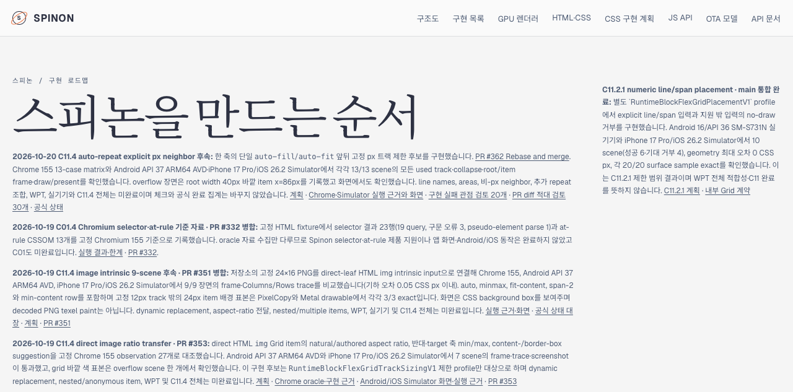
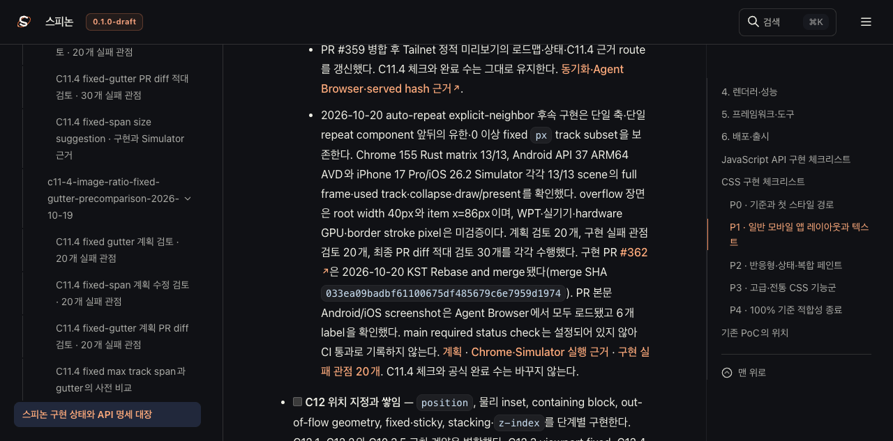
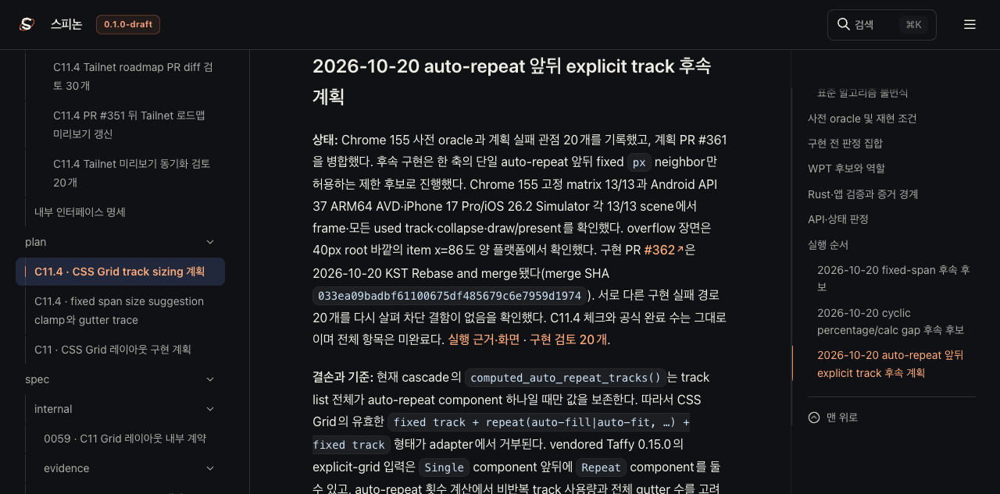
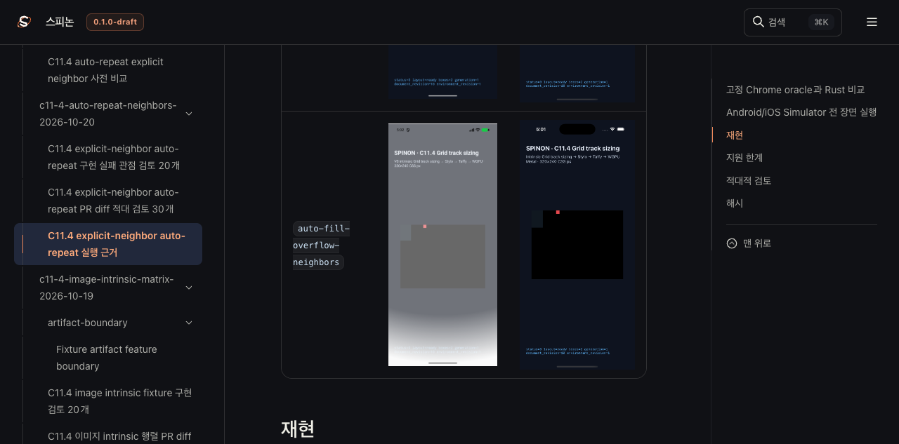

# C11.4 PR #362 뒤 Tailnet 로드맵 미리보기 갱신

**기준:** PR #362 Rebase and merge commit `033ea09badbf61100675df485679c6e7959d1974`.
**범위:** 선택한 구현 상태·C11.4 계획·내부 근거·공개 `roadmap.html`을 정적 Tailnet 경로 `/spinon/`에 반영했다. GitHub Pages 배포와 앱 실행은 하지 않았다.

## 반영 내용

- 공개 로드맵에서 C11.4 auto-repeat explicit-neighbor 후속과 PR #362 병합을 연결했다.
- 상태 대장·집중 계획·내부 근거 색인·실행 근거 README에 merge SHA와 병합 상태를 반영했다. C11.4 체크와 완료 수는 유지했다.
- 선택 Rspress root 빌드에 새 precomparison·구현 근거 디렉터리와 Android/iOS 이미지 자산을 포함했다. Rspress 설정·의존성은 변경하지 않았다.
- Tailnet HTTPS origin은 저장소 증거에서 생략했다.

## 선택 빌드와 동기화

선택 staging root는 576개 파일과 링크 재작성 관찰값을 기록했다. 입력 manifest는 선택 원본 332개의 SHA-256을 보존한다. Rspress가 만든 선택 site는 526개 파일, 총 23,622,287 bytes였다.

| 실행 | 파일 수 | 생성 | 교체 | 동일 | 기존 파일 백업 | 삭제 | 제공 결과 |
| --- | ---: | ---: | ---: | ---: | ---: | ---: | ---: |
| pass10 | 526 | 255 | 33 | 238 | 33/33 검증 | 0 | HTTP 200·byte·SHA 526/526 일치 |

교체 전 대상 파일을 모두 확인했고 교체 대상 중 열려 있던 파일은 0개였다. `SpinonPreview`에서는 선택 파일만 추가·교체했으며 다른 파일은 정리하지 않았다. 각 교체본은 별도 pass10 backup에 보존했고 원본 파일과 크기·SHA가 모두 일치했다. 복사는 같은 디렉터리 임시 파일을 만든 뒤 원자적으로 이름을 바꾸는 방식이다.

- [선택 root와 링크 재작성](./prepare-root-pass10.json)
- [선택 원본 SHA-256 332개](./SHA256SUMS-preview-inputs.txt)
- [Rspress 선택 build log](./selected-build-pass10.log)
- [정적 site host-path 검사](./sanitize-pass10.json)
- [대상 사전 비교](./preflight-pass10.json) · [열린 파일 확인](./open-handles-pass10.json)
- [복사와 기존 파일 백업 검증](./copy-and-backup-pass10.json)
- [Tailnet served byte·SHA 검증](./served-verification-pass10.json)

Build log 본문은 유지하고, `git diff --check`가 통과하도록 표의 행 끝 공백과 마지막 빈 줄만 정규화했다.

## Agent Browser 화면 확인

Agent Browser에서 다음 네 경로의 실제 화면을 확인했다.

- `/spinon/roadmap.html`: PR #362 Rebase and merge 링크와 제한 범위 표시.
- `/spinon/STATUS.html`: merge SHA 표시, main required status check 미설정 표시, CI 통과 주장은 없음, C11.4 미완료 유지.
- `/spinon/plan/c11-4-grid-track-sizing.html`: 계획의 merge SHA와 C11.4 미완료 표시.
- `/spinon/internal/evidence/c11-4-auto-repeat-neighbors-2026-10-20/README.html`: Android AVD 세 장과 iOS Simulator 세 장이 모두 로드됨. Android 원본은 각 1080×2400, iOS 원본은 각 1206×2622.

관찰값은 [browser-check](./browser-check-pass10.json)에 기록했다. 브라우저 캡처는 Tailnet 문서 화면이며 앱 화면이 아니다.

전용 Agent Browser 세션을 닫았고, 세션 inactive 및 남은 agent-browser process 0개를 확인했다([종료 기록](./browser-close-pass10.json)).

PR #363 본문에 첨부한 네 문서 화면도 Agent Browser에서 모두 로드됐고 각 이미지는 1280×633이다([PR 본문 이미지 확인](./pr-body-browser-check-363.json)). 이는 Tailnet 문서 화면 캡처이며 앱 실행 화면이 아니다.

## 검토와 범위

- [동기화 실패 관점 검토 20개](./sync-review-20.md)
- [PR diff 실패 관점 검토 30개](./pr-diff-review-30.md)
- 선택 문서 빌드만 실행했다. 앱 실행, WPT, GitHub Pages 배포는 이번 문서 갱신에서 주장하지 않는다.
- 이 동기화는 C11.4의 전체 구현이나 공식 완료 판정을 바꾸지 않는다.
