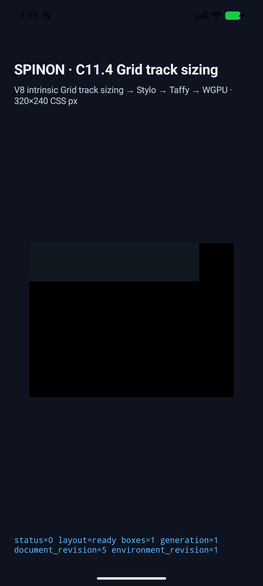
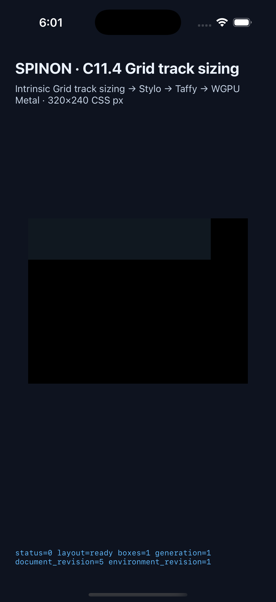

# C11.4 definite minimum-size · two-track auto-repeat 구현 근거

**날짜:** 2026-10-20
**범위:** definite `min-width` 또는 `min-height`와 두 track `auto-fill` fragment `minmax(40px, 1fr) 20px`의 조합. prefix-only, suffix-only, 양쪽 neighbor와 columns/rows 축을 검사한다.
**판정:** 이 고정 fixture 경로에서 기존 cascade/layout 코드는 Chrome 155와 일치했다. Rust scene adapter, Android/iOS app fixture allowlist·기대값, simulator trace 검증만 확장했다. C11.4와 C11 완료 체크·완료 수는 바꾸지 않는다.

## 독립 기준과 예상값

[계획](../../../../plan/c11-4-auto-repeat-two-track-min-size.md)과 [Chrome 155 사전 비교](../c11-4-auto-repeat-two-track-min-size-precomparison-2026-10-20/README.md)는 구현 전에 고정했다. CSS Grid Level 1 §7.2.3.2에 따라 definite minimum-size만 있으면 최소 크기를 만족하는 가장 작은 양의 반복 수를 고른다. 이 fragment에서는 반복당 definite minimum `40px + 20px`, 8px gap을 사용한다.

- 양쪽 neighbor가 있으면 `20px + 10px + 60n + 8(2n + 1) = 38 + 76n`: min-size 190/200/342px은 각각 2/3/4회 반복과 root 190/266/342px을 만든다.
- prefix-only min-size 200px은 3회 반복, root 248px이다.
- suffix-only min-size 200px은 3회 반복, root 238px이다.
- rows는 같은 입력을 block axis에 적용한다.

| Scene | Axis | Root frame | Final used tracks (CSS px) |
| --- | --- | --- | --- |
| `auto-fill-two-track-columns-both-190` | columns | `190×60` | `20, 40, 20, 40, 20, 10` |
| `auto-fill-two-track-columns-both-200` | columns | `266×60` | `20, 40, 20, 40, 20, 40, 20, 10` |
| `auto-fill-two-track-columns-both-342` | columns | `342×60` | `20, 40, 20, 40, 20, 40, 20, 40, 20, 10` |
| `auto-fill-two-track-columns-prefix-200` | columns | `248×60` | `20, 40, 20, 40, 20, 40, 20` |
| `auto-fill-two-track-columns-suffix-200` | columns | `238×60` | `40, 20, 40, 20, 40, 20, 10` |
| `auto-fill-two-track-rows-both-190` | rows | `50×190` | `20, 40, 20, 40, 20, 10` |
| `auto-fill-two-track-rows-both-200` | rows | `50×266` | `20, 40, 20, 40, 20, 40, 20, 10` |
| `auto-fill-two-track-rows-both-342` | rows | `50×342` | `20, 40, 20, 40, 20, 40, 20, 40, 20, 10` |

Every new scene has no grid items, one root box, no collapsed tracks, and `track count - 1` active 8px gaps. Simulator checks compare the final axis stage, reconstruct every trace chunk, assert every used track within 1/64 CSS px, and require the draw/present marker. The app screenshots show the running Grid fixture; geometry and track values come from app frames and track-sizing diagnostics, not screenshot color sampling.

## Build and simulator runs

- iOS build: [ios-build.log](./ios-build.log), Xcode **BUILD SUCCEEDED**; the captured app executable SHA-256 is `5def513848b684a53994cdcb4ce7fede886010a80c12a64e8470f18c99be1008`.
- Android build: [android-build.log](./android-build.log), Gradle **BUILD SUCCESSFUL**; APK SHA-256 `4151443d39f53e645ba891f46b098155477b0a9c8fb064758cd57735b047a2e9`.
- Rust focused fixture test: [`rust-test.log`](./rust-test.log), 1/1 passed; [Clippy](./rust-clippy.log) with `-D warnings` passed. [기본·opt-in rlib fixture 경계와 hash](./fixture-artifact-boundary.md).
- Android: [API 37 ARM64 AVD run](./android-avd-c114-neighbors-android-avd-20261019T205756565Z-3355bf45/result.json), **21/21 scenes passed**. The capture script recorded `emulator-5554`, `qemu=1`, API 37 and `arm64-v8a`; model `sdk_gphone16k_arm64`. The connected USB device was not used.
- iOS: [iPhone 17 Pro / iOS 26.2 Simulator run](./ios-simulator-c114-neighbors-ios-simulator-20261019T210104021Z-887d74fe/result.json), **21/21 scenes passed**.
- Both runs include the previous 13 explicit-neighbor scenes and all 8 new two-track minimum-size scenes. Their `result.json`, app logs, complete trace chunks, simulator metadata and PNG screenshots are in each run directory.

| Android API 37 ARM64 AVD | iPhone 17 Pro / iOS 26.2 Simulator |
| --- | --- |
|  |  |

## 발견 및 수정

첫 iOS 실행에서 이전 13개 장면은 통과했지만 새 scene ID가 앱 단계 allowlist에 없어 `SPINON_C114_GRID_ARGUMENT_ERROR rejected=true`로 거부됐다. [초기 launch](./ios-simulator-c114-neighbors-ios-simulator-20261019T205026403Z-b00ac83e/launch-auto-fill-two-track-columns-both-190.log)와 [거부 로그](./ios-simulator-c114-neighbors-ios-simulator-20261019T205026403Z-b00ac83e/runtime-auto-fill-two-track-columns-both-190.log)에 남아 있다. Rust resolver만 추가해서는 앱 진입이 되지 않는 경로였다.

iOS와 Android 양쪽에 새 scene ID, root/item frame, root-only node frame, expected box count를 추가했다. 재실행 뒤 21/21이 통과했다. 최종 캡처 harness는 새 장면마다 active gutter 개수와 각 8px 크기도 검사하며, Android 대상은 API·가상화 여부에 더해 ABI가 `arm64-v8a`인지 거부 조건으로 확인한다.

## 구현 검토와 범위

- [구현 코드·런타임 적대 검토 20개](./implementation-review-20.md)
- [최종 PR diff 적대 검토 30개](./pr-diff-review-30.md)
- [기본·opt-in fixture artifact 경계](./fixture-artifact-boundary.md)
- [계획 및 Chrome precomparison](../c11-4-auto-repeat-two-track-min-size-precomparison-2026-10-20/README.md)

`auto-fit` definite minimum-size의 Chrome axis discrepancy는 이 구현 acceptance에 넣지 않았고 별도 조사 항목으로 남겼다. WPT, 실기기, Android hardware GPU, iOS compositor 이후 픽셀 및 전체 C11.4 conformance는 확인하지 않았다. 이 제한 fixture 결과는 공개 CSS 지원 계약이나 C11.4 완료를 뜻하지 않는다.
