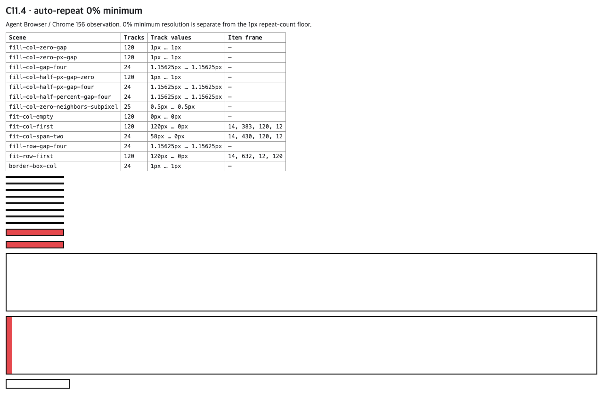

# C11.4 · auto-repeat 0% minimum 사전 비교

## 질문과 판정

`repeat(auto-fill | auto-fit, minmax(0%, 1fr))`에서 0% minimum은 실제 track size를 0으로 계산하되, auto-repeat 개수를 계산할 때는 UA floor를 적용하는가? CSS Grid Layout Module Level 1, 2025 CRD §7.2.3.2는 auto-repeat 개수 산정에서 track size를 0으로 나누지 않도록 UA 지정 값으로 floor해야 한다고 규정하고 1px를 제안한다. 이 floor는 반복 횟수 계산용이며 track의 authored/computed sizing function이나 배치 후 실제 크기를 1px로 바꾸지 않는다. [W3C §7.2.3.2](https://www.w3.org/TR/2025/CRD-css-grid-1-20250326/#repeat-syntax)

Chrome 156 / Agent Browser 0.31.1은 1 CSS px floor와 일치했다. 예를 들어 120px definite content axis에서는 gap 0일 때 120회, gap 4px일 때 24회 반복한다. auto-fit은 같은 pre-placement repeat count를 만들고 item placement 뒤 빈 repeated track을 collapse한다. 실제 0% minimum은 여전히 0px다.

## 입력과 관찰

- Fixture source: `tests/fixtures/css/c11/grid-auto-repeat-zero-percent-minimum-c114.html`, SHA-256 `cf06ba027c282ec96361a3dccd1df1e6e17d74cc110e4b1e4000fa25cf43d62a`.
- Browser: Agent Browser 0.31.1, `HeadlessChrome/156.0.0.0`, viewport 1280×633 CSS px, DPR 1.
- 13개 장면의 rendered CSS track histogram, repeat/total track count, basis 및 item frame은 `chrome156-observation.json`에 있다. Agent Browser 재확인은 `agent-browser-pass02-observation.json`에 있다. 독립 기대값은 `spec-derived-expectations.json`에 있다.
- `validate-precomparison.mjs`가 Chrome 156과 Agent Browser pass02의 장면을 각각 13/13 비교한다. 마지막 실행은 두 관찰 각각 13 pass, 총 0 fail이다.
- 검증기는 두 observation의 Chrome 156 user agent·viewport·DPR 일치, scene ID 집합·중복 여부, repeat/total count, track histogram, 지정된 content basis와 track-size 허용오차, 세 item의 width/height를 확인한다. fixture byte hash는 Chrome observation과 대조한다.
- [계획 실패 관점 20개](../../../../plan/c11-4-auto-repeat-zero-percent-minimum-plan-review-20.md)와 [계획 PR 변경 실패 관점 20개](./plan-pr-diff-review-20.md)를 분리해 기록했다. 파일 해시 manifest는 `SHA256SUMS`다.

pass01 캡처와 pass02 화면의 SHA-256은 동일하다: `10e2df8df4b04ca7622c31618a4d1e0f9163999f5fd5968084071082b478509e`.

## 고정 관찰값

| 비교 | definite content axis | 1px floor 적용 후 repeat 수 | 사용 track 결과 |
|---|---:|---:|---|
| columns `minmax(0%, 1fr)`, `auto-fill`, gap 0 | 120px | 120 | 120 × 1px (`1fr`가 leftover를 채움) |
| columns `minmax(0%, 1fr)`, `auto-fill`, gap 4px | 120px | 24 | Chrome CSSOM에서 각 1.15625px; 독립값 28/24px, serialization 허용오차 1/64px |
| columns explicit 0.5px neighbors + repeated `0%`, gap 4px | 120px | 23 | explicit neighbor 각 0.5px 유지, 반복 track 23개, 총 track 25개 |
| columns `auto-fit`, 빈 `0%` 반복 | 120px | 120 | placement 뒤 120개 모두 0px로 collapse |
| columns `auto-fit`, 한 item | 120px | 120 | 점유 track 120px, 빈 119개 0px |
| columns `auto-fit`, 한 item이 두 track span, gap 4px | 120px | 24 | 점유 track 58px 두 개, 빈 22개 0px |
| rows `minmax(0%, 1fr)`, `auto-fill`, gap 4px | 120px | 24 | column scene과 같은 block-axis 계산 |
| border-box columns 136px, 좌우 padding 8px·border 2px 각각, gap 4px | 116px content | 24 | floor track 24개와 gap 23개가 content axis에 맞음 |

`0px`와 `0.5px`/`0.5%` minimum 대조군은 floor가 0%만의 예외가 아니라 반복 개수 계산에 적용되는 UA floor임을 분리해 보여준다. explicit prefix/suffix track과 gap에는 floor를 적용하지 않는다. zero content basis와 indefinite basis는 이번 제품 입력에서 계속 fail-closed로 둔다.

## 범위 한계

이 비교는 Chrome oracle 및 CSS Grid 명세 해석이다. Spinon 코드, Android/iOS runtime, pixel equality, WPT 또는 전체 CSS Grid 지원을 검증하지 않는다. 다음 [계획](../../../../plan/c11-4-auto-repeat-zero-percent-minimum.md)은 기존 positive-percentage auto-repeat minimum의 opt-in boundary 안에서 typed `Percentage(0)`를 허용하고, 반복 횟수 산정에만 1px floor를 적용하는 구현 slice를 정의한다.
