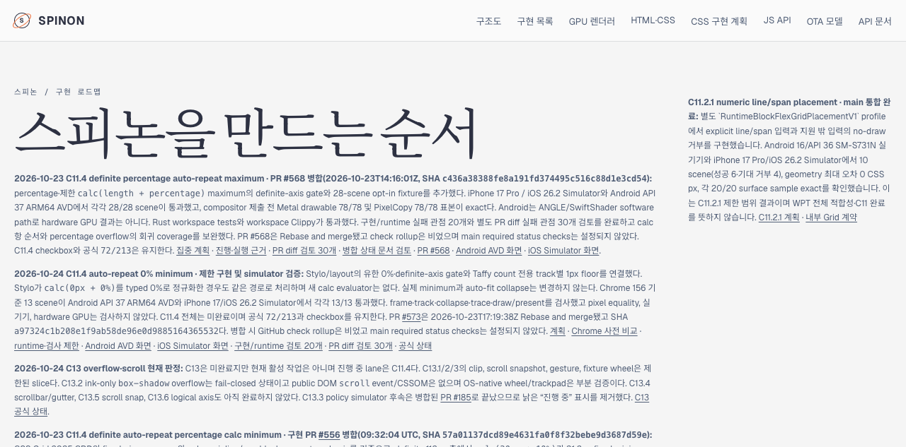
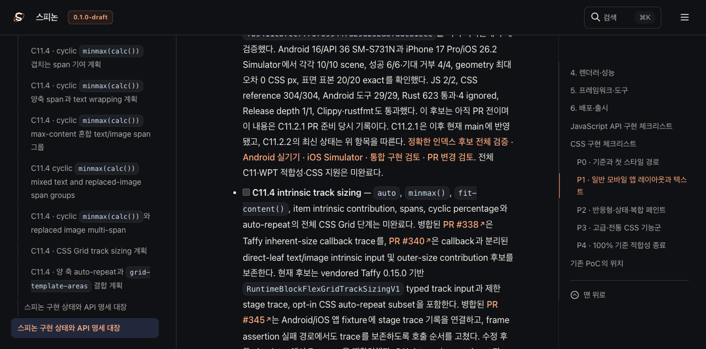

# C11.4 auto-repeat 0% minimum 로드맵 동기화 — pass02

## 기준 코드와 상태

- 기준 코드는 PR [#573](https://github.com/ohah/spinon/pull/573)의 merge commit `a97324c1b208e1f9ab58de96e0d9885164365532`다. live GitHub 조회에서 PR은 `MERGED`, merge 시각은 `2026-10-23T17:19:38Z`, merge commit은 현재 `main`과 일치한다.
- 구현은 Stylo의 고정 최소값 admission, `spinon-layout`의 definite-axis 검사, vendored Taffy의 auto-repeat 개수 계산을 연결한다. Taffy는 반복 track별 UA 1px floor를 개수 계산에만 쓰며 실제 track sizing과 flex sizing에 전달하지 않는다.
- `calc(0px + 0%)`는 cascade가 typed `Percentage(0)`으로 정규화한 경우 같은 제한 경로를 탄다. 새 calc evaluator를 추가하지 않았고, 지원 maximum·유한값·definite positive axis gate와 auto-fit collapse는 유지한다.
- Chrome 156을 기준으로 한 13 scene이 Android API 37 ARM64 AVD와 iPhone 17/iOS 26.2 Simulator에서 각각 13/13 통과했다. frame, used tracks, collapse, trace, draw/present를 확인했다. C11.4 전체, WPT, 일반 authored CSS admission, 실기기·hardware GPU, compositor 이후 pixel equality는 주장하지 않는다.
- 공식 상태 대장의 213개 task 중 72개가 완료다. C11.4와 C13 상위 task는 미완료다. 공개 roadmap의 활성 lane은 C11.4이며 C13은 미완료지만 현재 활성 작업이 아니다. PR [#185](https://github.com/ohah/spinon/pull/185)은 merged 상태를 live 조회했다.

## Tailnet 미리보기 반영

- 선택 빌드의 `HEAD`와 `origin/main`은 모두 `a97324c1b208e1f9ab58de96e0d9885164365532`였다. RSPress는 선택 root에서 빌드했고 `public/`의 10,773개 파일은 동일한 SHA-256을 확인한 뒤 hard link로 연결했다.
- 사전검사는 1,078개 경로를 확인했다. 985개가 바뀌었다(신규 978, 교체 7, 동일 93). 이전 파일 7개, 총 3,623,232 bytes를 별도 백업했고 삭제는 없었다.
- 복사 뒤 roadmap, 공식 status, 집중 계획, 계약 0059, Chrome 사전 비교 README·화면, runtime README·리뷰, Android/iOS 결과 JSON·화면 등 핵심 12개 경로가 모두 HTTP 200이고, local·remote 크기와 SHA-256이 선택 빌드와 일치했다. 전체 1,078개 route를 원격 순회했다고 확대 해석하지 않는다.
- 기존 preview server PID 1191을 유지했다. 서버 root에서 `lsof +D`로 3,569개의 열린 regular-file descriptor가 보였지만, 정확한 listener PID의 established TCP connection은 사전검사와 복사 직전 모두 0이었다. 서버 구현은 요청 경로마다 `stat` 후 `createReadStream`을 열며 파일은 임시 경로에 쓴 뒤 원자적으로 rename했다. 미리보기 서버를 중지하지 않았고 남아 있는 descriptor를 정리하지 않았다.

## Agent Browser 확인

- roadmap 화면에서 C11.4 0% 제한 slice, PR #573 merge SHA, `72/213`, C11.4 미완료 상태를 확인했다. 동적 task board에는 213개 checkbox 중 72개가 checked였고 C11.4와 C13은 unchecked였다.
- status 화면에서 PR #573, merge SHA, `72/213`, C11.4 및 C13 미완료 항목을 확인했다.
- roadmap 화면은 1280×633 viewport로 저장했다. Android AVD 화면은 `complete=true`, 1080×2400이고 iOS Simulator 화면은 `complete=true`, 1206×2622였다.
- Agent Browser 종료 결과는 [종료 보고서](./browser-close-pass02.json)에 기록한다.

## 검증 범위

선택 route build는 전체 사이트 dead-link/dead-image 검사가 아니다. 원격 HTTP·SHA 확인은 명시된 12개 경로에 한정된다. Simulator 화면은 scene 표시 근거이며 pixel equality나 실기기 결과가 아니다. PR check rollup은 비어 있었고 `main` required status checks는 설정되지 않았다.

자세한 파일별 hash와 변경 목록은 `preflight-pass02.json`, `delta-manifest-pass02.json`, `copy-and-backup-pass02.json`, `remote-verification-pass02.json`에 기록했다. 선택 root overlay, public hardlink, RSPress build 요약과 설정도 이 폴더에 보존했다.
