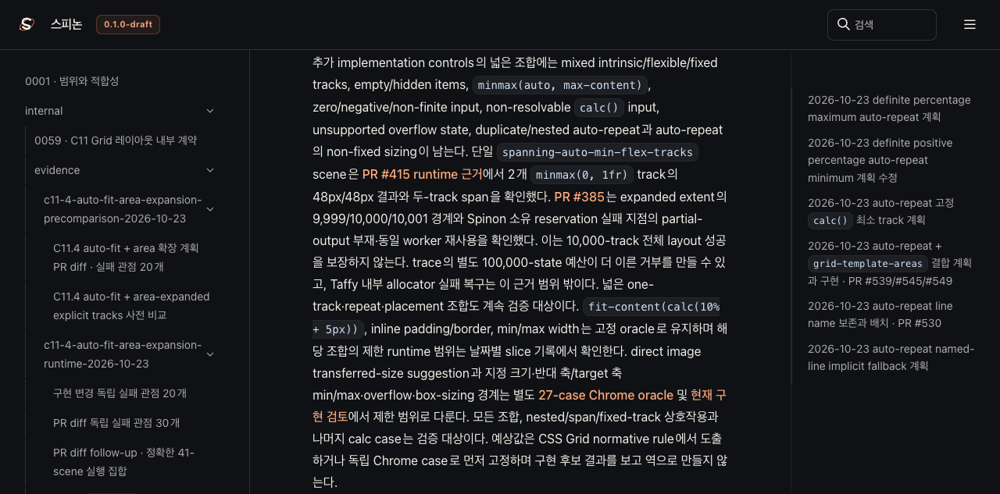

# C11.4 현재 코드·로드맵 재대조 · 2026-10-24

## 기준과 발견

기준 revision은 `1b00ba0d8c5e0014c3b41ff2efb1a093917980b8` (`main`과 `origin/main`이 같은 상태)다. 공식 구현 상태는 [`spec/STATUS.md`](../../../STATUS.md)이며, 공개 구현 목록은 [`spec/public/roadmap.html`](../../../public/roadmap.html)에서 이 상태를 표시한다.

이번 재대조에서 C13 전체는 미완료이고 현재 실행 lane은 C11.4라는 판정이 일치했다. C13.1–C13.3의 제한 opt-in slice는 남아 있지만 public DOM scroll/CSSOM, ink-only shadow overflow, scrollbar/gutter, scroll snap 및 logical axis는 완료되지 않았다. Tailnet Agent Browser에서 C13 checkbox는 unchecked, 공식 집계는 `72/213`, 활성 lane은 C11.4로 확인했다. 따라서 C13 상태 변경은 필요하지 않았다.

C11.4의 상위 계획에는 이미 구현된 고정 경계 두 개가 남은 일처럼 적혀 있었다. 계획 문구를 현재 근거에 맞춰 고쳤다.

- [PR #415](https://github.com/ohah/spinon/pull/415)의 [`spanning-auto-min-flex-tracks` 실행 근거](../c11-4-spanning-auto-min-flex-text-2026-10-21/README.md)는 두 `minmax(0, 1fr)` track의 48px/48px 분배와 두-track span을 확인한다. 이는 해당 고정 scene에 한정된다.
- [PR #385](https://github.com/ohah/spinon/pull/385)의 [실행 근거](../c11-4-negative-implicit-track-sizing-2026-10-20/README.md)는 expanded extent의 9,999/10,000/10,001 산술 경계와 Spinon 소유 reservation 실패 시 partial output 부재 및 동일 worker 재사용을 확인한다. 10,000-track 전체 layout 성공이나 Taffy 내부 allocator OOM 복구는 확인하지 않았다.
- Mixed intrinsic/flexible/fixed의 넓은 조합, empty/hidden item 상호작용, 나머지 `calc()` 조합과 repeat/placement cross-product는 계속 미완료다. C11.4 상위 checkbox와 `72/213`은 유지한다.

## 수정 및 확인

- [`plan/c11-4-grid-track-sizing.md`](../../../../plan/c11-4-grid-track-sizing.md)의 현재 상태 날짜를 2026-10-24로 맞추고, 완료된 고정 fixture와 남은 교차 조합 및 할당 한계를 분리했다.
- [C11.4 계획 diff 적대 검토 20개](./pr-diff-review-20.md)를 남겼다.
- RSPress `2.0.22` 문서 빌드가 11.6초 만에 성공했다. 선택한 7개 Tailnet route는 HTTP `200`과 빌드 산출물 SHA-256 일치로 모두 확인했다. 전체 사이트 link 검사나 모든 route의 remote 검증은 하지 않았다. preflight 당시 listener PID `1191`의 active connection은 `0`이었다. 기존 파일 3개(2,122,241 bytes)를 백업하고 4개 route를 추가했으며 삭제는 없었다.
- Agent Browser에서 Tailnet의 C11.4 계획 route를 열어 PR #415/#385 근거와 trace budget·allocator 한계를 확인했다. 화면은 1280×633이며 SHA-256은 `0362454ca835f950f659b4168127c87f201d838703f21f5e594e108b11c3b0d9`다.
- 이 문서 변경에는 Rust source가 없으므로 Rust tests는 실행하지 않았다. `git diff --check`는 통과했다.

## PR #580 이후 재대조 · 2026-10-24

기준 revision은 `67ccd0c13546f15e986fbf41afeb770678e84169` (`main`, `origin/main`, 현재 계획 branch base)다. 이전 섹션의 `1b00ba0d...` 기준점은 과거 스냅샷으로 유지한다.

- 실제 layout gate [`auto_repeat_neighbor_tracks_are_supported`](../../../../crates/spinon-layout/src/grid.rs)와 cascade gate [`is_auto_repeat_neighbor_track`](../../../../crates/spinon-style/src/stylo_dom/cascade/incremental/grid.rs)는 finite, nonnegative `LengthPx`와 `Percentage` neighbor를 허용한다. Percentage가 있으면 positive definite content-axis basis가 필요하고, basis product 및 aggregate가 `f32` 표현 범위를 넘으면 거부한다. 현재 두 gate 모두 `Calc` neighbor는 허용하지 않는다.
- 공식 상태 대장 #282와 공개 로드맵의 PR #580 기록은 이 구현/runtime 결과를 정확히 반영한다. 다만 [상위 C11.4 계획](../../../../plan/c11-4-grid-track-sizing.md)의 overview와 #577 바로 뒤 설명은 여전히 “fixed `px`만 허용”, “percentage neighbor 미구현”이라고 적혀 있어 모순됐다. 현재 코드와 PR #580 상태로 바로잡고 다음 calc-neighbor slice는 구현 전 계획으로 연결했다.
- Tailnet의 `https://macstudio.tailed42f2.ts.net/spinon/roadmap.html`을 Agent Browser로 열어 공식 status note `완료 72/213`, C13 checkbox `unchecked`, C11.4 checkbox `unchecked`와 `execution.inProgress:['C11.4']`를 확인했다. C13 note는 진행 중 lane card가 아니라 일반 `.kanban-note`이고 문구도 C13 비활성이라고 명시했지만 제목만 보면 오독 여지가 있어 공개 제목을 “백로그 · 미완료·비활성”로 더 분명히 한다. C13 상태 자체는 바꾸지 않는다.
- 다음 제한 slice는 [계획](../../../../plan/c11-4-auto-repeat-calc-neighbors.md), [Agent Browser Chrome 156 사전 비교](../c11-4-auto-repeat-calc-neighbors-precomparison-2026-10-24/README.md)로 고정한다. 14개 scene은 11개 지원 대상과 3개 CSS-valid negative control로 나눈다. 양축·양쪽/한쪽 neighbor·auto-fit collapse·minimum overflow·border-box basis·signed length·CSS Values range clamp와 signed percentage/3-term/indefinite 거부를 고정했다. Chrome DOM의 overflow scene item은 grid border-box 오른쪽 4px 바깥에 있다.
- W3C 기준: [CSS Grid 2025 CRD §7.2.1·§7.2.3](https://www.w3.org/TR/2025/CRD-css-grid-1-20250326/#auto-repeat) 및 [CSS Values 4 §10.12 range checking](https://www.w3.org/TR/css-values/#range-checking). Chrome 156 CSSOM observation은 normative expected values와 분리하고, 1/64 CSS px 이내의 고정 수치 비교는 전용 validator가 검사한다.

현재 변경의 독립 점검은 [PR diff 실패 관점 30개](./pr-diff-review-30.md)에 기록한다. 이 PR은 C11.4 상위 완료나 calc-neighbor runtime 구현을 주장하지 않는다. Tailnet 미리보기는 PR 병합 후 같은 문서 revision으로 다시 동기화한다.
