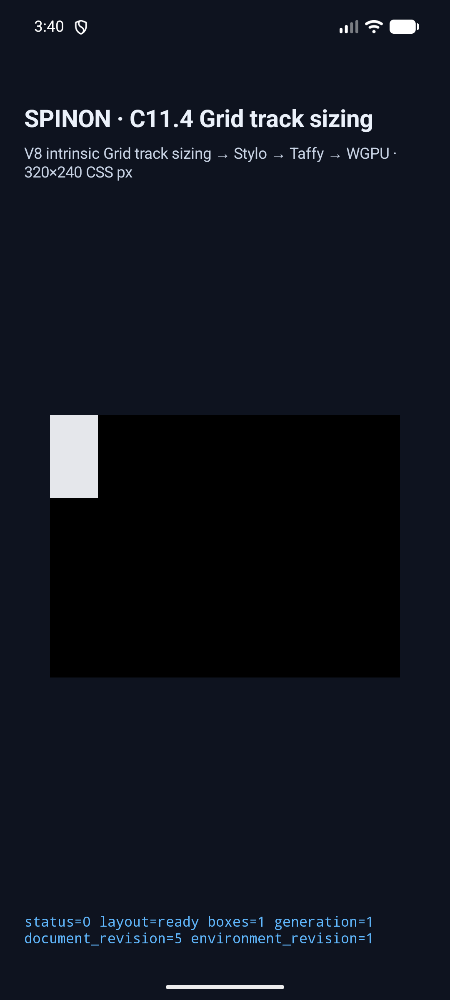
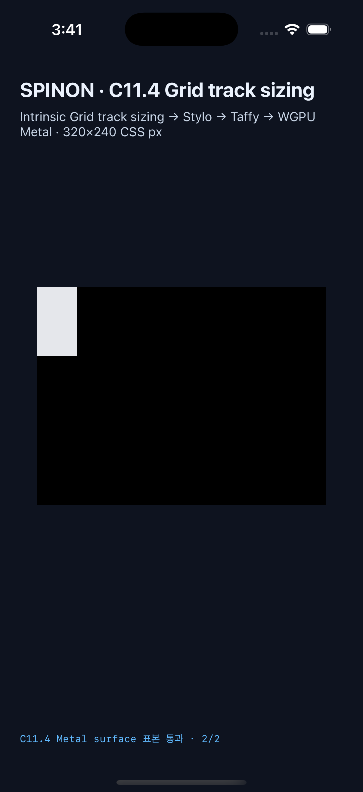
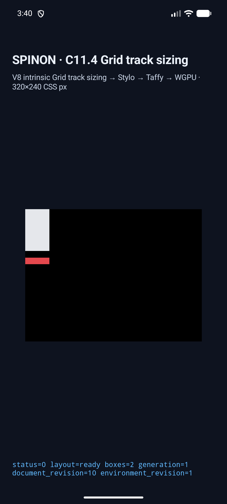
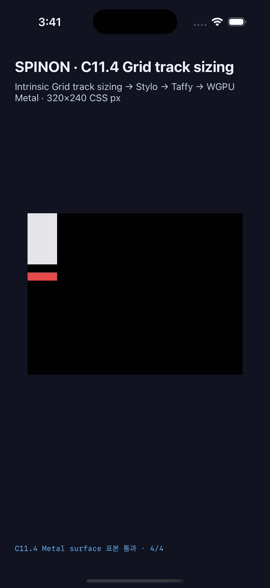

# C11.4 교차축 fixed-repeat + auto-repeat + template areas runtime

이 근거는 [계획](../../../../plan/c11-4-cross-axis-fixed-auto-repeat-areas.md)에 고정한 11개 opt-in fixture가 현재 C11.4 runtime 경로에서 작동함을 기록한다. C11.4 전체, 일반 CSS admission, WPT 적합성 또는 실기기 GPU 검증을 뜻하지 않는다. CRD 산출값과 Chrome 156 비교는 [사전 비교](../c11-4-cross-axis-fixed-auto-repeat-areas-precomparison-2026-10-25/README.md), 계획 실패 관점 검토는 [20개 검토](../../../../plan/c11-4-cross-axis-fixed-auto-repeat-areas-plan-review-20.md)에 있다.

## 플랫폼 실행

| 플랫폼 | 실행 근거 | 장면 | Surface 표본 | 환경 |
|---|---|---:|---:|---|
| Android | [API 37 AVD 실행](./android-avd-c114-cross-axis-fixed-auto-area-android-avd-20261024T184030545Z-2f33a429/) | frame·track/collapse·trace·draw/present 11/11 | PixelCopy 35/35 exact | API 37 ARM64, 16 KB page, ANGLE/Vulkan/SwiftShader |
| iOS | [iPhone 17 Pro Simulator 실행](./ios-simulator-c114-cross-axis-fixed-auto-area-ios-simulator-20261024T184055107Z-572dbc3b/) | frame 21개, trace chunk 56개, collapsed track 10개, draw/present 11/11 | Metal drawable 35/35 exact | iPhone 17 Pro, iOS 26.2 Simulator |

두 실행은 각각 `template-area-repeat-cross-axis-*` 11개만 선택했고 capture script가 run-kind와 근거 폴더를 자동 추론했다. 두 실행의 build/capture 시작 시각 tracked diff SHA-256은 `a333584407cc48415199d3f24bd2e8bb86d978113c9555346ec1a617ca2bc525`다. Android `verification-summary.json`은 capture 뒤 tracked diff `8813bd18fded1925f177e269d93c310845d13815949744b03ca6470ce9ba2151`과 이후 수정된 테스트 파일을 기록한다. iOS `simulator.json`은 시작 snapshot만 기록한다. capture 뒤 제품/native/app 입력은 바뀌지 않았고, Android와 iOS 실행 파일 SHA가 각 앱 빌드를 고정한다. Android 로컬 APK와 설치 APK SHA-256은 `67694e83395886400f21f2d72add35aea91bcd7d4707db96d926000e8e16dcc2`, iOS 앱 실행 파일 SHA-256은 `5a3ed8fbb4c5f6b7afeaf43f3bbd8153439e77ee791801a82c36afe2a88ef4a4`다.

capture 뒤 [projection negative test](../../../../crates/spinon-style-to-layout/src/c11_4_track_sizing_areas_tests.rs)의 실패 node 검사를 wildcard에서 실제 root ID 비교로 좁혔다. 제품/native/app 입력은 바뀌지 않았다. test-only 수정 직후 tracked diff SHA-256은 `8813bd18fded1925f177e269d93c310845d13815949744b03ca6470ce9ba2151`이었고, 이후의 상태 대장·conformance·evidence 문서 편집은 별도 후속 변경이다. 따라서 위 실행은 기록된 app SHA와 capture 당시 정확한 source snapshot에 연결되며, 별도 Rust test는 현재 checkout에서 다시 통과했다.

가운데 track만 접히는 장면에서 trace는 앞 gutter 4px, collapsed track 0px, 뒤 gutter 0px을 보인다. 이 값은 Grid §7.2.3.2의 하나뿐인 shared gap을 표현한다. 두 empty-area 장면은 auto-fit track과 양옆 gutter 네 개가 모두 0임을 확인한다. 세 overflow 장면에서 root 안쪽, root 바로 바깥, hero 앞·뒤의 표본도 모두 기대 색상과 일치했다.

## 코드와 artifact 경계

- `cargo test --locked -p spinon-style fixed_repeat_mixture_is_limited_to_one_auto_repeat_axis -- --nocapture`: 1/1 통과. 두 방향의 bounded fixed axis와 auto axis를 확인하며 fixed breadth의 `minmax`, percentage, flex, intrinsic 및 정규화되지 않은 `calc()`를 거부한다.
- `cargo test --locked -p spinon-style fixed_repeat_mixed_into_both_auto_repeat_axes_is_rejected_in_both_orientations -- --nocapture`: 1/1 통과. 두 축 auto-repeat에 fixed-repeat이 혼합된 조합을 각 방향에서 정확한 node/property와 함께 거부한다.
- `cargo test --locked -p spinon-style-to-layout cross_axis_fixed_repeat_rejects_area_dimension_mismatch_during_projection -- --nocapture`: 1/1 통과. fixed-axis area dimension이 repeat 확장 크기보다 작거나 큰 projection 입력을 root의 `grid-template-areas` 오류로 거부한다.
- `cargo test --locked -p spinon-ffi --features c04-runtime-gpu-fixture-test template_area_auto_repeat_scenes_have_fixed_runtime_frames -- --nocapture`: 1/1 통과.
- `node --test tools/css-reference/fixture-module-boundary.test.mjs`: 12/12 통과. `spinon_ffi.h` 선언은 core runtime과 fixture-test define이 모두 켜질 때만 노출된다.
- C header 전처리 대조: 기본, core만, fixture-test만 조합에서는 fixture host 선언이 없고 두 define을 모두 켰을 때 한 번 나타난다.
- `cargo fmt --all -- --check`, `cargo clippy --locked --workspace --all-targets -- -D warnings`: 통과. `git diff --cached --check`는 캡처 원본을 보존한 Android `avd-startup.log`와 iOS `ios-build.log`에서 trailing whitespace·파일 끝 빈 줄 11건을 보고한다. 이외 staged 소스·문서에는 해당 지적이 없다.
- 기본 `c04-runtime-gpu` archive는 신규 장면 marker 0/11과 C11.4 host symbol을 포함하지 않는다. `c04-runtime-gpu-fixture-test` positive control은 marker 11/11, 대표 track payload와 두 host symbol을 포함한다. [정적 archive 경계](./staticlib-archive-boundary-20261025T0319KST/README.md)는 최종 APK/IPA를 조사한 결과가 아니다.
- 별도 구현/runtime 실패 관점 검토는 [20개 검토](./implementation-runtime-review-20.md)에 둔다.

## 남은 한계

Android는 ANGLE/Vulkan/SwiftShader AVD다. iOS 표본은 Metal drawable 제출 전이다. 실기기, Android hardware GPU, iOS compositor 이후 출력, 최종 APK/IPA의 fixture exclusion, 공개 CSS admission, WPT 및 전체 C11.4는 검증하지 않았다. iOS build log에는 V8 archive의 epoch timestamp와 같은 object name 때문에 `dsymutil`이 debug-map 항목을 건너뛴다는 경고가 있지만 build는 성공했고 앱 실행 및 11개 scene 검증도 통과했다. C11.4 checkbox와 공식 `72/213`은 이 제한 slice만으로 바꾸지 않는다.

초기 capture에서 발견한 가려진 표본, scene/sample ID 길이 상한, FFI scene ID 상한 수정의 원본 log와 화면은 각 run 폴더에 보존했다. 위 표의 두 실행을 최종 runtime 근거로 사용한다.
