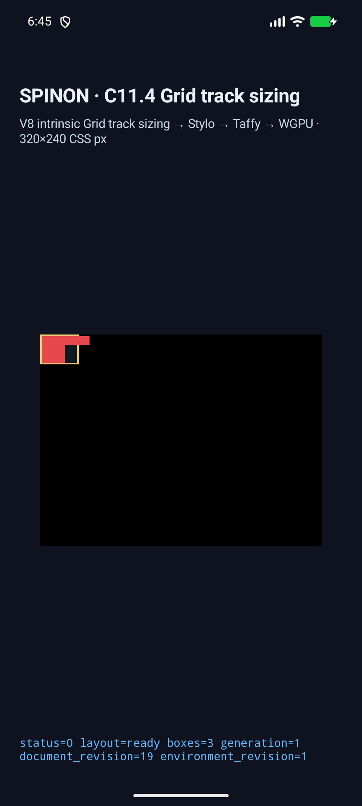
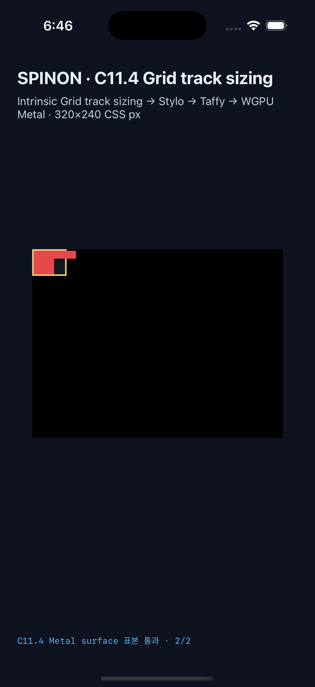

# C11.4 cyclic `minmax(calc())` 교차 축 span groups runtime

**기준:** 2026-10-22 · **상태:** 네 고정 scene opt-in runtime 통과 · **C11.4:** 미완료 · **공식 집계:** `77/213` 유지

**계획:** [교차 축 span groups](../../../../plan/c11-4-cyclic-minmax-calc-cross-axis-span-groups.md) · [Chrome 156 사전 비교와 CSS Grid CRD 독립 계산](../c11-4-cyclic-minmax-calc-cross-axis-span-groups-precomparison-2026-10-22/README.md)

## 범위와 수정 내용

두 Ahem text item이 가운데 열과 같은 두 행을 공유하는 3×2 Grid를 네 고정 scene으로 연결했다. 두 intrinsic scene은 `min-content` width, 두 definite control은 40px content width를 쓴다. 각 item은 서로 다른 column span-2이며 reverse scene은 DOM 순서만 바꾼다. CSS 입력·규범 계산·계획 검토는 계획과 사전 비교 문서에 고정했다.

재현 중 Taffy의 cyclic `minmax(calc(10% + 2px), max-content)` minimum 초기화가 indefinite percentage를 zero로 다루면서 `2px` absolute term까지 잃는 결함을 찾았다. 이후 percentage sizing rerun도 원래 indefinite available-space를 받아 final intrinsic container size로 percentage를 다시 풀지 못했다. 수정은 cyclic minimum을 0% basis로 초기화해 absolute term을 남기고, final rerun에는 확정된 content size를 전달하면서 이전 intrinsic base를 보존한다.

## 기대값과 결과

| 장면 | Columns 기대 / 결과 | Rows 기대 / 결과 | Root border box | A item | B item |
| --- | --- | --- | --- | --- | --- |
| intrinsic forward/reverse | `[15.671875,15.671875,15.65625]` / 실제 `[15.666666]*3` | `[9,9]` / `[9,9]` | `55×24` | `[2,2,33.34375,20]`; 실제 width `33.333332` | `[19.671875,2,40,10]`; 실제 x `19.666666` |
| definite forward/reverse | `[12,12,12]` / exact | `[14,14]` / exact | `44×34` | `[2,2,26,30]` / exact | `[16,2,40,10]` / exact |

Intrinsic scene의 개별 track/frame float 오차는 최대 약 `0.01042` CSS px로, 판정 허용치 `1/64 = 0.015625` CSS px 이내다. 근거는 Chrome 관측과 별도로 CSS Grid 2025 CRD에서 계산한 양자화 기준을 사용한다.

Rust style-to-layout trace는 Columns가 Rows보다 먼저 크기를 정하는지, 두 item의 `Minimum`·`MinContent`·`MaxContent` contribution과 span 2를 node identity별로 분리했는지 확인한다. 초기 Columns `[2,2,2]`, 각 item의 planned increase A `[7,7]`·B `[17,17]`, 같은 track에서 합이 아니라 최댓값을 적용한 `[7,17,17]`, min-content constraint bases `[9,19,19]`, 최종 track 배열을 검사한다. 직접 text intrinsic source·font revision, item별 20px/30px wrapping 변화와 reverse DOM 순서 불변성도 확인한다.

## Android API 37 ARM64 AVD

`emulator-5558`, API 37, `arm64-v8a`, viewport `320×240` CSS px, scale `2.625`에서 네 scene 모두 `layout=ready`, 세 box, `drawPresented=true`로 통과했다. [scene/frame/track 결과](android-avd-c114-cross-axis-span-groups-android-avd-20261022T094504492Z-be93d82d/result.json) · [AVD 정보와 APK hash](android-avd-c114-cross-axis-span-groups-android-avd-20261022T094504492Z-be93d82d/simulator.json) · [설치 APK SHA 일치](android-avd-c114-cross-axis-span-groups-android-avd-20261022T094504492Z-be93d82d/installed-apk-verification.json).

Definite forward/reverse 각각에서 AVD PixelCopy가 root-relative `(50,4)`의 border 바깥 item B를 `229,72,77,255`로, `(60,4)`의 item 이후 surface clear를 `0,0,0,255`로 읽었다. 2.625× scale에서 forward 좌표는 `(132,11)`, `(158,11)`이고 각 장면 2/2, 합계 4/4 exact다. [forward 표본 로그](android-avd-c114-cross-axis-span-groups-android-avd-20261022T094504492Z-be93d82d/runtime-definite-minmax-calc-cross-axis-span-groups-forward.log) · [reverse 표본 로그](android-avd-c114-cross-axis-span-groups-android-avd-20261022T094504492Z-be93d82d/runtime-definite-minmax-calc-cross-axis-span-groups-reverse.log).

대표 overflow 화면:



## iPhone 17 Pro / iOS 26.2 Simulator

`ACA7BF91-E2D5-4CF7-909A-08D1AD95FF3D`, iOS 26.2, viewport `320×240` CSS px, drawable `960×720`에서 네 scene 모두 draw/present와 geometry 검사를 통과했다. [scene/frame/track 결과](ios-simulator-c114-cross-axis-span-groups-ios-simulator-20261022T094650728Z-f1702aac/result.json) · [Simulator 정보와 app hash](ios-simulator-c114-cross-axis-span-groups-ios-simulator-20261022T094650728Z-f1702aac/simulator.json).

Definite forward/reverse의 Metal drawable 표본도 `(50,4)`에서 `229,72,77,255`, `(60,4)`에서 `0,0,0,255`로 각각 2/2, 합계 4/4 exact다. 3× scale에서 forward drawable 좌표는 `(151,13)`, `(181,13)`이다. 이 표본은 drawable submit 전 읽었으며 iOS compositor 이후 화면을 증명하지 않는다. [forward 표본 로그](ios-simulator-c114-cross-axis-span-groups-ios-simulator-20261022T094650728Z-f1702aac/runtime-definite-minmax-calc-cross-axis-span-groups-forward.log) · [reverse 표본 로그](ios-simulator-c114-cross-axis-span-groups-ios-simulator-20261022T094650728Z-f1702aac/runtime-definite-minmax-calc-cross-axis-span-groups-reverse.log).

대표 overflow 화면:



## 실행 명령과 빌드

캡처 스크립트는 native app을 빌드하지 않으므로 시뮬레이터 실행 전에 최신 앱을 별도 빌드했다. 최초 Android와 iOS 시도는 이전 prebuilt app이 새 scene ID를 거부해 실패했다. 최신 native library/APK와 iOS Simulator app을 빌드한 후 다시 실행했다. Android의 첫 definite 표본 시도에서는 새 표본 ID에 대한 기대 RGB mapping 누락을 추가로 고치고 네 scene을 재실행했다. 초기 실패 산출물은 날짜 폴더에 보존했다.

```sh
mise exec -- env SPINON_ENABLE_C04_RUNTIME_GPU=1 SPINON_ENABLE_C04_RUNTIME_GPU_FIXTURE_TEST=1 SPINON_ENABLE_C11_GRID_METAL_SURFACE_PIXELS_TEST=1 bash tools/build-android.sh
mise exec -- env SPINON_ENABLE_C04_RUNTIME_GPU=1 SPINON_ENABLE_C04_RUNTIME_GPU_FIXTURE_TEST=1 SPINON_ENABLE_C11_GRID_METAL_SURFACE_PIXELS_TEST=1 bun run build:android
mise exec -- node tools/css-reference/capture-c11-4-auto-repeat-neighbors-simulator.mjs android-avd emulator-5558 --scene-id=cyclic-minmax-calc-cross-axis-span-groups-intrinsic-forward,cyclic-minmax-calc-cross-axis-span-groups-intrinsic-reverse,definite-minmax-calc-cross-axis-span-groups-forward,definite-minmax-calc-cross-axis-span-groups-reverse --run-kind=cross-axis-span-groups --evidence-group=c11-4-cross-axis-span-groups-runtime

mise exec -- env SPINON_V8_DIR=/Users/yoonhb/Documents/workspace/spinon/build/v8-source/v8 SPINON_ENABLE_C04_RUNTIME_GPU=1 SPINON_ENABLE_C04_RUNTIME_GPU_FIXTURE_TEST=1 SPINON_ENABLE_C11_GRID_METAL_SURFACE_PIXELS_TEST=1 bun run build:ios-sim
mise exec -- node tools/css-reference/capture-c11-4-auto-repeat-neighbors-simulator.mjs ios-simulator ACA7BF91-E2D5-4CF7-909A-08D1AD95FF3D --scene-id=cyclic-minmax-calc-cross-axis-span-groups-intrinsic-forward,cyclic-minmax-calc-cross-axis-span-groups-intrinsic-reverse,definite-minmax-calc-cross-axis-span-groups-forward,definite-minmax-calc-cross-axis-span-groups-reverse --run-kind=cross-axis-span-groups --evidence-group=c11-4-cross-axis-span-groups-runtime
```

최종 Android APK와 설치 APK SHA-256은 `4136d59e2c418a3dbc46ef6ede1729e1f63d718cae9d3da87b6e9863b7b7cf70`, iOS Simulator app SHA-256은 `0c146f6b1ba37c12da9d56e29899657f4a34008f849eb03de828685cb86d5094`다. 두 manifest는 동일한 source commit `8538bfa2b63c50c79dc1d931b4c19a35fba6cabf`와 tracked diff hash `779247c745dda896539ee53c25ffc6a7ae8e0f8e907151bd0c82e3f19113631d`를 기록한다.

## 기본 release fixture 경계

별도 `CARGO_TARGET_DIR`에서 `spinon-ffi` 기본 release static archive와 `c11-grid-metal-surface-pixels-test` opt-in release archive를 각각 새로 빌드했다. 기본 archive(60,100,208 bytes, SHA-256 `8275a9b4193f085463e7266f6f0b12800c8b0db9a0d054d4c6749b5b6db33262`)에서는 신규 네 scene ID와 `spinon_runtime_gpu_host_new_c11_4_grid_track_sizing_fixture` marker가 모두 없다. opt-in archive(77,977,496 bytes, SHA-256 `e4a1a0001671e686a7d3b423fdfc23724ebc732db38e256c5f40fde7562f2097`)에는 모두 있다. [빌드 로그](ffi-artifact-default-build.log · ffi-artifact-fixture-build.log) · [문자열 scan과 hash](ffi-artifact-boundary.log). 이는 static archive 문자열 검사이며 APK/IPA 전체의 제외나 symbol-table audit는 아니다.

## 검증 결과와 경계

- Rust focused tests: 새 style-to-layout 1/1, runtime 1/1, FFI 2/2 통과. 변경 영향이 있는 `cyclic_` style-to-layout 회귀 필터도 16/16 통과했다. [style focused](rust-style-focused.log) · [cyclic regression](rust-style-cyclic-regressions.log) · [runtime focused](rust-runtime-focused.log) · [FFI focused](rust-ffi-focused.log).
- `mise exec -- cargo fmt --all -- --check`, 세 변경 crate Clippy `-D warnings`, JS syntax check, fixture-module boundary 6/6, `git diff --check` 통과. [formatter](cargo-fmt.log) · [Clippy logs](clippy-style.log · clippy-runtime.log · clippy-ffi.log) · [JS syntax](js-syntax.log) · [fixture-module boundary](fixture-module-boundary.log) · [diff check](git-diff-check.log).
- `spinon-ffi` 기본 release 및 opt-in release static archive를 새 target directory에서 모두 빌드했다. [기본](ffi-artifact-default-build.log) · [opt-in](ffi-artifact-fixture-build.log) · [문자열 scan](ffi-artifact-boundary.log).
- 캡처·빌드·검증 근거 파일의 SHA-256 목록은 [SHA256SUMS.txt](SHA256SUMS.txt)에 있다.
- 일부 capture log의 읽기용 복사본은 끝 공백만 정리했다. 원본 바이트는 `.raw.gz`로 보존하며 [변환 전후 hash](log-normalization.json)를 기록했다.
- AVD와 iOS Simulator 결과만 있다. Android 실기기/hardware GPU, iOS compositor 이후 pixel, WPT, glyph paint equality, border stroke 및 일반 CSS admission은 확인하지 않았다.
- 이 제한 fixture는 parent C11.4 완료를 뜻하지 않는다. `spec/STATUS.md`의 C11.4 체크박스와 공식 완료 수 `77/213`은 그대로 둔다.

- [구현/runtime 실패 관점 검토 20개](implementation-runtime-review-20.md)
- [최종 PR diff 실패 관점 검토 30개](pr-diff-review-30.md)
- [RSPress 이미지 경로 보정 PR diff 검토 30개](rspress-image-path-pr-diff-review-30.md)
