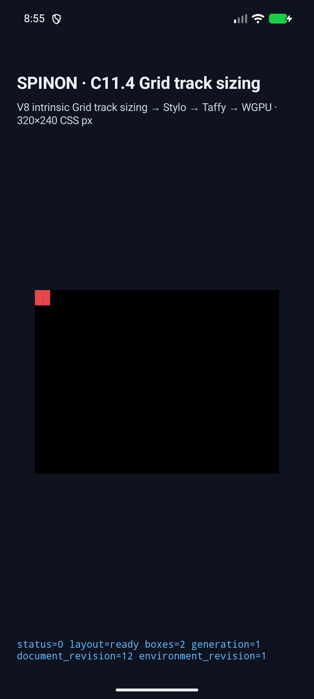
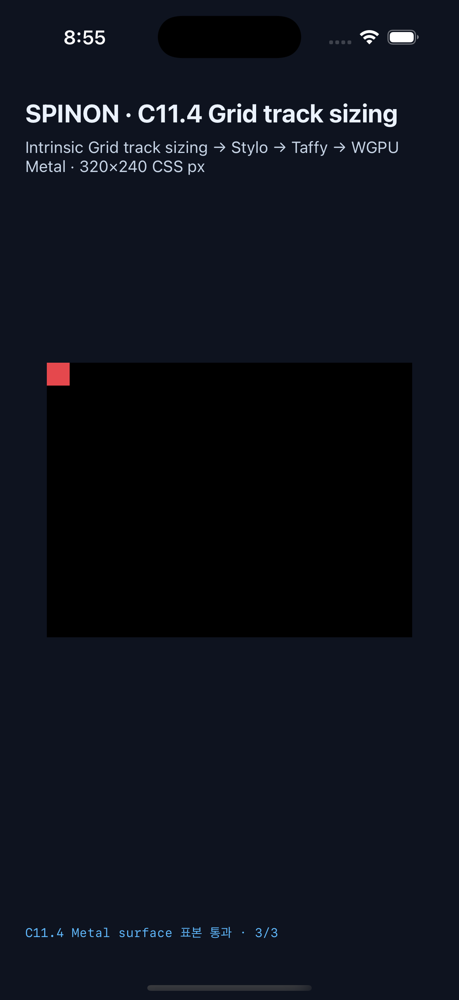

# C11.4 cyclic `fit-content(calc())` runtime 근거

**범위:** 네 개 고정 C11.4 fixture scene의 used track, frame, text overflow surface 표본. 일반 CSS 지원이나 C11.4 전체 완료 근거가 아니다.

## 구현

허용 scene은 `cyclic-fit-content-calc-column`, `cyclic-fit-content-calc-row`, `definite-fit-content-calc-column`, `definite-fit-content-calc-small-limit` 네 개다. 기존 `c04-runtime-gpu-fixture-test` 경로에서만 scene과 validator를 연결했다. `RuntimeBlockFlexGridTrackSizingV1`의 Ahem text layout 결과를 동일한 layout revision의 render snapshot에 붙이는 adapter도 이 네 root ID에만 적용한다. 일반 CSS admission과 기본 runtime profile은 변경하지 않았다.

BlockFlex/Grid fixture profile은 `computed_color` carrier를 내보내지 않는다. text painter는 fixture의 computed `color: rgb(229, 72, 77)`을 검증한 뒤 그 고정 sRGB 값을 사용한다. 화면 표본의 목적은 임의 색상 지원이 아니라 item/root 바깥의 Ahem glyph paint가 실제 surface까지 도달하는지 확인하는 것이다.

## 집중 검사와 빌드

모두 현재 최종 소스에서 실행했다.

```sh
mise exec -- cargo test --locked -p spinon-style-to-layout --features c11-4-grid-track-sizing-fixture-test cyclic_fit_content_calc
mise exec -- cargo test --locked -p spinon-ffi --features c04-runtime-gpu-fixture-test exposes_only_four_fixed_fit_content_calc_scenes
mise exec -- cargo test --locked -p spinon-runtime --features c11-4-grid-track-sizing-fixture-test cyclic_fit_content_calc
mise exec -- cargo clippy --locked -p spinon-runtime --features c11-4-grid-track-sizing-fixture-test -- -D warnings
mise exec -- cargo clippy --locked -p spinon-ffi --features c04-runtime-gpu-fixture-test -- -D warnings
mise exec -- cargo fmt --all -- --check
mise exec -- bun test tools/css-reference/fixture-module-boundary.test.mjs
node --check tools/css-reference/capture-c11-4-auto-repeat-neighbors-simulator.mjs
```

집중 Rust test는 crate별 1/1 통과했고, 두 Clippy 명령·format 검사·fixture module boundary 6/6·capture script syntax 검사도 통과했다.

```sh
SPINON_ENABLE_C04_RUNTIME_GPU=1 SPINON_ENABLE_C04_RUNTIME_GPU_FIXTURE_TEST=1 SPINON_ENABLE_C11_GRID_METAL_SURFACE_PIXELS_TEST=1 mise exec -- bun run build:android
SPINON_ENABLE_C04_RUNTIME_GPU=1 SPINON_ENABLE_C04_RUNTIME_GPU_FIXTURE_TEST=1 SPINON_ENABLE_C11_GRID_METAL_SURFACE_PIXELS_TEST=1 mise exec -- bun run build:ios-sim
```

두 앱 빌드가 성공했다. Android AVD는 API 37 ARM64 `emulator-5558`, model `sdk_gphone64_arm64`, emulator fingerprint `google/sdk_gphone64_arm64/emu64a:17/CE2A.260420.019/15611780:userdebug/dev-keys`다. GPU 로그는 ANGLE/Vulkan SwiftShader를 나타내며 hardware GPU 결과가 아니다. iOS는 iPhone 17 Pro, iOS 26.2 Simulator (`ACA7BF91-E2D5-4CF7-909A-08D1AD95FF3D`)다.

## 네 scene 결과

| Scene | Columns | Rows | Root | Item | Android | iOS |
| --- | ---: | ---: | --- | --- | --- | --- |
| `cyclic-fit-content-calc-column` | `[29]` | `[20]` | `50×20` | `29×20` | frame/track/draw 통과 | frame/track/draw 통과 |
| `cyclic-fit-content-calc-row` | `[20]` | `[22]` | `20×40` | `20×22` | frame/track/draw 통과 | frame/track/draw 통과 |
| `definite-fit-content-calc-column` | `[24]` | `[20]` | `40×20` | `24×20` | frame/track/draw 통과 | frame/track/draw 통과 |
| `definite-fit-content-calc-small-limit` | `[9]` | `[20]` | `10×20` | `9×20` | frame/track/draw 통과 | frame/track/draw 통과 |

Android API 37 AVD와 iPhone 17 Pro Simulator에서 각각 4/4 scene이 통과했다. 각 platform의 PixelCopy/Metal 표본은 각각 9/9 exact다. 앱 frame, 사용 track, 두 축 trace와 draw/present는 scene별 `simulator.json`과 `runtime-*.log`에 기록했다.

작은 limit 장면은 item 폭이 9 CSS px이고 root 폭이 10 CSS px다. `(5,5)`는 item 내부, `(15,5)`는 item과 root 모두 바깥이며 Ahem text 위, `(25,5)`는 text 바깥이다. Android PixelCopy 결과는 `[229,72,77,255]`, `[229,72,77,255]`, `[0,0,0,255]`로 세 표본 모두 exact였다. iOS drawable도 같은 RGB 세 값을 제출 전 Metal readback에서 3/3 exact로 읽었다. 이 검사는 glyph overflow다. border stroke 색은 검사하지 않았다.

Android 화면:



iPhone 17 Pro/iOS 26.2 Simulator 화면:



### Small-limit 표본 원본

- Android: [PixelCopy log](./android-avd-c114-fit-content-calc-reviewed-android-avd-20261021T235453467Z-50fff084/runtime-definite-fit-content-calc-small-limit.log), surface `840×630`, scale `2.625`, expected/observed 3/3 exact.
- iOS: [Metal drawable log](./ios-simulator-c114-fit-content-calc-reviewed-ios-simulator-20261021T235536379Z-777f2090/runtime-definite-fit-content-calc-small-limit.log), drawable `960×720`, scale `3`, expected/observed 3/3 exact. `runtime_text_count=1`, `glyph_batch_draw_count=1`.
- Android APK SHA-256: `99e88960f2802013c34bbda16c0c467afa93004ef66bc0ab722bc6925f1e5eec`.
- iOS app binary SHA-256: `f3d6a173f431fa74e77a64aa1ae3dc07ee45052f2381fc17c6014beb16829347`.
- Capture source was base commit `7aaeb7a60373914f8097919546d21e2ac0c50d1d` plus tracked-diff SHA-256 `ba65b319266091ec3ed40114fe152587f50e0e49387cc6aaa2975c7d7929343d`.

## FFI artifact boundary

두 archive는 별도 Cargo feature 조합으로 release build했다. `strings` 검사에서 기본 제품 GPU archive에는 `cyclic-fit-content-calc` marker가 없고 fixture-test positive control에는 네 scene ID와 fit-content 표현식이 있었다.

| Build | Scene marker | Archive SHA-256 | Bytes |
| --- | --- | --- | ---: |
| `--no-default-features --features c04-runtime-gpu` | 없음 | `6f0718db0f6d40fd807812da2d9fd930ce4c08ab2754db4c11eb6603a5925b75` | 75,079,952 |
| `--no-default-features --features c04-runtime-gpu-fixture-test` | 있음 | `9ed6e1301a4bc672898339b9ee14c2fd2eaafccfe730a400dddebb68ef264dd1` | 77,774,704 |

이는 macOS host release static archive의 fixture 문자열 비교다. 플랫폼 앱 전체 크기나 제품 release bundle 비교는 아니다.

## 실패 관점 검토

- [구현/runtime 실패 관점 20개](./implementation-review-20.md)
- [PR diff 실패 관점 30개](./pr-diff-review-30.md)

## 남은 범위

임의 HTML/CSS author input, fit-content calc의 일반 CSS admission, 여러 item/track, 여러 calc 문법, WPT, Android 실기기와 hardware GPU, iOS compositor 이후 표면, glyph 전수 비교 및 border stroke는 확인하지 않았다. C11.4 checkbox와 공식 완료 수 `72/213`은 미완료로 유지한다.
