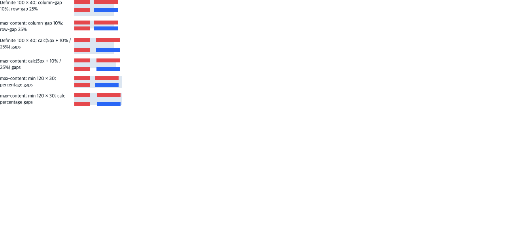

# C11.4 percentage/calc gap 사전 비교

**상태:** Chrome 155 oracle, Rust 회귀 및 제한 Android/iOS Simulator 실행을 완료했다. 이 후보는 전체 C11.4 구현이나 공개 CSS 지원을 뜻하지 않는다.

## 기준과 규범 범위

고정 기준은 Agent Browser에서 실행한 Chrome 155.0.8059.85다. 관찰 환경은 `HeadlessChrome/155.0.8059.85`, DPR 1, viewport 1280×633이었다. 여섯 장면의 DOMRect·computed gap을 JSON으로 보존하고 화면 캡처를 생성했다. 각 Agent Browser session과 그 전용 Chrome/daemon 프로세스를 종료했다. Terminal Browser는 사용하지 않았다.

[CSS Gaps Level 1 §2.3](https://www.w3.org/TR/css-gaps-1/#percentages-in-gap-properties)은 Grid의 cyclic percentage를 intrinsic size contribution을 구할 때 0을 기준으로 계산하고, 실제 contents layout에서는 grid container의 content box를 기준으로 계산하도록 서술한다. 해당 문서는 2026-06-24 Working Draft이므로 작업 기준으로 기록하고, 안정된 Recommendation으로 취급하지 않는다. [CSS Grid Level 1 §11](https://www.w3.org/TR/css-grid-1/#algo-overview)은 container 크기가 tracks에 의존하는 동안 cyclic track percentage를 intrinsic sizing에서 `auto`처럼 기여시킨 뒤, 정해진 container 크기를 기준으로 다시 resolve하도록 규정한다.

이 fixture는 columns `40px 60px`, rows `10px 10px`을 고정하고 definite 100×40px, unconstrained `max-content`, definite `min-width:120px; min-height:30px`이 있는 `max-content`를 비교한다. definite cases는 최종 content-box를 기준으로 gap을 계산한다. cyclic cases는 intrinsic 기여와 최종 used gap을 각각 관찰하며 item frame, grid overflow를 함께 기록한다.

## Chrome 155 결과

| 장면 | Grid 크기 | 최종 column/row gap | 두 번째 열 x / 두 번째 행 y | 오른쪽/아래 overflow |
| --- | ---: | ---: | ---: | ---: |
| `definite-percent` | 100×40px | 10 / 10px | 50 / 20px | 10 / 0px |
| `cyclic-percent` | 100×20px | 10 / 5px | 50 / 15px | 10 / 5px |
| `definite-calc` | 100×40px | 15 / 15px | 55 / 25px | 15 / 0px |
| `cyclic-calc` | 105×25px | 15.5 / 11.25px | 55.5 / 21.25px | 10.5 / 6.25px |
| `cyclic-percent-min-basis` | 120×30px | 12 / 7.5px | 52 / 17.5px | 0 / 0px |
| `cyclic-calc-min-basis` | 120×30px | 17 / 12.5px | 57 / 22.5px | 0 / 2.5px |

`cyclic-calc`의 intrinsic contribution에는 `calc()`의 고정 5px 부분만 들어가므로 grid는 105×25px이다. container 결정 뒤 10%와 25%를 각각 105px과 25px에 대입해 최종 gap이 15.5px과 11.25px이 된다. 이 장면이 기존 Rust 구현에서 grid 폭 100px로 잘못 계산되는 재현이다. min-size 장면은 definite `min-width`/`min-height`가 있어도 intrinsic gap contribution의 cyclic percentage가 0으로 계산되어야 함을 확인한다. `cyclic-calc-min-basis`에서는 intrinsic size 105×25px이 min-size 120×30px에 clamp된 뒤 최종 row gap 12.5px이 사용되어 item이 아래로 2.5px 넘친다. min-size를 intrinsic gap basis로 잘못 쓰면 Chrome의 30px grid 대신 32.5px 높이가 되는 회귀가 있었다.

## 원본 자료

- [Chrome 관찰값 JSON](./chrome155-observation.json)
- [Chrome 화면](./chrome155-percentage-gaps.png)
- [실행 HTML fixture](../../../../tests/fixtures/css/c11/grid-track-sizing-c114-percentage-gaps.html)
- [SHA-256](./SHA256SUMS)

사전 비교 fixture는 여섯 장면을 한 viewport에 배치해 시각 비교를 돕는다. 좌표 비교는 screenshot 픽셀을 재는 대신 JSON에 저장한 DOMRect와 computed style 값을 사용했다. Android/iOS 앱의 style cascade와 native surface는 이 사전 자료에 포함되지 않으며 아래 별도 Simulator 실행 근거에서 확인한다.

## Rust·fixture 경계

`CARGO_INCREMENTAL=0 cargo test --locked --workspace`는 1,126 passed·0 failed·4 ignored이며 all-target Clippy `-D warnings`, `cargo fmt --all -- --check`, focused FFI fixture test 및 six-case layout matrix도 통과했다. [전체 workspace test log](./rust-workspace-tests-final3.log), [Clippy log](./rust-workspace-clippy-final3.log), [format log](./rust-format-final3.log), [FFI fixture test log](./ffi-fixture-source-test-final.log).

Android/iOS fixture scene ID와 C11.4 FFI constructor/eval symbol은 `c04-runtime-gpu-fixture-test` static archive에서 확인했다. default `spinon-ffi` archive에는 신규 scene ID와 두 fixture symbol이 없다. [artifact 경계 검사·archive SHA-256](./artifact-boundary.log). Android APK SHA-256은 [`android-apk-artifact.txt`](./android-apk-artifact.txt)에, iOS Simulator app executable SHA-256은 [`ios-app-artifact.txt`](./ios-app-artifact.txt)에 기록했다. 양쪽 앱은 V8 revision `7b50b62cb18f28617959e8452e2cd18195b38bcf`를 포함한다.

## Android/iOS Simulator 실행

2026-10-20에 Android API 37 ARM64 AVD `spinon_api37_1_compat16k`와 iPhone 17 Pro / iOS 26.2 Simulator에서 여섯 scene을 모두 실행했다. [실행 로그와 캡처](./runs/c114-gap-20261019T181753Z/)에는 앱별 install/launch/runtime 로그, 여섯 screenshot, source HEAD/status·untracked hash snapshot과 run ID가 있다. Android C11.4 frame assertion 6/6과 PixelCopy surface sample 29/29가 통과했고, iOS frame assertion 6/6과 compositor 제출 전 Metal drawable sample 29/29가 통과했다. PixelCopy는 AVD의 ANGLE/SwiftShader 결과이며 실기기 hardware GPU 결과가 아니다.

대표 overflow scene: Android [`grid-gap-cyclic-calc-min-basis`](./runs/c114-gap-20261019T181753Z/android-avd/screenshot-grid-gap-cyclic-calc-min-basis.png), iOS [`grid-gap-cyclic-calc-min-basis`](./runs/c114-gap-20261019T181753Z/ios-simulator/screenshot-grid-gap-cyclic-calc-min-basis.png).

이 화면 표본은 고정 fixture의 CSS background box 색을 검사한다. iOS 표본은 compositor 제출 전 drawable이며, 어느 쪽도 물리 단말, Android hardware GPU, iOS compositor 이후 color management, 전체 CSS Grid, WPT 또는 일반 앱 문서 호환성을 입증하지 않는다. 이 제한 후보는 C11.4의 미완료 표시와 완료 수를 바꾸지 않는다.

초기 실행은 앱 fixture의 미지원 `justify-items`, JS node ID 인용 누락, C11.4 root Grid `max-content` projection 제한으로 차례로 실패했다. 각 원인과 수정은 [구현 적대 검토](./implementation-review-20.md)에 기록했으며, 수정 후의 전체 행렬은 위 최종 run에서 통과했다. 실패 로그도 각 이전 run directory에 보존했다.

캡처 텍스트의 메시지 내용은 유지하고 줄바꿈, 줄 끝 공백과 마지막 중복 빈 줄만 정규화했다. `SHA256SUMS`는 정리된 evidence 파일에 대해 재생성했다.
