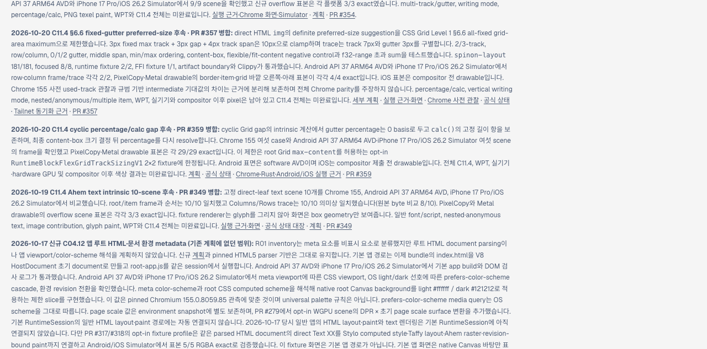
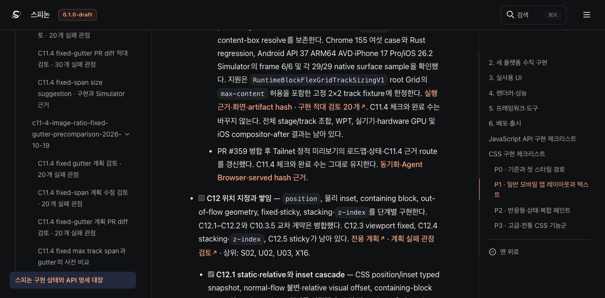
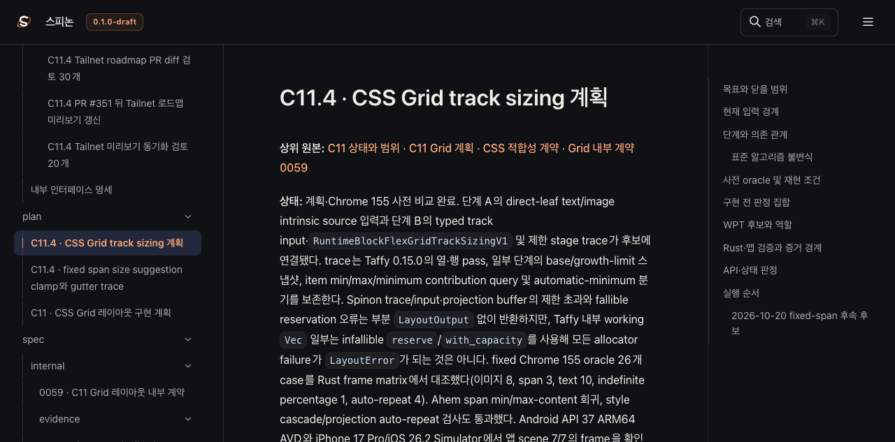
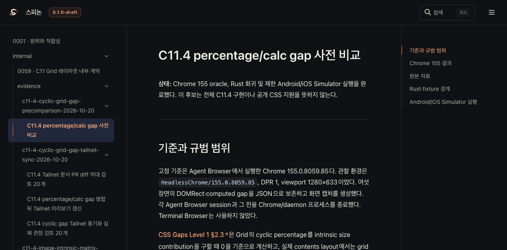

# C11.4 percentage/calc gap 병합 뒤 Tailnet 미리보기 갱신

**기준:** PR #359 rebase merge commit `7a364befe44ba56903be7c24df036ce89d252156`. 
**범위:** 병합된 cyclic percentage/`calc()` gap 구현의 공개 roadmap, 공식 상태 대장, 집중 계획과 선택된 C11.4 근거를 기존 Tailnet 정적 미리보기 `/spinon/`에 반영한다. GitHub Pages 배포와 앱 실행은 하지 않는다.

## 반영 내용

- 공개 roadmap에 PR #359의 cyclic gap basis 결과와 제한 범위를 추가했다.
- `spec/STATUS.md`에서 작업 근거를 연결했다. C11.4의 공식 완료 체크와 완료 수는 바꾸지 않았다.
- Tailnet 선택 문서에는 Chrome 155 관찰값과 대표 Chrome·Android AVD·iOS Simulator 캡처를 포함한다. 캡처는 각기 다른 실행 환경을 보여 주며 실기기나 전체 CSS Grid 지원을 뜻하지 않는다.
- 구현·기준값·시뮬레이터 행렬의 전체 로그는 저장소 근거 폴더에 남긴다. Tailnet에는 읽기와 화면 비교에 필요한 요약·대표 자료만 복사한다.

## Tailnet 동기화와 실제 응답

`pass10`은 C11.4 문서와 근거를 대상으로 282개 파일, 10,788,643 bytes를 preflight했다. 46개 생성, 31개 교체, 205개 동일이며 삭제 대상은 없었다. 교체 파일 31/31의 기존 bytes·SHA-256 backup이 일치했다. 교체 경로에는 열린 handle이 없었고, 복사 후 Tailnet의 선택 파일 282/282가 HTTP 200·byte·SHA-256 모두 일치했다. `no_deletes`는 true다. 기존 Tailnet 미리보기 루트를 사용하고 `pass10` 전용 backup 경로를 지정했다. Tailnet 서버 PID 1191은 계속 실행 중이다.

선택 Rspress build에는 HTML route 36개가 있다. 같은 origin에서 `/spinon/` 바깥으로 나가는 링크는 0개다. [route 확인](./html-route-check-pass10.json)과 [pass10 응답·해시](./served-verification-pass10.json)에서 결과를 재현할 수 있다.

## Agent Browser 화면 확인

Agent Browser 0.31.1에서 실제 Tailnet의 roadmap, 공식 STATUS, C11.4 집중 계획, Chrome·Simulator 근거 페이지를 열었다. C11.4 checkbox는 미완료 상태다. Chrome 155 이미지(1280×633), Android AVD 이미지(1080×2400), iOS Simulator 이미지(1206×2622)를 실제로 로드했다. 네 페이지 화면은 각각 1280×633이며 아래 캡처는 Tailnet 문서 화면이다.

[관찰값 JSON](./browser-check-pass10.json) · [동기화 전 비교](./preflight-pass10.json) · [열린 파일 확인](./open-handles-pass10.json) · [복사와 backup](./copy-and-backup-pass10.json) · [세션·프로세스 종료 확인](./browser-close-pass10.json)

## 최종 게시와 범위

첫 화면 확인 뒤 보고서와 캡처·실행 기록을 포함해 `pass11`로 다시 게시했다. 296개 파일 중 49개 생성, 35개 교체, 212개 동일이며 삭제는 없었다. backup 35/35, Tailnet 응답 296/296의 HTTP·byte·SHA가 일치했고 HTML route 36개의 same-origin out-of-base 링크는 0개였다. [pass11 응답·해시](./served-verification-pass11.json)에서 재현할 수 있다.

Agent Browser 검토에서 공백 경로가 sanitizer에 의해 어색하게 잘리는 것을 발견해 source에서 절대 경로를 없앴다. pass12 Browser에서 잘린 문구와 절대 사용자 경로가 사라진 것을 확인했다. pass13에서는 PR diff 검토 문구를 게시했지만, 마지막 화면 확인 중 이 보고서에 넣은 pass10 캡처 네 장이 선택 목록에서 빠져 GitHub `main` 링크로 rewrite된 것을 추가로 발견했다([pass13 관찰](./browser-check-pass13.json)).

pass14 선택 목록에 pass10 PNG 네 장을 명시해 Tailnet 내부 정적 asset으로 다시 게시한다. 네 장이 실제 페이지에서 4/4 로드되는지 확인하며 pass14도 별도 preflight·backup, 삭제 없음, atomic replacement, 전체 HTTP·byte·SHA 대조를 사용한다. 모든 pass에서 Tailnet 서버와 tmux 세션을 유지했다.

C11.4 공식 완료 체크와 완료 수는 그대로다. 이 미리보기 변경은 CSS Grid 전체 구현, WPT, 실기기, Android hardware GPU 또는 iOS compositor-after 결과를 추가로 입증하지 않는다. GitHub Pages 배포나 앱 실행도 하지 않았다.

## 검토

- [Tailnet 동기화 실패 관점 20개](./sync-review-20.md)
- [문서·동기화 PR diff 적대 검토 20개](./pr-diff-review-20.md)
- [선택 입력 SHA-256 목록](./SHA256SUMS-preview-inputs.txt)
