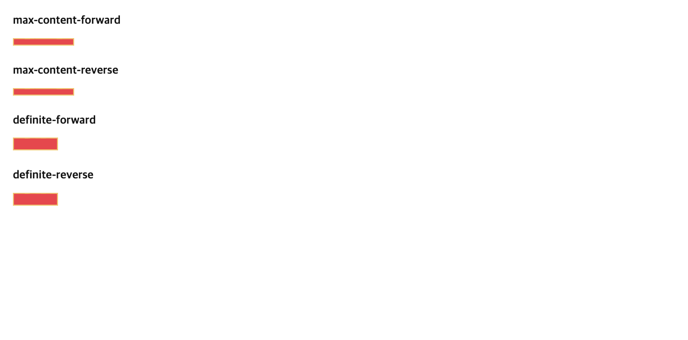
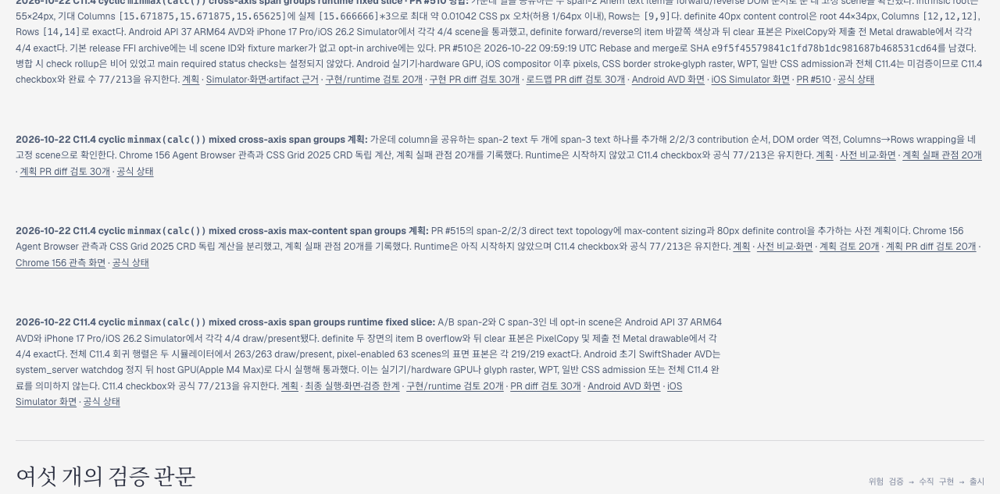

# C11.4 cyclic <code>minmax(calc())</code> mixed cross-axis max-content span-groups 사전 비교

## 범위와 고정 입력

3-column × 2-row Grid에 column span 2, 2, 3인 direct Ahem text item A/B/C를 둔다. A는 <code>AA A A</code>, B는 fixed 40×10px <code>XXXX</code>, C는 <code>AA AA AA AA</code>다. 모든 track은 <code>minmax(calc(10% + 2px), max-content)</code>, row/column gap은 2px, root border는 2px, padding은 0이다. DOM order만 forward/reverse로 바꾼다.

- [고정 CSS oracle](https://github.com/ohah/spinon/blob/main/spec/internal/evidence/c11-4-cyclic-minmax-calc-cross-axis-max-content-span-groups-precomparison-2026-10-22/oracle.html)
- [tests/fixtures 재현 source](https://github.com/ohah/spinon/blob/main/tests/fixtures/css/c11/grid-cyclic-minmax-calc-cross-axis-max-content-span-groups-c114-precomparison.html)
- [입력·측정·계산 SHA-256 manifest](https://github.com/ohah/spinon/blob/main/spec/internal/evidence/c11-4-cyclic-minmax-calc-cross-axis-max-content-span-groups-precomparison-2026-10-22/SHA256SUMS.txt)
- Ahem font SHA-256: <code>b719ecb31c5b21fc573c03f6421c74ac63c271a5a3ff841e34f9705fb94b8448</code>
- Font는 Ahem 400, 10px/10px이며 Agent Browser에서 <code>document.fonts.check('10px Ahem')</code>가 true였다.

네 scene은 max-content width forward/reverse와 80px definite width forward/reverse다. Root의 height는 모두 max-content다.

## 독립 기대값

CSS Grid 2025-03-26 CRD [§5.2](https://www.w3.org/TR/2025/CRD-css-grid-1-20250326/#grid-container-sizing), [§7.2.1](https://www.w3.org/TR/2025/CRD-css-grid-1-20250326/#track-sizes), [§11.3](https://www.w3.org/TR/2025/CRD-css-grid-1-20250326/#algo-track-sizing), [§11.5](https://www.w3.org/TR/2025/CRD-css-grid-1-20250326/#resolve-intrinsic-track-sizes), [§11.5.1](https://www.w3.org/TR/2025/CRD-css-grid-1-20250326/#distributing-extra-space-across-spanned-tracks), [§11.6](https://www.w3.org/TR/2025/CRD-css-grid-1-20250326/#algo-maximize-tracks)을 사용했다. Track rational 값은 Chrome output을 역산하지 않고 contribution sizes와 planned-increase rules에서 도출했다.

Intrinsic max-content calculation에서 cyclic percentage component는 auto처럼 처리된다. Span-2 A/B의 min-content contributions 20px/40px에서, per-track planned-increase maximum은 [9,19,19]가 되고 max-content growth limits는 span-2 A 적용 뒤 [24,34,19]가 된다. C의 110px contribution은 두 gutter를 제외하고 29px의 추가 space를 남긴다. 이 증가를 세 track에 나누면 intrinsic columns는 [101/3,131/3,86/3]px이고 grid content width는 110px이다.

이 결과 폭에서 cyclic column minimum은 10%×110+2=13px다. Resolved layout pass의 min-content growth limits는 B의 contribution 적용 뒤 [∞,19,19]다. A의 max-content contribution은 [26,32,19]를 만들고, C의 contribution은 [107/3,125/3,86/3]px을 만든다. 합과 gutter는 여전히 110px이다. Rows의 intrinsic height는 10px이고 final row tracks는 [4,4]다.

80px definite width에서 column minimum은 10px이고 gutter를 뺀 track space는 76px이다. Growth limits는 A/B/C contributions 뒤 [205/6,259/6,86/3]px. 10px base에서 남은 46px을 maximize 단계가 고르게 나누므로 각 final column은 76/3px이다. A/C는 각각 두 줄이고 grid max-content height는 20px다. Cyclic row minimum은 10%×20+2=4px로 resolve되고 final rows는 [9,9]다.

Rational expected values, intermediate growth limits, item frames, line widths, tolerance와 stage labels는 [spec-derived-expectations.json](./spec-derived-expectations.json)에 있다. CSSOM 결과와 비교할 때 각 track의 허용 차이는 1/64 CSS px다.

## Chrome 156 Agent Browser 관측

Agent Browser 0.31.1의 HeadlessChrome 156.0.0.0 / macOS arm64에서 viewport 1280×633 CSS px, DPR 1을 사용했다. Ahem font load 완료 뒤 root/item border boxes, computed track lists, text Range line rectangles, DOM order invariance를 수집했다.

| Scene | Chrome columns | Rows | Root border box | A/B/C line widths |
| --- | --- | --- | --- | --- |
| max-content forward/reverse | <code>[35.65625,41.671875,28.671875]</code> | <code>[4,4]</code> | <code>114×14px</code> | <code>[60] / [40] / [110]</code> |
| definite 80px forward/reverse | <code>[25.328125,25.34375,25.328125]</code> | <code>[9,9]</code> | <code>84×24px</code> | <code>[40,10] / [40] / [80,20]</code> |

Forward/reverse columns and rows matched exactly. In max-content the root content is 110×10px; item frames are A 79.328125×10px, B 40×10px, C 110×10px. In the 80px control root content is 80×20px; A frame is 52.671875×20px, B is 40×10px, C is 80×20px. Chrome track values differ from the rational spec derivation by at most 1/64 CSS px.

The full measurement record is [chrome156-observation.json](https://github.com/ohah/spinon/blob/main/spec/internal/evidence/c11-4-cyclic-minmax-calc-cross-axis-max-content-span-groups-precomparison-2026-10-22/chrome156-observation.json). Same-page explicit-min variants are in [chrome156-diagnostic-variants.json](https://github.com/ohah/spinon/blob/main/spec/internal/evidence/c11-4-cyclic-minmax-calc-cross-axis-max-content-span-groups-precomparison-2026-10-22/chrome156-diagnostic-variants.json); those values are Chromium-only diagnostics and do not define the independent expectation.

## 문서 선택 빌드와 Agent Browser 확인

RSPress 2.0.22 selected-root pass06은 새 plan, 사전 비교, 상태 대장과 공개 roadmap을 렌더했다. Agent Browser에서 계획 표 4 scene, precomparison screenshot natural width 1280px, 공개 roadmap의 여섯 새 링크 모두 HTTP 200을 확인했다. 로드맵 계획 행은 화면 크기 1280×633 캡처로 확인했다. 첫 link pass에서 raw PNG route가 404여서 링크를 screenshot이 포함된 README page로 바꿨다. Markdown에서 직접 여는 HTML/JSON/source file은 site output에 없는 로컬 경로를 가리키지 않도록 영구 GitHub main blob links로 바꿨다.

- [선택 build log](https://github.com/ohah/spinon/blob/main/spec/internal/evidence/c11-4-cyclic-minmax-calc-cross-axis-max-content-span-groups-precomparison-2026-10-22/selected-build-pass06.log)
- [선택 root와 복사 hash](https://github.com/ohah/spinon/blob/main/spec/internal/evidence/c11-4-cyclic-minmax-calc-cross-axis-max-content-span-groups-precomparison-2026-10-22/selected-root-preparation.json)
- [Agent Browser 경로·화면·정리 결과](https://github.com/ohah/spinon/blob/main/spec/internal/evidence/c11-4-cyclic-minmax-calc-cross-axis-max-content-span-groups-precomparison-2026-10-22/selected-build-summary.json)
- Agent Browser captures: plan, precomparison, and the compact roadmap-row screenshot plus their JSON observations are kept beside this README. The scoped browser session and its Chrome process were closed after capture.

This is a selected-page compile and link check, not a full documentation link audit or GitHub Pages deployment. The selected config disables dead-link and dead-image checks for unrelated repository content.

## 판정 경계

이 기록은 고정 CSS 입력의 Chrome 동작과 독립 규범 계산만 다룬다. Spinon runtime, Android/iOS app surfaces, PixelCopy/Metal pixels, WPT, glyph raster equality, arbitrary CSS admission, 실기기·hardware GPU, iOS compositor 이후 표면 또는 C11.4 전체 완료를 확인하지 않는다.
