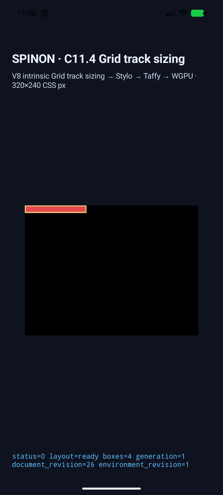
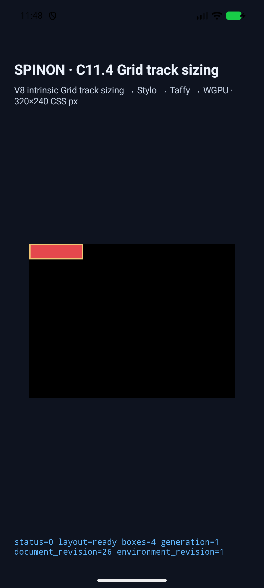
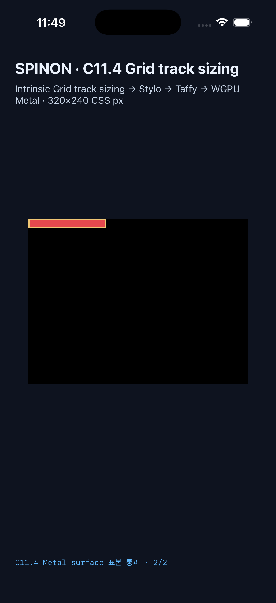
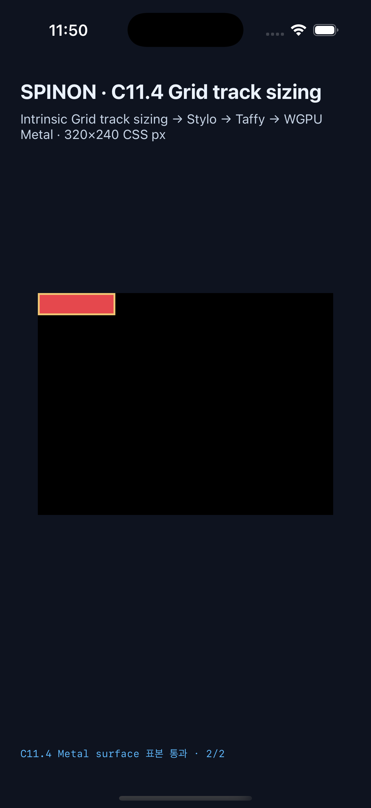

# C11.4 cyclic `minmax(calc())` cross-axis max-content span-groups runtime

## 판정

PR #516에서 합의한 네 fixed scene을 C11.4 opt-in fixture 경로에 연결했다. Android API 37 ARM64 AVD와 iPhone 17 Pro/iOS 26.2 Simulator에서 각각 네 scene 모두 track·frame·trace·draw를 통과했다. Android PixelCopy와 iOS compositor 제출 전 Metal drawable 표본은 플랫폼별 8/8 exact다.

| Scene | CSS width | Columns | Rows | Root content / border box | A/B/C text line widths |
| --- | --- | --- | --- | --- | --- |
| `cyclic-minmax-cross-axis-max-content-span-groups-forward` | `max-content` | `[107/3,125/3,86/3]` | `[4,4]` | `110×10 / 114×14px` | `[60] / [40] / [110]` |
| `cyclic-minmax-cross-axis-max-content-span-groups-reverse` | `max-content` | `[107/3,125/3,86/3]` | `[4,4]` | `110×10 / 114×14px` | `[60] / [40] / [110]` |
| `definite-minmax-cross-axis-max-content-span-groups-forward` | `80px` | `[76/3,76/3,76/3]` | `[9,9]` | `80×20 / 84×24px` | `[40,10] / [40] / [80,20]` |
| `definite-minmax-cross-axis-max-content-span-groups-reverse` | `80px` | `[76/3,76/3,76/3]` | `[9,9]` | `80×20 / 84×24px` | `[40,10] / [40] / [80,20]` |

Tracks and frames are compared to the independent rational expectations within `1/64 CSS px`. The focused Rust test checks final text line advances (`[60]/[40]/[110]` for max-content and `[40,10]/[40]/[80,20]` for the 80px control). The simulator trace validator checks the cyclic-as-auto intrinsic basis separately from the resolved 13px/10px minimum, span-2 group before span-3, and Columns before Rows consume text measurements. Reverse DOM order preserves item-keyed geometry.

## Android AVD

- Device: `emulator-5558`, `sdk_gphone64_arm64`, Android API 37, `arm64-v8a`, qemu AVD `spinon_api37_0_applied_txn`.
- Renderer: Android Emulator OpenGL ES Translator on Apple M4 Max host GPU. This is not a physical device or Android hardware-GPU result.
- Build flags: `SPINON_ENABLE_C04_RUNTIME_GPU=1`, `SPINON_ENABLE_C04_RUNTIME_GPU_FIXTURE_TEST=1`.
- APK and installed `base.apk` SHA-256: `51c0344fee4ef62e869f429339439d5eebb105d6c86038aa4a04dd6823be5e6e` (match).
- Result: four scenes passed; each has a `SPINON_C0410_DRAW ... presented` record and 15–20 parsed track-trace chunks. Border and clear-past-root PixelCopy samples are exact for all four scenes.
- [Simulator metadata](./android-avd-c114-max-content-span-groups-android-avd-20261022T144757717Z-0e77bb03/simulator.json) · [result summary](./android-avd-c114-max-content-span-groups-android-avd-20261022T144757717Z-0e77bb03/result.json)

| Screenshot | View |
| --- | --- |
| [Max-content, forward](./android-avd-c114-max-content-span-groups-android-avd-20261022T144757717Z-0e77bb03/cyclic-minmax-cross-axis-max-content-span-groups-forward.png) |  |
| [80px control, forward](./android-avd-c114-max-content-span-groups-android-avd-20261022T144757717Z-0e77bb03/definite-minmax-cross-axis-max-content-span-groups-forward.png) |  |

## iOS Simulator

- Device: iPhone 17 Pro, iOS 26.2 Simulator, UDID `ACA7BF91-E2D5-4CF7-909A-08D1AD95FF3D`.
- Build flags: `SPINON_ENABLE_C04_RUNTIME_GPU=1`, `SPINON_ENABLE_C04_RUNTIME_GPU_FIXTURE_TEST=1`, `SPINON_ENABLE_C11_GRID_METAL_SURFACE_PIXELS_TEST=1`.
- App executable SHA-256: `6a34d2b8644b329455e3f26db0f3ecc4b41fd597042adfda68bb1fdec812b186`.
- Result: four scenes passed; each has a `SPINON_C0410_DRAW ... presented` record and 30–40 parsed track-trace chunks. Metal drawable samples are exact before compositor submission.
- [Simulator metadata](./ios-simulator-c114-max-content-span-groups-ios-simulator-20261022T144955283Z-d8f7fe82/simulator.json) · [result summary](./ios-simulator-c114-max-content-span-groups-ios-simulator-20261022T144955283Z-d8f7fe82/result.json)

| Screenshot | View |
| --- | --- |
| [Max-content, forward](./ios-simulator-c114-max-content-span-groups-ios-simulator-20261022T144955283Z-d8f7fe82/cyclic-minmax-cross-axis-max-content-span-groups-forward.png) |  |
| [80px control, forward](./ios-simulator-c114-max-content-span-groups-ios-simulator-20261022T144955283Z-d8f7fe82/definite-minmax-cross-axis-max-content-span-groups-forward.png) |  |

## 빌드·캡처 재현

캡처 스크립트는 미리 빌드된 앱을 설치하므로 두 플랫폼 앱을 먼저 명시적으로 빌드한다.

```sh
mise exec -- env SPINON_ENABLE_C04_RUNTIME_GPU=1 SPINON_ENABLE_C04_RUNTIME_GPU_FIXTURE_TEST=1 bun run build:android
mise exec -- bun tools/css-reference/capture-c11-4-auto-repeat-neighbors-simulator.mjs android-avd emulator-5558 --scene-id=cyclic-minmax-cross-axis-max-content-span-groups-forward,cyclic-minmax-cross-axis-max-content-span-groups-reverse,definite-minmax-cross-axis-max-content-span-groups-forward,definite-minmax-cross-axis-max-content-span-groups-reverse --run-kind=max-content-span-groups --evidence-group=c11-4-cyclic-minmax-calc-cross-axis-max-content-span-groups-runtime

mise exec -- env SPINON_ENABLE_C04_RUNTIME_GPU=1 SPINON_ENABLE_C04_RUNTIME_GPU_FIXTURE_TEST=1 SPINON_ENABLE_C11_GRID_METAL_SURFACE_PIXELS_TEST=1 bun run build:ios-sim
mise exec -- bun tools/css-reference/capture-c11-4-auto-repeat-neighbors-simulator.mjs ios-simulator ACA7BF91-E2D5-4CF7-909A-08D1AD95FF3D --scene-id=cyclic-minmax-cross-axis-max-content-span-groups-forward,cyclic-minmax-cross-axis-max-content-span-groups-reverse,definite-minmax-cross-axis-max-content-span-groups-forward,definite-minmax-cross-axis-max-content-span-groups-reverse --run-kind=max-content-span-groups --evidence-group=c11-4-cyclic-minmax-calc-cross-axis-max-content-span-groups-runtime
```

## Fixture artifact 경계

`aarch64-apple-ios-sim`용 default release `c04-runtime-gpu` archive와 iOS Simulator fixture-test positive archive를 각각 검사했다. 신규 scene 문자열과 fixture `prepare` 심볼은 default archive에서 없고 positive archive에 있다. SHA-256, 크기, 검사 기준은 [artifact-boundary.json](./artifact-boundary.json)에 있다. 이는 정적 archive 검사이며 APK/IPA 또는 최종 앱 bundle 전체의 fixture 제외 판정은 아니다.

재현 명령:

```sh
mise exec -- env CARGO_TARGET_DIR="$PWD/target/c11-4-cyclic-max-content-default-artifact" cargo build --locked --target aarch64-apple-ios-sim --release -p spinon-ffi --lib --no-default-features --features c04-runtime-gpu
strings target/c11-4-cyclic-max-content-default-artifact/aarch64-apple-ios-sim/release/libspinon_ffi.a | rg 'max-content-span-groups|cyclic_minmax_calc_cross_axis_mixed_span_groups'
strings target/aarch64-apple-ios-sim/release/libspinon_ffi.a | rg 'cyclic-minmax-cross-axis-max-content-span-groups-forward'
```

첫 `strings` 검색은 결과가 없어야 하고 두 번째는 positive marker를 반환한다.

## 집중 검사

- `mise exec -- cargo test -p spinon-style-to-layout --features c11-4-grid-track-sizing-fixture-test cyclic_minmax_calc_mixed_span_groups_match_fixed_geometry_and_trace -- --nocapture` — 1/1 passed.
- `mise exec -- cargo test -p spinon-runtime --features c11-4-grid-track-sizing-fixture-test allowlists_only_eight_three_item_mixed_span_scenes -- --nocapture` — 1/1 passed.
- `mise exec -- cargo test -p spinon-ffi --features c04-runtime-gpu-fixture-test exposes_only_eight_fixed_three_item_mixed_span_scenes -- --nocapture` — 1/1 passed.
- `mise exec -- cargo fmt --all -- --check`, `git diff --check`, and `mise exec -- node --check tools/css-reference/capture-c11-4-auto-repeat-neighbors-simulator.mjs` passed.

## 검증 범위

이 고정 fixture는 임의 CSS admission, 일반적인 Grid·nested Grid 범위, WPT, Android 실기기, hardware GPU, glyph raster equality, iOS compositor 이후 pixel 또는 전체 C11.4 완료를 주장하지 않는다. 계획 PR [#516](https://github.com/ohah/spinon/pull/516)에 따른 구현 PR [#517](https://github.com/ohah/spinon/pull/517)이며 C11.4 checkbox와 공식 완료 수 `77/213`을 유지한다. 앱 화면은 box geometry와 검증 상태를 보여주며 glyph paint 근거가 아니다.
