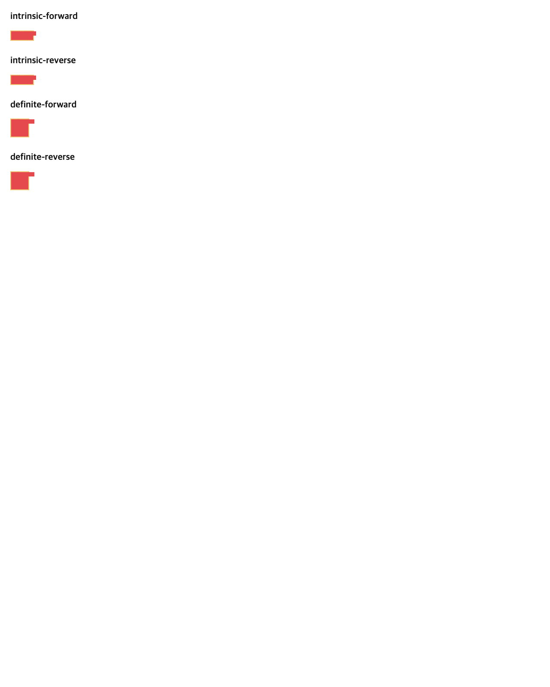

# C11.4 mixed-span cross-axis 사전 비교

## 범위

기존 cyclic `minmax(calc())` cross-axis fixture는 같은 3-column/2-row Grid의 두 span-2 direct Ahem text item만 allowlist한다. 이 후속은 세 번째 direct text item의 column span을 3으로 늘려, span-2 item group의 planned increase가 span-3 item보다 먼저 처리되는지와 Columns 결과가 세 item의 Rows contribution을 결정하는지 확인한다. 제품 코드는 아직 수정하지 않았다.

## 재현 입력

Chrome 156 Agent Browser에서 `oracle.html`을 열고 저장소의 고정 `Ahem.ttf`를 기다린 뒤 `chrome156-observation.json`을 수집했다. viewport는 1280 × 1600 CSS px이며, Ahem font load가 확인됐다. 네 장면의 DOM 차이는 `min-content`/definite 40px width 및 `[A,B,C]`/`[C,B,A]` 순서뿐이다.

| Item | Placement | Size | Text | Ahem min/max-content inline |
| --- | --- | --- | --- | --- |
| A | columns `1 / 3`, rows `1 / 3` | auto × auto | `AA A A` | 20 / 60px |
| B | columns `2 / 4`, rows `1 / 3` | 40 × 10px | `XXXX` | 40 / 40px |
| C | columns `1 / 4`, rows `1 / 3` | auto × auto | `AA AA AA AA` | 20 / 110px |

각 축은 세 개의 `minmax(calc(10% + 2px), max-content)` column과 두 개의 같은 row를 사용하며 gap은 2px, root border는 2px이다. A/B의 2-track span은 가운데 column을 공유하고 C는 세 column을 모두 span한다. 모든 item의 row span은 2다.

Root는 `box-sizing: content-box; display: grid; height: max-content; margin: 0; padding: 0; align-content: start; justify-content: start`이고 2px `#f0c674` border와 `#101820` background를 쓴다. Item은 direct block child, `box-sizing: border-box`, auto minimum, margin/padding/border 0이다. 모두 저장소 Ahem fixture의 400 weight `10px/10px` font, `white-space: normal`, normal word-break/overflow-wrap, `#e5484d` text/background를 쓴다. A/C는 auto × auto, B는 40 × 10px다. 고정 입력은 같은 폴더의 `oracle.html`에, font·입력·관측 image SHA-256은 `SHA256SUMS.txt`에 기록했다.

## 독립 규범 기대값

CSS Grid 2025 CRD §11.3–§11.5.1의 track sizing 순서를 기준으로 계산했다. cyclic percentage는 intrinsic container 크기를 구하는 동안 auto처럼 취급되고, item span이 작은 group부터 처리된다. 각 track의 planned increase를 item마다 구한 뒤 최대값을 남기므로 DOM 순서가 track size를 바꾸면 안 된다. [규범 알고리즘](https://www.w3.org/TR/2025/CRD-css-grid-1-20250326/#algo-track-sizing) · [span space distribution](https://www.w3.org/TR/2025/CRD-css-grid-1-20250326/#algo-content).

Intrinsic min-content constraint에서 cyclic minimum의 절대 2px을 초기 base로 둔다. 세 track의 초기 bases는 `[2,2,2]`다. A의 span-2 minimum 20px은 track 합과 2px gap 6px을 제외해 track당 7px을 요구한다. B의 span-2 minimum 40px은 `[0,17,17]` 증가를 요구한다. per-track maximum은 `[7,17,17]`이고 bases는 `[9,19,19]`가 된다. C의 span-3 minimum은 20px이지만 기존 bases와 두 gutter 합이 51px이므로 추가 증가가 없다. 따라서 intrinsic content width는 51px이다. 이 단계의 constraint bases `[9,19,19]`와 최종 percentage-resolved columns를 같은 값으로 취급하지 않는다.

| Case | Root content width | Final Columns | Final Rows | Root border box |
| --- | ---: | --- | --- | ---: |
| intrinsic forward/reverse | 51px | `[15.671875, 15.671875, 15.65625]` | `[9,9]` | 55 × 24px |
| definite forward/reverse | 40px | `[12,12,12]` | `[19,19]` | 44 × 44px |

Intrinsic Columns가 확정된 뒤 A의 33.34375px span에서 line widths `[20,30]`으로 2줄, B는 한 줄, C의 51px span에서 `[50,50]`으로 2줄이 된다. A와 C의 row min-content contributions는 각각 20px이다. 두 span-2 row의 bases는 `[9,9]`가 된다.

Definite 40px control에서는 A의 26px span이 `[20,10,10]`으로 3줄이고 C의 40px span은 각 20px인 4줄이다. C의 40px row contribution이 A의 30px보다 커서 row bases는 `[19,19]`가 되고 root content height는 40px이다. B는 두 scene 모두 한 줄, 40 × 10px이며 definite control에서 Grid의 오른쪽 border를 12px 넘는다. 실제 stretched item frame과 text contribution은 별도 값으로 검증한다.

## Chrome 156 관측

Agent Browser CSSOM·Range 관측은 위 독립 기대값과 맞았다. intrinsic/reverse 모두 columns `[15.6719,15.6719,15.6562]`, rows `[9,9]`, root 55 × 24px이며 A/C line count는 각각 2/2다. definite/reverse 모두 columns `[12,12,12]`, rows `[19,19]`, root 44 × 44px이며 A/C line count는 3/4다. Node별 frame은 source order를 바꿔도 같다. 관측값은 브라우저 구현 결과이며 규범 기대값 계산에는 사용하지 않았다.

## 문서 렌더링 확인

전체 `docs:build`는 기존 문서의 dead links와 Shiki `rust,ignore` alias로 실패했다. 이 변경에 필요한 계획·상태·로드맵·사전비교·기존 실행 evidence 페이지만 RSPress 2.0.22 선택 root에 준비해 별도로 빌드했고, 추가 페이지는 성공적으로 렌더링됐다. Agent Browser가 계획 본문의 모든 내부 링크와 공개 로드맵 새 행의 직접 링크를 확인했고, Chrome oracle와 기존 Android/iOS 화면의 이미지가 모두 로드됐다. 선택 빌드는 dead-link 검사 전체를 대신하지 않는다. [계획 PR 변경 검토 30개](./plan-pr-diff-review-30.md)가 별도로 있다. 빌드 로그, 검증 summary, 선택 root mapping JSON, 페이지 screenshot은 각각 `selected-build-pass04.log`, `selected-build-summary-pass04.json`, `selected-root-preparation-pass04.json`, `precomparison-page-agent-browser.png`에 보존한다.

## 한계

이 기록은 고정 CSS fixture의 Chrome 관측이다. Spinon layout/runtime, Android, iOS, 표면 pixel, WPT 또는 일반 CSS admission 결과가 아니다. 구현 시에는 C11.4 opt-in fixture profile에서만 네 scene을 추가하고 기본 artifact 제외 및 opt-in positive control을 별도로 검사한다.
