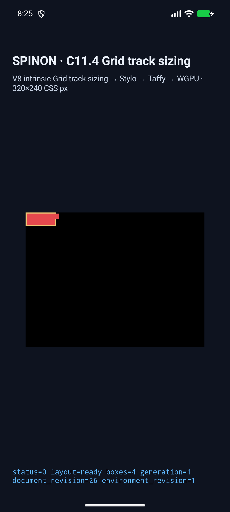
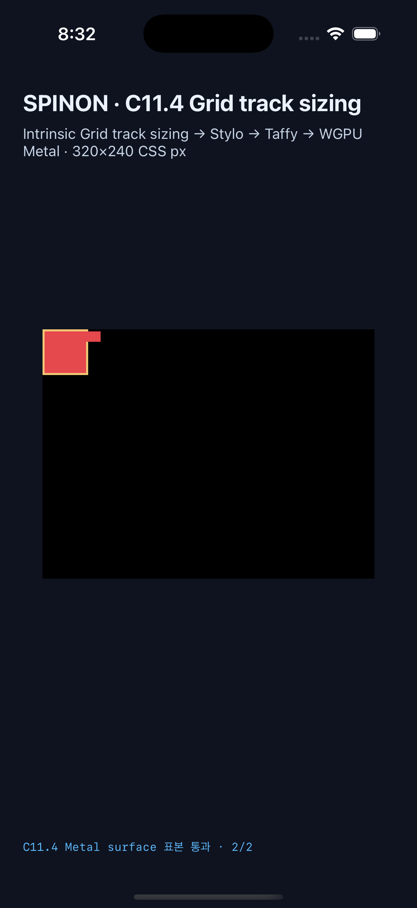

# C11.4 mixed cross-axis span groups 실행 근거

**판정: 부분 검증.** 이 고정 fixture는 세 direct Ahem text item에서 겹치는 span-2 group을 span-3 item과 함께 처리하고, columns의 wrapping 결과가 rows sizing에 반영되는지 확인한다. C11.4 전체 또는 일반 CSS 지원은 완료 처리하지 않는다. 공식 상태는 `77/213`으로 유지한다.

## 기준과 구현 범위

- [집중 계획](../../../../plan/c11-4-cyclic-minmax-calc-cross-axis-mixed-span-groups.md)
- [Chrome 156 관측과 독립 기대값](../c11-4-cyclic-minmax-calc-cross-axis-mixed-span-groups-precomparison-2026-10-22/README.md)
- [계획 실패 관점 20개](../../../../plan/c11-4-cyclic-minmax-calc-cross-axis-mixed-span-groups-plan-review-20.md)
- 네 scene ID만 opt-in `c11-4-grid-track-sizing-fixture-test` profile에서 받는다. 두 span-2 item은 span-3 item보다 먼저 sizing하며 forward/reverse는 direct child order만 바꾼다.
- Intrinsic case의 독립 기대값은 min-content bases `[9,19,19]`, final Columns `[15.671875,15.671875,15.65625]`, Rows `[9,9]`, root `55×24px`다. Definite case는 Columns `[12,12,12]`, Rows `[19,19]`, root `44×44px`다.
- 이 fixture는 box geometry를 렌더한다. glyph raster equality, 일반 author CSS admission, WPT, 실기기 또는 전체 CSS Grid 적합성 근거가 아니다.

## 코드·빌드 검증

| 검사 | 결과 | 근거 |
| --- | --- | --- |
| Style-to-layout 고정 geometry 및 trace | 1 passed | [`cyclic_minmax_calc_mixed_span_groups_match_fixed_geometry_and_trace`](../../../../crates/spinon-style-to-layout/src/c11_4_track_sizing_areas_tests/cyclic_minmax_calc_cross_axis_mixed_span_groups.rs) |
| FFI 고정 scene shape와 reverse order | 2 passed | [`cyclic_minmax_calc_cross_axis_mixed_span_groups.rs`](../../../../crates/spinon-ffi/src/runtime_gpu/fixtures/c11_4/cyclic_minmax_calc_cross_axis_mixed_span_groups.rs) |
| Fixture source/layout boundary | 18 passed | `mise exec -- bun test tools/css-reference/fixture-module-boundary.test.mjs` |
| Rust formatter | passed | `mise exec -- cargo fmt --all -- --check` |
| Style-to-layout feature Clippy | passed | `mise exec -- cargo clippy --locked -p spinon-style-to-layout --all-targets --features c11-4-grid-track-sizing-fixture-test -- -D warnings` |
| FFI feature Clippy | passed | `mise exec -- cargo clippy --locked -p spinon-ffi --all-targets --features c11-grid-metal-surface-pixels-test -- -D warnings` |
| Android fixture app build | passed | [`android-build-pass4.log`](./platform-expectations-20261022/android-build-pass4.log) |
| iOS Simulator fixture app build | passed | [`ios-build-pass3.log`](./platform-expectations-20261022/ios-build-pass3.log) |
| Default release FFI artifact | new scene IDs and fixture symbols absent | [`ffi-default-release-build.log`](./platform-expectations-20261022/ffi-default-release-build.log), SHA-256 `417f7dec4de376df0bd58170c6f955647514e8260b451c70c0ac4c418781e3b5` |
| Opt-in iOS Simulator FFI artifact | new scene IDs and fixture symbols present | SHA-256 `a2b31150ba3ffc2d7bbe7dd479ed1efcaee5af99a06ed968e3a95b9738d5176e` |

The opt-in archive exports `_spinon_runtime_gpu_host_new_c11_4_grid_track_sizing_fixture` and `_spinon_runtime_gpu_host_eval_c11_4_grid_track_sizing_fixture`; `strings` contains the four new scene IDs. The default release archive contains neither those scene IDs nor the C11.4 fixture entry symbols. Both hashes were read from the current checkout's built archives.

## iOS Simulator

iPhone 17 Pro / iOS 26.2 Simulator ran all four scenes. Each scene reports `drawPresented=true`, zero superseded retries, expected node order, frame counts, and Columns/Rows tracks. The intrinsic float representation differs from the quantized independent values by less than `1/64 CSS px`.

For both definite scenes, the compositor-submission-before Metal drawable readback matched both expected samples: overflow item B was `[229,72,77,255]`, and the point after B was clear `[0,0,0,255]`. This is four exact samples across two scenes; it is not a post-compositor pixel check.

| Scene | Layout/draw | Root | Rows | Samples |
| --- | --- | --- | --- | --- |
| Intrinsic forward | pass | `55×24` | `[9,9]` | n/a |
| Intrinsic reverse | pass | `55×24` | `[9,9]` | n/a |
| Definite forward | pass | `44×44` | `[19,19]` | overflow + clear, 2/2 exact |
| Definite reverse | pass | `44×44` | `[19,19]` | overflow + clear, 2/2 exact |

Run evidence: [`result.json`](./ios-simulator-c114-cross-axis-mixed-span-groups-ios-simulator-20261022T113152006Z-b45c3622/result.json), [simulator manifest](./ios-simulator-c114-cross-axis-mixed-span-groups-ios-simulator-20261022T113152006Z-b45c3622/simulator.json), and four per-scene runtime logs in the same directory.

## Android AVD

Android API 37 ARM64 AVD `emulator-5558` ran intrinsic forward and reverse through layout, frame checks, WGPU draw and screenshot capture. Definite forward reached the Rust runtime layout summary and all four expected node frames (`root`, A, B, C), but its log stops after `SPINON_C0410_SURFACE_CHANGED`: there is no `SPINON_C0410_RENDERER` or `SPINON_C0410_DRAW`, and no PixelCopy result. Definite reverse therefore did not run. This is not an Android presentation pass.

After the failed presentation, the AVD's Activity service disappeared. A captured ANR shows the `system_server` main thread waiting for `SurfaceFlingerAIDL` while `DisplayManagerService` starts. The SurfaceFlinger backtrace shows `SkiaGLRenderEngine::createEglContext` blocked in `eglCreateContext` and `QemuPipeStream::commitBufferAndReadFully`. Restarting SurfaceFlinger and reconnecting ADB did not restore the service. A non-destructive AVD process restart stopped the stuck QEMU instance, but Android Emulator then rejected a new start at host free space `1.3 GiB`, reporting insufficient disk. No test data was wiped.

The AVD diagnosis files are in [`android-avd-recovery-readonly-20261022/`](./android-avd-recovery-readonly-20261022/): ANR and thread backtraces, preflight rejection, and restart log. Other existing AVD transports `emulator-5554` and `emulator-5556` remain offline. No physical Android device was used.

## Screenshots

These captures show the box scene, including the red item crossing the root border in the iOS definite scene. They do not show glyph painting.

## 검증 상태

- [구현·runtime 실패 관점 검토 20개](./implementation-runtime-review-20.md)를 완료했다. Android definite presentation 누락을 부분 검증 판정에 반영했다.
- [PR diff 실패 관점 검토 30개](./pr-diff-review-30.md)를 완료했다. C11.4 완료 수 `77/213`과 fixture 전용 범위를 유지한다.
- Android definite forward/reverse 장면의 renderer draw·PixelCopy 표본과 4개 전체 AVD scene 실행.
- 이 fixture build를 포함한 기존 C11.4 회귀 matrix.
- AVD 재시작이 필요하다. host free space `1.3 GiB`에서 emulator preflight가 거부됐으나 필요 공간의 정확한 기준은 출력되지 않았다. `1.3 GiB`를 기준값으로 추정하지 않는다.
