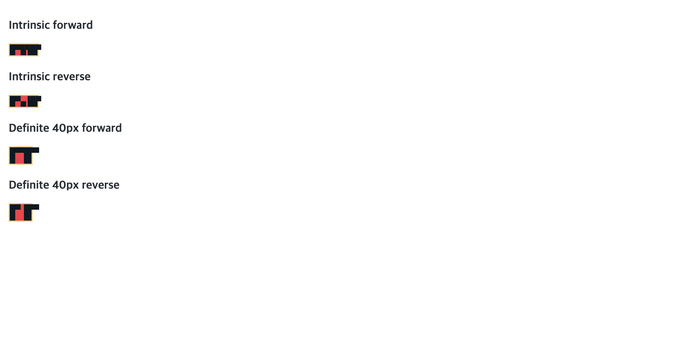

# C11.4 cyclic `minmax(calc())` 교차 축 span group 사전 비교

## 범위

Ahem text item 두 개를 3열 × 2행 고정 Grid에 둔다. item A는 columns `1/3`, rows `1/3`을 span하고 `AA A A`를 표시한다. item B는 columns `2/4`, rows `1/3`을 span하며 `XXXX`를 표시한다. 열 span이 가운데 열에서 겹치고 두 item은 같은 두 행을 공유한다. reverse scene은 두 item의 DOM 순서만 바꾼다.

- Grid: 모든 track `minmax(calc(10% + 2px), max-content)`, 각 gap 2px, border 2px, padding 0, `overflow:visible`.
- Intrinsic case: content width `min-content`, height `max-content`.
- Definite control: content width 40px, height `max-content`.
- Ahem: 10px font / 10px line-height, `Ahem.ttf` SHA-256 `b719ecb31c5b21fc573c03f6421c74ac63c271a5a3ff841e34f9705fb94b8448`.
- [재현 fixture](../../../../tests/fixtures/css/c11/grid-cyclic-minmax-calc-cross-axis-span-groups-c114-precomparison.html)

A text의 min-content/max-content inline contribution은 20/60px이다. B는 40/40px이고 40×10px preferred box를 가진다. A의 line count를 바꾸는 폭 경계는 30px이다. intrinsic scene의 33.34375px span은 두 줄 `[20,30]`, definite scene의 26px span은 세 줄 `[20,10,10]`을 만든다. 따라서 columns sizing이 각자의 row contribution을 바꾸는 실제 cross-axis 입력이다.

## 독립 기대값

CSS Grid 2025-03-26 CRD [§5.2](https://www.w3.org/TR/2025/CRD-css-grid-1-20250326/#grid-container-sizing), [§7.2.1](https://www.w3.org/TR/2025/CRD-css-grid-1-20250326/#track-sizes), [§11.1](https://www.w3.org/TR/2025/CRD-css-grid-1-20250326/#algo-overview), [§11.3](https://www.w3.org/TR/2025/CRD-css-grid-1-20250326/#algo-track-sizing), [§11.5.1](https://www.w3.org/TR/2025/CRD-css-grid-1-20250326/#distributing-extra-space-across-spanned-tracks)을 계산 기준으로 삼았다. 숫자는 Chrome output에서 역산하지 않았다.

Intrinsic width 계산과 최종 track 배치를 별도 단계로 다룬다. Min-content constraint에서 cyclic percentage는 `auto`처럼 취급되며 `calc()`의 absolute `2px`는 남는다. A의 20px minimum contribution은 track 1–2의 초기 base 2px와 gutter 2px를 뺀 14px를 남겨 track별 7px planned increase를 만든다. B의 40px contribution은 track 2–3에 17px씩 제안한다. §11.5.1의 per-track maximum은 `[7,17,17]`이며 초기 base를 더한 min-content-constraint bases는 `[9,19,19]`다. 두 gutter를 더한 content width는 51px이고, root border box는 55px다.

그 51px intrinsic container size로 최종 배치를 계산할 때 percentage를 다시 푼다. `calc(10% + 2px)` minimum은 약 7.1px이고, 세 max-content track에 남는 free space를 나누면 1/64 CSS px 양자화 허용치 안에서 Columns `[15.671875,15.671875,15.65625]`가 된다. A의 span 폭은 33.34375px라 `[20,30]` 두 줄이고 B는 40×10px 한 줄이다. 두 row의 contribution maximum은 `[9,9]`; root border box는 55×24px다.

Definite 40px content width에서는 min track이 각각 6px이고 gutter 뒤 남은 18px을 세 track에 나누어 Columns `[12,12,12]`가 된다. A span은 26px다. `AA` 20px은 들어가지만 뒤 구절 `A A` 30px은 들어가지 않아 세 줄 `[20,10,10]`과 30px block contribution이 생긴다. B는 40×10px다. 두 row의 contribution maximum은 `[14,14]`; root border box는 44×34px다. B는 root 오른쪽 border를 12px 넘는다.

Definite case에서 root-relative `(50,4)`는 border 바깥 item B의 `#e5484d` 배경이고 `(60,4)`는 두 item을 벗어난다. 앱 surface 비교에서는 두 번째 점의 기대 RGBA를 native clear `#000000`으로 정한다. 전체 독립 계산은 [`spec-derived-expectations.json`](./spec-derived-expectations.json)에 있고 Chrome 측정과 별도다.

## Chrome 156 Agent Browser 관측

Agent Browser 0.31.1 / HeadlessChrome 156.0.0.0, macOS arm64, viewport `1280×633`, DPR 1에서 Ahem 준비 완료를 확인했다. 네 장면의 최종 Columns/Rows, root/item frames, text Range line rectangles와 DOM 순서 불변성을 측정했다. Intrinsic A line count는 2, definite control은 3이다. Definite 두 장면 모두 root-relative `(50,4)`에서 `.item.b`와 `rgb(229,72,77)` 배경을 반환하고 `(60,4)`는 item 바깥이다.

관측 JSON은 [chrome156-observation.json](./chrome156-observation.json)에 있다. 스크린샷은 브라우저 렌더링 근거이며 Spinon runtime이나 모바일 표면을 확인한 결과가 아니다.

## 판정 경계

이 비교는 고정 CSS 입력의 Chrome 동작과 규범 기대값만 다룬다. 일반 Grid admission, Android/iOS runtime, Android PixelCopy, iOS Metal drawable, text glyph pixel equality, WPT, 실기기·hardware GPU, iOS compositor 이후 surface 및 전체 C11.4를 확인하지 않는다.
