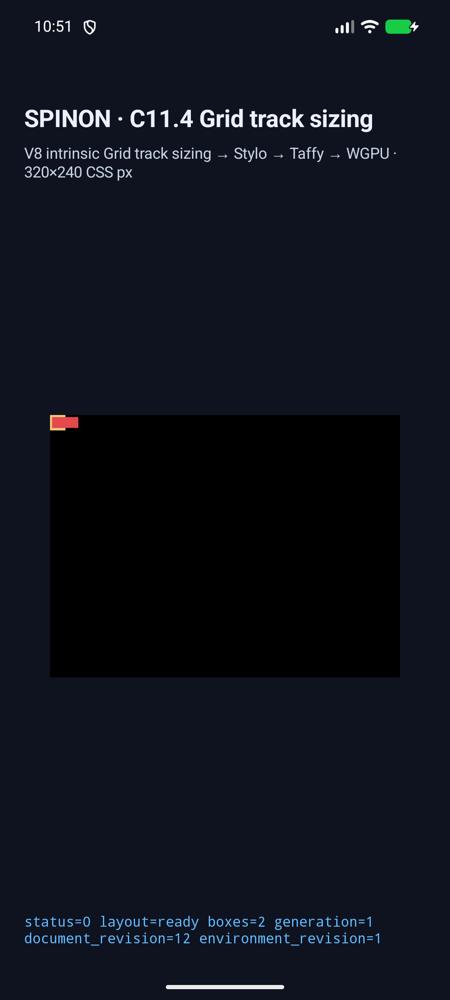
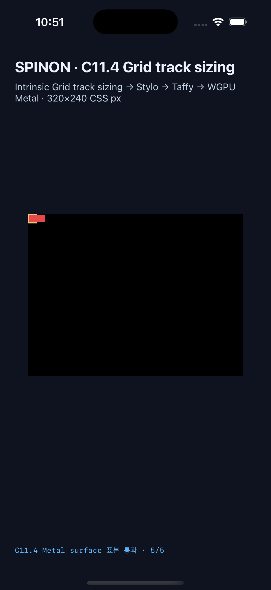

# C11.4 cyclic `minmax(calc())` minimum runtime 근거

이 evidence는 [집중 계획](../../../../plan/c11-4-cyclic-minmax-calc-minimum.md)의 네 고정 scene만 다룬다. 기준 입력과 Chrome 156 관측은 [사전 비교](../c11-4-cyclic-minmax-calc-minimum-precomparison-2026-10-22/README.md)에 있으며, 독립 기대 track은 column 24px·row 22px이다. percentage minimum은 intrinsic container sizing 단계에서는 cyclic이므로 10px content basis에 포함되지 않고, 최종 sizing 단계에서 `calc(200% + 4px)`/`calc(200% + 2px)`로 resolve된다. 각 root의 실제 CSS border는 2px이므로 border box는 14×14px이다.

## 실행 결과

| 플랫폼 | 환경 | scene/frame/track | surface 표본 |
| --- | --- | --- | --- |
| Android | API 37 ARM64 `spinon_api37_0_applied_txn` AVD, SwiftShader, serial `emulator-5558` | 4/4, `drawPresented`, root `14×14`, item `24×10` 또는 `10×22`, 두 축 track trace 통과 | PixelCopy 20/20 exact |
| iOS | iPhone 17 Pro, iOS 26.2 Simulator, Metal | 4/4, `drawPresented`, root `14×14`, item `24×10` 또는 `10×22`, 두 축 track trace 통과 | Metal drawable 20/20 exact, compositor 제출 전 |

네 scene은 cyclic column/row와 각각의 definite-size control이다. 모든 root는 `box-sizing:content-box`, 사방 `2px solid #f0c674`, zero padding/gap이다. Item은 Ahem 10px text `a`이며 background/text color는 `#e5484d`다. scene ID와 CSS/topology/style은 [FFI fixture](../../../../crates/spinon-ffi/src/runtime_gpu/fixtures/c11_4/cyclic_minmax_calc_minimum.rs), runtime allowlist는 [scene matrix](../../../../crates/spinon-runtime/src/session/ua_cascade/runtime_layout/fixtures/c11_4_text/cyclic_fit_content_calc/scene.rs)에 고정되어 있다.

각 axis에서 표본은 border 안쪽, item 내부, item이 덮은 root border, root 바깥의 item overflow, item 바깥 surface 순서다. column은 `(1,5)`, `(5,5)`, `(13,5)`, `(16,5)`, `(27,5)`이고 row는 `(1,5)`, `(5,5)`, `(5,13)`, `(5,16)`, `(5,25)` CSS px다. 기대 색은 `#f0c674`, `#e5484d`, `#e5484d`, `#e5484d`, `#000000`이며 Android PixelCopy와 iOS Metal 표면에서 모두 exact였다. 표본은 실제 CSS border와 item background paint 경로를 확인하며 테스트 overlay를 사용하지 않는다.

최신 캡처는 staged implementation source 기준 `sourceRevision.trackedDiffSha256=dbe4c909ac320872821221fb43aa61fab5b65f957796472e84c4745d8b2539d4`에 연결된다. Android 설치 APK hash는 local/installed 모두 `c1f65358a50eee54c85361af586b78210fdaa6adfc79b7b2e1caa8eb711dcd83`; iOS Simulator app hash는 `657df14b0a6d446198a8bf8b79ad510a5f249fb9ee3087c4701c580695edfc9e`다.

### Android API 37 AVD

최종 run [`c114-cyclic-percent-tracks-android-avd-20261022T015105529Z-ccced9ed`](./android-avd-c114-cyclic-percent-tracks-android-avd-20261022T015105529Z-ccced9ed/result.json):

- [cyclic column 화면](./android-avd-c114-cyclic-percent-tracks-android-avd-20261022T015105529Z-ccced9ed/cyclic-minmax-calc-min-column.png)
- [cyclic row 화면](./android-avd-c114-cyclic-percent-tracks-android-avd-20261022T015105529Z-ccced9ed/cyclic-minmax-calc-min-row.png)
- [definite column 화면](./android-avd-c114-cyclic-percent-tracks-android-avd-20261022T015105529Z-ccced9ed/definite-minmax-calc-min-column.png)
- [definite row 화면](./android-avd-c114-cyclic-percent-tracks-android-avd-20261022T015105529Z-ccced9ed/definite-minmax-calc-min-row.png)
- run의 `runtime-*.log`에는 scene별 두 축 track trace, node frame, PixelCopy 5/5 matched 표본이 있다.

### iPhone 17 Pro / iOS 26.2 Simulator

최종 run [`c114-cyclic-percent-tracks-ios-simulator-20261022T015105529Z-3111cd63`](./ios-simulator-c114-cyclic-percent-tracks-ios-simulator-20261022T015105529Z-3111cd63/result.json):

- [cyclic column 화면](./ios-simulator-c114-cyclic-percent-tracks-ios-simulator-20261022T015105529Z-3111cd63/cyclic-minmax-calc-min-column.png)
- [cyclic row 화면](./ios-simulator-c114-cyclic-percent-tracks-ios-simulator-20261022T015105529Z-3111cd63/cyclic-minmax-calc-min-row.png)
- [definite column 화면](./ios-simulator-c114-cyclic-percent-tracks-ios-simulator-20261022T015105529Z-3111cd63/definite-minmax-calc-min-column.png)
- [definite row 화면](./ios-simulator-c114-cyclic-percent-tracks-ios-simulator-20261022T015105529Z-3111cd63/definite-minmax-calc-min-row.png)
- run의 `runtime-*.log`에는 scene별 두 축 track trace, node frame, Metal 표본 5/5 matched와 drawable scale 3이 있다.

### 실패와 수정

첫 Android 실행은 [원본 runtime log](./android-avd-c114-cyclic-percent-tracks-android-avd-20261022T013924186Z-fa120527/runtime-cyclic-minmax-calc-min-column.log)의 `unregistered cyclic calc track scene`로 종료됐다. FFI source와 native sample allowlist에는 새 ID가 있었지만 runtime의 별도 C11.4 text-track scene registry에 없었다. 네 ID를 exact runtime matrix에 추가하고 registry test를 12개로 갱신했다. 수정 후 Android/iOS 각 4/4를 반복 통과했다. 최초 실패와 중간 성공 run은 지우지 않고 보존했다.

## 로컬 검증과 재현

통과한 Rust 검사:

- `mise exec -- cargo test --locked -p spinon-runtime --features c11-4-grid-track-sizing-fixture-test exposes_fixed_cyclic_calc_track_scenes_by_function -- --nocapture` — 1/1
- `mise exec -- cargo test --locked -p spinon-style-to-layout --features c11-4-grid-track-sizing-fixture-test calc_min -- --nocapture` — 2/2
- `mise exec -- cargo test --locked -p spinon-ffi --features c04-runtime-gpu-fixture-test minimum_calc -- --nocapture` — 2/2
- 수정된 세 crate의 opt-in feature 조합에 대한 `cargo clippy --all-targets -- -D warnings` — 모두 통과
- `mise exec -- cargo fmt --all -- --check`, `git diff --check` — 통과

opt-in 앱은 `SPINON_ENABLE_C04_RUNTIME_GPU=1`, `SPINON_ENABLE_C04_RUNTIME_GPU_FIXTURE_TEST=1`, `SPINON_ENABLE_C11_GRID_METAL_SURFACE_PIXELS_TEST=1`로 Android와 iOS Simulator에서 각각 빌드했다. 캡처 명령은 `tools/css-reference/capture-c11-4-auto-repeat-neighbors-simulator.mjs`를 각 플랫폼 target, 네 scene ID, `--evidence-group=c11-4-cyclic-minmax-calc-minimum-runtime`과 함께 실행한다.

release `spinon-ffi` static archive도 별도 target directory에서 no-feature와 `c04-runtime-gpu-fixture-test,c11-grid-metal-surface-pixels-test` 조합으로 빌드했다. 기본 archive에는 네 새 scene ID 및 `_spinon_runtime_gpu_host_new_c11_4_grid_track_sizing_fixture` marker가 없고, opt-in archive에는 네 ID와 진입점 marker가 있다. SHA-256은 default `fe9efc2ed04846f9b5f37c418ad7c454728b8f4f4cc2ccedde0feaec5c95f032`, fixture `73bfbc2faa8d27165c6d5ab6c98637fd0eb8ebd51e25d874a84208b3c330915b`다. 이 검사는 Rust static archive 범위이며 APK/IPA 전체에서 다른 fixture payload가 빠졌다는 뜻은 아니다.

구현 실패 관점은 [별도 검토 20개](./implementation-review-20.md)에 기록했다. C11.4 checkbox와 공식 완료 수 `72/213`은 유지한다. 일반 CSS admission, WPT, Android 실기기/hardware GPU, iOS compositor 이후 pixels 및 전체 C11.4는 검증하지 않았다.
