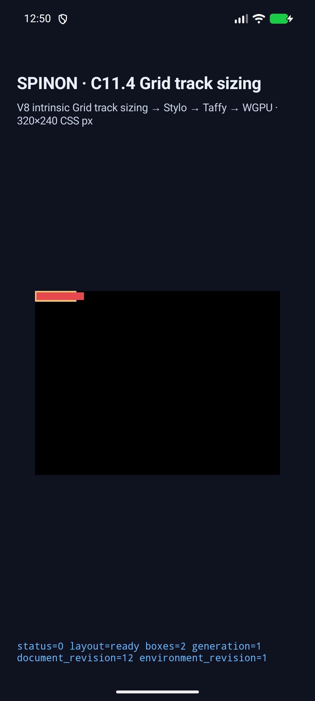
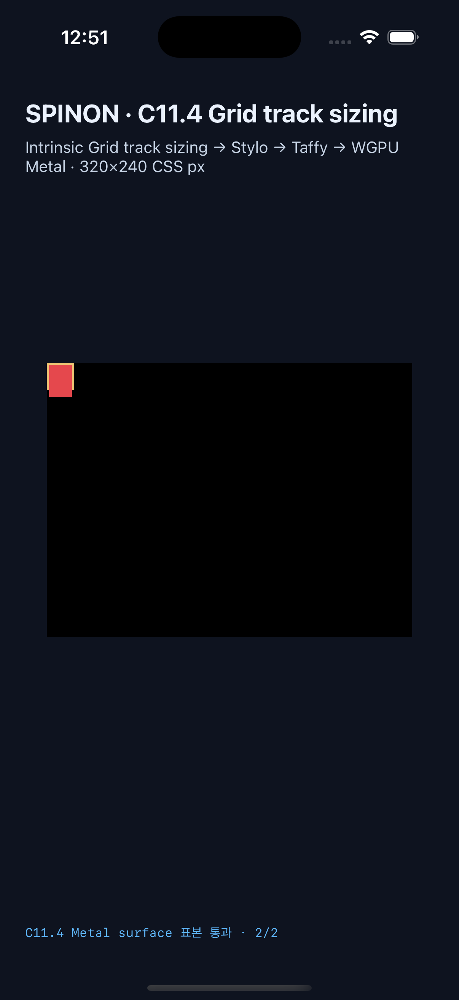

# C11.4 cyclic `minmax(calc())` minimum + spanning text runtime

이 실행 근거는 [계획](../../../../plan/c11-4-cyclic-minmax-calc-minimum-span.md)의 네 fixed scene만 다룬다. [CSS Grid 2025 CRD 독립 계산과 Chrome 156 precomparison](../c11-4-cyclic-minmax-calc-minimum-span-precomparison-2026-10-22/README.md)은 browser page backdrop을 기록한다. 앱 PixelCopy/Metal은 host가 소유한 native surface를 읽으므로 표면 clear는 `#000000`이다. 두 배경 값은 서로 다른 표면이며 대체 가능한 기대값이 아니다.

## 결과

| scene | final Columns | final Rows | root border box | span item, root-relative |
|---|---|---|---|---|
| `cyclic-minmax-calc-min-span-columns` | `[29,29]` | `[10]` | `54×14px` | `(2,2) 62×10px` |
| `definite-minmax-calc-min-span-columns` | `[29,29]` | `[10]` | `54×14px` | `(2,2) 62×10px` |
| `cyclic-minmax-calc-min-span-rows` | `[20]` | `[12,12]` | `24×24px` | `(2,2) 20×28px` |
| `definite-minmax-calc-min-span-rows` | `[20]` | `[12,12]` | `24×24px` | `(2,2) 20×28px` |

Android API 37 ARM64 SwiftShader AVD (`emulator-5558`)와 iPhone 17 Pro/iOS 26.2 Simulator에서 각각 4/4 scene이 layout-ready, exact node frame, intrinsic span, two-axis track trace 및 draw/present를 통과했다. Android PixelCopy와 iOS compositor 제출 전 Metal drawable은 장면당 2개씩, 각각 8/8 표본이 RGBA exact다.

Column scene의 intrinsic contribution distribution은 Ahem `aa aa` max-content 50px에서 4px gap을 한 번 제외해 `[23,23]`을 만든 다음, 최종 `calc(50% + 4px)` minimum `[29,29]`가 된다. Row scene의 `a a`는 폭 20px에서 두 줄이며, block contribution 20px에서 4px row gap을 제외해 `[8,8]`을 만든 다음 final `calc(50% + 2px)` minimum `[12,12]`로 resolve한다. Cyclic cases와 같은 definite size control이 같은 final track/frame을 만들어 각 축의 cyclic branch를 대조한다.

표면 표본은 root 기준 column `(58,6)`의 border 바깥 item 내부 빨강 `(229,72,77,255)`, item 바깥 `(66,6)` native clear 검정 `(0,0,0,255)`; row `(8,27)`의 border 아래 item 내부 빨강, item 바깥 `(8,31)` 검정이다. CSS border stroke를 그리는 경로는 이 fixture에 없으므로 border 색/외곽선 자체는 검증하지 않는다. 앱 screenshot은 전체 화면을 보존한다.

## 최신 Android AVD 실행

Run ID `c114-android-avd-20261022T035021373Z-40639034`, API 37 ARM64 `sdk_gphone64_arm64`, SwiftShader. APK local/install SHA-256은 `2f22d8ed5961957da9985435c479e8220ec69ae11174d3918934e1dca586e469`로 일치한다.

- [cyclic columns](./android-avd-c114-cyclic-minmax-span-android-avd-20261022T035021373Z-40639034/cyclic-minmax-calc-min-span-columns.png)
- [definite columns](./android-avd-c114-cyclic-minmax-span-android-avd-20261022T035021373Z-40639034/definite-minmax-calc-min-span-columns.png)
- [cyclic rows](./android-avd-c114-cyclic-minmax-span-android-avd-20261022T035021373Z-40639034/cyclic-minmax-calc-min-span-rows.png)
- [definite rows](./android-avd-c114-cyclic-minmax-span-android-avd-20261022T035021373Z-40639034/definite-minmax-calc-min-span-rows.png)
- [run result](./android-avd-c114-cyclic-minmax-span-android-avd-20261022T035021373Z-40639034/result.json)

## 최신 iPhone 17 Pro Simulator 실행

Run ID `c114-ios-simulator-20261022T035118837Z-95f456a0`, UDID `ACA7BF91-E2D5-4CF7-909A-08D1AD95FF3D`, iOS 26.2. App executable SHA-256은 `f48e7d848441dc0b5d54b4ee31ea3eb1855455f478a07df21ef0ba09bbf9be1f`다. Metal drawable scale은 3이며 OS compositor 제출 전 readback이다.

- [cyclic columns](./ios-simulator-c114-cyclic-minmax-span-ios-simulator-20261022T035118837Z-95f456a0/cyclic-minmax-calc-min-span-columns.png)
- [definite columns](./ios-simulator-c114-cyclic-minmax-span-ios-simulator-20261022T035118837Z-95f456a0/definite-minmax-calc-min-span-columns.png)
- [cyclic rows](./ios-simulator-c114-cyclic-minmax-span-ios-simulator-20261022T035118837Z-95f456a0/cyclic-minmax-calc-min-span-rows.png)
- [definite rows](./ios-simulator-c114-cyclic-minmax-span-ios-simulator-20261022T035118837Z-95f456a0/definite-minmax-calc-min-span-rows.png)
- [run result](./ios-simulator-c114-cyclic-minmax-span-ios-simulator-20261022T035118837Z-95f456a0/result.json)

## 구현 경계와 회귀

FFI fixture는 [exact four-scene source](../../../../crates/spinon-ffi/src/runtime_gpu/fixtures/c11_4/cyclic_minmax_calc_minimum_span.rs)에, style-to-layout 회귀는 [span contribution test](../../../../crates/spinon-style-to-layout/src/c11_4_track_sizing_areas_tests/cyclic_minmax_calc_minimum_span.rs)에, runtime scene admission은 [C11.4 runtime matrix](../../../../crates/spinon-runtime/src/session/ua_cascade/runtime_layout/fixtures/c11_4_text/cyclic_fit_content_calc/scene.rs)에 고정했다. 런타임은 gap/track grammar와 typed `grid-column` 또는 `grid-row` span을 확인하고 정확한 scene 외 값을 fail closed한다. 런타임 fixture registry가 초기 AVD 시도에서 빠져 `unregistered cyclic calc track scene` 오류가 난 것을 확인했다. 네 scene을 별도 registry에도 등록하고 runtime suite를 다시 실행해 해결했다. 첫 실패 및 중간 재시도 디렉터리는 지우지 않았다.

| 검증 | 결과 |
|---|---|
| `mise exec -- cargo test --locked -p spinon-runtime --features c11-4-grid-track-sizing-fixture-test` | 214 passed, 0 failed, 3 ignored; 나머지 integration 3 passed와 node-lifecycle 16 passed |
| style-to-layout fixed span-distribution regression | 1 passed |
| opt-in FFI fixed-scene registry regression | 1 passed |
| `mise exec -- cargo fmt --all -- --check` | 통과 |
| style-to-layout, runtime, FFI modified-crate `cargo clippy --all-targets -- -D warnings` | 모두 통과 |
| `mise exec -- node --check tools/css-reference/capture-c11-4-auto-repeat-neighbors-simulator.mjs` | 통과 |
| `mise exec -- bun test tools/css-reference/fixture-module-boundary.test.mjs` | 6 passed |
| `git diff --check` | 통과 |
| Android Gradle `assembleDebug` with fixture + PixelCopy flags | BUILD SUCCESSFUL |
| iOS `tools/build-ios-sim.sh` with fixture + Metal pixel flags | BUILD SUCCEEDED |

두 simulator 실행의 source fingerprint는 `08eaf851c75bb0960976cc568b09b7cde54ce615` 기준 tracked diff `c71b23fb991671afd61811176c6d5289f0993371f1ff69762c58e6b8af8dc63b`다. 해당 실행은 이후 문서 변경 이전에 끝났고 앱 소스는 그 fingerprint와 같다. 상세 빌드/launch/runtime 로그는 같은 evidence directory에 보존한다.

기본 release `spinon-ffi` archive는 `--no-default-features`; positive control은 같은 crate에 `c11-grid-metal-surface-pixels-test`를 켜 별도 target directory로 만들었다. [Archive boundary log](./ffi-artifact-boundary.log)에서 네 scene ID와 `_spinon_runtime_gpu_host_new_c11_4_grid_track_sizing_fixture` marker는 기본 archive에서 모두 absent, opt-in archive에서 모두 present다. SHA-256은 각각 `46a1faec3adc1676d339d997c9cc6ae71c4f148725972384d39556f0929d1ecf` 및 `acbbb686f6bade18eabc48e8684a881ea50086a6eb064af37fbccae006173502`다. 이는 Rust static archive 검사이며 최종 APK/IPA release 산출물 전체를 증명하지 않는다.

계획 PR [#496](https://github.com/ohah/spinon/pull/496)은 2026-10-22에 병합됐다. 구현 PR 전 별도 실패 관점 검토 20개는 [implementation/runtime review](./implementation-runtime-review-20.md)에 기록했다. 현재 공식 `77/213`은 roadmap과 동일한 status-ID/하위 항목 파서로 계산했다(상위 ID 211개와 공식 미구현 하위 항목 2개). 단순 Markdown checkbox 전체 수에는 roadmap 작업이 아닌 체크박스도 섞여 있어 이 집계에 쓰지 않았다. C11.4 checkbox는 미완료이고 이 작업에서 공식 완료 수는 바뀌지 않았다. 일반 CSS admission, WPT, Android physical/hardware GPU 및 iOS compositor-after pixels는 검증하지 않았다.

첫 registry 누락과 첫 native-surface 기대색 mismatch를 포함한 실행 산출물의 [SHA-256 manifest](./SHA256SUMS.txt)를 보존한다.
