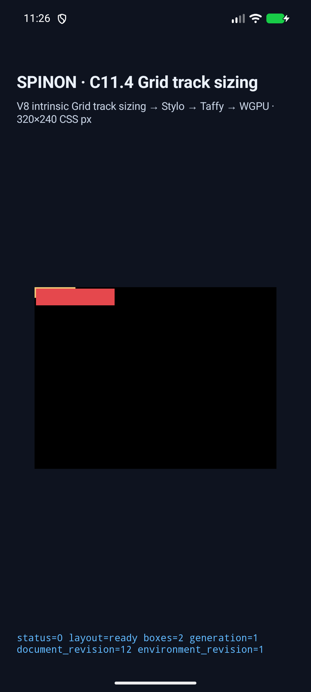
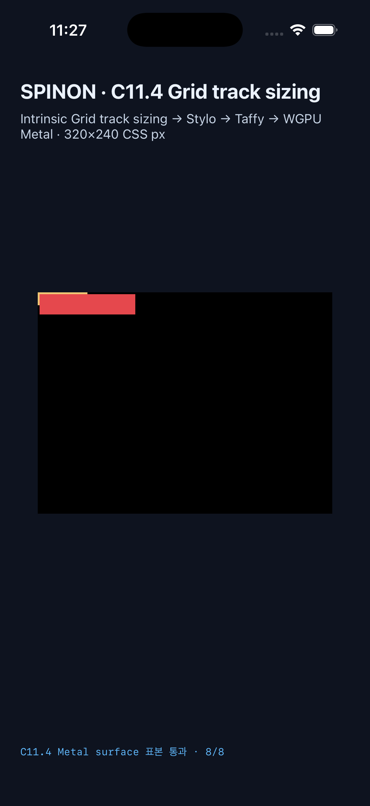

# C11.4 양축 cyclic `minmax(calc())` minimum runtime 근거

**상태:** 고정 fixture 구현과 Android·iOS Simulator 검증 결과다. C11.4 전체 지원이나 일반 CSS admission을 뜻하지 않는다.

## 입력과 실행

- 기준 입력·규범 계산·Chrome 156 관측: [사전 비교](../c11-4-cyclic-minmax-calc-minimum-two-axis-precomparison-2026-10-22/README.md)
- 계획과 정확한 기대값: [slice 계획](../../../../plan/c11-4-cyclic-minmax-calc-minimum-two-axis.md)
- base commit `8c7c412708ec4cb8bb78faf9366bb96c529c8938`; capture 당시 tracked diff SHA-256 `99592880f95dd909b2a556a4a242c51bf43958f20378a349ca9ffb5328ea8f81`.
- Android: API 37 ARM64 AVD `emulator-5558`, Android 17, APK 설치 전후 SHA-256 일치 `b4586f007b1d7e84350875cd71529744a09d5a6e516425f9431b470eb0fa610b`.
- iOS: iPhone 17 Pro / iOS 26.2 Simulator `ACA7BF91-E2D5-4CF7-909A-08D1AD95FF3D`, 앱 실행 파일 SHA-256 `bd1a266282bb72b541cc9363606efde84a2520aa0fc828f0bc70a4bcb884e3a8`.
- 원본 실행 로그·각 scene 결과 JSON·시뮬레이터 metadata와 전체 SHA-256은 이 폴더의 `android-avd-*`, `ios-simulator-*`, `SHA256SUMS.txt`에 보존한다.

## 최종 결과

| Scene | Columns / Rows | Root border box | Item frame | Android / iOS |
| --- | --- | --- | --- | --- |
| `cyclic-minmax-calc-min-both-axes` | `[104] / [22]` | `54×14px` | `(2,2) 104×22px` | 통과 / 통과 |
| `cyclic-minmax-calc-min-column-definite-row` | `[104] / [10]` | `54×14px` | `(2,2) 104×10px` | 통과 / 통과 |
| `definite-column-cyclic-minmax-calc-min-row` | `[10] / [42]` | `14×24px` | `(2,2) 10×42px` | 통과 / 통과 |
| `definite-minmax-calc-min-both-axes` | `[24] / [22]` | `14×14px` | `(2,2) 24×22px` | 통과 / 통과 |

각 플랫폼에서 4/4 scene의 typed track trace, intrinsic input, root/item/node frame과 draw/present가 독립 기대값에 맞았다. Android PixelCopy는 28/28, iOS Metal drawable은 28/28 표본이 exact다. iOS 표본은 compositor 제출 전 drawable에서 읽었다. 표본은 border overpaint, root 밖 overflow, item 내부와 각 item 경계 바깥을 포함한다. 이 fixture의 표본은 CSS border stroke의 색상 일치나 glyph rasterization을 검사하지 않는다.

## Fixture artifact 경계

[기본/positive-control release static archive 검사](artifact-boundary.json)는 `spinon-ffi` archive 문자열과 fixture ABI 이름을 비교한다. 기본 archive에는 새 scene ID·payload와 C11.4 fixture ABI 이름이 없고, `c04-runtime-gpu-fixture-test` positive control에는 둘 다 있다. 이 검사는 Android APK·iOS 앱 전체에서 fixture가 제거됐다는 증거로 확대하지 않는다.

구현과 실제 실행 검토는 [서로 다른 runtime 실패 관점 20개](implementation-runtime-review-20.md), 이 PR 변경분 자체의 독립 검토는 [diff 실패 관점 30개](pr-diff-review-30.md)에 기록했다.

## 재실행 중 발견과 수정

실패한 중간 결과도 삭제하지 않고 해당 실행 폴더에 남겼다.

1. 첫 두 AVD 실행은 이전에 만들어진 APK SHA `c1f65358a50eee54c85361af586b78210fdaa6adfc79b7b2e1caa8eb711dcd83`를 설치해 신규 scene 인자를 거부했다. 캡처 스크립트가 앱을 빌드하지 않는 경로임을 확인하고, `SPINON_ENABLE_C04_RUNTIME_GPU=1` 및 `SPINON_ENABLE_C04_RUNTIME_GPU_FIXTURE_TEST=1`로 APK를 다시 빌드했다. 최종 실행은 로컬·설치 APK SHA 일치 후 통과했다.
2. 첫 full-matrix 실행에서 definite control의 Android expected-root helper가 기본 `100×40px`를 반환했다. 앱의 실제·규범 root `14×14px`에 맞게 scene 판정을 고쳤다.
3. 다음 실행에서는 definite control의 `x=25` 표본이 폭 24px item 내부여서 검정 경계 바깥 대신 빨강을 읽었다. item의 실제 오른쪽 다음 좌표 `x=27`로 옮기고 두 플랫폼 전체 matrix를 재실행해 통과했다.
4. 신규 Android scene은 C11.4 scene registry뿐 아니라 pixel-matrix scene registry도 별도 갱신해야 했다. 두 허용 목록을 각각 연결하고 전체 AVD run에서 재검증했다.

최초 Chrome precomparison 및 이번 캡처는 Agent Browser/시뮬레이터 기반이다. terminal-browser는 사용하지 않았다. Agent Browser session은 precomparison에서 종료했고, 이번 runtime capture에서는 브라우저를 열지 않았다.

## 범위

고정된 네 scene의 layout/trace/draw/pixel 경로를 검증했다. 일반 author CSS admission, WPT, 임의 Grid 문법, Android 실기기·hardware GPU, iOS compositor 이후 픽셀 및 전체 C11.4는 검증하지 않았다. 공식 `C11.4` 미완료 상태와 완료 수 `72/213`은 그대로다.
