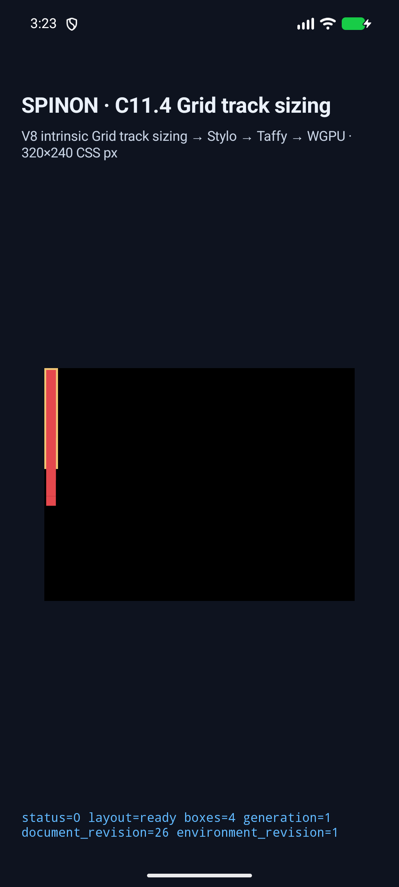
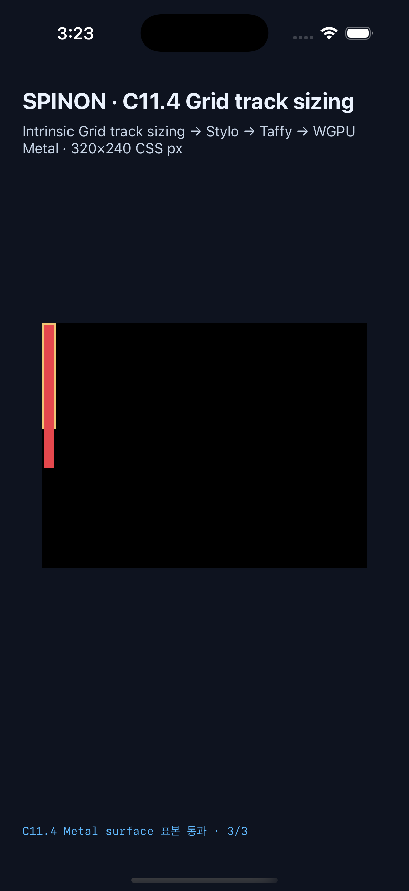

# C11.4 cyclic `minmax(calc())` 겹치는 row span runtime 근거

[집중 계획](../../../../plan/c11-4-cyclic-minmax-calc-overlapping-rows.md)과 [Chrome 156 사전 비교·독립 계산](../c11-4-cyclic-minmax-calc-overlapping-rows-precomparison-2026-10-22/README.md)에 고정한 여섯 장면을 opt-in runtime fixture로 연결했다. 실행은 커밋 `938261090f303e1efa989f225641d4e132c21ee0`에서 했으며 Android와 iOS metadata 모두 source revision의 tracked dirty path가 비어 있다.

## Simulator 실행

- Android API 37 ARM64 AVD `emulator-5558` (`sdk_gphone64_arm64`)에서 6/6 장면이 통과했다. 최종 [Android 결과](./android-avd-c114-overlapping-rows-android-avd-20261022T062328039Z-5a1f2e5a/result.json), [시뮬레이터 metadata](./android-avd-c114-overlapping-rows-android-avd-20261022T062328039Z-5a1f2e5a/simulator.json), [runtime logs](./android-avd-c114-overlapping-rows-android-avd-20261022T062328039Z-5a1f2e5a/)를 확인한다.
- iPhone 17 Pro / iOS 26.2 Simulator에서 6/6 장면이 통과했다. 최종 [iOS 결과](./ios-simulator-c114-overlapping-rows-ios-simulator-20261022T062341649Z-844ff45e/result.json), [시뮬레이터 metadata](./ios-simulator-c114-overlapping-rows-ios-simulator-20261022T062341649Z-844ff45e/simulator.json), [runtime logs](./ios-simulator-c114-overlapping-rows-ios-simulator-20261022T062341649Z-844ff45e/)를 확인한다.
- 모든 장면에서 Rows sizing trace, intrinsic span `[2,3]`, 전체 node frame, `layout=ready`, `drawPresented=true`를 assertion했다. 140px group은 Rows `[42,47,47]`, root `14×144px`; 100px small control은 Rows `[32,32,32]`, root `14×104px`다. Columns는 고정 `[10]`이다.
- Ahem text의 70/80/140px block intrinsic 입력과 span item별 frame을 forward/reverse source order 모두 대조했다. 두 order는 kind별 track과 frame이 같다.

## Root 밖 text 표본과 화면

각 플랫폼에서 definite 100px forward/reverse small scene의 세 표본을 native surface에서 확인했다. 두 장면씩 세 표본으로 총 6/6 exact다.

- `(7,7)`: span-2 text의 root 내부 색상 `#e5484d`.
- `(7,126)`: 104px root border box 바깥에서 span-3 Ahem text 색상 `#e5484d`.
- `(7,150)`: 140px text content 뒤의 native clear `#000000`.

Android 표본은 API 37 AVD의 PixelCopy이며 surface scale `2.625×`다. iOS 표본은 iPhone 17 Pro의 `960×720` Metal drawable에서 `3×`로 확인했다. iOS 값은 compositor 제출 전 drawable 결과다.

| Android API 37 ARM64 AVD | iPhone 17 Pro / iOS 26.2 Simulator |
|---|---|
|  |  |

샘플은 overflow text와 clear 경계를 검증한다. CSS border stroke 색 자체, Android 실기기/hardware GPU, iOS compositor 이후 화면은 검증하지 않았다.

## Build와 focused 검사

- `SPINON_ENABLE_C04_RUNTIME_GPU=1 SPINON_ENABLE_C04_RUNTIME_GPU_FIXTURE_TEST=1 mise exec -- bun run build:android` — 성공, [build log](./android-build.log).
- `SPINON_ENABLE_C04_RUNTIME_GPU=1 SPINON_ENABLE_C11_GRID_METAL_SURFACE_PIXELS_TEST=1 SPINON_ENABLE_C04_RUNTIME_GPU_FIXTURE_TEST=1 mise exec -- bun run build:ios-sim` — 성공, [build log](./ios-build.log.gz, gzip compressed).
- Runtime allowlist test, style-to-layout geometry/trace test, FFI fixed-scene allowlist test는 각 1/1 통과했다.
- 수정한 세 crate의 fixture feature `cargo clippy -- -D warnings`, `mise exec -- cargo fmt --all -- --check`, simulator capture script의 Node syntax check가 통과했다.
- [`implementation-runtime-review-20.md`](./implementation-runtime-review-20.md)는 구현과 두 simulator의 별도 실패 관점 20개를 기록한다. [PR diff 검토 20개](./pr-diff-review-20.md)는 변경된 연결부·근거·상태 문서를 별도로 다룬다.

## 기본/fixture artifact 경계

macOS `spinon-ffi` release static archive의 신규 scene ID와 runtime rejection marker를 byte scan했다. [scan report](./artifact-profile-scan.json)는 기본 release archive에서 둘 다 없고, `c04-runtime-gpu-fixture-test` positive control에 둘 다 있음을 SHA-256과 함께 기록한다. 검사한 archive는 `spinon-ffi` static archive이며 APK/IPA 전체에 fixture code가 없다는 주장은 하지 않는다.

## 발견해 고친 실행 문제

첫 Android capture는 새 row scene ID를 runtime text fixture registry가 몰라 `unregistered overlapping span scene`으로 실패했다. registry를 행·열 축을 포함한 고정 allowlist로 확장했다. 그 다음 capture는 행 scene의 Rows contribution을 Columns pass와 함께 비교하는 simulator assertion 오류를 드러냈다. row 전용 contribution 검증을 분리해 수정한 뒤, 커밋된 최종 코드에서 두 플랫폼 각 6/6을 다시 실행했다.

이 작업은 일반 CSS admission이나 전체 Grid 구현이 아니다. C11.4 checkbox는 미완료이고 공식 완료 수 `77/213`을 유지한다. WPT, Android 실기기, hardware GPU, border stroke 및 전체 C11.4는 범위 밖이다.
