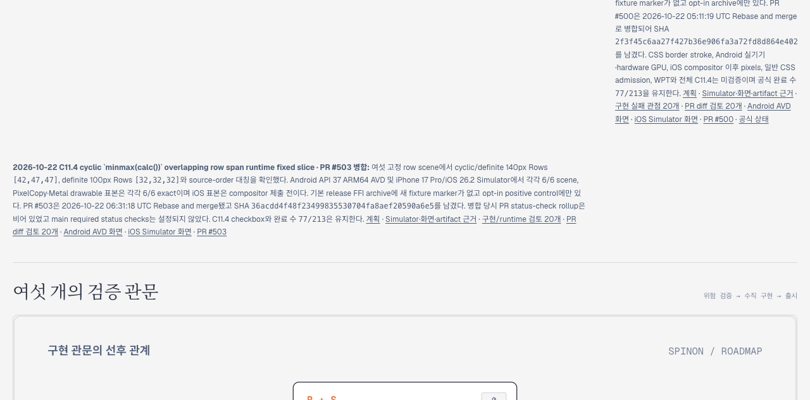
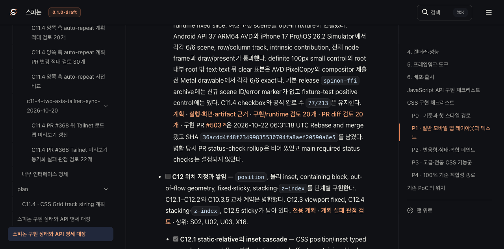

# PR #503 병합 뒤 Tailnet 로드맵 동기화

문서 sync 근거 PR: [#504](https://github.com/ohah/spinon/pull/504).

PR [#503](https://github.com/ohah/spinon/pull/503)은 2026-10-22 06:31:18 UTC Rebase and merge되어 `36acdd4f48f23499835530704fa8aef20590a6e5`를 남겼다. 이 동기화는 그 merge 상태를 집중 계획·공식 상태·공개 로드맵의 private Tailnet 미리보기에 반영했다. GitHub Pages와 `gh-pages`는 배포하지 않았다.

## 선택 문서 build

선택 문서 root의 기준 source commit은 `530691ee889b03f40e79e216bab042efd5427e09`다. 기존 pass27 선택 root에서 시작해 merge 이후 변경한 계획·STATUS·roadmap·C11.4 runtime evidence를 commit object에서 복사했다. 미추적 workspace evidence는 제외했다. 선택 root는 8,190개 파일, 344,155,309 bytes이며 symlink는 없다. [선택 root 기록](./selected-root-preparation-pass28.json)

[RSPress 2.0.22 build](./selected-build-pass28.log.gz, gzip compressed)은 4,534개 파일, 229,005,804 bytes를 만들었다. 정적 tree SHA-256은 `b60c17e44313b90b19aaffab74b09c55601e3cbabab452a137a8e5ccc8b990fb`다. [build summary](./selected-build-summary-pass28.json)은 roadmap, STATUS alias, 집중 계획, 계획 검토, runtime 근거·검토 페이지와 두 최종 Simulator 이미지를 route로 확인한다.

## Tailnet 미리보기 동기화

미리보기는 [로드맵](https://macstudio.tailed42f2.ts.net/spinon/roadmap.html) · [공식 상태](https://macstudio.tailed42f2.ts.net/spinon/STATUS.html) · [집중 계획](https://macstudio.tailed42f2.ts.net/spinon/plan/c11-4-cyclic-minmax-calc-overlapping-rows.html) · [runtime 근거](https://macstudio.tailed42f2.ts.net/spinon/internal/evidence/c11-4-cyclic-minmax-calc-overlapping-rows-runtime-2026-10-22/README.html)에서 확인할 수 있다.

| 결과 | 파일 수 | bytes | 판정 |
|---|---:|---:|---|
| 새 파일 | 407 | — | 생성됨 |
| 기존 파일 교체 | 280 | 55,761,127 백업 | 이전 bytes/hash를 별도 백업에 보존 |
| 동일 파일 | 3,847 | — | 수정하지 않음 |
| 삭제 | 0 | — | 삭제 없음 |
| 전체 target | 4,534 | 229,005,804 | source와 target hash 일치 |
| HTTP served response | 4,534 | — | local target과 source hash 모두 일치 |

백업은 `/Users/yoonhb/Library/Application Support/SpinonPreviewBackups/c11-4-cyclic-minmax-calc-overlapping-rows-tailnet-sync-2026-10-22/pass28-final`에 만들었다. 동기화 스크립트는 매 파일 교체 직전에 target이 preflight hash와 같은지 확인하고, 교체 전에 백업을 검증한다. 복사와 local 검증 모두 4,534/4,534이며 백업 280/280, HTTP 응답 4,534/4,534가 통과했다. 삭제는 실행하지 않았다. 전체 결과는 [preflight](./preflight-pass28-final.json.gz), [copy/backup](./copy-pass28-final.json.gz), [local verification](./local-verification-pass28-final.json.gz), [served verification](./served-verification-pass28-final.json.gz)에 기록했다.

## Agent Browser 확인

터미널 브라우저를 사용하지 않았다. Agent Browser 0.31.1로 Tailnet 도메인의 roadmap, STATUS, 계획, runtime evidence를 열었다. roadmap·STATUS·계획에서 PR #503 merge SHA와 `77/213`을 확인했다. runtime evidence의 Android와 iOS 이미지는 각각 `1080×2400`, `1206×2622`로 로드됐고 PR diff review 링크도 보인다. [검증 결과 JSON](./agent-browser-verification-pass28.json)

이 preview 작업은 공식 C11.4 상태를 완료로 표시하지 않는다. C11.4는 미완료이며 공식 완료 수 `77/213`을 유지한다. sync safety 점검은 [서로 다른 실패 관점 20개](./sync-review-20.md)에 기록했다. PR 변경 검토는 [별도 실패 관점 20개](./pr-diff-review-20.md)에 기록했다.
