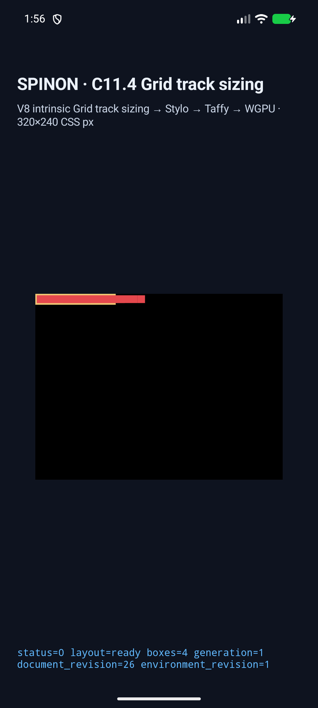
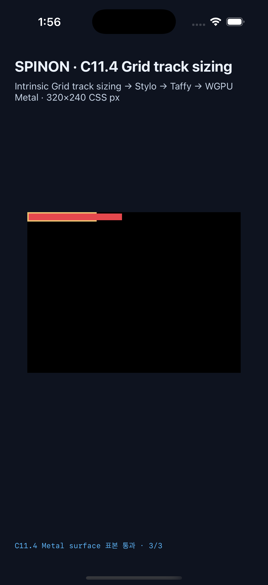

# C11.4 overlapping cyclic `minmax(calc())` span runtime

**기준:** 2026-10-22 · **상태:** 제한된 fixture 구현 후보 · **공식 C11.4:** 미완료 · **집계:** `77/213` 유지

## 검증 범위

이 변경은 [집중 계획](../../../../plan/c11-4-cyclic-minmax-calc-overlapping-spans.md)에 적힌 여섯 ID에만 적용된다. 세 개의 `minmax(calc(10% + 2px), max-content)` column, 2px column gap, 단일 10px row와 Ahem 10px nowrap text 세 개를 사용한다. 두 span-2 item은 겹치며 각각 70px·80px intrinsic contribution을 만든다. 뒤이은 span-3 item은 140px contribution을 만든다. forward/reverse DOM order, max-content width, definite 140px 및 definite 100px control을 포함한다.

독립 계산의 같은-span planned increase는 `[34,39,39]`이고 span-3 group 적용 뒤 max-content upper size는 `[42,47,47]`이다. 100px control의 최종 Columns는 `[32,32,32]`다. 계산 과정과 Chrome 156 사전 비교는 [precomparison evidence](../c11-4-cyclic-minmax-calc-overlapping-spans-precomparison-2026-10-22/README.md)에 있다.

## Android API 37 ARM64 AVD

최신 run은 `emulator-5558` (`google/sdk_gphone64_arm64/emu64a`, API 37, ARM64)에서 여섯 scene을 6/6 실행했다. 모든 scene에서 Columns/Rows trace, intrinsic inputs/spans, node frames, `drawPresented=true`를 확인했다. 네 intrinsic/140px scene은 Columns `[42,47,47]`, Rows `[10]`, root border box `144×14px`; 두 definite 100px control은 Columns `[32,32,32]`, Rows `[10]`, root border box `104×14px`다. [전체 관찰값](android-avd-c114-overlapping-span-groups-android-avd-20261022T045550962Z-9ada2377/result.json) · [simulator fingerprint](android-avd-c114-overlapping-span-groups-android-avd-20261022T045550962Z-9ada2377/simulator.json).

두 100px control 각각에서 Android PixelCopy 표본 3/3 exact다.

| root-relative CSS sample | target | expected RGBA | result |
|---|---|---|---|
| `(4,7)` | span-2 text inside root | `229,72,77,255` | exact |
| `(126,7)` | span-3 red text outside root border | `229,72,77,255` | exact |
| `(150,7)` | after text, host surface clear | `0,0,0,255` | exact |

Forward/reverse small-scene logs each contain all three matching samples. The capture maps them to AVD pixels `(11,19)`, `(332,19)`, `(395,19)` respectively. [Android log](android-avd-c114-overlapping-span-groups-android-avd-20261022T045550962Z-9ada2377/runtime-definite-minmax-calc-overlap-small-forward.log).

Representative AVD screenshot:

## iPhone 17 Pro / iOS 26.2 Simulator

The latest run used iPhone 17 Pro simulator UDID `ACA7BF91-E2D5-4CF7-909A-08D1AD95FF3D`, iOS 26.2, and passed the same six-scene matrix 6/6. Track/frame/intrinsic traces and draw/present match the expected values above. [전체 관찰값](ios-simulator-c114-overlapping-span-groups-ios-simulator-20261022T045608568Z-282431e3/result.json) · [simulator fingerprint](ios-simulator-c114-overlapping-span-groups-ios-simulator-20261022T045608568Z-282431e3/simulator.json).

Each definite 100px scene passed all three Metal drawable samples (6/6 across two scenes). At 3× scale they map to drawable pixels `(13,22)`, `(379,22)`, `(451,22)`. These samples are read before drawable submission; they do not prove post-compositor display.

Representative iOS screenshot:

## PR screenshot rendering

Agent Browser opened [PR #500](https://github.com/ohah/spinon/pull/500). Both committed raw GitHub images reported `complete=true`: Android `1080×2400`, iOS `1206×2622`. [DOM verification](pr-dom.json) records the source URLs and dimensions; [Android-visible PR capture](pr-agent-browser.png) and [iOS-visible PR capture](pr-agent-browser-ios.png) show the embedded images in the PR body.

## Build and code checks

- Android fixture-enabled build: [final build log](android-build-three-samples.log), successful. The first Android build had `SPINON_ENABLE_C04_RUNTIME_GPU_FIXTURE_TEST=0`; enabling the opt-in fixture flag fixed the route. The initial pixel oracle also lacked expected colors for new sample IDs; its RGB map was added and the final three-sample run passed.
- iOS Simulator fixture-enabled build: [normalized final build log](ios-build-three-samples.log), successful. The [raw Xcode log](ios-build-three-samples.log.raw.gz) is preserved; [normalization hashes and method](build-log-normalization.json) record whitespace-only cleanup for review.
- Focused style-to-layout, runtime, and FFI tests: each 1/1 passed ([style](rust-style-focused.log), [runtime](rust-runtime-focused.log), [FFI](rust-ffi-focused.log)).
- Clippy with `-D warnings` passed for all three changed Rust crates ([style](clippy-style.log), [runtime](clippy-runtime.log), [FFI](clippy-ffi.log)). `mise exec -- cargo fmt --all -- --check` and the JavaScript syntax check passed. [Fixture module boundary](js-static-checks.log): 6/6.

## Release artifact boundary

Default release archive `target/release/libspinon_ffi.a` (60,096,336 bytes, SHA-256 `6ba9369417ae964fea08250b3371fcbf16e1861548902e573a3aee889ce30393`) contains none of the six new scene ID strings or the fixture entry marker. The opt-in positive control archive `target/c114-overlap-fixture-release/release/libspinon_ffi.a` (77,906,512 bytes, SHA-256 `65bd0fe25a314a10a61d841bc3b425949b7b653dc063089d5b6aebf299e65e19`) contains all seven. [String scan record](ffi-artifact-boundary.log); this is a static-archive string scan, not an application bundle or symbol-table audit.

## Source and limits

Both final simulator manifests bind to base commit `a4941f809e9515e45b71de4063d04aa1e8d676e7`, tree `6e9eddcab0bb89325a182d1686daaa85fa941884`, and the same 12-path tracked diff SHA-256 `a8838c835fedf21427563d9965e90411780333fee224555da3e9b993fbc84e0f`. [Machine-checked final run summary](simulator-final-validation.json) rechecks all six scenes and six exact pixel samples per platform from the saved result and native logs.

This is an opt-in fixed-scene result. It does not add general CSS admission or public API support; it does not cover WPT conformance, arbitrary track/span combinations, Android physical devices or hardware GPU, CSS border-stroke pixels, or iOS compositor-after pixels. C11.4 stays unchecked and the official roadmap count stays `77/213`.

- [Implementation failure review, 20 paths](implementation-review-20.md)
- [PR diff review, 20 paths](pr-diff-review-20.md)
