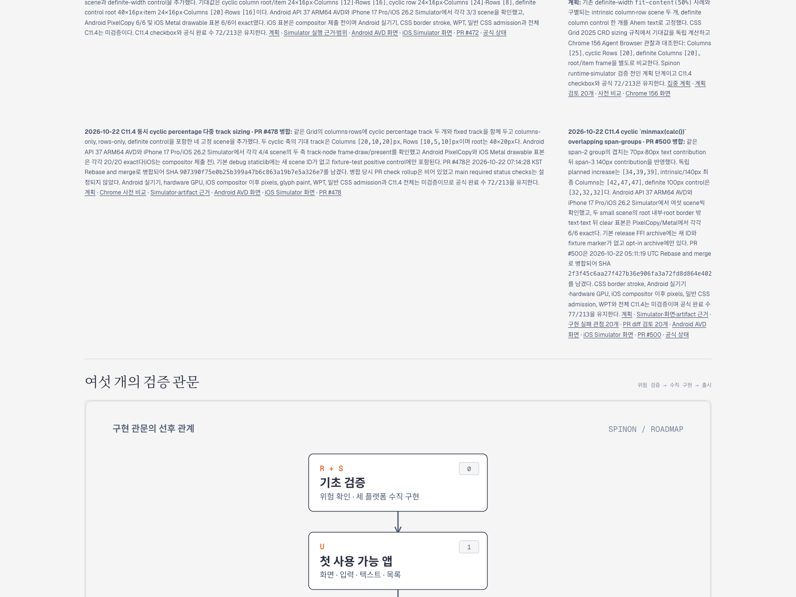
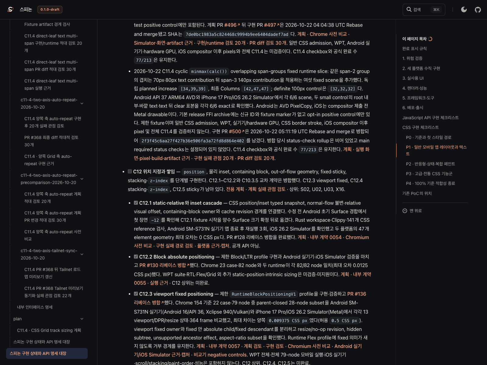
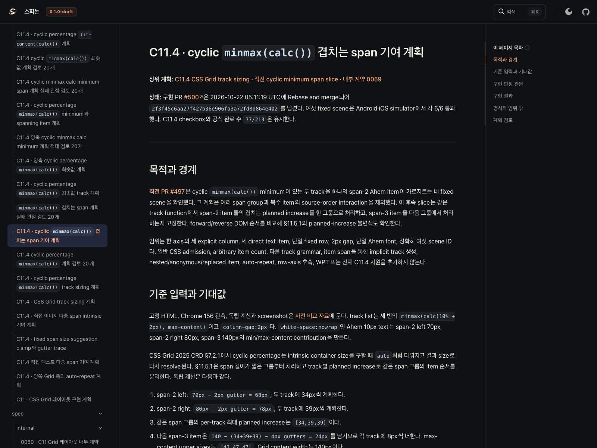

# PR #500 뒤 Tailnet C11.4 로드맵 동기화

- 날짜: 2026-10-22
- 기준 병합: [구현 PR #500](https://github.com/ohah/spinon/pull/500), Rebase and merge, SHA 2f3f45c6aa27f427b36e906fa3a72fd8d864e402
- 미리보기: [Tailnet 로드맵](https://macstudio.tailed42f2.ts.net/spinon/roadmap.html) · [공식 상태](https://macstudio.tailed42f2.ts.net/spinon/STATUS.html) · [C11.4 계획](https://macstudio.tailed42f2.ts.net/spinon/plan/c11-4-cyclic-minmax-calc-overlapping-spans.html) · [실행 근거](https://macstudio.tailed42f2.ts.net/spinon/internal/evidence/c11-4-cyclic-minmax-calc-overlapping-spans-runtime-2026-10-22/README.html)

## 반영 내용과 공식 상태

병합된 PR #500의 overlapping span-groups 실행 결과를 공개 로드맵·공식 상태·집중 계획에 반영했다. 여섯 fixed scene은 Android API 37 ARM64 AVD와 iPhone 17 Pro/iOS 26.2 Simulator에서 각 6/6 통과했다. C11.4 checkbox는 미완료이며 공식 완료 수 77/213을 유지한다. CSS border stroke, Android 실기기/hardware GPU, iOS compositor 이후 pixels, 일반 CSS admission, WPT와 전체 C11.4는 검증 범위에 넣지 않았다. GitHub Pages와 gh-pages는 배포하지 않았다.

## 선택 문서 build · pass26-initial

선택 source는 docs-sync branch의 commit 4e7da7c409db21ad5d55e86442999071062c4c7c, tree a7ba7b7d538d40e4564a2fe1d5c7c7384245bf34다. 입력은 git archive에서 가져오고 pass46 문서 root에 그 뒤로 변경된 tracked C11.4 계획·STATUS·공개 roadmap·내부 인덱스·Grid 계약·11개 C11.4 evidence 디렉터리·고정 HTML fixture만 반영했다. full archive는 23,790개 파일·998,199,217 bytes였고, 실제 RSPress 선택 root는 7,839개 파일·325,513,966 bytes다. 기존 미추적 workspace 파일은 source에 포함하지 않았다.

RSPress 2.0.22 build의 최종 산출물은 4,331개 파일·213,561,054 bytes, tree SHA-256 70d7755a6cbb1518d583450b880a4fe2f15a9e804a451e5ebc3e84891783bbe2다. 첫 build는 기존 Markdown image destination에 상대 경로 접두사 ./가 빠져 Rspack module resolution에서 실패했다. 실제 PNG 두 개는 선택 root에 있었고 링크가 가리키는 파일 누락은 아니었다. preview 전용 normalizer가 선택 root의 네 alias Markdown page 안 이미지 참조 8개에 ./를 붙인 뒤 build가 성공했다. 저장소의 원본 문서에는 이 보정이 없다. [선택 root·archive 요약](./selected-docs-root-pass26-initial.json) · [이미지 경로 보정 기록](./image-normalization-pass26-initial.json) · [첫 build 실패 log](./selected-build-pass26-initial.log) · [성공한 build log](./selected-build-pass26-initial-retry.log) · [route·산출물 요약](./selected-build-summary-pass26-initial.json).

생성된 필수 route에는 roadmap, STATUS와 spec/STATUS, C11.4 plan, 내부 인덱스, 실행 evidence, Android/iOS PNG 및 30개 Tailnet PR review가 포함된다. 전체 문서의 dead-link·image 검사나 전체 CSS conformance는 이 preview build가 판정하지 않는다.

## Tailnet copy · backup · SHA-256

대상은 /Users/yoonhb/Library/Application Support/SpinonPreview, listener는 127.0.0.1:8768의 기존 PID 1191이다. 동기화 전후 listener를 유지했다. 기존 preview 파일은 삭제하지 않았다.

pass26-initial preflight는 4,331개 파일을 create 725, replace 254, same 3,352로 분류했다. 교체 전 파일 254개·40,784,640 bytes를 전용 backup root에 보관했다. 복사 manifest의 target 4,331/4,331 및 backup 254/254가 모두 source/preflight 길이와 SHA-256에 일치했다. 미리보기 서버 HTTP GET 4,331/4,331도 상태 200이며 기대 byte 수와 SHA-256이 모두 일치했다. 불일치는 0이고 no_deletes는 true다. 교체 시점의 target open-handle 관찰은 0건이었다.

- [preflight manifest](./preflight-pass26-initial.json.gz)
- [atomic copy 및 backup manifest](./copy-pass26-initial.json.gz)
- [local target·backup 검증](./local-verification-pass26-initial.json.gz)
- [served HTTP byte·SHA 검증](./served-verification-pass26-initial.json.gz)
- [sync 스크립트](./sync-tailnet-pass26.mjs) · [served verifier](./verify-served-pass26.mjs)

## Agent Browser에서 확인한 화면

터미널 브라우저를 사용하지 않았다. 전용 Agent Browser session으로 Tailnet roadmap, STATUS, 계획과 실행 evidence를 열었다. roadmap에는 PR #500의 merge SHA와 77/213이 표시된다. STATUS parent C11.4 checkbox는 unchecked이고 최신 #500 결과가 기록됐다. 계획은 merge SHA와 두 simulator의 6/6 결과를 표시한다. 실행 evidence 페이지의 Android 이미지가 1080×2400, iOS 이미지가 1206×2622이며 모두 complete=true로 로드됐다.

[roadmap DOM](./roadmap-dom-pass26-initial.json) · [STATUS DOM](./status-dom-pass26-initial.json) · [PR #500 STATUS entry DOM](./status-pr500-dom-pass26-initial.json) · [plan DOM](./plan-dom-pass26-initial.json) · [Android/iOS image DOM](./runtime-images-dom-pass26-initial.json)

## 범위와 재현 도구

이 작업은 사용자가 정한 private Tailnet 미리보기만 갱신한다. 앱을 다시 실행하거나 GitHub Pages를 배포하지 않았다. main의 구현 완료 표시는 변경하지 않고 C11.4를 미완료로 유지했다. 커밋 archive 생성, 선택 root 생성, preview 전용 Rspress 설정, 상대 이미지 경로 보정, target preflight/copy/backup, local 검증 및 HTTP verifier는 이 디렉터리에 있다. PR diff 적대 검토는 서로 다른 30개 실패 관점을 다룬다.
