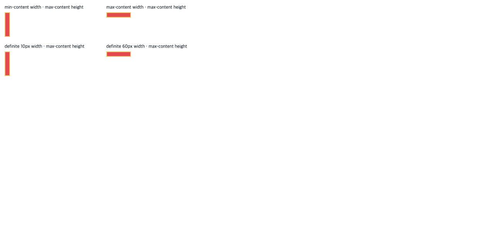
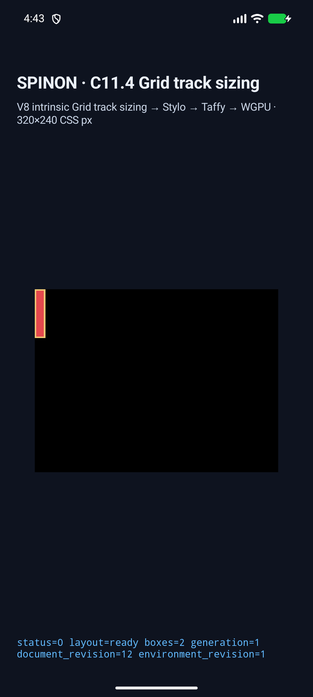
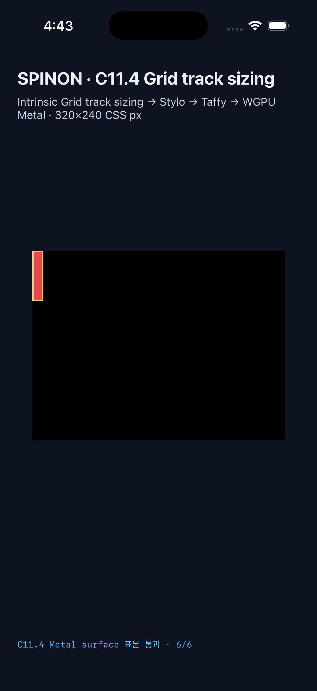

# C11.4 양축 cyclic `minmax(calc())` text wrapping runtime 근거

## 범위와 기준

이 slice는 explicit 2×2 Grid, 한 direct Ahem text item, `minmax(calc(10% + 2px), max-content)` track, 2px gaps와 네 width 입력만 다룬다. 기준은 [CSS Grid Layout Module Level 1, 2025-03-26 CRD §7.2.1·§11.1·§11.5.1](https://www.w3.org/TR/2025/CRD-css-grid-1-20250326/#algo-track-sizing)의 cyclic percentage와 sizing 순서, 고정 Chrome 156 관측이다. 독립 계산과 Chrome 원본은 [사전 비교 자료](../c11-4-cyclic-minmax-calc-two-axis-spanning-text-precomparison-2026-10-22/README.md)에 있다.

Chrome의 네 scene은 예상 columns/rows와 frame에 일치했고, min-content inline width 10px에서 6줄·60px block contribution, max-content 60px에서 1줄·10px contribution을 관찰했다. Definite 10px·60px control은 각 intrinsic scene을 재현한다. 구현 source revision은 `514a2ee73b807fdd2b19d57016adb976dae34d17`이며, 두 simulator manifest 모두 tracked worktree diff가 비어 있다.

## 결과

| 입력 | Columns | Rows | Root border box | Item content box | Ahem 줄 수 기준 |
| --- | --- | --- | --- | --- | ---: |
| cyclic `min-content` | `[4,4]px` | `[29,29]px` | `14×64px` | `10×60px` | 6 |
| cyclic `max-content` | `[29,29]px` | `[4,4]px` | `64×14px` | `60×10px` | 1 |
| definite `10px` | `[4,4]px` | `[29,29]px` | `14×64px` | `10×60px` | 6 |
| definite `60px` | `[29,29]px` | `[4,4]px` | `64×14px` | `60×10px` | 1 |

네 장면 모두 item origin `(2,2)`, intrinsic span `[2]`, Columns 이후 Rows 계산, `drawPresented=true`, superseded retry 0을 기록했다. Android trace는 scene별 10/13 chunks, iOS는 19/20/25 chunks이며 track·frame·contribution 의미값은 예상과 같다.

### Android API 37 ARM64 AVD

- 대상: `emulator-5558`, `sdk_gphone64_arm64`, API 37, `arm64-v8a`, QEMU AVD.
- 최신 run: [`android-avd-c114-cyclic-minmax-calc-two-axis-spanning-text-android-avd-20261022T074336156Z-30579381/`](./android-avd-c114-cyclic-minmax-calc-two-axis-spanning-text-android-avd-20261022T074336156Z-30579381/)
- 네 scene 4/4 통과. PixelCopy는 scene마다 border, item 내부, root 밖, root 하단 경계를 포함해 6점씩 확인했고 총 24/24 표본이 exact다.
- local APK와 설치 APK SHA-256은 `4ceb32b1c04ae49d23cb90957b520578456cb9134409bc5c1d83577e7f1252a6`로 일치한다.

### iPhone 17 Pro / iOS 26.2 Simulator

- 대상: UDID `ACA7BF91-E2D5-4CF7-909A-08D1AD95FF3D`, drawable `960×720`, scale `3×`.
- 최신 run: [`ios-simulator-c114-cyclic-minmax-calc-two-axis-spanning-text-ios-simulator-20261022T074352914Z-9d6794aa/`](./ios-simulator-c114-cyclic-minmax-calc-two-axis-spanning-text-ios-simulator-20261022T074352914Z-9d6794aa/)
- 네 scene 4/4 통과. Metal drawable 표본은 scene마다 6점, 총 24/24 exact이며 compositor submission 이전 readback이다.
- Simulator app SHA-256은 `48acae6d7437840eb27228cc2a2dcb25e240ff6effa9543b92081880146cd1d0`이다.

## 화면

화면은 C11.4 runtime scene과 box geometry를 표시한다. sample 내부는 item 배경색, 경계는 root border 색을 사용한다. 이 fixture 경로의 runtime log는 glyph batch 0을 기록하므로 아래 이미지는 text glyph paint나 줄별 raster를 증명하지 않는다.

## 검증

- `mise exec -- cargo test --locked -p spinon-style-to-layout --features c11-4-grid-track-sizing-fixture-test cyclic_minmax_calc -- --nocapture` — 7 passed.
- `mise exec -- cargo test --locked -p spinon-runtime --features c11-4-grid-track-sizing-fixture-test exposes_only_the_four_two_axis_span_text_scenes -- --nocapture` — 1 passed.
- `mise exec -- cargo test --locked -p spinon-ffi --features c11-grid-metal-surface-pixels-test exposes_only_four_fixed_two_axis_span_text_scenes -- --nocapture` — 1 passed.
- `mise exec -- cargo fmt --all -- --check`, `git diff --check`, `node --check tools/css-reference/capture-c11-4-auto-repeat-neighbors-simulator.mjs` — 통과.
- Android/iOS Simulator build와 네 scene runtime capture — 각각 4/4 통과.
- [fixture artifact boundary](./artifact-boundary/)는 기본 `spinon-ffi` static archive에서 새 scene/error/font marker 부재, opt-in `c11-grid-metal-surface-pixels-test` archive에서 positive control 포함을 확인한다. 이는 static archive 비교이며 최종 앱 번들 크기 검증이 아니다.

## Hashes

| Artifact | SHA-256 |
| --- | --- |
| Android AVD APK | `4ceb32b1c04ae49d23cb90957b520578456cb9134409bc5c1d83577e7f1252a6` |
| iOS Simulator app | `48acae6d7437840eb27228cc2a2dcb25e240ff6effa9543b92081880146cd1d0` |
| Android min-content screenshot | `6be47476455dafb58b83c7ad527b9b874fcbe0fbe30f9f98fd6766e38bd946d3` |
| Android max-content screenshot | `69f65ad2be0b2dd7933cd0cb44b8c4ba92d93a6f0a9ff362b83a928355338876` |
| iOS min-content screenshot | `0e79ac85ba04d9f1afa233b14219381bdaf735f21a043f1c3400049b9512bae0` |
| iOS max-content screenshot | `2e1403070b1e3c820cbf2252db1fcb54d5f5e5893167d5e8df569e423c355326` |
| Chrome Agent Browser baseline | `d33d1af4dad514103f1920c2b5978211060f38309ee8af6a81391b39df92bcfc` |
| Ahem font | `b719ecb31c5b21fc573c03f6421c74ac63c271a5a3ff841e34f9705fb94b8448` |

## 남은 범위

일반 HTML/CSS admission, 임의 track·span·calc 조합, 다른 font/writing mode, anonymous/nested/replaced item, WPT, 실기기, Android hardware GPU, iOS compositor 이후 pixels, glyph raster equality, 전체 C11.4는 검증하지 않았다. 이 근거로 공식 C11.4 checkbox를 완료 처리하지 않으며 `77/213` 집계를 유지한다.

## 적대 검토

- [구현/runtime 실패 관점 20개](./implementation-runtime-review-20.md)
- [구현 PR #506 변경분 실패 관점 20개](./pr-diff-review-20.md)
