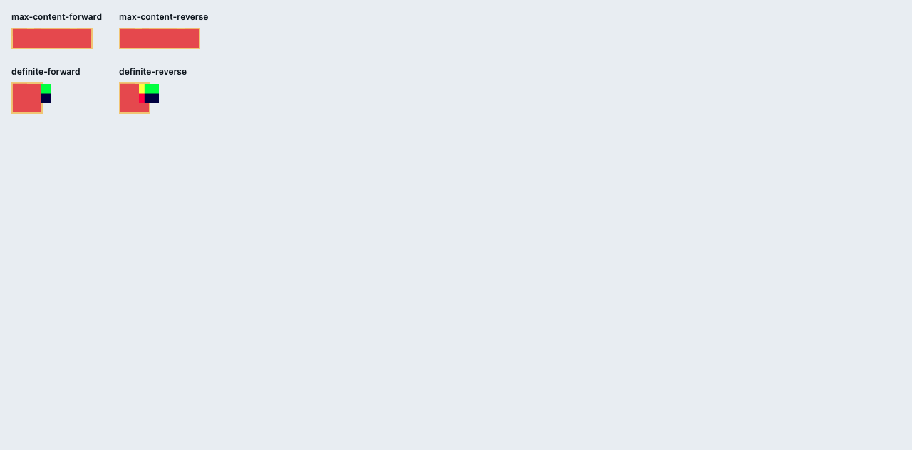

# C11.4 cyclic `minmax(calc())` max-content 혼합 text/image span 사전 비교

## 재현 입력

Chrome 156 Agent Browser에서 [고정 HTML fixture](../../../../tests/fixtures/css/c11/grid-cyclic-minmax-max-content-mixed-text-image-span-c114-precomparison.html)를 열어 네 장면을 비교했다. Viewport는 1280×633 CSS px, DPR 1이다. Ahem 400 10px/10px이 로드됐고 PNG image decode가 끝난 것을 확인했다. Browser 환경은 [browser-environment.json](./browser-environment.json), 전체 CSSOM/frame 관측은 [chrome156-observation.json](./chrome156-observation.json)에 저장했다. 사용한 Agent Browser session은 종료했으며 [종료 후 상태](./agent-browser-session-after-close.json)는 inactive, `pid:null`이다.

- HTML SHA-256: `2cfc58ca7db363371d92801f4e4ded515dd48ec39872486c58a99ac9e7ceaa7d`
- PNG natural size 24×16px; CSS width/min-width 40px, height auto; SHA-256 `5d8c9509a0fec2288f02611a8ccc22a23a90033d1a96b894b439525398bce4a2`
- Ahem SHA-256: `b719ecb31c5b21fc573c03f6421c74ac63c271a5a3ff841e34f9705fb94b8448`
- Screenshot SHA-256: `dc4ffb0e41e4eab344fbf7982d6ffac7446eb03a8e75ae0e4defd984e73ee588`

## 독립 기대값

CSS Grid Layout 2025 CRD §7.2.1에 따라 intrinsic sizing 중 cyclic percentage는 auto처럼 취급하고 계산된 inner size로 나중에 resolve한다. §11.3–§11.5.1의 span 길이 순서와 같은 span group 안의 per-track 최대 planned increase를 적용한다. Column 계산은 기존 text max-content 선행 fixture에서 독립 산출한 값을 따른다. span-2 min-content bases는 `[9,19,19]`; 110px content width와 최종 Columns `[107/3,125/3,86/3]`은 [spec-derived-expectations.json](./spec-derived-expectations.json)에 적었다.

PNG natural ratio 3:2와 CSS width 40px는 image block contribution `80/3px`을 만든다. Max-content 장면에서 image는 두 행을 span한다. 각 row의 2px initial base와 2px gutter를 뺀 뒤 남은 증가량을 반씩 나눠 Rows `[37/3,37/3]`을 얻는다. Intrinsic content size는 `110×80/3px`, 2px 양쪽 border를 포함한 border box는 `114×92/3px`이다. Cyclic row minimum은 `10% × 80/3 + 2 = 14/3px`이며 row base보다 작다.

Definite 40px control의 Columns/Rows는 `[12,12,12]` / `[19,19]`이다. Content는 40×40px, border box는 44×44px이다. Image B는 root-relative x=16px에서 40px 폭으로 그려져 오른쪽 border보다 12px 더 나간다. 유리수 frame 값과 tolerance는 별도 기대값 파일에 두고 Chrome 결과와 섞지 않았다.

## Chrome 관측

| 장면 | Columns | Rows | Border box | A text line | B image | C text line |
| --- | --- | --- | --- | --- | --- | --- |
| max-content 정/역순 | `[35.65625,41.671875,28.671875]` | `[12.328125,12.328125]` | `114×30.65625px` | `[60]` | `40×26.65625px` | `[110]` |
| definite 정/역순 | `[12,12,12]` | `[19,19]` | `44×44px` | `[20,10,10]` | `40×26.65625px`, x=16px | `[20,20,20,20]` |

정방향/역방향은 같은 track 배열과 item identity별 geometry를 냈다. Chrome CSSOM의 fractional 값은 독립 유리수 값에서 1/64 CSS px 안으로 비교한다. definite screenshot에서는 image가 오른쪽 border를 넘어간 모습이 보이지만, 이는 브라우저 oracle 화면이지 모바일 runtime 증거가 아니다.

## 범위

이 자료는 Chrome layout 사전 비교만 기록한다. Runtime 구현, Android API 37 ARM64 AVD, iPhone 17 Pro/iOS 26.2 Simulator, PixelCopy와 compositor 전 Metal 표본은 후속 관문이다. 일반 CSS admission, WPT, hardware GPU, compositor 이후 iOS pixels 또는 C11.4 완료를 주장하지 않는다.
