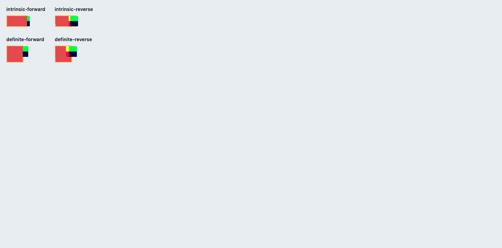

# C11.4 cyclic minmax mixed text/image span 사전 비교

## 재현 입력

Chrome 156 Agent Browser에서 [고정 HTML](../../../../tests/fixtures/css/c11/grid-cyclic-minmax-mixed-text-image-span-c114-precomparison.html)을 열었다. Viewport는 1280×633 CSS px, DPR 1이다. `Ahem.ttf` loaded 및 PNG image decode 완료를 확인했다. Browser와 asset 환경은 [browser-environment.json](./browser-environment.json)에 있다.

- HTML SHA-256: `e54b658f1ee5d0ed390b39b761fd0eeea70048a7a9d7e023c814800034e7b5c3`
- Image natural size: 24×16px; CSS `width`/`min-width` 40px and `height:auto`; SHA-256 `5d8c9509a0fec2288f02611a8ccc22a23a90033d1a96b894b439525398bce4a2`
- Ahem 400 10px/10px SHA-256: `b719ecb31c5b21fc573c03f6421c74ac63c271a5a3ff841e34f9705fb94b8448`
- Chrome screenshot SHA-256: `7573ceea827f9916dfb6f1a0fb0cb385abdf1a9fb7970ead0f33e817e9a28819`

## 독립 기대값

CSS Grid Layout 2025 CRD §7.2.1과 §11.3–§11.5.1에서 직접 계산했다. Span-2 text/image items의 planned increase는 각각 `[7,7,0]`, `[0,17,17]`; 같은 span에서 per-track maximum `[7,17,17]`을 적용하면 initial `[2,2,2]` bases가 `[9,19,19]`가 된다. Span-3 text의 20px min-content는 기존 51px content span보다 작아 더 증가하지 않는다. Intrinsic content width는 51px이다.

Image의 natural 24×16 ratio와 CSS width/min-width 40px는 `80/3px` block contribution을 만든다. Two row bases start at `[2,2]`; 2px gutter를 제외한 image block contribution 증가를 두 track에 나누면 rational Rows `[37/3,37/3]`, content height `80/3px`이다. Definite 40px root의 A/C text는 각각 3/4줄이며 C의 40px block contribution이 Rows `[19,19]`를 결정한다. Full item/frame/line values와 exact tolerance는 [spec-derived-expectations.json](./spec-derived-expectations.json)에 고정했다.

## Chrome 관측

| Scene | Columns | Rows | Border box | A lines | B image frame | C lines |
| --- | --- | --- | --- | --- | --- | --- |
| intrinsic forward/reverse | `[15.671875,15.671875,15.65625]` | `[12.328125,12.328125]` | `55×30.65625px` | `20,30` | `40×26.65625px` | `50,50` |
| definite forward/reverse | `[12,12,12]` | `[19,19]` | `44×44px` | `20,10,10` | `40×26.65625px` | `20,20,20,20` |

전체 CSSOM observation과 node-keyed frames는 [chrome156-observation.json](./chrome156-observation.json)에 있다. Rational image/row values와 CSSOM fractional values는 1/64 CSS px 범위로 비교한다. Browser observation은 규범 기대값에 사용하지 않았다.

## 범위

이는 Chrome layout observation이다. Spinon Runtime, Android/iOS, PixelCopy, Metal drawable, artifact boundary, WPT 또는 일반 CSS admission은 아직 검증하지 않았다. 그 검증은 [집중 계획](../../../../plan/c11-4-cyclic-minmax-mixed-text-image-span.md)의 구현 단계에서 수행한다.
