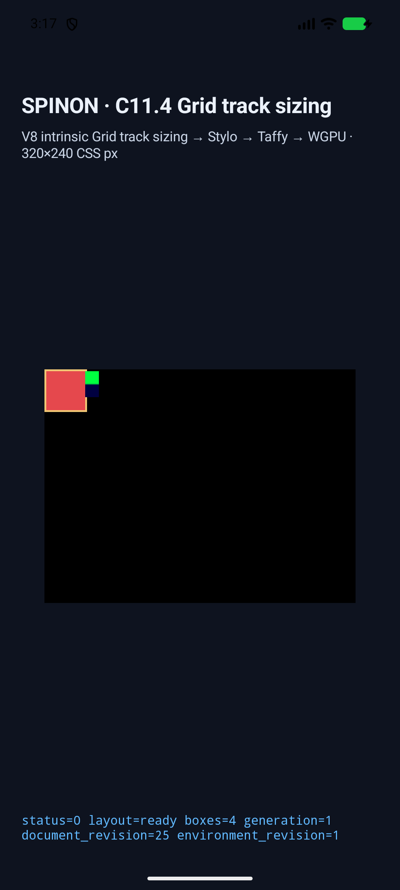
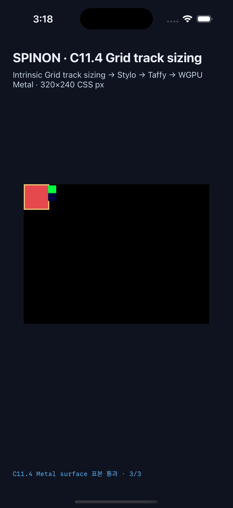

# C11.4 cyclic `minmax(calc())` mixed text/image span runtime slice

이 증거는 `RuntimeBlockFlexGridTrackSizingV1` opt-in fixture 경로의 정확히 네 scene만 다룬다. 3-column × 2-row Grid에서 Ahem text A/C와 replaced image B가 span-2 contribution group에 함께 들어가고, 뒤따르는 text C가 span 3으로 계산된다. intrinsic min-content forward/reverse와 40px definite-width forward/reverse의 source order만 바뀐다. 일반 문서의 임의 text/image Grid admission을 뜻하지 않는다.

## 사전 기준

- [독립 CSS Grid 계산과 Chrome 156 Agent Browser 관측](../c11-4-cyclic-minmax-mixed-text-image-span-precomparison-2026-10-23/README.md)
- [CSS fixture HTML](../../../../tests/fixtures/css/c11/grid-cyclic-minmax-mixed-text-image-span-c114-precomparison.html)
- [독립 기대값 JSON](../c11-4-cyclic-minmax-mixed-text-image-span-precomparison-2026-10-23/spec-derived-expectations.json)
- 네 scene의 Columns·Rows, frame, source-order invariance 및 A/B/C line widths는 independently derived expectation과 Chrome observation을 각각 대조한다. Chrome은 oracle 관측자이며 기대값 생성 기준이 아니다.

## 실행 환경과 결과

| 플랫폼 | 환경 | scene/frame/track/trace/draw | 경계 표본 |
| --- | --- | ---: | ---: |
| Android | API 37 ARM64 AVD `emulator-5558`, `sdk_gphone64_arm64`, Android 17; 설치 APK SHA가 빌드 APK SHA와 일치 | 4/4 | definite forward/reverse 각 3개 PixelCopy, 총 6/6 exact |
| iOS | iPhone 17 Pro, iOS 26.2 Simulator, `ACA7BF91-E2D5-4CF7-909A-08D1AD95FF3D` | 4/4 | definite forward/reverse 각 3개 Metal drawable 표본, 총 6/6 exact |

최종 Android run은 [scene result](android-avd-c114-cyclic-percent-tracks-android-avd-20261022T181721087Z-74c00bba/result.json), [simulator와 APK metadata](android-avd-c114-cyclic-percent-tracks-android-avd-20261022T181721087Z-74c00bba/simulator.json), [PixelCopy/runtime log](android-avd-c114-cyclic-percent-tracks-android-avd-20261022T181721087Z-74c00bba/runtime-definite-minmax-calc-mixed-text-image-span-forward.log), [설치 APK hash 대조](android-avd-c114-cyclic-percent-tracks-android-avd-20261022T181721087Z-74c00bba/installed-apk-verification.json)에 기록했다. iOS는 [scene result](ios-simulator-c114-cyclic-percent-tracks-ios-simulator-20261022T181757837Z-37539e36/result.json), [simulator/app metadata](ios-simulator-c114-cyclic-percent-tracks-ios-simulator-20261022T181757837Z-37539e36/simulator.json), [Metal drawable/runtime log](ios-simulator-c114-cyclic-percent-tracks-ios-simulator-20261022T181757837Z-37539e36/runtime-definite-minmax-calc-mixed-text-image-span-forward.log)에 기록했다.

두 definite scene에서 플랫폼별 표본 세 개는 root 위쪽 edge의 설정 색, root border를 넘어간 이미지 B 내부의 녹색 texel, 이미지 뒤 surface clear 검정이다. forward/reverse 모두 같은 표본 집합을 검사했다. 지정된 한 점은 전체 CSS border stroke의 두께·형태 적합성을 증명하지 않는다. iOS 값은 Metal drawable의 compositor 제출 전 readback이다.

최종 화면:

| Android API 37 AVD | iPhone 17 Pro iOS 26.2 Simulator |
| --- | --- |
|  |  |

앱 로그의 `runtime_text_count=0`과 `glyph_batch_draw_count=0` 때문에 화면에서 보이는 text item의 빨간색 box는 text glyph raster가 아니다. 이 결과는 text wrapping/line metrics와 item geometry를 확인하지만 글리프 픽셀 정확성을 확인하지 않는다. Android 결과는 emulator-only이며 물리 기기나 Android hardware GPU 증거가 아니다. iOS 결과도 compositor 이후 화면이나 scanout 검증이 아니다. WPT·전체 CSS Grid 적합성을 주장하지 않는다.

## Artifact 경계와 검증

- [default / fixture positive-control archive 검사](artifact-boundary.json): 기본 `c04-runtime-gpu` archive는 새 scene 문자열·fixture source marker·runtime source symbol이 없고, fixture-test archive는 모두 포함한다. 정적 archive 검사 결과이며 APK/IPA 최종 bundle 제외를 뜻하지 않는다.
- [기본 artifact build 로그](default-artifact-build.log), [Android build 로그](android-simulator-build.log), [iOS build 로그](ios-simulator-build.log), [runtime capture 요약](android-simulator-capture.log), [iOS capture 요약](ios-simulator-capture.log).
- [source SHA-256 manifest](source-checksums.sha256)은 신규 Rust module/test와 scene source를 만드는 Android·iOS·HTML·capture 도구 파일을 고정한다.
- 첨부된 로그는 `git diff --check`를 위해 줄 끝 공백과 불필요한 마지막 빈 줄만 정리했다. 내용 행은 유지했다.
- 새 fixture focused tests는 style-to-layout 2/2, runtime 1/1, FFI 1/1이며, 기존 C11.4 track-sizing test 25개, runtime fixture test 19개, FFI fixture test 55개도 통과했다. [신규 style-to-layout test](style-to-layout-focused-test-final.log) · [runtime test](runtime-focused-test-rerun.log) · [FFI test](ffi-focused-test-rerun.log) · [style-to-layout C11.4 회귀 25개](style-c114-regression-test.log) · [runtime C11.4 fixture 19개](runtime-c114-regression-test.log) · [FFI C11.4 fixture 55개](ffi-c114-regression-test.log). 별도 Android API 37 AVD와 iOS Simulator에서 기존 mixed text/image multispan의 네 scene도 각각 4/4 통과했다. [Android regression result](../c11-4-cyclic-minmax-mixed-text-image-span-regression-2026-10-23/android-avd-c114-mixed-multispan-contributions-android-avd-20261022T182744679Z-562dc069/result.json) · [iOS regression result](../c11-4-cyclic-minmax-mixed-text-image-span-regression-2026-10-23/ios-simulator-c114-mixed-multispan-contributions-ios-simulator-20261022T182753680Z-56497e30/result.json).
- `cargo fmt --all -- --check`, default workspace Clippy, style-to-layout/runtime/FFI fixture feature Clippy, JavaScript syntax와 fixture module-boundary 검사 및 Swift parse가 통과했다. workspace Clippy가 기존 C11.4 mixed-span test module의 누락된 feature gate를 발견해 추가했고, feature Clippy가 새 assertion helper의 인자 수를 발견해 구조체로 묶은 뒤 파일 책임도 나누고 재검증했다. 첫 실패 로그([workspace](workspace-clippy.log), [feature test helper](style-to-layout-feature-clippy.log))와 수정 후 통과 로그([workspace](workspace-clippy-fix-validation.log), [최종 style-to-layout](style-to-layout-feature-clippy-final.log), [runtime](runtime-feature-clippy.log), [FFI](ffi-feature-clippy.log))를 함께 보관한다. [fixture module-boundary 6/6](fixture-module-boundary.log)도 통과했다.

이 slice는 C11.4 checkbox를 완료하지 않으며 공식 `77/213`, 내부 계약 `0.1.0`을 유지한다.
