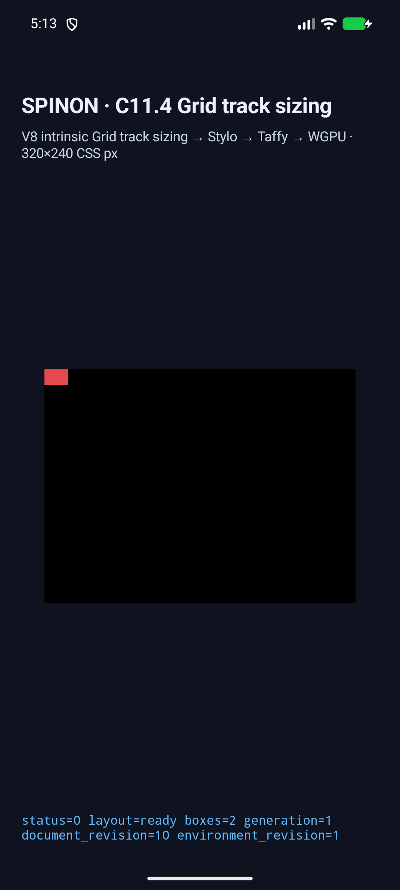
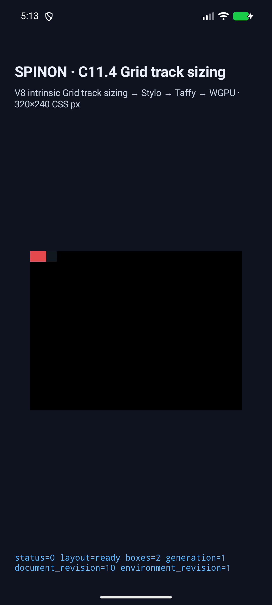
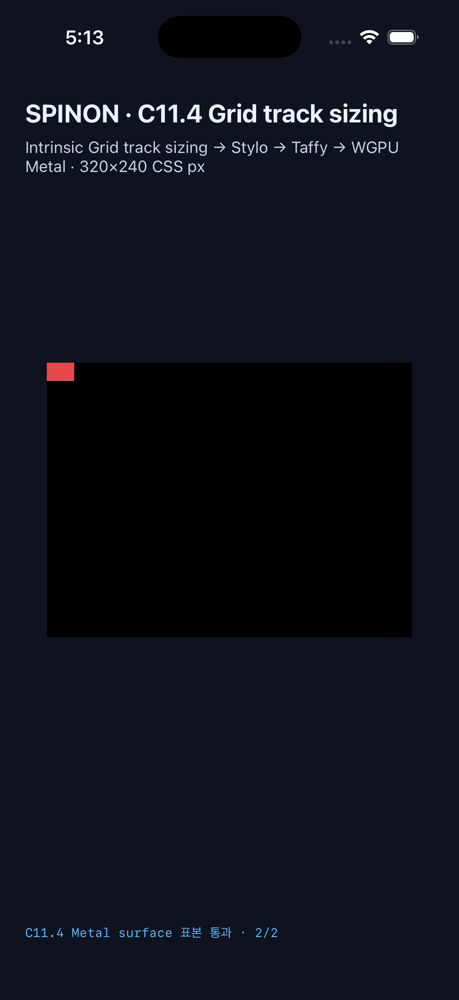
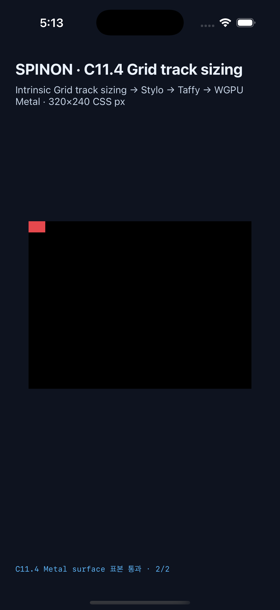

# C11.4 cyclic percentage `minmax()` runtime 근거

2026-10-22에 계획의 세 fixed scene을 기존 opt-in C11.4 CSS→Taffy→native runtime fixture 경로에 연결했다. generic Grid sizing 알고리즘과 일반 CSS admission은 변경하지 않았다. 사전 비교 입력·Chrome 156 관찰·규범 계산은 [계획](../../../plan/c11-4-cyclic-percent-minmax.md)과 [precomparison 근거](../c11-4-cyclic-percent-minmax-precomparison-2026-10-22/README.md)에 있다.

## 독립 기대값과 실제 결과

CSS Grid Layout Module Level 1 2025 CRD §11의 intrinsic container sizing 단계와 final track sizing 단계를 나눠 기대값을 계산했다. 첫 단계에서 cyclic percentage track size는 `auto`처럼 취급하고, intrinsic container size가 정해진 뒤 percentage maximum을 최종 basis에 resolve한다. [계획의 계산 근거](../../../plan/c11-4-cyclic-percent-minmax.md#규범-계산)

| Scene | Root / item frame | Columns / Rows | 표면 표본 |
| --- | --- | --- | --- |
| `cyclic-minmax-column` | `24×16` / `24×16` | `[12]` / `[16]` | x=11, 18에서 red item |
| `cyclic-minmax-row` | `24×16` / `24×16` | `[24]` / `[8]` | y=7, 12에서 red item |
| `definite-minmax-column` | `40×16` / `24×16` | `[20]` / `[16]` | x=19, 22에서 red item |

Android API 37 ARM64 AVD와 iPhone 17 Pro/iOS 26.2 Simulator에서 각각 세 scene 모두 frame, 두 축 track trace, draw/present가 통과했다. Android SurfaceView PixelCopy 표본은 6/6 exact, iOS Metal drawable 표본은 compositor 제출 전에 6/6 exact였다. 두 실행의 [result JSON](./android-avd-c114-cyclic-percent-minmax-android-avd-20261021T201312528Z-6b0532c2/result.json)과 [iOS result JSON](./ios-simulator-c114-cyclic-percent-minmax-ios-simulator-20261021T201321673Z-17e9f201/result.json)을 보존했다.

## 플랫폼 실행과 화면

- Android: `emulator-5558`, Android API 37, ARM64 AVD `sdk_gphone64_arm64`, SwiftShader. local APK와 설치 APK SHA-256은 `8f696038672de21828d08f517cda7bc0c5f850ee1d605e1871f2ebcfb438c8b9`로 일치한다. [시뮬레이터 정보](./android-avd-c114-cyclic-percent-minmax-android-avd-20261021T201312528Z-6b0532c2/simulator.json), [PixelCopy 원문 로그](./android-avd-c114-cyclic-percent-minmax-android-avd-20261021T201312528Z-6b0532c2/runtime-cyclic-minmax-column.log).
- iOS: iPhone 17 Pro Simulator UDID `ACA7BF91-E2D5-4CF7-909A-08D1AD95FF3D`, iOS 26.2. 앱 executable SHA-256은 `2b01efa171a4bd835de8e8e14d1351dfcf3d600b49b1aab1bc2a3a5578ac4996`이다. [시뮬레이터 정보](./ios-simulator-c114-cyclic-percent-minmax-ios-simulator-20261021T201321673Z-17e9f201/simulator.json), [Metal 표본 원문 로그](./ios-simulator-c114-cyclic-percent-minmax-ios-simulator-20261021T201321673Z-17e9f201/runtime-cyclic-minmax-column.log).

대표 scene 캡처:

| 플랫폼 | Column | Row | Definite control |
| --- | --- | --- | --- |
| Android AVD |  |  |  |
| iOS Simulator |  |  |  |

## 빌드와 검사

- Rust focused test `mise exec -- cargo test --locked -p spinon-ffi --features c04-runtime-gpu-fixture-test exposes_cyclic_percentage_track_runtime_scenes`: 1/1 통과 ([로그](./rust-test.log)).
- `mise exec -- cargo fmt --all -- --check`와 fixture feature `mise exec -- cargo clippy --locked -p spinon-ffi --features c04-runtime-gpu-fixture-test --all-targets -- -D warnings` 통과 ([formatter](./rust-fmt.log), [Clippy](./rust-clippy.log)).
- `mise exec -- bun test tools/css-reference/fixture-module-boundary.test.mjs`: 6/6 통과 ([로그](./fixture-module-boundary-test.log)). 캡처 runner의 `node --check`도 통과했다.
- Android fixture APK build와 iOS Simulator fixture app build 모두 성공했다 ([Android](./android-fixture-build.log), [iOS](./ios-fixture-build.log)). Android Gradle은 compile SDK 37.2가 AGP 8.13.2의 검증 범위(36.1)보다 높다는 경고를 냈지만 빌드에 성공했다. iOS link에는 기존 duplicate-symbol/debug-map 경고가 있었고 빌드에 성공했다.
- 기본 `spinon-ffi` release `.rlib`에는 새 module marker와 세 scene ID가 없고, fixture-test positive control에는 module marker·세 scene ID·fixture entry point가 있다. [빌드·byte scan 결과와 SHA-256](./artifact-boundary/README.md). 이는 static archive 경계만 검사하며 최종 APK/IPA release 제외나 크기를 증명하지 않는다.

## 조정한 검증 harness와 한계

첫 Android 캡처에서는 신규 sample ID 여섯 개에 대한 기대 RGB mapping이 빠져 관측된 red pixels가 기본 `-1,-1,-1` 기대값과 달라졌다. Android RGB allowlist에 여섯 ID를 추가하고 APK를 재빌드한 뒤 전체 3-scene matrix를 다시 실행했다. [초기 실패 로그](./android-avd-c114-cyclic-percent-minmax-android-avd-20261021T201246721Z-dbc21322/runtime-cyclic-minmax-column.log)를 삭제하지 않고 같은 디렉터리에 보존했다.

읽기용 `.log`의 줄 끝 공백과 중복 EOF blank line은 정리했다. 변환 전 원문 byte는 대응하는 `.log.raw.gz` 파일에 gzip으로 보존했다.

확인 범위는 opt-in fixed fixture의 두 축 track trace, node frame, draw/present와 지정 surface pixel이다. renderer screenshot의 red item은 실제 CSS border stroke가 아니며 border paint 완료를 주장하지 않는다. Android 실기기, iOS compositor 이후 pixels, hardware GPU, WPT, percentage `minmax()` minimum, `calc()`, `fit-content(%)`, 복수 또는 동시 cyclic axes, nested Grid와 일반 CSS author support는 검증하지 않았다. C11.4 checkbox는 미완료이고 공식 완료 수 `72/213`을 유지한다.

## Source와 artifact 재현

Simulator capture 당시 source base commit은 `4c780be73ede3fa01637028d9e3d7696ca601162`이며 tracked patch SHA-256은 `742d83d4853bd719f30f526f2fe4df129448a952361bfd5cfcb362804a8df247`다. 각 simulator JSON에도 commit, tree, patch hash가 기록되어 있다. 캡처 파일·로그·hash manifest는 [SHA256SUMS](./SHA256SUMS)에 있다.
