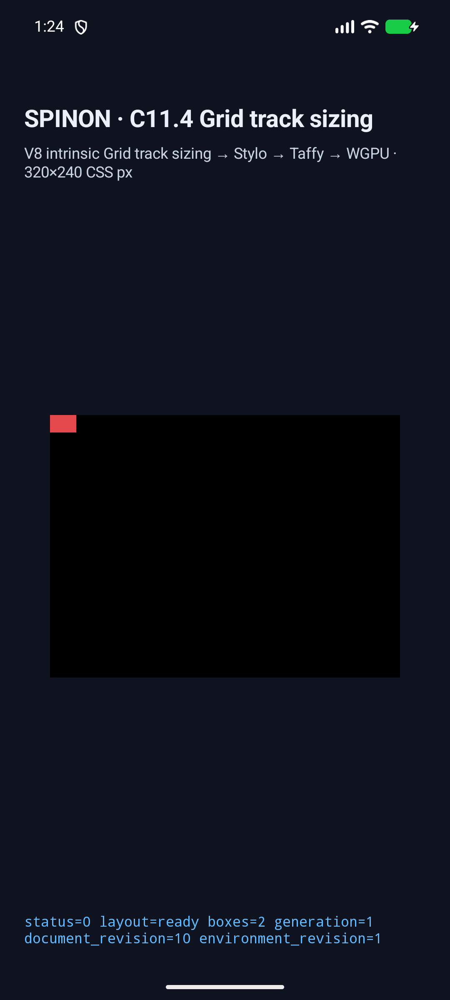
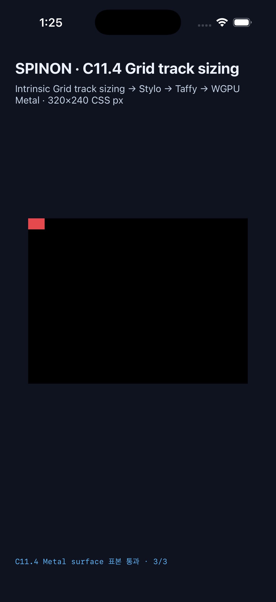
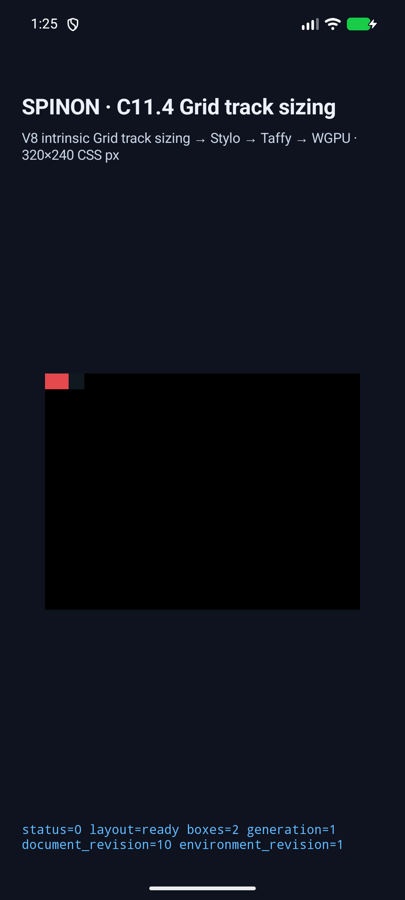
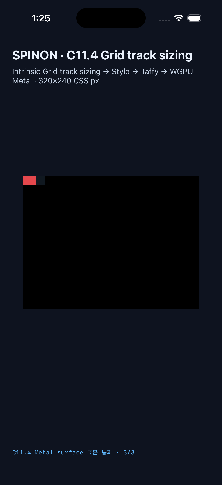

# C11.4 cyclic percentage × auto-repeat runtime evidence

## 고정 revision과 범위

- 구현 revision: `c5b8ef75804e39d36a37aa61b82b1f028115fefd`
- 기준 `origin/main`: `650866e9`
- 날짜: 2026-10-25
- 계약 계획: [`plan/c11-4-cyclic-percentage-auto-repeat.md`](../../../../plan/c11-4-cyclic-percentage-auto-repeat.md)
- 규범 입력·독립 기대와 Chrome 사전 비교: [`precomparison README`](../c11-4-cyclic-percentage-auto-repeat-precomparison-2026-10-25/README.md)
- 이 증거는 고정 fixture 구현과 두 simulator 환경에서 관찰한 결과다. C11.4 전체 지원 완료 증거가 아니다. `spec/STATUS.md`의 C11.4 체크와 공식 완료 수 `72/213`은 갱신하지 않았다.

## 입력과 판정

| Runtime scene ID | 기대 결과 | 실제 결과 |
|---|---|---|
| `cyclic-max-content-auto-fill` | intrinsic max-content pass: count 1, percentage basis 없음, item max-content contribution과 root content width 24px. 이어진 final definite pass: basis 24px, count 2, columns `[12px,12px]`, root 24×16px, item `(0,0) 24×16px`. | 두 phase, count/basis, track list, frame을 Android와 iOS trace에서 모두 확인했다. |
| `definite-40px-auto-fill-control` | final definite pass: basis 40px, count 2, columns `[20px,20px]`, root 40×16px, item `(0,0) 24×16px`. | definite control trace, frame을 Android와 iOS에서 모두 확인했다. |

Browser-only `.boundary` marker는 sizing 입력이 아니다. Runtime tree에는 in-flow 24×16px child 하나만 존재한다. Browser IDs `cyclic` / `definite`는 위 두 runtime scene ID에 대응한다.

## 빌드와 검사

모든 빌드와 runtime 검사는 위 구현 revision에서 수행했다. Runtime fixture 계측과 앱 harness는 다음 opt-in에 한정했다.

- Cargo runtime feature: `c11-4-grid-track-sizing-fixture-test`
- Android/iOS build defines: `SPINON_ENABLE_C04_RUNTIME_GPU=1`, `SPINON_ENABLE_C04_RUNTIME_GPU_FIXTURE_TEST=1`, `SPINON_ENABLE_C11_GRID_METAL_SURFACE_PIXELS_TEST=1`
- V8 source revision: `7b50b62cb18f28617959e8452e2cd18195b38bcf`

| 검증 | 결과 | 원본 로그 |
|---|---|---|
| Runtime grid focused tests | 25 passed, 0 failed | [`runtime-c11-grid-tests.log`](./runtime-c11-grid-tests.log) |
| Runtime fixture feature-off negative control | 1 passed, 0 failed | [`runtime-feature-off-control.log`](./runtime-feature-off-control.log) |
| FFI C11.4 focused tests | 72 passed, 0 failed | [`ffi-c11-4-tests.log`](./ffi-c11-4-tests.log) |
| Runtime Clippy (`-D warnings`) | 통과 | [`runtime-clippy.log`](./runtime-clippy.log) |
| FFI Clippy (`-D warnings`) | 통과 | [`ffi-clippy.log`](./ffi-clippy.log) |
| Android debug APK build | `BUILD SUCCESSFUL` | [`android-build.log`](./android-build.log) |
| iOS Simulator app build | `BUILD SUCCEEDED` | [`ios-build.log`](./ios-build.log) |

Toolchain: Rust `1.96.1`; Xcode `26.2 (17C52)`. Android build used SDK NDK `27.1.12297006`; Gradle emitted the compile SDK 37.2 support warning but completed successfully. Test totals are focused targets, not workspace-wide test totals.

### 앱 build outputs

| Artifact | SHA-256 | Bytes |
|---|---|---:|
| Android debug APK (`platforms/android/app/build/outputs/apk/debug/app-debug.apk`) | `0b09c0207d36236a15551462421559fbe1a6dd9443c1a20a8f4dcae49b6e4401` | 76,608,378 |
| iOS Simulator executable (`SpinonBootstrap.app/SpinonBootstrap`) | `c41558a1c9ae4a6941eeff466120805d27d47b386f1523cae5dc821ccf47a6f6` | 38,688,496 |

These are opt-in **debug fixture-test** app outputs used for simulator runs; they are not release artifacts.

### 기본/positive static archive 경계

정적 archive 검사에서는 기본 feature build에 fixture symbol/string marker가 없고, `c04-runtime-gpu-fixture-test` positive-control build에 cyclic fixture symbol과 payload marker가 있음을 확인했다.

| Build | SHA-256 | Bytes | Marker result | Log |
|---|---|---:|---|---|
| `cargo build --locked --release -p spinon-ffi` | `2369089af5a46cc7ead1009ec807bda36e9359550d6f0babccf7b4a1d4f3f30a` | 60,233,880 | `fixture_markers=absent` | [`archive-default-build.log`](./archive-default-build.log) |
| `cargo build --locked --release -p spinon-ffi --features c04-runtime-gpu-fixture-test` | `479209a7250109b7bad8bb85984069981a94fb30ac6d9c44e5bf06d0d06722a2` | 78,356,464 | cyclic target/control symbols and fixture payload present | [`archive-fixture-build.log`](./archive-fixture-build.log), [`archive-fixture-markers.log`](./archive-fixture-markers.log) |

이 결과는 Rust static `.a` 경계만 확인한다. Android APK 및 iOS 앱의 release/제품 artifact에서 fixture가 제외된다는 근거로 확대하지 않는다.

## Negative control 범위

Focused runtime fixture tests는 fixed-slice 예외가 인접 입력을 허용하지 않는지 확인한다.

- `repeat(auto-fill,minmax(0px,40%))`, `repeat(auto-fill,minmax(10%,50%))`, `repeat(auto-fit,minmax(0px,50%))`, extra in-flow child는 `invalid_grid_track_list`로 거부된다.
- Root `height:7px`, `aspect-ratio:2`, `direction:rtl` 변형은 `invalid_grid_track_list`로 거부되고 `overflow:hidden`은 inline cascade의 `unsupported_inline_property`로 거부된다.
- feature 없는 빌드에서 target 자체도 `invalid_grid_track_list`로 거부된다. 누락/stale trace와 phase label 없는 trace는 별도 trace/report gate에서 실패한다.
- 상세 실행은 [`runtime-c11-grid-tests.log`](./runtime-c11-grid-tests.log), [`runtime-feature-off-control.log`](./runtime-feature-off-control.log), [`ffi-c11-4-tests.log`](./ffi-c11-4-tests.log)에 보존했다.

## Android AVD 결과

Android 픽셀은 API 37 AVD의 software renderer에서 PixelCopy로 읽었다. iOS 픽셀은 아래와 같이 Metal drawable을 OS compositor에 제출하기 전에 읽었다. 이 결과는 hardware GPU 또는 compositor 이후 화면의 pixel 동등성을 증명하지 않는다.

- AVD: `spinon_api37_1_compat16k`, Android 17 / API 37, 1080×2400, density 420
- 최종 serial: `emulator-5570`
- 앱은 위 revision의 Android debug APK에서 실행했다.

| Scene | Run ID | Frame | Trace | PixelCopy |
|---|---|---|---|---|
| cyclic target | `cyclic-android-c5b8ef75` | root 24×16, item 24×16 | intrinsic count 1 / basis null / contribution 24; final count 2 / basis 24 / tracks `[12,12]` | 3/3 sample exact match |
| definite control | `definite-android-c5b8ef75` | root 40×16, item 24×16 | final count 2 / basis 40 / tracks `[20,20]` | 3/3 sample exact match |

- [`android-cyclic.log`](./android-cyclic.log), [`android-cyclic-samples.json`](./android-cyclic-samples.json), [`android-cyclic-samples.base64`](./android-cyclic-samples.base64)
- [`android-definite-control.log`](./android-definite-control.log), [`android-definite-control-samples.json`](./android-definite-control-samples.json), [`android-definite-control-samples.base64`](./android-definite-control-samples.base64)
- Raw PixelCopy images: [`android-cyclic-pixelcopy.png`](./android-cyclic-pixelcopy.png), [`android-definite-control-pixelcopy.png`](./android-definite-control-pixelcopy.png)

## iOS Simulator 결과

- Device: iPhone 17, iOS 26.2, UDID `D6E8EEE5-62C2-4BED-960A-F49F06158B06`
- Viewport 320×240 CSS px, drawable 960×720 at 3× scale
- 앱은 위 revision의 iOS Simulator build에서 실행했다.

| Scene | Run ID | Frame | Trace | Metal surface pixels |
|---|---|---|---|---|
| cyclic target | `cyclic-ios-c5b8ef75` | root 24×16, item 24×16 | intrinsic count 1 / basis null / contribution 24; final count 2 / basis 24 / tracks `[12,12]` | 3/3 sample exact match |
| definite control | `definite-ios-c5b8ef75` | root 40×16, item 24×16 | final count 2 / basis 40 / tracks `[20,20]` | 3/3 sample exact match |

- [`ios-cyclic.log`](./ios-cyclic.log), [`ios-cyclic-samples.json`](./ios-cyclic-samples.json), [`ios-cyclic-samples.base64`](./ios-cyclic-samples.base64)
- [`ios-definite-control.log`](./ios-definite-control.log), [`ios-definite-control-samples.json`](./ios-definite-control-samples.json), [`ios-definite-control-samples.base64`](./ios-definite-control-samples.base64)

## 화면 캡처

아래 캡처는 같은 `c5b8ef7` 앱 build에서 수집했다. Simulator screenshot은 전체 기기 화면이고, frame/pixel acceptance는 위 앱 trace와 native pixel readback 로그가 판정한다.

| Android API 37 AVD | iOS 26.2 Simulator |
|---|---|
| **Cyclic target**  | **Cyclic target**  |
| **Definite control**  | **Definite control**  |

## 독립 검토

- [PR diff 20관점 검토](./pr-diff-review-20.md): 20 PASS / 0 PARTIAL / 0 FAIL.
- [Implementation/runtime 20관점 별도 검토](./implementation-runtime-review-20.md): 초기 19 PASS / 1 PARTIAL, evidence provenance 후속 확인 뒤 최종 20 PASS / 0 PARTIAL / 0 FAIL.

## 정리와 남은 한계

- 검증한 Android AVD `emulator-5570`과 iPhone 17 UDID는 종료했다. 종료 확인 시 `adb devices -l`에 별도 세션인 `emulator-5560`만 남았고, booted iOS device 목록에는 다른 세션 소유 iPhone 17 Pro 두 대만 있었다. 다른 세션은 건드리지 않았다.
- 종료 후 확인한 프로세스 검색에서 `emulator-5570`, 앱, `agent-browser` 프로세스는 없었다. 이 작업에서는 브라우저를 새로 시작하지 않았다.
- 물리 Android 기기에서 검증하지 않았다. CI, PR review/approval, merge는 이 자료의 범위가 아니다.
- 기본 static archive 제외 검증과 debug opt-in 앱 실행을 분리해서 해석한다. Release APK/IPA exclusion은 별도 확인이 필요하다.
- C11.4 공식 완료 checkbox/count는 그대로 둔다. 이 fixed slice만으로 C11.4 전체가 완료되지 않는다.
