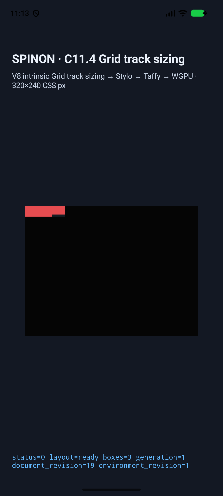
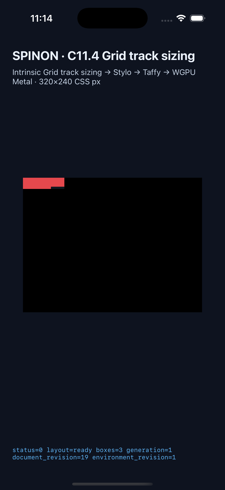

# C11.4 direct text/image intrinsic row-axis runtime slice

## 범위

이 제한 fixture는 Ahem `XX XXXXX` text item과 natural-size PNG ``를 같은 intrinsic row에 놓고, DOM source order를 바꾸어도 row contribution과 frame이 유지되는지 확인한다. 네 scene은 `min-content`/`max-content` row와 forward/reversed child order 조합이다. 전체 CSS Grid, 일반 CSS admission, WPT, 공개 CSS 지원 또는 C11.4 전체 완료를 뜻하지 않는다.

입력과 독립 규범 기대값은 [계획](../../../../plan/c11-4-mixed-direct-text-image-intrinsic-row-axis.md) 및 [Chrome 156 사전 비교](../c11-4-row-axis-mixed-text-image-precomparison-2026-10-25/README.md)에 기록했다. Runtime fixture는 명시적 item self-alignment를 쓰지 않는다. root computed `align-items:start`·`justify-items:normal`과 child `align-self:auto`·`justify-self:auto`를 runtime adapter가 검사한다. Chrome Agent Browser에서도 같은 computed values와 geometry를 확인했다.

## 최종 source와 실행 결과

두 플랫폼 모두 source commit `0af34026039f11c8f354856b34bdef12f8fd7878`, tree `b927942e35b5257a132bea2f326c80d972793172`, 9개 source input aggregate SHA-256 `7e1d93fc5705a633026d401e613f93e7360cf99c0e6dcfdeed518f7f9652b1fb`에서 다시 빌드했다. 각 플랫폼 결과는 독립적으로 4/4다.

| 플랫폼 | 실행 기기 | 결과 | 앱 artifact SHA-256 | manifest |
| --- | --- | ---: | --- | --- |
| Android | API 37 ARM64, 16 KB AVD `emulator-5560` | 4/4 | APK/install `f42340d6e9648a674e99de0f6e841ad3608f1998d662ea8c43e61ff6b941202b` | [android-simulator.json](./runs/c114-direct-mixed-row-axis-android-avd-20261025T021332021Z-d0cb6eb7/android-simulator.json) · SHA-256 `14534c652dbef52bf088e65f43d150b3a37c0a4bdb4acfd85061b66b4267434a` |
| iOS | iPhone 17 Pro / iOS 26.2 Simulator | 4/4 | app `e6fea42023aee30e632b4454b53dfd6d905c37a4be8bd4c3ccb2038e0beeea92` | [ios-simulator.json](./runs/c114-direct-mixed-row-axis-ios-simulator-20261025T021336446Z-00e16757/ios-simulator.json) · SHA-256 `3a786afdc67c851c4c94189d75bea40a58438dd8db0aff8ffda850b8a73ff6fa` |

모든 scene에서 root frame은 `(0,0) 74×20px`, Columns `[50,24]px`, Rows `[20]px`였다. Text item은 `(0,0) 50×20px`, PNG는 `(50,0) 24×16px`이며 reversed scene은 DOM 순서만 바뀐다. 각 stage trace의 gutter는 0이고 row track은 collapse되지 않았다. Android는 scene마다 4 trace chunks, iOS는 scene마다 8/8 chunks를 보존했다. 모두 `status=0 layout=ready boxes=3`과 `status=0 presented boxes=3`을 기록했다.

Ahem text의 inline-axis min/max intrinsic inputs는 `50×20`/`80×10`; 50px column에서 wrapping된 block contribution은 두 row 함수 모두 20px이다. PNG natural size와 block contribution은 `24×16`/16px이다. 따라서 두 track keyword의 기대 row size는 모두 `max(20,16)=20px`다. 이 출력은 두 함수를 서로 구별하지 않는다.

| Scene | Child order | Row item contributions | Root / item frame |
| --- | --- | --- | --- |
| `direct-row-min-content-forward` | text → image | text 20px, image 16px (`MinContent`) | root `74×20`; text `50×20`; image `24×16` |
| `direct-row-min-content-reversed` | image → text | image 16px, text 20px (`MinContent`) | root `74×20`; image `24×16`; text `50×20` |
| `direct-row-max-content-forward` | text → image | text 20px, image 16px (`MaxContent`) | root `74×20`; text `50×20`; image `24×16` |
| `direct-row-max-content-reversed` | image → text | image 16px, text 20px (`MaxContent`) | root `74×20`; image `24×16`; text `50×20` |

## 화면

화면은 box 배치와 `layout=ready` 상태를 확인하기 위한 보조 자료다. 이 캡처는 Ahem glyph raster나 PNG texel 색상 비교, 전체 화면 pixel equality, Android 실기기/hardware GPU 또는 iOS compositor 이후 픽셀을 검증하지 않는다.

네 scene의 PNG, runtime logs, build/install logs와 개별 screenshot/runtime-log hashes는 각 manifest와 run directory에 보존했다.

## 검증과 artifact 경계

- Runtime focused test와 FFI focused test는 각각 1/1 통과했다. 최종 source revision에서 저장한 로그는 [runtime test](./verification/runtime-focused-final-0af.log), [FFI test](./verification/ffi-focused-final-0af.log)다.
- Fixture feature를 켠 runtime/FFI all-target Clippy, `cargo fmt --all -- --check`, `git diff --check`가 통과했다. 로그는 [runtime Clippy](./verification/runtime-clippy-final-0af.log), [FFI Clippy](./verification/ffi-clippy-final-0af.log), [fmt](./verification/fmt-final-0af.log)에 있다.
- [FFI archive boundary](./artifact-boundary/README.md)는 source revision `0af34026`의 product static archive에서 네 scene marker 0/4·fixture ABI 없음, opt-in positive control에서 marker 4/4·fixture ABI 존재를 확인한다. 최종 APK/IPA 전체 fixture exclusion을 뜻하지 않는다.
- Android run 뒤 지정 AVD에서 Spinon PID가 없고 foreground가 Nexus Launcher임을 확인했다. iOS run은 지정 simulator를 Shutdown으로 종료했고, 다른 두 booted simulator는 그대로 뒀다.
- iOS `sourceRevision` 시작/종료 tracked diff hash는 서로 다르지만 9개 source input hash와 aggregate는 빌드 전후 같고 dirty path 목록도 evidence 문서 세 개로 동일하다. 이 차이는 실행 중 문서 증거가 갱신된 provenance이며 앱 소스 변경은 아니다. 상세 값은 iOS manifest에 보존했다.

## 이전 실패 기록

초기 `3ece14e` 실행은 허용되지 않은 author `writing-mode` declaration 때문에 Android/iOS 각각 0/4였다. `a23917c` 재실행은 text item의 명시 `align-self:start`가 projection에서 거부되어 양 플랫폼 0/4였다. 두 실패 run과 raw log는 [runs](./runs/)에 보존했고, 원인 수정 뒤의 최종 `0af34026` 결과와 섞어 계산하지 않는다. 구현 검토는 [implementation-review-20.md](./implementation-review-20.md), 계획 입력 변경 검토는 [revision-review-20](../../../../plan/c11-4-mixed-direct-text-image-intrinsic-row-axis-revision-review-20.md)에 기록했다.

## 공유 trace matcher 후 기존 column 회귀

Row trace 검증을 추가하면서 Android/iOS의 공용 direct mixed text/image matcher도 확장했으므로, 최종 source `0af34026039f11c8f354856b34bdef12f8fd7878`에서 #611의 기존 column 네 장면을 양 플랫폼에 다시 실행했다. 기존 #611 evidence 경로는 수정하지 않았다.

| 플랫폼 | 결과 | 대상 | 실행 근거 |
| --- | ---: | --- | --- |
| Android | 4/4 | API 37 ARM64 16 KB AVD `emulator-5560` | [android-simulator.json](./runs/c114-direct-mixed-column-regression-android-avd-20261025T022319630Z-adc546c2/android-simulator.json) · manifest SHA-256 `5c498e7c66251c9d5ce68939c40148b86cd96613bd9f2d5d2241f18b867926c9` |
| iOS | 4/4 | iPhone 17 Pro / iOS 26.2 Simulator | [ios-simulator.json](./regression/runs/c114-direct-mixed-ios-simulator-20261025T022325437Z-aec18e56/ios-simulator.json) · manifest SHA-256 `fee8440a92a3b389b70e61ef5a8fdb2f13598537e438248a95ddd801b399ffbf` |

두 platform run은 `direct-min-content-forward/reversed`의 columns `[50]`, rows `[24,24]`, root `120×48`, text `50×20`, image `24×16`과 `direct-max-content-forward/reversed`의 columns `[80]`, rows `[24,24]`, root `120×48`, text `80×10`, image `24×16`을 확인했다. DOM reverse 순서, item contribution, stage trace와 `presented boxes=3`도 각각 검사했다. Android 앱 종료 뒤 AVD는 booted 상태·Nexus Launcher로 돌아왔고, iOS 대상 simulator는 `Shutdown` 상태였으며 다른 simulator는 유지했다.

이 회귀는 matcher 공용화로 바뀐 #611 호출 경로가 그대로 동작함을 확인한다. 화면은 layout/box 배치 근거이며 pixel equality, 실기기 또는 hardware GPU 증거로 해석하지 않는다.

C11.4 상위 checkbox와 공식 완료 집계 `72/213`은 미완료 상태로 유지한다.
