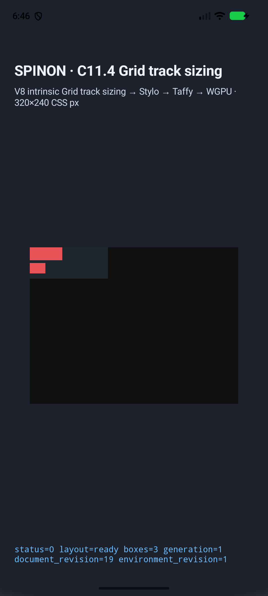
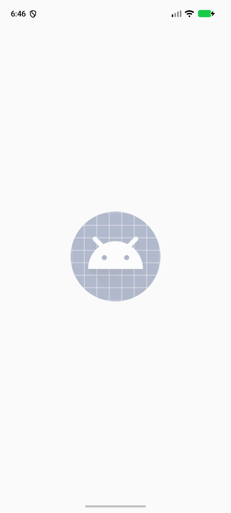
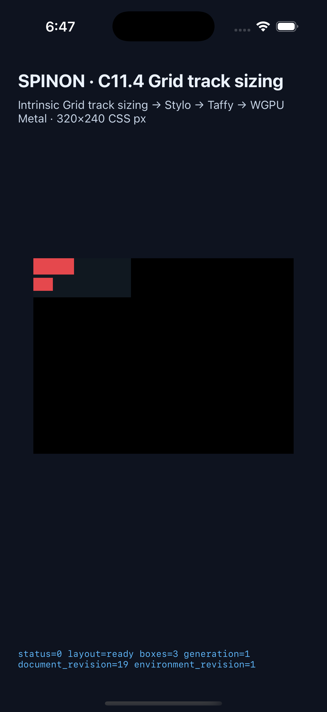
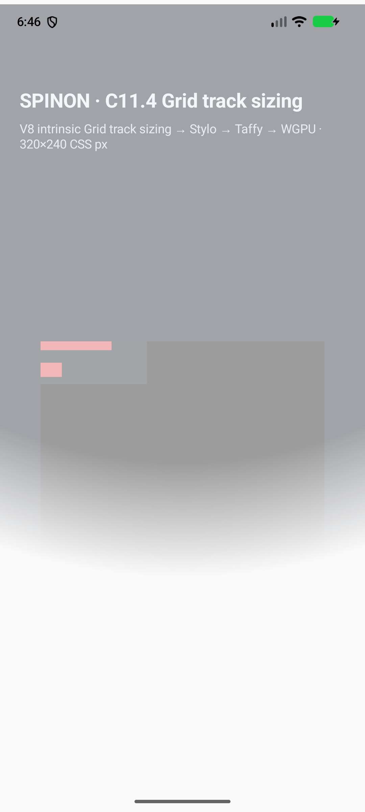
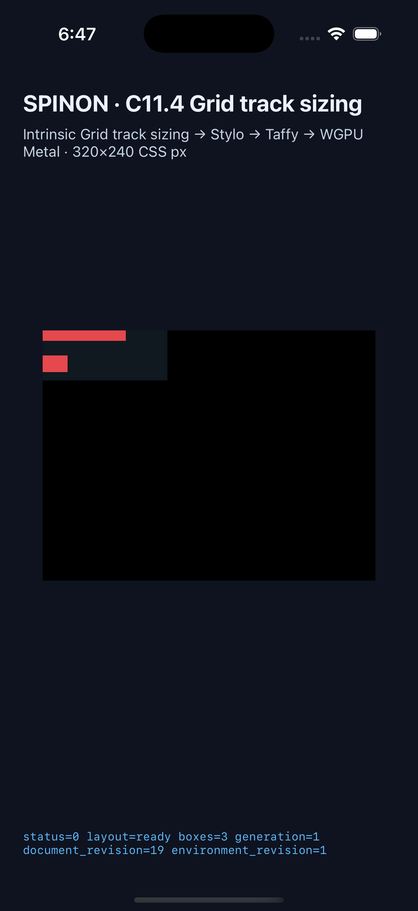

# C11.4 direct text + image non-spanning intrinsic contribution

이 evidence는 `RuntimeBlockFlexGridTrackSizingV1`의 opt-in fixture에 direct Ahem text item과 natural-size PNG item을 함께 둔 네 장면만 기록한다. 일반 author CSS admission이나 전체 C11.4 구현 완료의 근거가 아니다. 공식 C11.4 checkbox와 완료 집계 `72/213`은 유지한다.

## 입력과 독립 기대값

기준은 [CSS Grid Layout Module Level 1, 2025 CRD §7.2.1·§11.5](https://www.w3.org/TR/2025/CRD-css-grid-1-20250326/)와 [구현 전 Chrome 156 비교](../c11-4-mixed-direct-text-image-intrinsic-precomparison-2026-10-25/README.md)다. Chrome 관측은 독립 기대값과 대조하며 기대값을 생성하는 입력으로 쓰지 않았다.

| 장면 | 단일 column track | 직접 item 순서 | 기대 track | 관측 track |
|---|---|---|---:|---:|
| `direct-min-content-forward` | `min-content` | text, image | 50px | 50px |
| `direct-min-content-reversed` | `min-content` | image, text | 50px | 50px |
| `direct-max-content-forward` | `max-content` | text, image | 80px | 80px |
| `direct-max-content-reversed` | `max-content` | image, text | 80px | 80px |

각 scene은 root 120×48px, 두 24px row, 10px Ahem `XX XXXXX`, natural 24×16px PNG와 0 gap/edge를 쓴다. Min-content text contribution은 `5 × 10 = 50px`, max-content는 `8 × 10 = 80px`; image의 contribution은 둘 다 24px다. 따라서 단일 non-spanning track의 item contribution 최댓값은 각각 50px와 80px다. 입력·fixture allowlist·실패 조건은 [focused plan](../../../../plan/c11-4-mixed-direct-text-image-intrinsic.md)에 있다.

## 플랫폼 실행

Android는 page size 16,384 bytes인 API 37 ARM64 `sdk_gphone16k_arm64` AVD (`emulator-5560`, Android 17 fingerprint)에서 실행했다. Android 17 `dumpsys window`에는 이전 `mCurrentFocus` 필드가 없어 매 화면 캡처 직전 `dumpsys activity activities`의 `topResumedActivity`가 Spinon 앱인지 확인한다. 기기 결과는 아니며 연결된 Samsung 실기기는 사용하지 않았다. [이번 실행 manifest](runs/c114-direct-mixed-android-avd-20261024T214623162Z-49f60916/android-simulator.json), [Android app build log](runs/c114-direct-mixed-android-avd-20261024T214623162Z-49f60916/android-build.log), [capture script](capture-direct-mixed.mjs)를 보존한다. 각 capture 실행이 현재 checkout에서 APK를 다시 빌드하며, manifest에는 APK·설치본·빌드 산출물 SHA-256과 빌드 로그 hash가 연결된다.

iOS는 iOS 26.2 / `com.apple.CoreSimulator.SimDeviceType.iPhone-17-Pro` Simulator `Spinon-C114-Cyclic-Image-Span` (`00D4D861-56AA-4552-9181-58D88770EDDA`)에서 실행했다. [이번 실행 manifest](runs/c114-direct-mixed-ios-simulator-20261024T214638568Z-954b507d/ios-simulator.json), [app build log](runs/c114-direct-mixed-ios-simulator-20261024T214638568Z-954b507d/ios-build.log), [OCR verifier](verify-ios-screenshot.swift)를 보존한다. 각 capture 실행이 현재 checkout에서 Simulator app을 다시 빌드하고, manifest의 app binary SHA-256이 해당 build output SHA-256과 같다.

각 성공 manifest는 런타임·앱 호스트·FFI와 신규 untracked generator를 포함한 앱 source 7개 입력 파일의 SHA-256을 기록한다. 캡처 스크립트 SHA-256은 별도 기록하고 빌드 및 실행 종료 시까지 같은지 확인한다. 앱 입력 fingerprint는 빌드 직전·직후·캡처 뒤에 대조하며, Android에서는 APK와 설치본 hash도 대조한다. Build/runtime log는 저장소·사용자 홈 절대경로, 줄 끝 공백과 빈 끝줄을 정규화한 뒤 저장하고 manifest hash는 저장된 내용과 일치한다.

각 실행은 `runs/c114-direct-mixed-<platform>-<timestamp>-<token>/` 아래의 새 디렉터리에 저장한다. 새 실행이 실패해도 기존 실행의 로그·화면·manifest를 바꾸지 않는다. 단일 scene 필터도 별도 run 디렉터리를 사용하고 전체 matrix 근거와 섞지 않는다. 각 성공 manifest observation은 해당 scene runtime log와 screenshot의 SHA-256, screenshot pixel dimensions를 담는다. Android 1080×2400 및 iOS 1206×2622 PNG는 signature, `sips` decode와 선택한 simulator 해상도까지 확인한다. iOS 화면은 Apple Vision OCR로 앱 제목 `SPINON`·`C11.4`·`Grid track sizing`도 확인하고 결과 및 verifier hash를 manifest에 남긴다. 이는 앱 제목이 실제 화면에 보인다는 근거이며 별도 UIKit foreground-state API 관찰이나 system overlay 부재 증거는 아니다.

양 플랫폼은 각각 네 장면의 ordered node frame, used column/row tracks, intrinsic revision 1, complete Grid trace와 성공 draw/present를 확인했다. Android의 JNI와 Java는 성공 draw를 서로 다른 두 로그 행으로 기록한다. 캡처는 JNI의 `status=0 presented boxes=3` 행을 확인하고 Java generation 행은 추가 진단으로 보존한다.

| Scene | Android screenshot | iOS screenshot | 실행 요약 |
|---|---|---|---|
| `direct-min-content-forward` |  |  | column 50px; rows 24px, 24px; draw/present 성공 |
| `direct-min-content-reversed` |  |  | column 50px; rows 24px, 24px; draw/present 성공 |
| `direct-max-content-forward` |  |  | column 80px; rows 24px, 24px; draw/present 성공 |
| `direct-max-content-reversed` |  |  | column 80px; rows 24px, 24px; draw/present 성공 |

요약 JSON은 [Android](runs/c114-direct-mixed-android-avd-20261024T214623162Z-49f60916/android-simulator.json)와 [iOS](runs/c114-direct-mixed-ios-simulator-20261024T214638568Z-954b507d/ios-simulator.json), 장면별 원본 log는 해당 run 폴더의 `android-runtime-direct-*.log` 및 `ios-runtime-direct-*.log`다. Screenshot은 layout 배치를 눈으로 확인하기 위한 것이다. Draw 로그에서 `runtime_text_count=0`, `glyph_batch_draw_count=0`, `runtime_image_count=0`, `image_draw_count=0`이므로 글리프나 PNG texel의 paint를 증명하지 않는다. PixelCopy/Metal pixel equality, Android hardware GPU, 실기기, iOS compositor 이후 표면도 확인하지 않았다.

처음 선택한 API 37.0 AVD에서는 Android Activity/Package 시스템 서비스가 사라져 마지막 draw를 만들지 못했다. 재부팅 뒤에도 복구되지 않았다. 상태와 당시 로그는 [서비스 확인 전](prior-attempts/legacy-top-level/android/android-avd-services-before-reboot.txt), [재부팅 전](prior-attempts/legacy-top-level/android/android-avd-health-before-reboot.log), [재부팅 후](prior-attempts/legacy-top-level/android/android-avd-health-after-adb-reboot.log), 그리고 [API 37.0 시도](prior-attempts/legacy-top-level/android/android-avd-api37-0-pre-recovery/)에 보존했다. 해당 시도는 4/4 통과 수에 포함하지 않으며 API 37.2 ARM64 16 KB AVD의 정상 환경에서 전체 matrix를 다시 통과했다. Android 17에서 더 이상 출력하지 않는 `mCurrentFocus` 필드를 확인해 중단된 새 검증 시도([로그](prior-attempts/capture-before-final-run-provenance/c114-direct-mixed-android-avd-20261024T213724201Z-ac114226/android-runtime-direct-min-content-forward.log))도 별도 run 폴더에 남아 있고 통과 건수에는 포함하지 않는다. 원인은 foreground 부재가 아니라 verifier가 Android 17의 바뀐 `dumpsys` 출력을 가정한 것이었다. `prior-attempts/*`와 `prior-attempts/legacy-top-level/`은 모두 역사적 시도이며 현재 pass 로그가 아니다.

## 별도 검증과 한계

기본/product FFI archive에서 신규 scene marker 및 전용 runtime source symbol이 제외되고 opt-in fixture-test positive control에서 포함되는지 확인한다. 결과는 [artifact boundary](artifact-boundary/README.md)에 기록한다. Scanner 로그·symbol 목록은 run별 하위 디렉터리에 두며 `artifact-boundary.json`은 마지막 성공 scan을 가리킨다. 이후 scan이 실패하면 이전 성공 manifest를 유지하고 새 실패 run은 별도 로그로 남긴다. 이는 FFI archive의 경계만 확인하며 최종 APK/IPA 전체 fixture exclusion을 증명하지 않는다. 구현/runtime의 별도 20관점 검토는 [implementation-review-20.md](implementation-review-20.md)에 있다.

## 재현 가능한 코드 검증

- [runtime focused test log](verification/runtime-focused.log): fixture feature 활성 상태에서 1/1 pass.
- [FFI focused test log](verification/ffi-focused.log): fixture-test feature 활성 상태에서 1/1 pass.
- [fmt check log](verification/fmt.log), [workspace Clippy log](verification/clippy.log), [fixture module boundary 12-test log](verification/fixture-module-boundary.log).
- [capture script Node syntax log](verification/capture-script-syntax.log), [artifact scanner Python syntax log](verification/artifact-scanner-syntax.log).
- [최종 run manifest·source·앱·로그·이미지 hash 무결성 확인](verification/capture-manifest-integrity.log).
- 각 로그 옆 `.exit` 파일은 명령 종료 코드이며, runtime과 FFI 로그에는 실제 1/1 실행 결과가 담겨 있다.

이 slice는 span 1 direct text + replaced image의 `min-content`/`max-content` column 집계와 source-order reversal만 다룬다. 일반 CSS admission, arbitrary/nested/anonymous content, multi-span distribution, intrinsic row sizing, cyclic percentage, WPT, 전체 C11.4 완료로 일반화할 수 없다. 공식 상태는 [STATUS.md](../../../STATUS.md#c11-css-grid)에서 관리한다.
