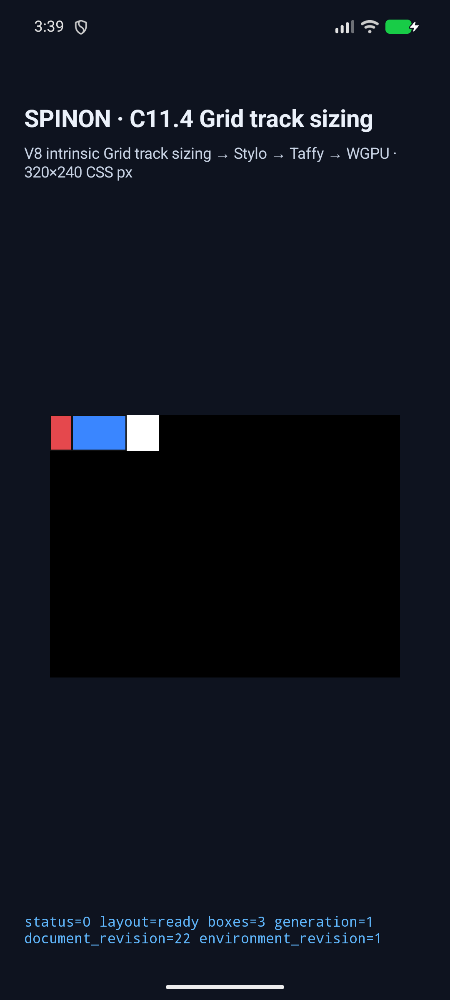
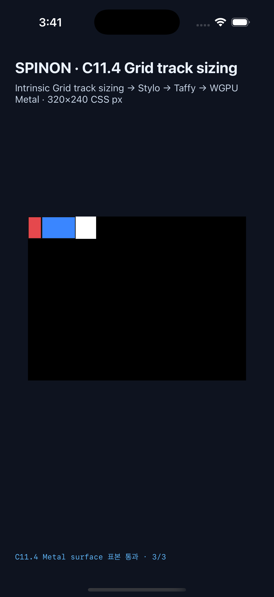

# C11.4 direct-text `auto <ratio>` runtime 근거

## 판정 범위

이 제한 구현 후보는 C11.4 `RuntimeBlockFlexGridTrackSizingV1` fixture-test profile에서 HTML non-replaced direct-text Grid item 하나에 `aspect-ratio: auto <ratio>`의 content-box 기준을 전달한다. 일반 author CSS admission이나 C11.4/C11 전체 완료를 뜻하지 않는다. 공식 완료 수 `72/213`은 유지한다. Chrome 156/Ahem 사전 관측 및 독립 계산은 [precomparison evidence](../c11-4-direct-text-aspect-ratio-auto-precomparison-2026-10-30/README.md)에 있다.

기존 유한 양수 ratio 회귀 16개와 새 `auto <ratio>`·numeric·no-ratio control 7개를 함께 실행했다. 새 장면은 기존 숫자 ratio 동작과 auto ratio의 sizing basis 차이, content-box control, definite row의 overflow를 비교한다.

## 새 장면과 기대값

각 장면은 폭 100px root, `AAAA`/`A` Ahem text, `padding: 2px 4px`, 1px border를 사용한다. Auto row item frame은 Chrome의 1/64 CSS px quantization을 따르며 runtime trace에는 구현의 f32 결과도 기록된다.

| 장면 | 구분 | Chrome 156 관측 |
| --- | --- | --- |
| `grid-text-aspect-ratio-auto-row-auto-3-2-border-box` | border-box item의 `auto 3/2` | row `32.65625px`, columns `[20, 50]px` |
| `grid-text-aspect-ratio-auto-row-numeric-3-2-border-box` | 동일 입력의 numeric `3/2` | row `33.328125px`, columns `[20, 50]px` |
| `grid-text-aspect-ratio-auto-row-no-ratio-border-box` | ratio 없는 control | row `16px`, columns `[20, 50]px` |
| `grid-text-aspect-ratio-auto-row-auto-3-2-content-box` | content-box item의 `auto 3/2` | row `32.65625px`, columns `[20, 50]px` |
| `grid-text-aspect-ratio-row-60-auto-3-2-border-box` | definite 60px row의 auto ratio | columns `[91, 20]px`; root 밖으로 11px overflow |
| `grid-text-aspect-ratio-row-60-numeric-3-2-border-box` | 동일 입력의 numeric `3/2` | columns `[90, 20]px`; root 밖으로 10px overflow |
| `grid-text-aspect-ratio-row-60-no-ratio-border-box` | definite row의 no-ratio control | columns `[50, 20]px`; overflow 없음 |

각 scene은 track/contribution trace, root/item frame, draw/present 및 지정 표면 표본을 확인한다. 두 overflow 장면은 root 안 첫 item edge와 root 바깥 파란 item 표본을 따로 검사한다.

## 시뮬레이터 결과

| 플랫폼 | 환경 | 장면 | 표면 표본 | 실행 영수증 |
| --- | --- | ---: | ---: | --- |
| Android | Android API 37 ARM64 QEMU AVD `sdk_gphone16k_arm64`, software renderer | 23/23 | 72/72 exact | [result.json](../c11-4-direct-text-aspect-ratio-runtime-2026-10-30/android-avd/c114-text-ratio-mvulqeze-ea726d6a/result.json) · [simulator.json](../c11-4-direct-text-aspect-ratio-runtime-2026-10-30/android-avd/c114-text-ratio-mvulqeze-ea726d6a/simulator.json) |
| iOS | iPhone 17 Pro (`iPhone18,1`), iOS 26.2 Simulator | 23/23 | 72/72 exact | [result.json](../c11-4-direct-text-aspect-ratio-runtime-2026-10-30/ios-simulator/c114-text-ratio-mvulryum-c2eacd82/result.json) · [simulator.json](../c11-4-direct-text-aspect-ratio-runtime-2026-10-30/ios-simulator/c114-text-ratio-mvulryum-c2eacd82/simulator.json) |

Android PixelCopy와 iOS Metal drawable readback은 고정 RGBA 표본과 일치했다. iOS 표본은 OS compositor 제출 전이다. Android는 software renderer를 사용했으며 실기기와 hardware GPU는 검사하지 않았다. 두 receipt의 `sourceHead`는 당시 checkout HEAD `74dce30b5be51c1d34dc977b8b64a2fdf08d101d`를 기록한다. 각 receipt의 27개 source hash는 서로 일치하고 현재 파일 bytes와도 일치한다.

### 동작 화면

Android AVD:

iOS Simulator:

## 구현 검증

- iOS Simulator build: `BUILD SUCCEEDED`.
- Android app build: `BUILD SUCCESSFUL`.
- `cargo fmt --all -- --check`: 통과.
- 기본 Clippy: 변경 crate `spinon-style`, `spinon-style-to-layout`, `spinon-runtime`의 `--all-targets -D warnings` 통과.
- C11.4 fixture-feature Clippy: runtime 및 FFI `--all-targets -D warnings` 통과.
- `aspect_ratio_profile` fixture tests 6/6, 23-scene direct-text runtime test 1/1, style ratio tests 2/2, Taffy Grid ratio oracle 6/6 통과.
- FFI release archive 경계: 기본 archive `a1bbbbe5e120ba47aa9e08bb9898a19c9f659052f1e72c6d01968296e8f6e99a`에 신규 route ID 2개와 `c114_generic_direct_text`가 없고, `c04-runtime-gpu-fixture-test,c11-grid-metal-surface-pixels-test` opt-in archive `e153364e9f3d97fa5845e49d3b25dbbe0534091f757fe58fe49639d87f153b31`에는 신규 route ID 2개가 있다. 이는 FFI static archive 결과이며 Release APK/IPA 전체에서 fixture 제외를 증명하지 않는다.

인접 `cargo test -p spinon-style-to-layout c07_3_aspect_ratio_tests`는 4/5 통과했다. 남은 비교는 `ratio-calc-number.aspect-ratio`의 computed string `1.7777778 / 1`과 Chromium 기준 `1.77778 / 1` 사이 차이다. 이 변경은 computed-style serializer를 수정하지 않았다. 차이를 통과로 세지 않고 PR 전 별도 판정 항목으로 남긴다.

## 미지원 범위

일반 CSS author admission, replaced/natural ratio, 여러 ratio owner, wrapping/multiline text, min/max transfer, non-auto dimensions, percentage/calc edges, vertical writing, 전체 WPT, 실기기/hardware GPU, glyph paint, iOS compositor 이후 pixels, 전체 Grid/C11.4 지원은 이 fixture 후보에 포함하지 않는다.
