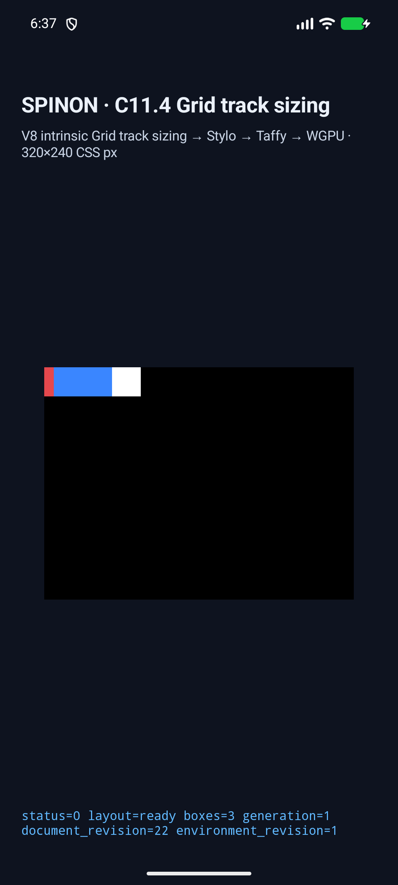
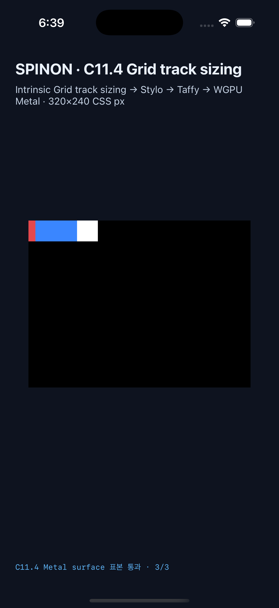

# C11.4 direct-text definite-axis aspect-ratio runtime

**상태:** 제한 fixture 후보. C11.4/C11 완료나 공식 완료 수 승격 근거가 아니다. `spec/STATUS.md`의 C11 checkbox와 `72/213`은 유지한다.

## 범위와 독립 기준

`AAAA` direct-text Grid item의 definite `width:60px` 또는 `height:30px`가 numeric `aspect-ratio:2 / 1`을 통해 반대 축의 intrinsic contribution으로 전달되는 두 장면과, ratio 없는 대응 control 두 장면만 다룬다. 사용자 CSS admission과 공개 API는 추가하지 않았다.

독립 기준은 [Chrome 156 Agent Browser 사전 비교](../c11-4-direct-text-aspect-ratio-axis-transfer-precomparison-2026-10-31/README.md) 및 CSS Grid Layout 2025 CRD §6.2/§6.6이다. 계산된 기대값은 width ratio `(60,30)`, width control `(60,10)`, height ratio `(60,30)`, height control `(40,30)` CSS px이며 각 장면의 text Range 폭은 40px이다.

## 실행 결과

| 대상 | 실행 | 장면 | 표면 표본 | 결과 |
| --- | --- | ---: | ---: | --- |
| Android API 37 ARM64 AVD `emulator-5554` | [결과 JSON](./android-avd/c114-text-ratio-mvvhtfz4-348d5435/result.json) · [전체 캡처 로그](./android-capture-pass06.log) | 55/55 | PixelCopy 177/177 exact | 통과 |
| iPhone 17 Pro / iOS 26.2 Simulator | [결과 JSON](./ios-simulator/c114-text-ratio-mvvhvvfz-4b9929a2/result.json) · [전체 캡처 로그](./ios-capture-pass03.log) | 55/55 | 제출 전 Metal drawable 177/177 exact | 통과 |

신규 네 장면의 Android PixelCopy 표본은 12/12 exact이고, iOS Metal 표본도 12/12 exact다. 각 표면 표본은 scene별 로그에 색상·좌표·revision과 함께 남겼다. 전체 55 장면의 통과 수, 표면 표본, source hash는 결과 JSON과 전체 캡처 로그에 기록했다. PR에는 용량을 제한하기 위해 신규 네 장면의 screenshot과 상세 scene 로그만 포함하며, 기존 회귀 장면의 중복 screenshot은 작업 폴더에 보존하고 PR에는 복제하지 않았다.

첫 iOS 시도는 기존 multispan 장면에서 validator의 Swift `Index out of range`로 종료됐다. 신규 검증 조건이 scene profile 확인 전에 `expectedNodes[1]`을 읽었던 순서 결함이었다. 수정 후 앱을 재빌드하고 전체 55 장면을 다시 실행해 통과했다. 분석은 [크래시 원인 기록](./ios-crash-triage.md)에 남겼다.

## 코드와 검증

- Android 앱 fixture 빌드: [android-build-final4.log](./android-build-final4.log) (`BUILD SUCCESSFUL`)
- iOS Simulator fixture 빌드: [ios-build-final4.log](./ios-build-final4.log) (`BUILD SUCCEEDED`)
- Rust direct-text runtime tests: 4 passed; FFI fixture source test: 1 passed.
- `cargo fmt --all -- --check`, workspace Clippy (`--locked --workspace --all-targets -- -D warnings`), Node capture syntax check, fixture module boundary test 24/24 통과.
- 기본/product release FFI archive와 fixture-test opt-in positive control: [archive boundary](./archive-boundary/README.md).
- 독립 실패 관점 기록: [구현/runtime 20개](./implementation-review-20.md), [PR diff 30개](./pr-diff-review-30.md).

Android는 API 37 ARM64 AVD의 emulator renderer이며 실기기/hardware GPU 결과가 아니다. iOS 표본은 Metal drawable readback이며 compositor 제출 이후의 화면 결과가 아니다. 두 Simulator 결과는 physical device 검증이나 Spinon WPT 적합성을 입증하지 않는다.

실행 로그의 의미 필드와 marker는 보존했다. Git diff 검사를 위해 로그 끝의 불필요한 공백과 초과 빈 줄만 정규화했다.

## 남은 범위

전체 intrinsic Grid track sizing, 일반 CSS declaration admission, 다른 ratio·제약 조합, replaced content, public API, Spinon WPT 적합성, Android 실기기/hardware GPU, iOS compositor 이후 픽셀과 C11 전체는 미완료다. 이번 네 scene은 고정 opt-in fixture profile에만 연결돼 있다.
