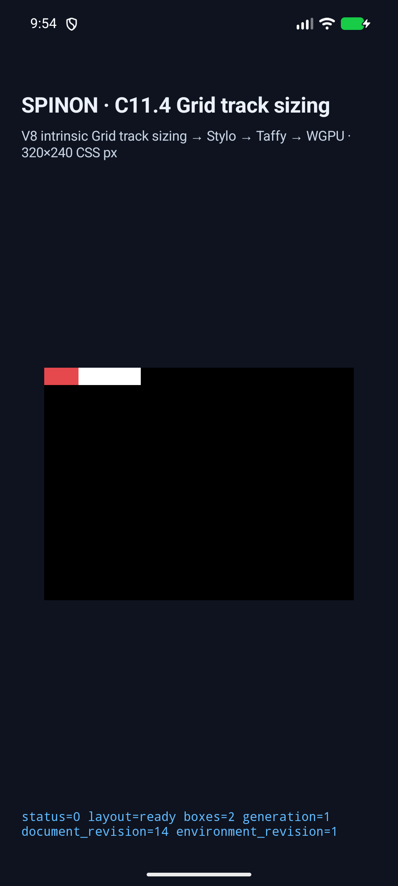
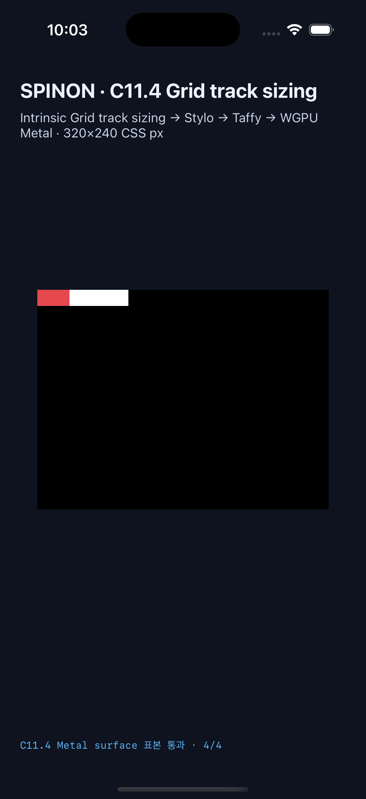

# C11.4 direct-text aspect-ratio two-column span runtime 근거

## 판정 범위

기존 direct-text aspect-ratio/min-max 42개 장면에 한 direct-text item이 두 개의 같은 max-content column을 차지하는 9개 고정 장면을 더했다. Android API 37 ARM64 AVD와 iPhone 17 Pro / iOS 26.2 Simulator에서 최종 성공 실행은 각각 51/51 장면이다. 새 9개 장면의 PixelCopy와 Metal 표본은 각 36/36 정확히 일치했고 전체 행렬은 플랫폼별 165/165였다.

이 결과는 C11.4의 제한된 fixture-test slice다. 일반 author CSS admission, 전체 WPT, 전체 C11.4 또는 C11 완료가 아니다. 공식 C11.4 체크와 전체 완료 집계 72/213은 그대로 미완료다. 내부 계약 0059의 버전은 0.1.0으로 유지한다.

고정 입력, 독립 계산, Chrome 156 관측은 [구현 전 비교](../c11-4-direct-text-aspect-ratio-multispan-precomparison-2026-10-30/README.md)에 있다. 작업 범위와 nine-case geometry는 [집중 계획](../../../../plan/c11-4-direct-text-aspect-ratio-multispan.md)에 있다.

## Simulator 실행

| 플랫폼 | 최종 성공 실행 | 장면 / 표본 | 기기와 읽기 경계 | 설치 artifact |
|---|---|---:|---|---|
| [Android AVD](./android-avd/c114-text-ratio-mvuz29vp-ecca38a3/result.json) | capture pass15, run prefix c114-text-ratio-mvuz29vp-ecca38a3 | 51/51, PixelCopy 165/165; 신규 장면 9개와 표본 36/36 | API 37, ARM64 QEMU, emulator-5554, sdk_gphone16k_arm64, ANGLE/Vulkan/SwiftShader software renderer | local 및 installed APK SHA-256 626ffd6e6c4c90796e9850d885b200bad1359f97af7107cca08ab0516b206c60 일치 |
| [iPhone 17 Pro Simulator](./ios-simulator/c114-text-ratio-mvuzeirh-6322b22d/result.json) | capture pass03, run prefix c114-text-ratio-mvuzeirh-6322b22d | 51/51, Metal drawable 165/165; 신규 장면 9개와 표본 36/36 | iPhone18,1, iOS 26.2, UDID ACA7BF91-E2D5-4CF7-909A-08D1AD95FF3D; compositor 제출 전 readback | local 및 installed executable SHA-256 12cfd3da5a2f9a393cda9b59de54a25362aaf16f1007cb9e4648aec1f59a14f6 일치 |

최종 전체 실행 로그: [Android 51/51](./android-capture-pass15.log), [iOS 51/51](./ios-capture-pass03.log). Android/iOS simulator app builds: [Android pass11](./android-build-pass11.log), [iOS pass06](./ios-build-pass06.log). 두 성공 실행의 source HEAD는 68112a357db019f6d1e53ea7de8a86e20547d6fd다. 두 receipt 뒤 plan의 상태 문단만 검증 완료 상태로 갱신했다. Android pass15 receipt에는 그 plan 변경과 이후 Swift validator 수정 hash가 다르다. Android Java, shared Rust, FFI, expected-values와 capture runner hash는 receipt 및 최종 파일과 일치한다. Swift validator 수정은 iOS pass06 build와 pass03 실행에서 검증했다.

해시를 같은 시점으로 맞추려는 추가 Android capture pass16은 42/51에서 AVD surface 재생성 뒤 첫 신규 장면의 정확한 layout summary까지 만들었으나 draw/pixel callback이 오지 않아 종료됐다. [실패 로그](./android-capture-pass16.log)에 남겼고 runner finally가 Spinon 앱을 force-stop했다. 이는 기존 Android 성공 실행을 대체하지 않는다. pass15의 Android source hash가 현재 Android 구현과 일치하고, 변경된 Swift 검사는 Android에서 실행되지 않는다.

## 신규 장면

열 track과 frame의 독립 기대값은 사전 비교 JSON에 있으며 precomparison verifier가 9/9 geometry, hash와 변형 거부를 확인한다.

| 장면 | 열 | 행 | item frame | direct text overhang |
|---|---:|---:|---:|---:|
| span-baseline | [20, 20] | 20 | 40×20 | 0 |
| span-min-width-45 | [22.5, 22.5] | 22.5 | 45×22.5 | 0 |
| span-min-width-60 | [30, 30] | 30 | 60×30 | 0 |
| span-min-height-30 | [30, 30] | 30 | 60×30 | 0 |
| span-max-width-30-min-width-0 | [15, 15] | 15 | 30×15 | 10 |
| span-max-height-15-auto-min-control | [20, 20] | 15 | 40×15 | 0 |
| span-max-height-15-min-width-0 | [15, 15] | 15 | 30×15 | 10 |
| span-max-height-17-75-range | [17.75, 17.75] | 17.75 | 35.5×17.75 | 4.5 |
| span-no-ratio | [20, 20] | 10 | 40×10 | 0 |

The runtime trace checks each spanned contribution on both columns, row sizing, stage bases/growth limits, final track sizes, direct Text layout and root-relative frames. The `min-width:auto` max-height control keeps the 40px min-content floor; the `min-width:0` counterpart exposes the 30px ratio/max-height result. The 35.5px item stays fractional in expected geometry and pixel coordinate calculation.

## 화면 근거

Android AVD, max-height 17.75px case:

iOS Simulator, same case:

The simulator fixture paints item background and root background, but does not rasterize the Ahem glyph. Images and PixelCopy/Metal samples therefore prove box fill and clear/background samples only. Text width and overflow are proven by Chrome range geometry, runtime paragraph layout, item frame and Grid trace. The sample just beyond the root on Android is the SurfaceView's opaque black clear color. iOS samples are from the Metal drawable before compositor submission.

## 로컬 검사

- cargo fmt --all -- --check 통과.
- Runtime focused test `direct_text_ratio_two_track_span_matches_independent_precomparison`: 1/1 통과.
- Existing and new generic direct-text runtime regression group `generic_direct_text_tests::`: 26/26 통과.
- FFI allowlisted scene route `exposes_exact_direct_text_ratio_multispan_cases`: 1/1 통과.
- Runtime fixture-feature Clippy와 FFI fixture-feature Clippy, 각각 all-targets `-D warnings` 통과.
- `node --check tools/css-reference/capture-c11-4-direct-text-aspect-ratio-simulators.mjs` 통과.
- `node --test tools/css-reference/fixture-module-boundary.test.mjs`: 23/23 통과.
- `node spec/internal/evidence/c11-4-direct-text-aspect-ratio-multispan-precomparison-2026-10-30/verify-precomparison.mjs`: 9/9 geometry와 hash, 변형 거부 통과.
- Default 및 fixture positive-control `spinon-ffi` release static archive 비교: [archive boundary JSON](./archive-boundary.json).
- [구현/runtime 실패 관점 검토 20개](./implementation-runtime-review-20.md).
- [구현 PR diff 실패 관점 검토 30개](./pr-diff-review-30.md).

## 발견한 검증기·AVD 문제와 수정

초기 실행 중 생긴 결과는 성공 결과와 섞지 않았다.

1. Android/iOS validator가 새 장면에 root, item, text의 세 box를 예상했으나 runtime report는 layout box 두 개를 기록했다. 새 profile의 예상 box count를 2로 고쳤다.
2. Simulator의 computed `white-space`는 `Normal`인데 새 validator가 `NoWrap`을 요구했다. expected trace와 native 비교기를 `Normal`로 통일했다.
3. Root 바깥 Android sample은 root의 흰 배경이 아니라 SurfaceView 검정 clear를 읽었다. 표본을 분리해 black clear를 정확히 기대하도록 바꿨다.
4. min-height 0인 row의 `Initialize`/intrinsic stage base는 0이며 최종 height는 `MaximizeTracks`에서 반영됐다. 양 플랫폼 stage matcher가 초기 기여와 최종 track size를 분리하도록 수정했다.
5. 35.5px CSS item의 PixelCopy x좌표가 Android validator의 정수 truncation 때문에 한 pixel 작았다. ceil 기반 sample 좌표를 독립 기대값과 맞췄고 targeted fractional test 4/4 exact를 확인했다.
6. constrained min/max span에서 Android intrinsic measurement list는 definite 측정만 포함할 수 있는데 기존 validator는 네 Min/Max 측정 모두를 요구했다. 해당 profile은 최소 한 측정을 요구하고 contribution input과 trace에서 제약을 검사하도록 고쳤다.
7. iOS scene allowlist와 generic direct-text input count가 fixed profile에 묶여 신규 scene을 거부했다. allowlist를 확장하고 item count를 실제 장면 수와 비교하도록 수정했다.
8. AVD surface replacement는 가끔 새 scene evaluation 뒤 draw callback을 내지 않는다. 기존 pass15 성공 실행과 별도로 pass16에서 42/51 후 timeout한 사례를 보존했다. 실패 결과는 simulator 동작 증거로 사용하지 않았다.

## Fixture 범위와 남은 한계

이 slice는 한 HTML Grid root, Ahem 10px의 direct text `AAAA` 하나, column line 1부터 두 개의 같은 max-content track span, numeric ratio 2/1 또는 no-ratio control, finite fixed 0..=60px min/max subset만 허용한다. Fixture-test feature 바깥의 일반 CSS와 C ABI는 바꾸지 않았다. 기본/positive-control static archive 차이는 JSON 기록에 있으며, 최종 Android APK/iOS app 번들의 fixture 제외를 증명하지 않는다.

다른 span 길이/track topology, unequal/fixed/flexible/fit-content tracks, gap, multiple items, image/replaced content, arbitrary font/script, vertical writing, baseline, glyph raster equality, WPT, 실기기/hardware GPU, iOS compositor 이후 pixel, 일반 CSS admission과 전체 C11.4/C11은 검증하지 않았다. 구현 PR 검토가 끝나고 병합되더라도 C11.4 checkbox 및 공식 완료 72/213은 그대로 둔다.
