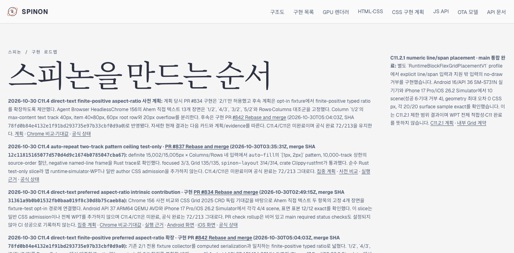
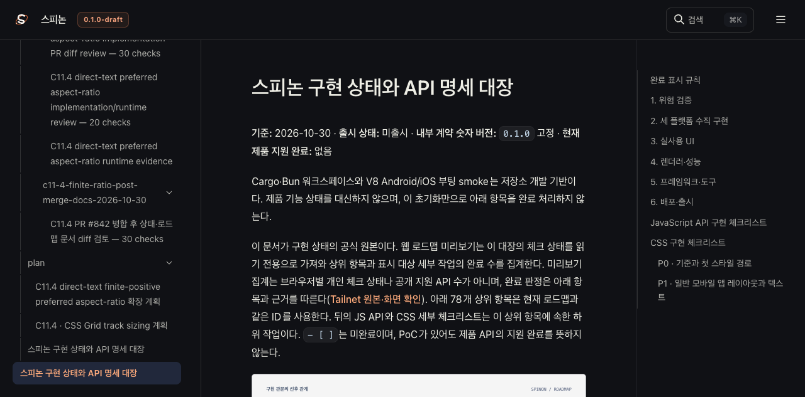
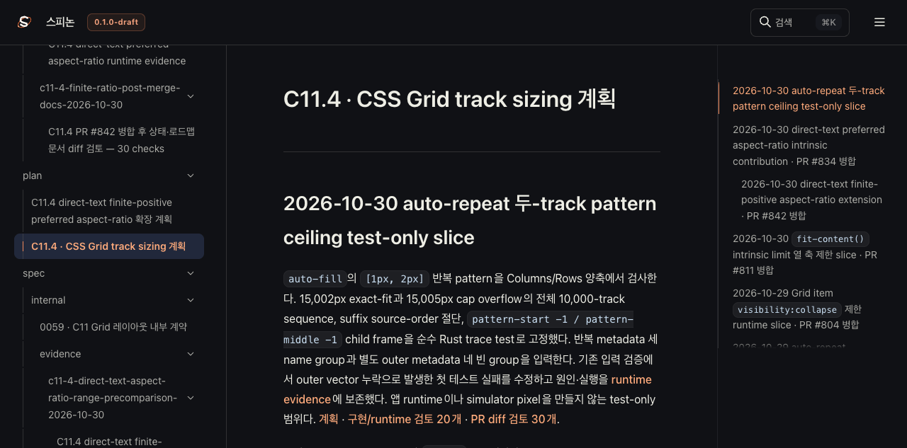

# C11.4 Tailnet 로드맵 동기화

2026-10-30 `origin/main`의 C11.4 유한 양수 preferred aspect-ratio 후보 문서와 실행 근거를 사용자 지정 Tailnet 미리보기의 `/spinon/` 경로에 반영했다. 기준 커밋은 `9a7d04bf21d832672c4c204fb9cceafc29cdb654`(PR #843 병합 후 `main`)이다. 이 동기화는 공식 지원 범위를 바꾸지 않는다. C11 및 C11.4 체크박스는 미완료이며 공식 완료 수는 `72/213`이다.

## 빌드와 선택

- RSPress `2.0.22`로 선택된 문서 루트를 빌드했다. 구성·루트 준비·출판 선택 도구는 이 디렉터리의 `rspress.config.ts`, `prepare-selected-root.mjs`, `select-publication.mjs`에 있다.
- 선택 루트는 356개 파일, 13,960,527 bytes였다. 출판 manifest는 419개 route, 23,047,485 bytes를 기록하며 필수 확인 경로 13개를 포함한다.
- 첫 선택 검증은 HTML에서 링크가 만든 `#842` 표기가 텍스트 `PR #842`와 연속하지 않는 경우를 놓쳐 실패했다. 이 단계에서는 Tailnet 파일을 쓰지 않았다. validator를 실제 HTML 표기 `#842`에 맞추고 새 pass02 빌드/manifest를 만들었다. pass02는 PR·merge SHA·`72/213`·`49/49 exact`·계획의 오래된 상태 문구 부재를 확인한다.
- 빌드 로그는 원본 바이트와 SHA-256 `cd5ab375145ad8f5afbb89d28e30c7c655849d897940aa85a6142dd0319dd8af`를 보존한 [gzip 파일](./tailnet-build-pass02.log.gz)로 저장했다. 압축 해제 후 이 hash와 일치한다. manifest는 [selected-root-pass02.json](./selected-root-pass02.json)과 [selected-publication-pass02.json](./selected-publication-pass02.json)에 있다.

## Tailnet 파일 반영

[sync-tailnet.mjs](./sync-tailnet.mjs)는 현재 `HEAD`와 `origin/main`, 출판 manifest의 SHA-256, 목적지 경로 구성요소와 symlink 부재를 검사한다. 삭제하지 않고, 덮어쓰는 기존 파일은 별도 backup에 바이트 단위로 저장한 후 같은 디렉터리의 임시 파일에서 원자적으로 교체한다. URL 검사에는 사용자 지정 `SPINON_PREVIEW_ORIGIN`만 사용한다. 이 스크립트의 로컬 목적지 경로는 이 Mac의 Application Support에 고정된 일회성 도구이며, 다른 환경에서 그대로 재사용할 수 없다.

- 사전 점검: 새 파일 346개, 교체 18개, 동일 55개, 삭제 0개. 18개 원본의 5,826,707 bytes를 백업했다.
- 복사: 새 파일과 교체 파일 364개 반영, 백업 18개 생성.
- 사후 점검: 로컬 파일 419/419, 백업 18/18, Tailnet HTTPS의 HTTP 200 및 원격 SHA-256 419/419 일치. 원격 redirect 추적을 막는 검사를 보강한 뒤 전체 419 route를 pass02로 재검증했다.
- 사전 점검·복사·사후 점검 상세: [tailnet-preflight-pass01.json](./tailnet-preflight-pass01.json), [tailnet-copy-pass01.json](./tailnet-copy-pass01.json), [첫 사후 점검](./tailnet-verify-pass01.json), [redirect 제한을 추가한 전체 재검증](./tailnet-verify-pass02.json).
- 중간 실패로 복사가 일부만 진행되면 자동 rollback은 없다. 교체 파일은 백업에서 수동 복구할 수 있고 사전 점검 manifest에 이전 hash가 남는다. 이번 실행은 전체 복사와 검증을 마쳤다.
- 미리보기 서버 PID `28040`은 동기화 전후 `tailnet-preview-server.mjs`로 확인했고 `127.0.0.1:8768`의 단일 listener를 유지했다. 서버 프로세스는 재시작하거나 종료하지 않았다. 복사 가드가 요청 중 일시적으로 열린 연결을 listener와 혼동해 처음 중단했지만, 안전 확인을 단일 loopback listener 판정으로 좁힌 후 성공했다. 목적지 파일을 잡고 있는 프로세스 검사는 그대로 유지했다.

## Agent Browser 확인

요청한 Agent Browser로 로드맵·상태 대장·C11.4 계획을 열어 제목과 화면 내용을 확인했다. URL별 화면 캡처는 1280×633이다.

### 구현 로드맵

[DOM 관찰](./tailnet-roadmap-agent-browser-observation.json)은 PR #842, merge SHA `78fd0b84e4132e1f91bd293735e97b33cbf0d9a0`, `72/213`, C11.4/C11 미완료 문구가 렌더링된 텍스트에 있는지 기록한다.

### 공식 상태 대장

### C11.4 계획

[계획 DOM 관찰](./tailnet-plan-agent-browser-observation.json)은 C11.4 제목, `72/213`과 렌더된 이미지 상태를 기록한다.

화면 캡처 후 Agent Browser 세션을 닫았다. `ps`에서 Agent Browser와 HeadlessChrome 프로세스가 남지 않았음을 확인했다.

## 지원 범위 판정

현재 main에는 [구현 PR #842](https://github.com/ohah/spinon/pull/842)와 [문서 상태 PR #843](https://github.com/ohah/spinon/pull/843)이 병합됐다. #842의 제한 후보는 Android API 37 ARM64 QEMU AVD와 iPhone 17 Pro/iOS 26.2 Simulator에서 각 16 scene, surface 표본 49/49 exact를 기록한다. 일반 CSS admission, 전체 WPT/Spinon 적합성, 실기기·hardware GPU 및 iOS compositor 이후 pixel은 포함하지 않는다. 따라서 C11.4와 C11은 미완료이며 공식 집계도 `72/213` 그대로다.
