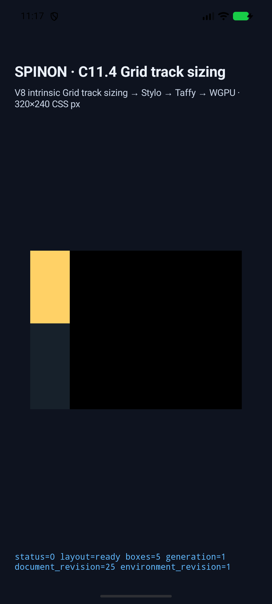
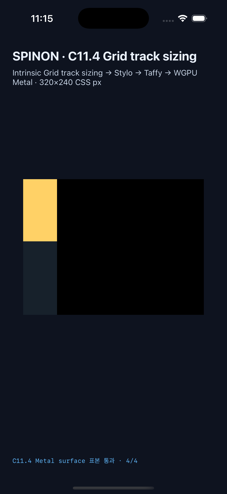
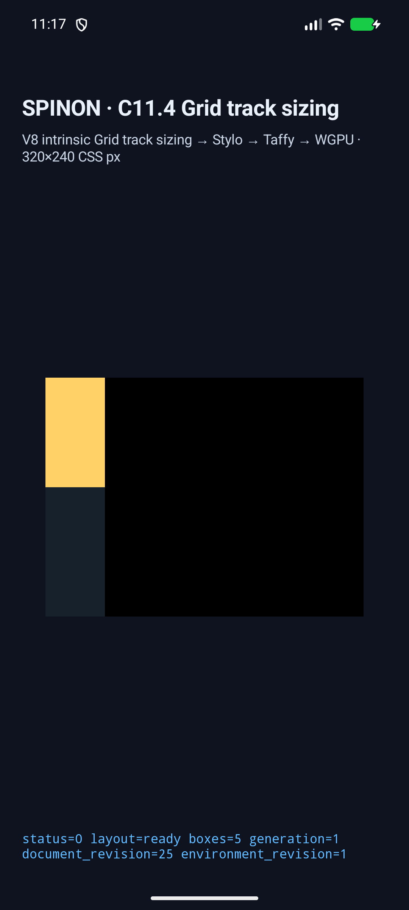

# C11.4 `fit-content()` automatic-minimum floor runtime evidence

## Scope and expected result

This run covers the pinned third assertion in WPT [`fit-content-track-sizing.html`](https://github.com/web-platform-tests/wpt/blob/c999c58338ee1d223df5ad62e48be1202ced0d37/css/css-grid/grid-definition/fit-content-track-sizing.html#L90-L92), revision `c999c58338ee1d223df5ad62e48be1202ced0d37`. Its source hash and upstream Chrome 156 baseline are recorded in the [precomparison](../c11-4-fit-content-auto-min-floor-precomparison-2026-10-28/README.md) and [expected JSON](../c11-4-fit-content-auto-min-floor-precomparison-2026-10-28/expected.json).

CSS Grid 2025 CRD §§6.6, 11.2, and 11.5 give the independent rule: `fit-content(limit)` uses `max(minimum, min(limit, max-content))`; an auto-minimum Grid item can therefore keep a track above its limit. The main scene expects rows `[10,100]px` with a `40px` limit. The differential `min-height:0` control expects `[10,40]px` while its `100px` child overflows the second track by `60px`. The control is not counted as a separate WPT pass.

## Final simulator runs

Both apps were rebuilt with the opt-in fixture flag. The final Android and iOS captures have the same tracked-diff SHA-256 (`0bc90319a50a7e2ee74a7fdfda2ad8b57cff46f0ef11b437cfff61e9f32aace6`) and source-snapshot SHA-256 (`b7fccff443623580b79bdac55a8230a3bc260075a086f2ff5217f6767dc6a8a9`). They use the same five-node source topology and produce the same frames and track trace.

| Platform | Runtime | Main rows / presentation | Zero-control rows / presentation | Surface samples |
| --- | --- | --- | --- | --- |
| Android | API 37 ARM64 AVD `emulator-5554`, `sdk_gphone16k_arm64` | `[10,100]px`, 6 trace chunks, presented | `[10,40]px`, 6 trace chunks, presented | PixelCopy exact: 4/4 and 5/5 |
| iOS | iPhone 17 Pro, iOS 26.2 Simulator | `[10,100]px`, 11 trace chunks, presented | `[10,40]px`, 11 trace chunks, presented | Metal drawable exact before compositor submission: 4/4 and 5/5 |

In both scenes, the root is `[0,0,60,300]px`; items are `[0,0,60,10]px` and `[0,10,60,100]px` (main) / `[0,10,60,40]px` (control); the second child remains `[0,10,60,100]px`. The presentation identity matches the source document, layout, style, environment revisions, and surface generation. Per-sample actual/expected RGBA values, device coordinates, scene reports, app hashes, and simulator metadata are in the run folders:

- [Android AVD final run](./android-avd-c114-fit-content-auto-min-floor-android-avd-20261028T141744382Z-dd733902/)
- [iOS Simulator run](./ios-simulator-c114-fit-content-auto-min-floor-ios-simulator-20261028T141539139Z-d4323722/)
- [Release archive boundary records](./archive-boundary/README.md)

### Main WPT scene

### `min-height:0` differential control

## Debugging and corrections

The first Android capture attempted to launch a newly added scene using the pre-existing APK; the app rejected the unknown scene ID. The capture script installs the existing APK and does not build it. After an explicit opt-in Android build, the next launch reached the runtime but the C11.4 profile rejected the fixture's explicit inline `overflow:visible`. That declaration was removed: visible overflow is the computed default and the pinned WPT input does not author an overflow declaration. The rebuilt Android app then passed both scenes.

The initial iOS build found a Swift local-name collision between the row-size binding and the per-stage expectation array. Renaming the latter to `expectedRowStages` fixed the compile error. The final iOS build and both simulator scenes passed. Android was rebuilt and captured again after this Swift-only correction so both final runs bind to the same source-snapshot hash. The failed attempts are retained in the parent evidence folder and are not used as final pass evidence.

## Validation and limits

- Rust layout oracle: `cargo test -p spinon-layout fit_content_auto_minimum --lib` — 2 passed.
- Runtime adapter: `cargo test -p spinon-runtime --features c11-4-grid-track-sizing-fixture-test c11_4_fit_content_auto_min_floor --lib` — 1 passed.
- FFI fixture route: `cargo test -p spinon-ffi --features c04-runtime-gpu-fixture-test fit_content_auto_min_floor --lib` — 1 passed.
- Fixture module boundary: `node --test tools/css-reference/fixture-module-boundary.test.mjs` — 16 passed.
- Production `c04-runtime-gpu` FFI release archive has zero matching scene IDs, fixture symbols, or fixture source paths; the fixture-test archive contains the scene IDs and symbols. Reproducible command outputs are in [archive-boundary](./archive-boundary/README.md).
- The final Android opt-in app build and iOS opt-in Simulator build succeeded. The Node capture runner passed both scenes on both platforms.

This is a two-scene opt-in runtime fixture, not a Spinon WPT-suite pass or general `fit-content()`/Grid CSS support. Android evidence is from an emulator, not a physical device or hardware GPU. iOS RGBA samples are from the Metal drawable before compositor submission; post-compositor pixels were not measured. The complete C11.4 item and official completion count `72/213` remain unchanged.
