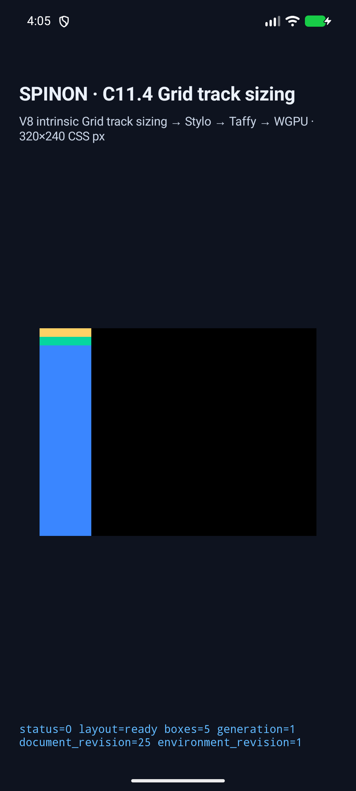
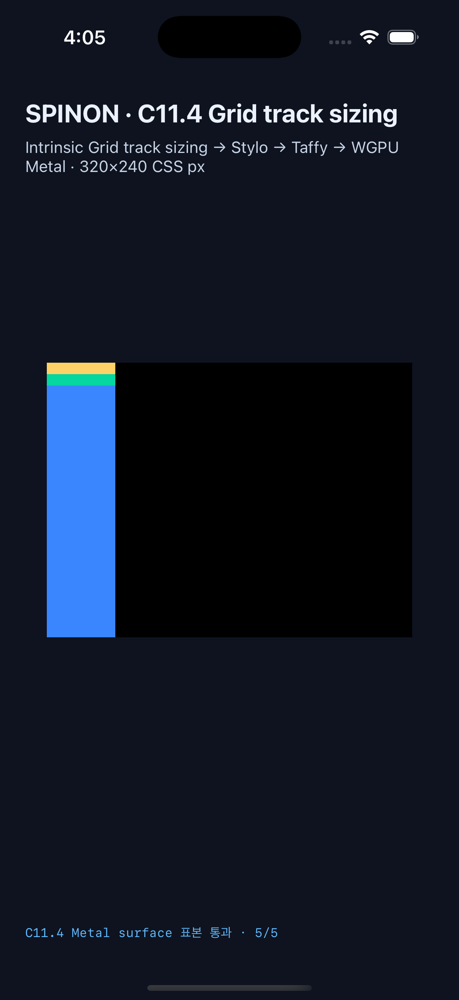

# C11.4 `fit-content()` 옆 `auto` implicit row runtime slice

이 기록은 고정 scene `fit-content-auto-neighbor-wpt` 하나를 기존 opt-in C11.4 앱 경로에서 실행한 근거다. WPT 원본과 독립 기대값은 [계획](../../../../plan/c11-4-fit-content-auto-neighbor-runtime.md), [WPT 대상 계획](../../../../plan/c11-4-fit-content-auto-neighbor-wpt.md), [Chrome 사전 비교](../c11-4-fit-content-auto-neighbor-runtime-precomparison-2026-10-27/README.md)에 고정돼 있다. Chrome 156의 upstream WPT 관찰은 Spinon WPT 적합성 결과가 아니다.

## 기대값과 관찰값

입력은 60×300 CSS px Grid root, `grid-auto-rows: fit-content(40px) auto`, 0 row gap, 두 개의 10px content item이다. `fit-content(40px)` row의 남는 공간을 늘리지 않고 인접 `auto` row만 늘어나야 한다.

| 항목 | 기대값 | Android AVD | iOS Simulator |
|---|---:|---:|---:|
| CSS Rows | `[10, 290]px` | `[10, 290]px` | `[10, 290]px` |
| Root border box | `[0, 0, 60, 300]` | 동일 | 동일 |
| 첫 item / child | `[0,0,60,10]` | 동일 | 동일 |
| 두 번째 item | `[0,10,60,290]` | 동일 | 동일 |
| 두 번째 child | `[0,10,60,10]` | 동일 | 동일 |
| Draw / presentation revision | `1/25/3/0/1` | matched | matched |
| Surface 표본 | 5개 exact | PixelCopy 5/5 | Metal drawable 5/5 |

최종 Android 실행은 API 37 ARM64 AVD `emulator-5554`에서 수행했다. 설치된 base APK와 로컬 APK SHA-256은 `9b37c7480fdb7c590c0e242434f3bf627a24aaa065e5cd1312feeeeee107a7ff`로 같다. iOS 대상은 iPhone 17 Pro / iOS 26.2 Simulator이고 app SHA-256은 `10657b3358b29ce8e69802f3fb12e4d5881be9960bdad1fe9da4dd12617bec20`이다. 양쪽 앱은 fixture-test build이며, iOS Metal readback은 OS compositor 제출 전이다. 최종 Rust·Android·iOS matcher는 Rows trace의 StretchAutoTracks stage가 정확히 하나이고 마지막이어야 통과한다. Rust 회귀 테스트는 trailing-stage 변조를 거부한다. iOS matcher의 duplicate-stage 가드는 pass5 빌드와 pass6 Simulator 실행에 반영했다.

## 화면

Android AVD:

iPhone 17 Pro / iOS 26.2 Simulator:

화면은 시각 자료다. geometry는 runtime `LayoutOutput`의 CSS-pixel frame, track sizing은 단계 trace, 색은 각 플랫폼 surface readback log에서 별도로 확인한다.

## 재현·원본 근거

- Android [result](android-avd-c114-fit-content-auto-neighbor-android-avd-20261026T190540661Z-27b72972/result.json), [runtime log](android-avd-c114-fit-content-auto-neighbor-android-avd-20261026T190540661Z-27b72972/runtime-fit-content-auto-neighbor-wpt.log), [installed APK hash](android-avd-c114-fit-content-auto-neighbor-android-avd-20261026T190540661Z-27b72972/installed-apk-verification.json).
- iOS [result](ios-simulator-c114-fit-content-auto-neighbor-ios-simulator-20261026T190530681Z-85dd0569/result.json), [runtime log](ios-simulator-c114-fit-content-auto-neighbor-ios-simulator-20261026T190530681Z-85dd0569/runtime-fit-content-auto-neighbor-wpt.log).
- Source snapshot hash와 tracked dirty paths(새 fixture module 포함), V8 revision, app/APK 및 installed APK hashes, screenshot hashes는 [source-revision.json](source-revision.json)에 있다. 양쪽 `simulator.json`의 `sourceSnapshotSha256`는 같다.
- 최종 앱의 pass5 build log는 [Android](android-build-pass5.log), [iOS](ios-build-pass5.log)에 있다. 이에 설치한 pass6 Simulator 캡처는 새 체크섬 포함 source snapshot에 묶었다. 두 앱은 fixture-test 경로로 빌드했다. iOS link는 V8 archive의 duplicate debug-map warning을 냈지만 build는 성공했다. 이전 pass4 build log [Android](android-build.log)와 [iOS](ios-build.log)도 보존했다.
- Focused Rust 결과는 [layout oracle](focused-layout-test.log), [runtime fixture 4개](focused-runtime-tests.log), [revision provenance 회귀](focused-revision-provenance-test.log), [FFI route](focused-ffi-test.log)에 있다. 기본 workspace 및 fixture-test feature 검사는 [Clippy](workspace-clippy.log), [Clippy positive-control](fixture-clippy.log)에 있다.
- macOS ARM64 기본/core-only/fixture-test archive 비교는 [artifact-boundary](artifact-boundary/README.md)에 있다. 이는 APK/IPA 전체 fixture 제외 증명이 아니다.
- 구현/runtime 실패 관점 검토 20개는 [implementation review](implementation-review-20.md), PR 변경 실패 관점 검토 30개는 [PR diff review](pr-diff-review-30.md)에 있다.

## 범위

이 slice는 한 고정 scene의 Stylo computed style → typed Grid input → Taffy track trace → LayoutOutput frame → Android/iOS draw/presentation까지 확인한다. Mutation별 전체 양 플랫폼 negative app matrix는 검증하지 않았다. 일반 CSS admission, production root HTML parser parity, Spinon WPT 실행, arbitrary Grid 조합, 실기기·hardware GPU, iOS compositor 이후 pixel, release APK/IPA fixture exclusion은 범위 밖이다. C11.4는 미완료이며 공식 완료 `72/213`과 상태 대장의 checkbox는 유지한다.
