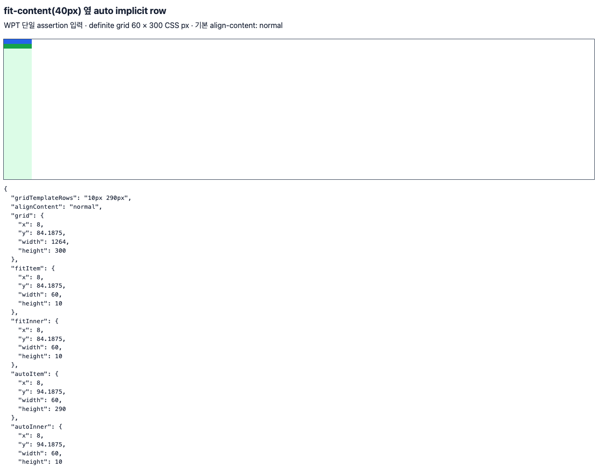

# C11.4 · `fit-content()` 옆 `auto` implicit row 사전 비교

## 범위

이 자료는 `fit-content-track-sizing.html`의 마지막 assertion 하나만 다음 계획에 고정한다. definite block-size가 300px인 Grid에서 implicit row pattern `fit-content(40px) auto`를 사용하고, 각 row의 직접 자식 안에 10px 높이 block을 둔다. 필요한 결과는 row track `[10px, 290px]`이며, 옆의 `auto` row만 남은 공간을 받는다. 계획과 이 사전 관측은 구현이나 Spinon/WPT 적합성 통과를 뜻하지 않는다.

## WPT 입력 고정

- WPT checkout: `/Users/yoonhb/Documents/workspace/spinon/build/wpt-c124-source`
- revision: `c999c58338ee1d223df5ad62e48be1202ced0d37`
- source: [`fit-content-track-sizing.html` at pinned WPT revision](https://github.com/web-platform-tests/wpt/blob/c999c58338ee1d223df5ad62e48be1202ced0d37/css/css-grid/grid-definition/fit-content-track-sizing.html#L130-L132)
- local source SHA-256: `828160951bba50f6ce1c09a69b804480df10d5e622c92a047452f432cb790736`
- selected assertion: source lines 130–132, `autoRowAndFitContentRow`, expected serialization `10px 290px`
- source pin data: `source-pins.json`

다른 assertion은 포함하지 않는다. 직전의 `autoRow`는 `auto` 단독 대조군이며 이 단일 slice의 구현 scope 밖이다.

## CSS Grid 2025 CRD에서 계산한 독립 기대값

규범 기준은 [CSS Grid Layout Module Level 2, 2025 CRD §12.2](https://www.w3.org/TR/2025/CRD-css-grid-2-20250326/#algo-terms), [§12.5](https://www.w3.org/TR/2025/CRD-css-grid-2-20250326/#algo-content), [§12.8](https://www.w3.org/TR/2025/CRD-css-grid-2-20250326/#algo-stretch)다. WPT가 연결한 §12.8은 해당 축의 content-distribution이 `normal` 또는 `stretch`이고 free space가 양수이며 definite일 때, `auto` max track sizing function을 가진 track만 확장한다고 설명한다. §12.2의 track sizing 용어는 `fit-content()`의 max function을 일반 `auto`와 구별하고, §12.5의 fit-content maximum은 max-content growth limit을 argument로 clamp한다.

고정 입력에는 row gap, border, padding이 없다. 첫 row item의 minimum/max-content contribution과 둘째 row의 기여는 각각 nested 10px block에서 10px이다. 따라서 초기 row bases는 `[10, 10]px`다. 첫 fit-content track의 max-content growth limit은 `min(10, 40) = 10px`이고, 그 max function은 §12.8의 `auto` eligibility에 해당하지 않는다. 둘째 `auto` row의 max track sizing function은 `auto`이므로 stretch 단계에서만 대상이 된다.

```text
definite inner block size       = 300px
pre-stretch bases               = 10px + 10px
row gaps / border / padding     = 0px
positive definite free space   = 300 - 10 - 10 = 280px
eligible auto-max tracks       = 1
final used row tracks           = [10px, 10px + 280px] = [10px, 290px]
```

예상 stage는 `StretchAutoTracks { applied: true }`다. stage 직전 bases `[10,10]px`, stage 뒤 bases `[10,290]px`를 요구한다. WPT 원본은 block-level Grid의 inline size를 지정하지 않아 viewport에서 남은 폭을 사용하지만, 이 unit test의 root는 유일한 60px column과 같은 60px 폭으로 고정한다. 이 변화는 열에 자유 공간을 없애고 행 축 입력을 고립한다. 예상 단위 테스트 frame은 root `(0,0,60,300)`, 첫 direct item `(0,0,60,10)`, 둘째 `(0,10,60,290)`이다. 각 nested 10px child는 해당 track 시작점에 남는다. 전체 입력·파생값은 `expected.json`에 구조화했다.

## Chrome 156 사전 관측

Agent Browser CLI `0.31.1`의 전용 세션에서 Headless Chrome `156.0.8078.48`을 사용했다. `navigator.userAgentData`는 macOS `26.5.1`, ARM 64-bit, viewport `1280×1000`, DPR `1`을 보고했다. Chrome legacy `navigator.platform`은 `MacIntel`이며 모델 문자열은 비어 있다. 원시 환경·CSSOM·frame 관측은 `chrome156-observation.raw.json`에 있다. 선택 입력의 최종 screenshot은 다음과 같다.



Agent Browser에서 pinned WPT 원본 파일도 `file://`로 열어 선택된 DOM의 CSSOM/frame을 읽었다. 그 결과 `gridTemplateRows="10px 290px"`, 두 item의 높이는 `10px`, `290px`이었다. 원본 DOM 출력은 `wpt-source-chrome156-observation.raw.json`에 보존했다. 하지만 WPT의 `/resources/testharness.js` 및 `/resources/testharnessreport.js`는 `file:///resources/...`로 해석되어 이 페이지에서 로드되지 않았다. 요청은 `wpt-source-network-requests.raw.txt`에 남겼다. 따라서 이 관측은 브라우저의 선택 DOM CSSOM/frame 기록이며 **testharness 실행이나 WPT PASS가 아니다**. C11.4 계획에서도 Spinon WPT 적합성은 미검증으로 둔다.

## 기존 코드와 제안 테스트 경계

현재 [`grid_stretch_auto_tracks_oracle_tests.rs` at base commit](https://github.com/ohah/spinon/blob/d48d31698842866241dcb3317c6f8ff1ee068d1c/crates/spinon-layout/src/grid_stretch_auto_tracks_oracle_tests.rs)은 `[auto, auto, 5px]` row-stage positive/control과 `align-content:normal`을 다루지만 fit-content track과 implicit auto-row pattern은 포함하지 않는다. `GridContainerInput.auto_rows`의 `TrackList`는 `TrackSizing` profile에서 fit-content/auto sequence를 표현할 수 있다. 현 adapter는 [`grid_auto_placement/track_sizing.rs` at base commit](https://github.com/ohah/spinon/blob/d48d31698842866241dcb3317c6f8ff1ee068d1c/crates/spinon-layout/src/grid_auto_placement/track_sizing.rs)에서 positive implicit tracks를 `tracks::expand_tracks`로 만든다. 현재 [auto-track sizing tests](https://github.com/ohah/spinon/blob/d48d31698842866241dcb3317c6f8ff1ee068d1c/crates/spinon-layout/src/grid_auto_track_sizing_tests.rs)에는 fixed `TrackList` pattern 순서 control이 있지만 fit-content 뒤 auto row의 stretch stage는 없다. 제안하는 새 pure Rust test 경로는 `crates/spinon-layout/src/grid_fit_content_auto_neighbor_oracle_tests.rs`다. `crates/spinon-layout/src/lib.rs`에는 해당 파일의 `#[cfg(test)] mod` 등록 한 줄만 추가한다. 기존 stretch oracle 파일은 수정하지 않는다.

새 입력은 explicit row 목록을 비워 두고 `auto_rows=TrackList([FitContent(40px), Auto])`를 사용해 두 실제 implicit row를 만든다. Root는 60px columns, 60px width, definite height 300px, `align-content:normal`, zero gaps/padding/border다. 각 direct grid item은 auto height이며 내부 child만 10px fixed height라서 content contribution과 stretch된 item frame을 구분한다. 이 변경은 stage trace와 frames를 pure Rust에서 검사할 계획이며 C11.4 지원 범위를 넓히지 않는다.

## 해시와 범위

- `precomparison.html` SHA-256: 아래 `SHA256SUMS` 참조
- screenshot SHA-256: 아래 `SHA256SUMS` 참조
- WPT upstream file은 이 저장소 안으로 복사·수정하지 않았다. hash는 pinned read-only checkout 파일을 직접 계산했다.
- 새 계획·evidence의 로컬 링크와 고정 WPT source hash를 확인한다. 전체 저장소 `mise exec -- bun run docs:build`는 RSPress `2.0.22`에서 exit 1이며, 선택하지 않은 기존 evidence 페이지들의 905 dead-link 진단으로 끝났다. 새 precomparison README에는 별도 dead-link 진단이 없었다. 상세는 `docs-build-summary.json`에 기록한다. 이는 전체 문서 링크 또는 build 통과가 아니다.
- Android/iOS, runtime fixture, product style admission, full WPT runner, browser matrix, native paint는 범위 밖이다.
- 공식 C11.4 상태와 완료 집계 `72/213`은 바꾸지 않는다.
