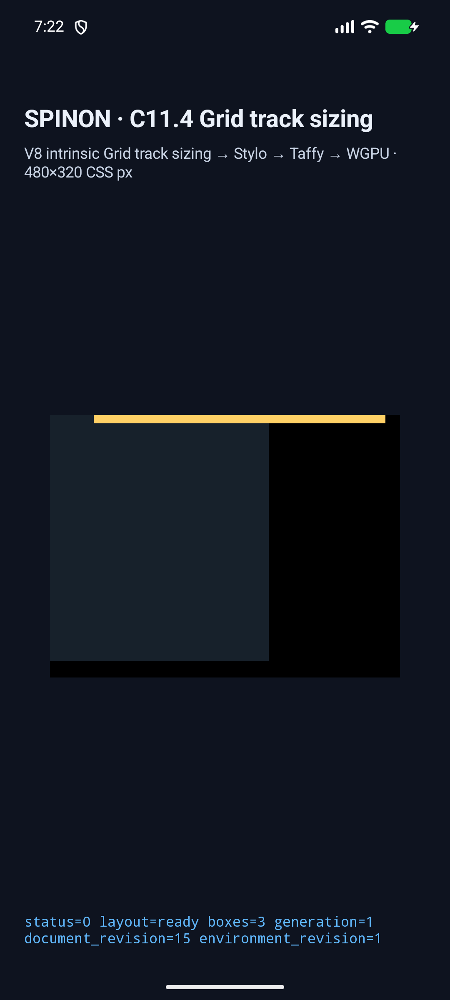
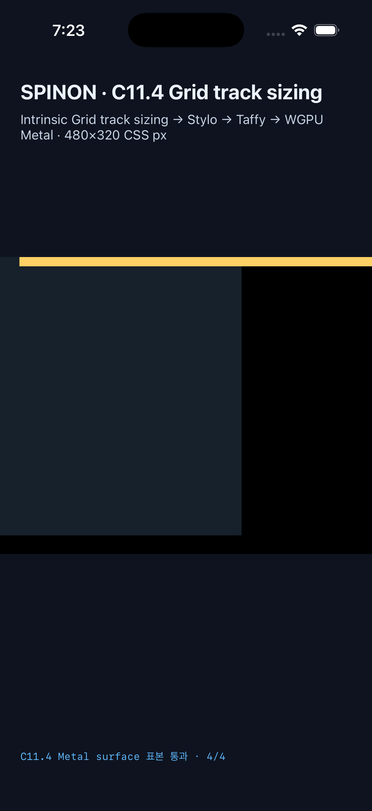

# C11.4 pinned WPT `fit-content()` implicit column runtime

이 근거는 pinned WPT [`fit-content-track-sizing.html`](https://github.com/web-platform-tests/wpt/blob/c999c58338ee1d223df5ad62e48be1202ced0d37/css/css-grid/grid-definition/fit-content-track-sizing.html)의 `fit-content()` implicit-column computed-value assertion 하나를 고정한 opt-in fixture-test slice다. Pinned source revision은 `c999c58338ee1d223df5ad62e48be1202ced0d37`, SHA-256은 `828160951bba50f6ce1c09a69b804480df10d5e622c92a047452f432cb790736`다. Chrome 156 Agent Browser에서 upstream WPT harness 13/13을 확인했지만, 이는 Spinon WPT runner의 결과가 아니다. 독립 규범 계산과 Chrome 관측은 [사전 비교](../c11-4-fit-content-implicit-column-precomparison-2026-10-29/README.md)에 있고, 구현은 [PR #775](https://github.com/ohah/spinon/pull/775)에서 검토 중이다.

## 고정 입력과 판정

- Root: `300×300px` Grid, explicit column `60px`, `grid-auto-columns:fit-content(40px)`, implicit row `fit-content(40px)`, gap 0.
- Item: column line 2, `min-width:0`; child: `400×10px`.
- 최종 기대 track: columns `[60,40]px`, rows `[10]px`. Root frame은 `(0,0,300,300)`, item은 `(60,0,40,10)`, child는 `(60,0,400,10)` CSS px다.
- Child는 item보다 360px, Grid root보다 160px 가로로 더 나간다. 표면 표본은 root 밖 x=350px의 child와 viewport clear인 x=470px을 포함한다.
- Columns trace의 item contribution은 `Minimum=0px` (`SpecifiedMinimum`), `MinContent=400px`, `MaxContent=400px`다. 최종 column base는 `60px`와 `40px`다. Rows는 `Minimum=10px` (`AutomaticMinimum`), `MinContent=10px`, `MaxContent=10px`, final base `10px`이다.
- Stage 배열과 `StretchAutoTracks { applied }` 값은 Taffy 전용 회귀 기대값이지 규범 또는 Chrome의 단계별 oracle가 아니다. `applied`는 축 정렬이 trace 단계를 활성화했는지를 나타낸다. Columns는 `false`, Rows는 `true`를 기록하지만 row base는 `10px` 그대로다. `fit-content(40px)`의 max sizing function은 `auto`가 아니다.

## Android API 37 ARM64 emulator

`emulator-5554` (`sdk_gphone16k_arm64`, API 37, `arm64-v8a`)에서 scene `fit-content-implicit-column-wpt` 한 번을 실행했다. Strict environment와 presentation identity는 `300×300 / 480×320 CSS px`, node 3개와 같은 document/render-tree revision을 확인했다. PixelCopy의 RGBA 표본 4개가 정확히 일치했고, root 밖 child도 포함했다.

- Run ID: `c114-implicit-col-android-20261029k`
- APK SHA-256: `8cc35372ddb0c5ed7b1966c0f4a139912a17d9d27d4d37743b79aa9d08524ad2`
- PixelCopy PNG SHA-256: `2bb8d4fdc9cd091e74cb993d328507f0f11f0cab317a8bbda9652b1c557dae7b`
- 화면 캡처 SHA-256: `4006e5f96ba09f9d640348610f1927fbb158a5b7d106f99ffd590ca306a0009a`
- [Android runtime log](./android/logcat-final.log) · [PixelCopy](./android/pixelcopy-final.png) · [화면](./android/screenshot-final.png) · [빌드](./android/build-final.log)

## iPhone 17 Pro iOS 26.2 Simulator

전용 simulator `Spinon-C114-Cyclic-Image-Span`에서 같은 scene을 한 번 실행했다. Strict environment와 presentation identity는 `300×300 / 480×320 CSS px`, node 3개와 같은 document/render-tree revision을 확인했다. Metal drawable readback 표본 RGBA 4개가 정확히 일치했다. 이 readback은 OS compositor에 넘기기 전이다.

- Run ID: `c114-implicit-col-ios-20261029e`
- 앱 실행 파일 SHA-256: `28babcca2ef9187b3aaee2670f3e6113935296cc29d0a7f7d4e7990daa1c6614`
- 화면 캡처 SHA-256: `2824d116615c6918981f36a48eb22210487e89c38aa41b019b67eb8d8a21600c`
- [iOS Simulator runtime log](./ios/logs-final.log) · [화면](./ios/screenshot-final.png) · [빌드](./ios/build-final.log)

## 빌드와 코드 검사

- Android runtime-GPU 및 fixture-test flag 빌드: [최종 빌드 로그](./android/build-final.log).
- iOS Simulator runtime-GPU, fixture-test 및 Metal readback flag 빌드: [최종 빌드 로그](./ios/build-final.log). Vendored V8 archive object의 duplicate timestamp debug-map 경고가 있었지만 빌드는 성공했다.
- 캡처 로그는 행 끝 공백과 말미의 중복 빈 줄만 정규화했고, 비공백 출력은 바꾸지 않았다.
- Runtime fixture test 3개 통과: [로그](./checks/runtime-tests-final.log).
- FFI scene allowlist test 1개 통과: [로그](./checks/ffi-tests-route-final.log). 이전 filter는 0개를 선택했으므로 통과로 세지 않았다.
- `cargo fmt --all -- --check`와 `spinon-ffi/c04-runtime-gpu-fixture-test`를 켠 workspace Clippy가 통과했다: [formatter](./checks/fmt-final.log) · [Clippy](./checks/clippy-fixture-final.log).
- macOS arm64 release static archive 경계에서 기본 `c04-runtime-gpu`는 scene marker 4종이 없고, fixture-test positive control은 포함한다. [명령·hash·개수·선택 source hash](./archive-boundary/result-final.json) · [기본 제품 빌드](./archive-boundary/product-build.log) · [positive-control 빌드](./archive-boundary/fixture-build.log). 이는 static FFI archive만 확인하며 APK/IPA 제외를 주장하지 않는다.

## 범위 제한

이는 pinned WPT assertion 하나를 위한 opt-in fixture scene이다. 일반 author CSS admission, Spinon WPT 실행, 임의 Grid 입력, Android 실기기·hardware GPU, iOS compositor 출력 또는 전체 C11.4 지원을 확인하지 않았다. C11.4는 미완료이며 공식 완료 수 `72/213`을 유지한다. [구현 검토 20개](./implementation-review-20.md)와 [PR diff 검토 30개](./pr-diff-review-30.md)는 서로 다른 변경 경계를 대상으로 별도 기록했다.
