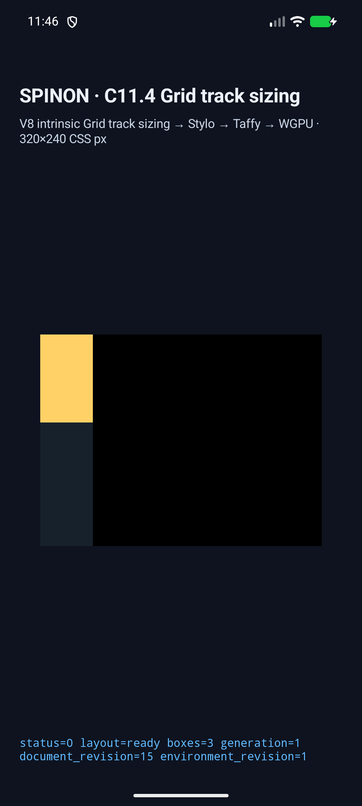
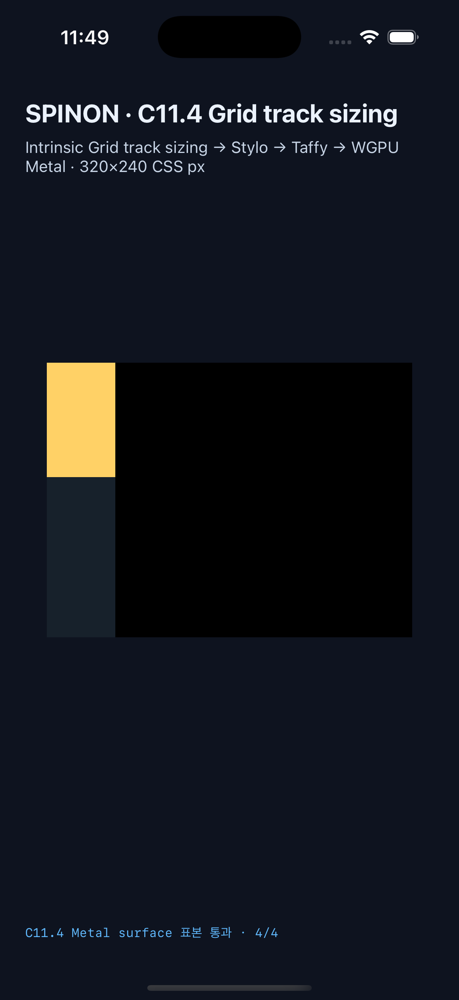
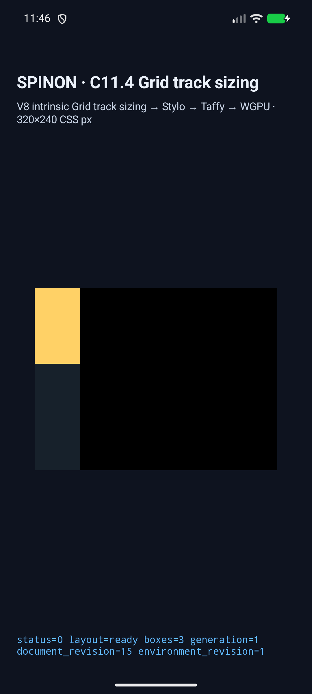

# C11.4 `fit-content()` limit 경계 · simulator runtime 결과

2026-10-29 · pinned WPT `fit-content-track-sizing.html`의 세 고정 limit assertion을 exact opt-in fixture로 확인했다. 이 결과는 Spinon WPT 전체 pass나 일반 CSS support를 의미하지 않는다. 공식 C11.4 checkbox와 완료 집계 `72/213`은 유지한다.

## 기준과 기대값

Pinned source는 revision `c999c58338ee1d223df5ad62e48be1202ced0d37`의 `css/css-grid/grid-definition/fit-content-track-sizing.html`이며 source SHA-256은 `828160951bba50f6ce1c09a69b804480df10d5e622c92a047452f432cb790736`다. Agent Browser HeadlessChrome 156의 upstream harness는 13/13이었다. Chrome 결과는 upstream oracle이며 Spinon에서 WPT harness를 실행한 결과가 아니다. [사전 비교](../c11-4-fit-content-limit-boundaries-precomparison-2026-10-29/README.md)

세 target은 direct item에 `min-height:0`, `overflow:visible`을 두고 100px child를 유지한다. 따라서 minimum은 0px, max-content contribution은 100px이고 기대 row 공식은 `max(0, min(limit, 100))`이다.

| WPT assertion | `fit-content()` limit | 기대 row/item | child | Android AVD | iOS Simulator |
| --- | ---: | ---: | ---: | --- | --- |
| `contentLargerThanArgument` | 40px | 40px | 100px | 통과 | 통과 |
| `smallArgument` | 30px | 30px | 100px | 통과 | 통과 |
| `largeArgument` | 200px | 100px | 100px | 통과 | 통과 |

모든 결과에서 root frame은 `60×300px`, item frame은 위 표의 row 크기, child frame은 `60×100px`다. `MaximizeTracks`에서 raw finite growth limit은 세 case 모두 100px이며 `infinitelyGrowable=false`다. CSS Grid 2025 CRD §11.5.1은 base-size 분배 한도를 growth limit과 `fit-content()` argument의 작은 값으로 제한한다. 따라서 raw growth limit이 argument와 다른 것은 오류가 아니다. [규범 문서](https://www.w3.org/TR/2025/CRD-css-grid-1-20250326/#algo-maximize-tracks)

## Android API 37 ARM64 AVD

- Emulator: `emulator-5554`, `sdk_gphone16k_arm64`, API 37, ARM64, QEMU software renderer.
- APK SHA-256: `6df152da56e4c89e46aa53c6db5c1c2dc373e3b24ebd8fc880a4885a086a9329`.
- 최종 scene result: [result.json](./android-avd-c114-fit-content-limit-boundaries-android-avd-20261029T024631013Z-fbc45138/result.json) · [AVD 정보·source revision](./android-avd-c114-fit-content-limit-boundaries-android-avd-20261029T024631013Z-fbc45138/simulator.json).
- 세 scene에서 layout, trace chunk, frame, draw와 presentation identity가 일치했다. PixelCopy 표본은 총 11/11 exact (`40px: 4/4`, `30px: 4/4`, `200px: 3/3`). Software AVD 결과는 Android 실기기나 hardware GPU 검증이 아니다.

## iPhone 17 Pro / iOS 26.2 Simulator

- Simulator: iPhone 17 Pro (`iPhone18,1`), iOS 26.2, UDID `ACA7BF91-E2D5-4CF7-909A-08D1AD95FF3D`.
- App SHA-256: `8039c743a132d06f3fdb6d60b30a6fb1871fc4e35fbec5448f7a1d8636207c24`.
- 최종 scene result: [result.json](./ios-simulator-c114-fit-content-limit-boundaries-ios-simulator-20261029T024930724Z-be38701e/result.json) · [Simulator 정보·source revision](./ios-simulator-c114-fit-content-limit-boundaries-ios-simulator-20261029T024930724Z-be38701e/simulator.json).
- 세 scene에서 layout, trace chunk, frame, draw와 presentation identity가 일치했다. Metal drawable 표본은 총 11/11 exact (`40px: 4/4`, `30px: 4/4`, `200px: 3/3`). Metal 표본은 compositor 제출 전이며 compositor 이후 화면의 pixel equality를 증명하지 않는다.

## 실행 화면

화면은 같은 캡처 실행의 layout 상태를 보여준다. Frame·표본의 acceptance는 원본 runtime log와 `result.json`을 따른다.

| Limit | Android API 37 ARM64 AVD | iPhone 17 Pro / iOS 26.2 Simulator |
| ---: | --- | --- |
| 40px |  |  |
| 30px |  |  |
| 200px |  |  |

PNG SHA-256은 [screenshots.sha256](./screenshots.sha256)에 있다. Android 이미지는 1080×2400, iOS 이미지는 1206×2622 해상도다.

## 빌드와 캡처

```sh
SPINON_ENABLE_C04_RUNTIME_GPU=1 \
SPINON_ENABLE_C04_RUNTIME_GPU_FIXTURE_TEST=1 \
mise exec -- bun run build:android
node tools/css-reference/capture-c11-4-auto-repeat-neighbors-simulator.mjs \
  android-avd emulator-5554 \
  --scene-id=fit-content-limit-40-wpt,fit-content-limit-30-wpt,fit-content-limit-200-wpt
```

```sh
SPINON_ENABLE_C04_RUNTIME_GPU=1 \
SPINON_ENABLE_C04_RUNTIME_GPU_FIXTURE_TEST=1 \
SPINON_ENABLE_C11_GRID_METAL_SURFACE_PIXELS_TEST=1 \
mise exec -- bun run build:ios-sim
node tools/css-reference/capture-c11-4-auto-repeat-neighbors-simulator.mjs \
  ios-simulator ACA7BF91-E2D5-4CF7-909A-08D1AD95FF3D \
  --scene-id=fit-content-limit-40-wpt,fit-content-limit-30-wpt,fit-content-limit-200-wpt
```

빌드 로그: [Android build](./android-build.log)은 `BUILD SUCCESSFUL`, [iOS Simulator build](./ios-simulator-build.log)은 `BUILD SUCCEEDED`다. 이 캡처 경로에서는 iOS Metal 표본 feature를 켜야 한다.

소스 검증 로그: [workspace Clippy](./workspace-clippy.log), [Rust fmt](./rust-fmt-check.log), [소스·문서 diff 검사](./diff-check.log), [fixture module 경계 테스트](./fixture-module-boundary-test.log), [FFI focused test](./ffi-focused-test.log). diff 검사는 원본 `.log`·`.txt` 실행 출력의 공백을 보존하기 위해 해당 근거 파일을 제외하고 staged 소스·문서에 실행했다. 검증은 최종 변경 소스에서 통과했다.

## 진단 시도와 최종 결과 구분

이 디렉터리에는 원인을 좁힌 실패 시도도 보존되어 있다. 이 실패 로그는 최종 acceptance로 세지 않는다.

- 첫 Android 시도는 예상 row `40px`와 실제 base `40px`가 일치했지만 verifier가 raw growth limit도 `40px`이어야 한다고 잘못 요구했다. 이어진 instrumented capture에서 실제 `growth_limit=100px`를 확인했다. [instrumented log](./android-avd-c114-fit-content-limit-boundaries-android-avd-20261029T024421998Z-e027fa74/runtime-fit-content-limit-40-wpt.log)
- Rust 검사 기준을 고친 뒤 두 앱 matcher와 Node capture matcher가 이전 expectation을 유지해 assertion이 남았다. 모든 matcher를 raw growth limit `100px` 기준으로 맞춘 후 최종 Android 3/3가 통과했다. [matcher 개발 시도](./android-avd-c114-fit-content-limit-boundaries-android-avd-20261029T024534668Z-a4bd4140/runtime-fit-content-limit-40-wpt.log)
- 첫 iOS capture의 layout과 frames는 정상이나 `SPINON_ENABLE_C11_GRID_METAL_SURFACE_PIXELS_TEST`가 꺼져 readback이 명시적으로 거부됐다. 해당 flag로 다시 빌드한 뒤 최종 iOS 3/3 및 Metal 11/11가 통과했다. [flag 미설정 log](./ios-simulator-c114-fit-content-limit-boundaries-ios-simulator-20261029T024753596Z-501cb8b5/runtime-fit-content-limit-40-wpt.log)

## Fixture artifact 경계

macOS ARM64 `spinon-ffi` release static archive의 `strings` scan은 product feature `c04-runtime-gpu`에서 새 scene ID, 전용 DOM prefix, report key 및 C11.4 fixture marker `0`개를 찾았다. `c04-runtime-gpu-fixture-test` positive-control archive에서는 세 scene ID/DOM prefix와 `fitContentLimitBoundaries` report key를 찾았다. Product archive SHA-256은 `582344bf1dd6f77ceef2ab925cf321ec4eff664c8133a09f0dc5f3a2bd21e563`; fixture archive SHA-256은 `24726ec0d0ae31a113f12030ed39de41db1bdb0671c125a9d3f3cf2f7da057ea`다. 빌드 로그와 marker scan은 [artifact-boundary](./artifact-boundary/)에 있다.

이 검사는 macOS ARM64 static archive에 한정된다. APK/IPA 전체 또는 release app bundle의 fixture exclusion을 증명하지 않는다. Apple `nm`는 Rust 1.96 LLVM 22.1.2 object attribute를 읽지 못해 `Unknown attribute kind`로 실패했다. 이 작업은 새 C header나 전용 C ABI symbol을 추가하지 않고 기존 opt-in fixture runtime route를 사용한다.

## 남은 범위

이 실행은 pinned WPT 파일 13 assertions 중 세 assertion fixture다. 일반 author CSS admission, 전체 WPT runner, 임의 `fit-content()`/Grid 조합, 실기기/hardware GPU, iOS compositor 이후 pixels 및 전체 C11.4 지원은 확인하지 않았다.
