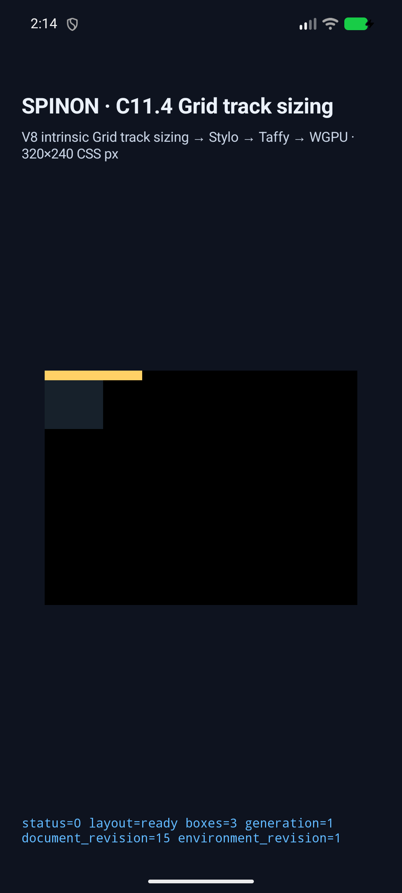
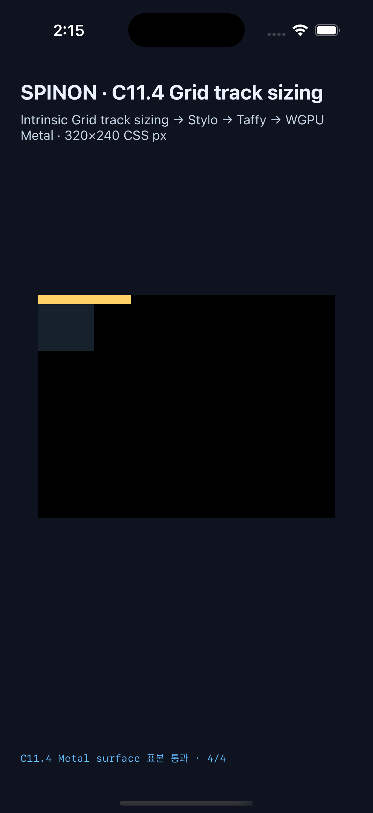

# C11.4 `fit-content()` column limit simulator evidence

**상태 · 2026-10-30:** C11.4의 제한 opt-in column-axis runtime slice다. 공식 C11.4/C11 완료가 아니며 공식 완료 수 `72/213`을 바꾸지 않는다. 계획 PR #810은 병합됐고 runtime 구현/시뮬레이터 검증은 끝났으며 runtime PR/병합 상태 처리가 남아 있다.

## 비교 입력과 기대값

Chrome 156 사전 비교 입력, 고정 viewport/DPR, HTML hash와 화면 hash는 [precomparison evidence](../c11-4-fit-content-columns-precomparison-2026-10-30/README.md)에 있다. [CSS Grid 2025 CRD §11.2](https://www.w3.org/TR/2025/CRD-css-grid-1-20250326/)의 독립 기대값은 `max(minimum, min(limit, max-content))`다. 네 장면은 하나의 100×10px child, zero gap, implicit column, definite root width를 사용한다.

| Scene | Limit | Minimum contribution | Max-content | Used column | Runtime item / child |
| --- | ---: | ---: | ---: | ---: | ---: |
| `column-fit-content-30` | 30px | 0px | 100px | 30px | 30px / 100px |
| `column-fit-content-40` | 40px | 0px | 100px | 40px | 40px / 100px |
| `column-fit-content-200` | 200px | 0px | 100px | 100px | 100px / 100px |
| `column-fit-content-auto-minimum-control` | 40px | auto → 100px | 100px | 100px | 100px / 100px |

The automatic minimum control confirms that a 100px minimum contribution can exceed the 40px fit-content argument. The child remains wider than the item in the 30px and 40px scenes so overflow remains observable.

## Android API 37 AVD

The fixed target is `emulator-5554`, API 37, ARM64 (`sdk_gphone16k_arm64`). The installed APK SHA-256 matches the local APK: `1e3e7f5622f4b0ed2561802fd727d9356637be18fb01479bf752cc1986fe415d`. Runtime logs identify ANGLE/Vulkan/SwiftShader; this is a software-rendered AVD result, not a hardware GPU or physical-device result.

The complete 4-scene capture is in [the Android AVD run](./android-avd-c114-fit-content-limit-columns-android-avd-final-2026-10-30/). Each scene has a strict style/input/revision/frame/column-trace/row-trace match, a presented draw, and a PixelCopy sample matrix. All 14 configured surface samples match: 4 each for the 30px and 40px scenes and 3 each for the 200px and automatic-minimum scenes. The run manifest records the local/installed APK hash and source snapshot.

## iOS 26.2 Simulator

The fixed target is iPhone 17 Pro, iOS 26.2, UDID `ACA7BF91-E2D5-4CF7-909A-08D1AD95FF3D`, model `iPhone18,1`. The installed app executable SHA-256 matches the build: `93ce63ea3d4c6823808a2e3a4bb75356884ba7b4eb8cabbe2c93c7f46d3b2f7e`.

The complete 4-scene capture is in [the iOS Simulator run](./ios-simulator-c114-fit-content-limit-columns-ios-simulator-final-2026-10-30/). Each scene has strict layout and presentation identity matches. Metal drawable samples are exact for all 14 configured points (4 each for 30px and 40px; 3 each for 200px and automatic-minimum). These samples are taken from the drawable before OS compositor submission; they do not establish compositor-after pixels or iOS physical-device behavior. The run manifest records the build/installed executable hash and source snapshot.

## Builds, focused checks, and artifact boundary

- [Android fixture build](./android-build.log): `SPINON_ENABLE_C04_RUNTIME_GPU_FIXTURE_TEST=1 mise exec -- bun run build:android` succeeded.
- [iOS Simulator fixture build](./ios-simulator-build.log): runtime fixture and `SPINON_ENABLE_C11_GRID_METAL_SURFACE_PIXELS_TEST=1` build succeeded.
- Runtime tests: 4/4. FFI scene-route test: 1/1. Fixture boundary tests: 2/2. `cargo fmt --all -- --check` passed.
- Default Clippy reports three pre-existing warnings in unchanged files (`grid.rs:438`, `grid_values.rs:183`, `grid_values.rs:663`). Runtime and FFI Clippy passed with only those three named lints allowed; the changed files added no remaining Clippy findings.
- Product static FFI archive (`c04-runtime-gpu`) contains zero matching strings and symbols. The fixture-test positive control contains 25 strings and 25 matching symbols. [Archive build logs and scans](./archive-boundary/README.md) record the two hashes. This is a static archive boundary check, not full APK/IPA exclusion evidence.
- The [20-point implementation/runtime failure review](./implementation-review-20.md) records the independent identity, style, sizing trace, frame, presentation, and artifact boundaries checked for this slice.

## Screenshots and hashes

The separate [20-point PR diff review](./pr-diff-review-20.md) and [30-point adversarial PR review](./pr-adversarial-review-30.md) cover the submitted change surface. Neither review changes the official C11.4 status.

The PNGs are simulator screenshots. They are useful for visual review; geometry and color assertions come from the runtime logs and PixelCopy/Metal drawable matrices above.

| Android API 37 AVD | iPhone 17 Pro / iOS 26.2 Simulator |
| --- | --- |
|  |  |

The first Android launch after the initial matcher edit exposed two test-harness mismatches: CSS `grid-auto-flow` serializes as lowercase `column`, and integer frame strings were compared against a floating-point spelling. The Swift matcher also initially appended `.0` twice to interpolated `Double` values. Those comparisons now use the serialized CSS value and the runtime’s numeric debug representation. An earlier iOS build omitted the opt-in Metal readback flag; the final matrix was rebuilt with that flag and passed. These were harness/build-configuration corrections; expected geometry did not change.

## Limits

This slice does not add general author-CSS admission, full `fit-content()` grammar, text wrapping, multiple items/spans, nested Grid, full WPT execution, Android physical-device/hardware-GPU evidence, iOS compositor-after pixels, or complete C11.4/C11 support. The official C11.4 checkbox and `72/213` remain unchanged.
