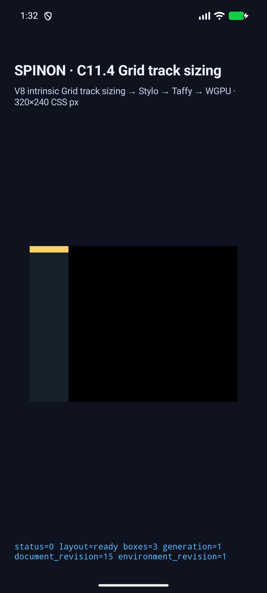
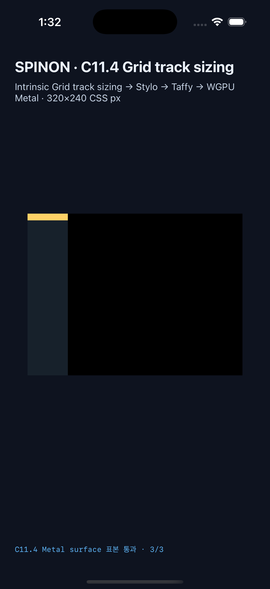

# C11.4 `fit-content()` implicit row와 `min-height` 런타임 근거

## 범위

Pinned WPT `fit-content-track-sizing.html`의 `height:auto; min-height:300px` Grid case 하나를 opt-in C11.4 fixture로 실행했다. Android API 37 ARM64 AVD와 iPhone 17 Pro / iOS 26.2 Simulator에서 같은 JS scene을 실제 V8 → HostDocument → Stylo → typed Grid input → Taffy → WGPU/Metal surface 경로로 평가했다.

동작 계약은 [내부 계약 0059](../../0059-c11-grid-layout.md)에 기록했다.

이 근거는 일반 CSS admission, 전체 WPT suite, C11.4 완료, 실기기 또는 hardware GPU 동작을 뜻하지 않는다. 공식 상태는 `72/213`으로 유지한다.

## 관찰값

| 관찰 | 독립 기대값 | Android API 37 AVD | iOS 26.2 Simulator |
|---|---:|---:|---:|
| Root frame | 60×300 CSS px | 60×300 | 60×300 |
| Implicit `fit-content(40px)` row | 10px | 10px | 10px |
| Item frame | 60×10 CSS px | 60×10 | 60×10 |
| Nested child frame | 60×10 CSS px | 60×10 | 60×10 |
| Presented boxes | 3 | 3 | 3 |
| Draw identity | environment와 동일 revision | 통과 | 통과 |
| Pixel 표본 | child / root 배경 / root 밖 | 3/3 일치 | 3/3 일치 |

Rows trace의 `StretchAutoTracks { applied: true }`는 정렬 단계가 실행됐다는 뜻이다. 행은 stretch 전후 모두 10px이며 남은 290px는 root의 배경 영역으로 남는다. 화면 표본은 CSS 좌표 `(30,5)`에서 child `#ffd166`, `(30,15)`에서 root 배경 `#17212b`, `(60,15)`에서 root 밖 `#000000`을 확인했다.

### Android

- 대상: `spinon_api37_0_applied_txn`, serial `emulator-5556`, API 37, `arm64-v8a`, SwiftShader.
- APK SHA-256: `a9a8271ca3a03e0042c080dea9cf40a8f382de81b52414942d9df5348211f91c`.
- 원본 자료: `android-avd-c114-fit-content-min-height-android-avd-20261027T163236995Z-0cd6fe79/runtime-fit-content-min-height-wpt.log`, `result.json`, `simulator.json`.

### iOS

- 대상: iPhone 17 Pro, iOS 26.2 Simulator, UDID `9DCCE836-7659-4914-B6C1-13F54BFFA9DB`.
- App SHA-256: `d60180e16fbfcac11eb4bc819300f5688b4f961f5fd45da23fb1794b7df0afde`.
- 원본 자료: `ios-simulator-c114-fit-content-min-height-ios-simulator-20261027T163247441Z-70588c92/runtime-fit-content-min-height-wpt.log`, `result.json`, `simulator.json`.

## 추가 검증

- Rust layout oracle 5/5, runtime adapter 1/1, FFI allowlist 1/1 통과. Oracle에는 음수·NaN·무한대 `min-height`와 `fit-content()` 입력 거부 회귀 검사가 포함된다.
- `fixture-module-boundary.test.mjs`: Node test runner에서 15/15 통과.
- Android 기본 및 fixture-test 앱 빌드, iOS 기본 및 fixture-test 앱 빌드 통과.
- 제품 `c04-runtime-gpu` FFI archive에서는 C11.4 fixture symbol과 scene marker가 없고, `c04-runtime-gpu-fixture-test` positive control에는 둘 다 있음을 확인했다.
- `cargo fmt --all -- --check` 및 `git diff --check` 통과.
- 검토 기록: [구현/runtime 경계 검토](./implementation-review-20.md), [PR diff 검토](./pr-diff-review-30.md). 실제 실행 근거, 코드 경계만 확인한 항목, fault injection을 하지 않은 항목을 구분했다.
- `docs:build`는 exit 1로 끝났고 repository 내 976개 문서에서 dead link가 보고됐다. 내부 계약 0059는 기존 계획/evidence 링크 때문에 목록에 있지만, 이번 min-height slice의 계획·evidence 경로는 오류 목록에 없었다. 전체 빌드 로그는 실행 환경의 `/tmp`에만 남아 저장소에 포함하지 않았다.

이 실행은 계획 PR #698에서 고정한 expected JSON과 CSS Grid 2025 CRD 계산을 검증했다. upstream Chrome WPT 결과와 Spinon simulator 결과는 서로 다른 근거다.
