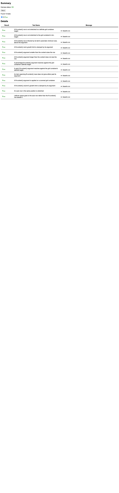

# C11.4 definite-height percentage `fit-content()` 사전 비교

## Source

Pinned WPT revision `c999c58338ee1d223df5ad62e48be1202ced0d37`의 `css/css-grid/grid-definition/fit-content-track-sizing.html`에서 `percentageArgument` 장면을 확인했다. Source SHA-256은 `828160951bba50f6ce1c09a69b804480df10d5e622c92a047452f432cb790736`이며, 2026-10-29 `wpt.live` fetch hash도 같다.

대상 DOM은 원본 48행, assertion은 107행이다. WPT는 definite `height:300px`, `grid-auto-rows:fit-content(50%)`, item `min-height:0`, nested child `height:400px`를 사용한다. Assertion은 used row size `150px`이다.

## Browser observation

Agent Browser 0.31.1에서 HeadlessChrome 156.0.0.0을 사용했다. Viewport는 1280×633 CSS px, DPR 1이다. Upstream harness status는 OK이며 13 tests / 13 Pass였다. Target root height는 300px, computed `grid-template-rows`는 `150px`, item height는 150px이다.

Screenshot SHA-256은 `a7eaaf9fd1d68755272c044c519d277546ec6e070861c0cf663dfa3698c77849`이다. 실행 뒤 Agent Browser를 닫았고 session list가 비어 있음을 확인했다. 이는 Chrome upstream 결과이며 Spinon WPT/app runtime pass가 아니다.

## Independent expected value

CSS Grid 2025 CRD [§7.2.1](https://www.w3.org/TR/2025/CRD-css-grid-1-20250326/#track-sizes)는 row percentage가 definite grid container inner block size를 기준으로 resolve된다고 정의한다. 이 입력은 content-box height가 300px이므로 `50%` limit은 150px이다. Intrinsic sizing 중 cyclic percentage fallback 규칙은 definite height인 이 장면에 적용되지 않는다.

§11.2의 fit-content track sizing은 minimum과 `min(limit, max-content)` 사이에서 크기를 정한다. Item의 `min-height:0`은 automatic minimum floor를 제거하고 nested 400px child는 150px cap보다 크다. 따라서 independent expected Rows는 `[150]px`이다. §6.6의 grid item minimum-size rule은 item CSS 조건을 설명하며, Chrome observation에서 값을 역산하지 않았다.

## Runtime boundary

이 디렉터리는 source/browser precomparison만 담고 있다. Spinon Rust layout, app route, Android/iOS simulator는 아직 실행하지 않았다. Planned runtime fixture는 viewport 의존성을 없애기 위해 WPT의 auto root width를 60px로 고정하되 definite 300px block basis와 단일 60px column을 유지한다. Child width는 paint sample에서 item/root 배경을 분리하도록 30px로 고정하며 block-axis expected value는 WPT와 같은 400px height에서 나온다. Runtime evidence는 별도 디렉터리에 남기고 upstream baseline과 섞지 않는다.

기계 판독 관찰과 independent expected value는 [expected.json](./expected.json)에 있다.
