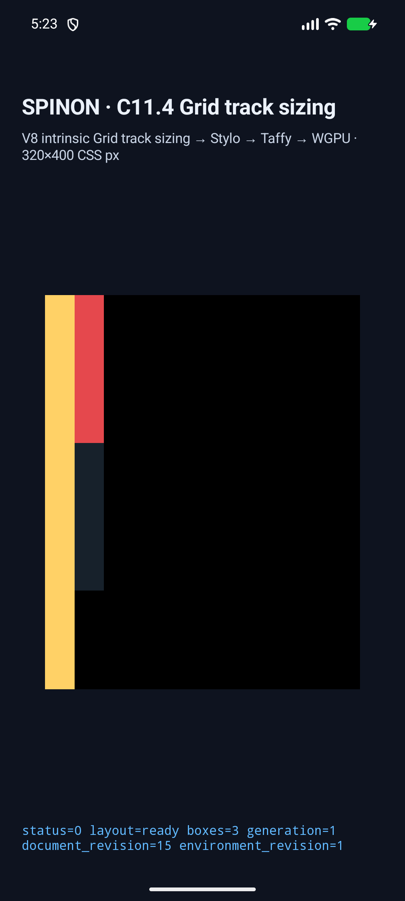
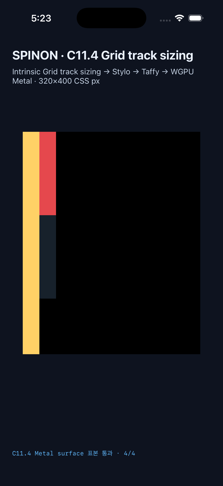

# C11.4 definite-height percentage `fit-content()` row

이 기록은 pinned WPT [`fit-content-track-sizing.html`](https://github.com/web-platform-tests/wpt/blob/c999c58338ee1d223df5ad62e48be1202ced0d37/css/css-grid/grid-definition/fit-content-track-sizing.html)의 percentage argument assertion 하나를 고정한 opt-in 앱 fixture다. Source SHA-256은 `828160951bba50f6ce1c09a69b804480df10d5e622c92a047452f432cb790736`다. 규범 기대값과 기존 Chrome upstream 관찰은 [계획](../../../../plan/c11-4-fit-content-percentage-argument.md)에 분리했다.

## 고정 입력과 판정

- Root content box: `60×300px`; computed `grid-auto-rows:fit-content(50%)`; definite row percentage limit은 `150px`이다.
- 한 implicit row의 final base와 item frame은 `150px`이다. Child frame은 `30×400px`로 row와 root 밖까지 overflow한다.
- Item은 `min-height:0`을 지정한다. Computed overflow는 initial `visible`이며 source에는 explicit `overflow:visible` declaration이 없다.
- Rows trace는 `Initialize`, `IntrinsicItemBatch(span:1)`, `IntrinsicSizingComplete`, `MaximizeTracks`, `ExpandFlexibleTracks`, `StretchAutoTracks(applied:true)` 여섯 단계와 base sequence `[0,0,0,150,150,150]px`를 검사한다. Contribution vector는 `Minimum 0` (`SpecifiedMinimum`), `MinContent 400`, `MaxContent 400`이다.
- Raw trace의 growth limit `400px`은 max-content bound다. CSS Grid 2025 CRD [§7.2.1](https://www.w3.org/TR/2025/CRD-css-grid-1-20250326/#track-sizes)와 [§11.5.1](https://www.w3.org/TR/2025/CRD-css-grid-1-20250326/#algo-spanning-items)에서 fit-content argument가 base-size distribution을 `150px`으로 제한하므로 raw growth-limit field를 used track size로 읽지 않는다.
- 표면 표본은 row 안 child `#ffd166`, row 안 item `#e5484d`, row 아래 root background `#17212b`, root 외부 child `#ffd166`이다. 각 surface에서 네 표본 모두 RGBA exact다.

## Android API 37 ARM64 AVD

AVD `emulator-5554` (`sdk_gphone16k_arm64`, API 37, `arm64-v8a`)에서 장면 1/1, node frame 3/3, row base `150px`, 네 PixelCopy 표본 4/4, draw presentation identity 일치를 확인했다. AVD 결과는 물리 기기나 hardware GPU를 입증하지 않는다.

- APK SHA-256: `e5778e0f70ee430ecec95c55a77f86da41055f568662aea1cda218c8dff349cd`
- Source snapshot SHA-256: `88aebc21c77fc4afa04ebf039e90ba4bb321bafed2aa10c710ba287cf857aced`
- [실행 결과 JSON](./android-avd-c114-fit-content-percentage-argument-android-avd-20261028T202319247Z-70fcd649/result.json) · [simulator/source/hash](./android-avd-c114-fit-content-percentage-argument-android-avd-20261028T202319247Z-70fcd649/simulator.json) · [runtime trace와 PixelCopy](./android-avd-c114-fit-content-percentage-argument-android-avd-20261028T202319247Z-70fcd649/runtime-fit-content-percentage-row-wpt.log)

## iPhone 17 Pro iOS 26.2 Simulator

iPhone 17 Pro / iOS 26.2 Simulator에서 장면 1/1, node frame 3/3, row base `150px`, 여덟 trace chunk, 네 Metal drawable 표본 4/4, draw presentation identity 일치를 확인했다. Metal readback은 OS compositor 제출 전이다.

- App SHA-256: `ce35434f0f50a546201cbdf631cd196f7d403e8ed4fd22db042afda35376e822`
- Source snapshot SHA-256: `88aebc21c77fc4afa04ebf039e90ba4bb321bafed2aa10c710ba287cf857aced`
- [실행 결과 JSON](./ios-simulator-c114-fit-content-percentage-argument-ios-simulator-20261028T202326567Z-704048f7/result.json) · [simulator/source/hash](./ios-simulator-c114-fit-content-percentage-argument-ios-simulator-20261028T202326567Z-704048f7/simulator.json) · [runtime trace와 Metal readback](./ios-simulator-c114-fit-content-percentage-argument-ios-simulator-20261028T202326567Z-704048f7/runtime-fit-content-percentage-row-wpt.log)

## 빌드와 검사

- Android build: `SPINON_ENABLE_C04_RUNTIME_GPU=1 SPINON_ENABLE_C04_RUNTIME_GPU_FIXTURE_TEST=1 tools/build-android-app.sh` — 성공. [로그](./android-build-final.log)
- iOS Simulator build: `SPINON_ENABLE_C04_RUNTIME_GPU=1 SPINON_ENABLE_C04_RUNTIME_GPU_FIXTURE_TEST=1 SPINON_ENABLE_C11_GRID_METAL_SURFACE_PIXELS_TEST=1 tools/build-ios-sim.sh` — 성공. Xcode가 vendored V8 archive object의 중복 timestamp debug-map 경고를 출력했으나 build는 성공했다. [로그](./ios-build-final.log)
- Runtime focused tests 2/2 ([로그](./checks/runtime-test-final.log)), FFI exact-route test 1/1 ([로그](./checks/ffi-test-final.log)), runtime/FFI fixture-feature Clippy ([runtime](./checks/runtime-clippy-final.log), [FFI](./checks/ffi-clippy-final.log)), formatter ([로그](./checks/fmt-final.log)), capture-script syntax ([로그](./checks/capture-script-syntax-final.log))와 `git diff --check` ([로그](./checks/diff-check-final.log)) 통과.
- `fixture-module-boundary.test.mjs` 18/18 통과. [로그](./checks/fixture-module-boundary-final.log)
- Default `c04-runtime-gpu` static FFI archive marker 0개, opt-in `c04-runtime-gpu-fixture-test` positive control marker 4개. [archive 결과와 SHA-256](./archive-boundary/result-final.txt) · [product build](./archive-boundary/product-build-final.log) · [fixture build](./archive-boundary/fixture-test-build-final.log). 범위는 macOS ARM64 static archive이며 APK/IPA 전체 exclusion은 검사하지 않았다.

## 수정한 중간 실패와 범위

초기 Android surface parser는 240px 아래 좌표를 거부해 `y=350` 표본을 만들지 못했다. Percentage scene에만 `320×400` CSS px viewport와 상한 검사를 적용했다. Profile이 명시적 `overflow:visible` style을 거부해 fixture는 initial computed value를 확인하도록 고쳤다. iOS는 새 scene의 viewport와 presentation identity가 서로 다른 시점의 값을 비교해 strict match에서 실패했으며 scene 전용 viewport와 내부 style/layout revision 검사를 맞췄다. Capture runner는 strict failure를 바로 반환하도록 바꿨다. 이전 실패 실행 자료는 각 timestamp evidence directory에 보존하고 이 README는 마지막 통과 실행을 가리킨다.

이 실행은 pinned WPT assertion 하나의 opt-in runtime 검증이다. Spinon WPT harness 실행, 일반 author CSS admission, 임의 Grid tree, 전체 WPT suite, Android 실기기/hardware GPU, iOS compositor 이후 pixel 및 전체 C11.4 지원을 확인하지 않았다. C11.4는 미완료이며 공식 완료 `72/213`을 유지한다.
