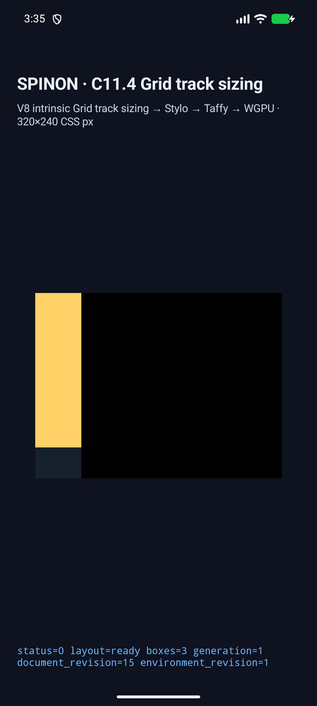
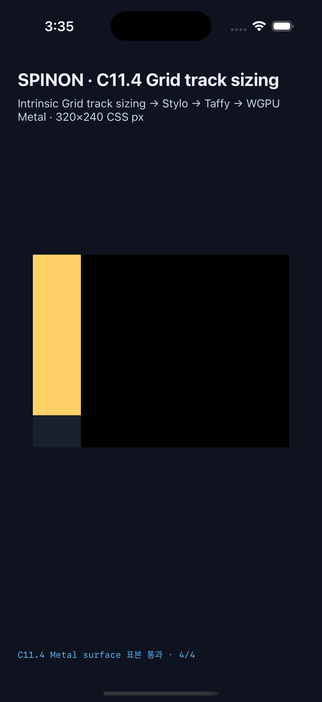

# C11.4 `fit-content()` span-2 WPT runtime 근거

이 기록은 pinned WPT `css/css-grid/grid-definition/fit-content-track-sizing.html`의 span-2 assertion 하나를 기존 opt-in 앱 경로에서 확인한 결과다. WPT source revision은 `c999c58338ee1d223df5ad62e48be1202ced0d37`이다. CSS Grid 2025 CRD 기반 독립 기대값과 Chrome 사전 관찰은 [계획](../../../../plan/c11-4-fit-content-spanning-wpt.md) 및 [사전 비교](../c11-4-fit-content-spanning-precomparison-2026-10-29/README.md)에 분리했다.

C11.4 공식 항목은 미완료이며 공식 완료 수 `72/213`을 유지한다. 이 fixture는 일반 author CSS 지원, 전체 WPT, 전체 C11.4 또는 실기기 GPU 동작을 의미하지 않는다.

## Android AVD와 iOS Simulator

두 앱은 같은 source snapshot `ab3a8d0c5b207b7aad2a1d41986e56080100847e4b3d71aee7434ba007c76c64`에서 각각 scene `fit-content-spanning-wpt`를 통과했다. 루트는 `60×300px`, implicit `fit-content(40px)` row는 `[40,40]px`, span item은 `60×80px`, 자식은 `60×200px`이다. 각 실행에서 frame revision과 draw presentation identity가 일치했다.

- Android API 37 ARM64 AVD `emulator-5554` (`sdk_gphone16k_arm64`, APK SHA-256 `d88ac0c9be5582b2a9611a8a6b1a3fdb1446c132ab4ddaae29160e10870ead4c`): [실행 결과](./android-avd-c114-fit-content-spanning-android-avd-20261028T183501979Z-69e492b8/result.json) · [환경·설치 APK hash](./android-avd-c114-fit-content-spanning-android-avd-20261028T183501979Z-69e492b8/simulator.json) · [runtime trace와 PixelCopy](./android-avd-c114-fit-content-spanning-android-avd-20261028T183501979Z-69e492b8/runtime-fit-content-spanning-wpt.log)
- iPhone 17 Pro / iOS 26.2 Simulator (`ACA7BF91-E2D5-4CF7-909A-08D1AD95FF3D`, app SHA-256 `2b48a523108398d1c2c4a67721613f13d47c462a7b4c50eeae402c4ef1e8681e`): [실행 결과](./ios-simulator-c114-fit-content-spanning-ios-simulator-20261028T183506443Z-c6b59126/result.json) · [환경·설치 app hash](./ios-simulator-c114-fit-content-spanning-ios-simulator-20261028T183506443Z-c6b59126/simulator.json) · [runtime trace와 Metal readback](./ios-simulator-c114-fit-content-spanning-ios-simulator-20261028T183506443Z-c6b59126/runtime-fit-content-spanning-wpt.log)

Android PixelCopy 표본은 내부 child `(30,30)`에서 `[255,209,102,255]`, item 바깥 child `(30,80)`에서 같은 노랑, child 뒤 root 배경 `(30,200)`에서 `[23,33,43,255]`, root 외부 `(60,120)`에서 `[0,0,0,255]`로 4/4 exact였다. iOS drawable 표본도 `(91,91)`, `(91,241)`, `(91,601)`, `(181,361)`에서 같은 RGBA 순서로 4/4 exact였다. iOS 표본은 Metal drawable의 OS compositor 제출 전 결과다.

## 구현과 경계 검사

- Runtime focused tests 5/5: exact frame·Rows trace·span contribution, root/style/tree mutations, growth-limit mutation 및 flexible-growth mutation을 검사했다. [로그](./runtime-test-final.log)
- FFI exact-route test 1/1, runtime/FFI fixture-feature Clippy와 `cargo fmt --all -- --check` 통과. [FFI test](./ffi-test-final.log) · [runtime Clippy](./runtime-clippy-final.log) · [FFI Clippy](./ffi-clippy-final.log) · [formatter](./fmt-final.log)
- fixture-module boundary test 17/17, capture script syntax check 통과. [경계 test](./fixture-module-boundary-final.log) · [syntax](./capture-script-syntax-final.log)
- Android APK와 iOS Simulator app을 최종 strict trace matcher 포함 상태로 재빌드했다. [Android build](./android-build-final.log) · [iOS build](./ios-build-final.log)
- Default `c04-runtime-gpu` static FFI archive에서 신규 scene/source marker는 0개, opt-in fixture-test positive control에서 16개가 검출됐다. [archive 결과](./archive-boundary/result.txt) · [product SHA-256](./archive-boundary/product-archive-final.sha256) · [fixture SHA-256](./archive-boundary/fixture-test-archive-final.sha256) · [positive scan](./archive-boundary/fixture-test-marker-scan-final.txt). APK/IPA 전체 exclusion을 검사한 것은 아니다.

첫 Android 진단 실행은 report가 computed overflow를 Rust 표현 `Some(Visible)`로 내보내 native matcher의 CSS 값 `visible`과 달라 실패했다. report를 CSS keyword로 정규화하고 양 플랫폼을 다시 빌드해 최종 실행을 통과시켰다. 추가 검토에서 native matchers가 `MaxContent` 존재만 요구하고 harness가 세 contribution 전체를 exact 비교하는 불일치를 발견해, Android/iOS도 `Minimum`, `MinContent`, `MaxContent`의 순서·값·minimum source, fit-content growth limit과 flexible flag를 exact 검사하도록 강화했다. 최종 simulator run은 강화된 검사로 수행했다.

## 범위 한계

이 실행은 pinned WPT assertion 하나의 opt-in fixture 검증이다. 임의 HTML/CSS admission, arbitrary Grid tree, 다른 contribution 유형, clipping/scrolling, 전체 WPT harness, 물리 Android 기기/hardware GPU, iOS compositor 이후 pixel 결과 및 전체 C11.4 지원은 검증하지 않았다. 공식 상태 `72/213`은 그대로 유지한다.
