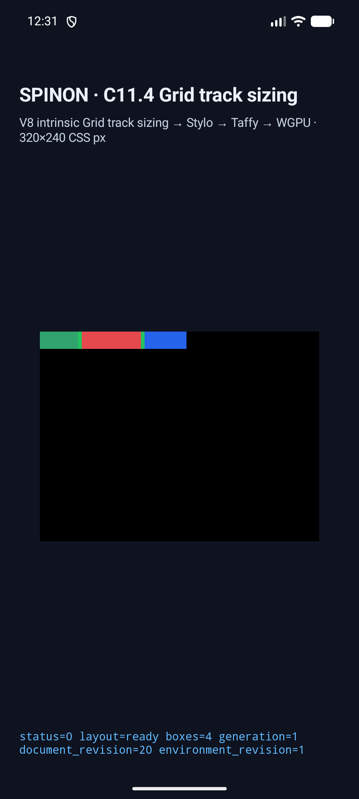
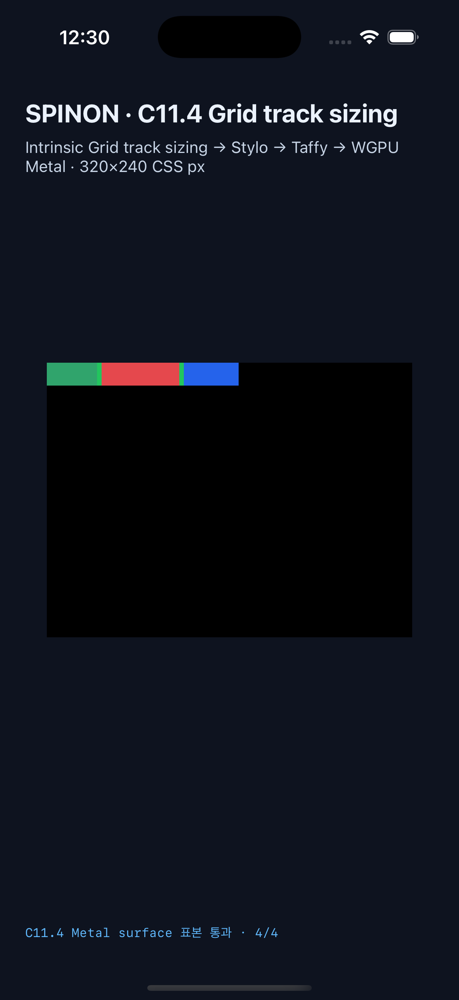

# C11.4 fixed-repeat + auto-repeat + template-area 제한 runtime slice

이 근거는 같은 axis의 한 grid track list에 fixed-repeat 하나와 auto-repeat 하나를 두고 `grid-template-areas`가 함께 있을 때의 제한 지원 후보를 기록한다. `grid-template`/`grid` track-list shorthand에 `grid-template-areas` longhand를 더하는 유효한 syntax는 검사한다. Area-string shorthand의 track list는 CSS Grid §7.4에서 `repeat()`이 금지되어 이 조합의 지원 범위가 아니다. fixed/auto-repeat의 교차 axis 조합, 여러 fixed-repeat group, 일반 CSS 전체 admission 및 상위 C11.4 완료를 뜻하지 않는다. 독립 기대값과 Chrome 156 관측은 [사전 비교](../c11-4-fixed-auto-repeat-areas-precomparison-2026-10-24/README.md)에 있다.

## 변경과 확인 범위

- Cascade admission은 같은 axis의 fixed-repeat + auto-repeat + areas 조합을 허용하고 교차-axis 조합과 양축 area controls는 기존 제한에 둔다.
- Style-to-layout projection은 template areas와 auto-repeat line-name metadata의 합산 projected size를 1 MiB로 제한한다. 크기 계산은 wrapper 및 문자열 payload를 세며 allocator rounding과 내부 bookkeeping은 포함하지 않는다. 정확히 1 MiB 통과, 1 byte 초과 거부, 양축 회계, reservation 실패 context/recovery를 검사한다. Layout adapter의 기존 별도 preflight는 repeat line-name expansion 추정치를 16 MiB로 제한하며, 작은 입력이 Taffy의 최대 track 수로 확장될 때도 거부하는 regression test를 추가했다.
- Runtime fixture는 columns/rows, `auto-fill`/`auto-fit`, empty/occupied collapse, area가 explicit tracks보다 크거나 작은 경우를 포함한 9 scenes다.
- Rust cascade·projection·FFI focused tests, `cargo fmt --all -- --check`, workspace Clippy, fixture-module boundary test를 실행했다. 빌드·boundary·Clippy 로그와 iOS build summary는 이 디렉터리에 있다.

## 시뮬레이터 결과

| 대상 | 장치·런타임 | scenes | 확인 |
| --- | --- | ---: | --- |
| Android | API 37 ARM64 AVD `emulator-5558` (`sdk_gphone64_arm64`) | 9/9 | node frames, used tracks/collapse, scene별 trace 4개, draw/present |
| iOS | iPhone 17 Pro, iOS 26.2 Simulator | 9/9 | node frames, used tracks/collapse, scene별 trace 8개, draw/present |

각 플랫폼의 두 `area-larger` 장면에서 root gap, root 밖으로 넘친 item, overflow item, 빈 바깥 지점 표본을 확인했다. Android PixelCopy는 8/8, iOS Metal drawable readback은 compositor 제출 전에 8/8 exact RGBA 일치했다. 이 표본 수치는 전체 surface pixel 비교가 아니다. 기준 HTML과 fixture 색상은 같은 팔레트로 정렬했으며, Chrome 비교는 CSSOM·기하 기대값을 다루고 screenshot 전체 색상 parity를 입증하지 않는다.

2026-10-25 최신 전체 재실행은 수정된 Android trace 검증기와 scene-ID 기본 run-kind 추론을 포함한 APK/app으로 수행했다. 캡처는 source revision을 `simulator.json`의 commit/tree/`trackedDiffSha256` 필드에 남긴다.

- [Android API 37 ARM64 AVD 결과](../c11-4-fixed-auto-repeat-template-areas-runtime-2026-10-25/android-avd-final-2026-10-25/result.json) · [원본 logs/화면](../c11-4-fixed-auto-repeat-template-areas-runtime-2026-10-25/android-avd-final-2026-10-25/)
- [iPhone 17 Pro / iOS 26.2 Simulator 결과](../c11-4-fixed-auto-repeat-template-areas-runtime-2026-10-25/ios-simulator-final-2026-10-25/result.json) · [원본 logs/화면](../c11-4-fixed-auto-repeat-template-areas-runtime-2026-10-25/ios-simulator-final-2026-10-25/)
- 
- 

최종 재실행은 각 플랫폼 9/9 scenes에서 frames·tracks/collapse·정확히 두 trace pass·draw/present를 통과했다. 두 `area-larger` scene의 PixelCopy 및 제출 전 Metal drawable 표본은 각 플랫폼 8/8 exact다. Android APK SHA-256은 `cf918196c17e6763bf60ee6d316f6116fd76c8e500d3123647d1810b1085a27a`이며 AVD와 실기기 설치 시 일치했다. iOS app binary SHA-256은 `a61812b540082447ff4e92c3bfab30ef7b0648c6158c8293158a7d0ab9ce41eb`다.

추가 Android 실기기 시도는 [SM-S731N 실행 요약](./android-device-attempt.md)에 기록했다. API 36 / Android 16 / Xclipse 940에서 앱 설치 SHA와 layout trace는 일치했지만, 실행 당시 기기가 Dozing 상태이고 keyguard가 표시되어 SurfaceView가 숨겨졌다. `draw/present` 및 화면 표본을 확인하지 못해 실기기 실행은 통과로 세지 않는다.

## PR 및 병합 상태

구현 PR [#604](https://github.com/ohah/spinon/pull/604)은 2026-10-24T15:51:45Z Rebase and merge됐고 merge SHA는 `912c10bee4e2d88374a2a32689ac37c824b1207d`다. PR check rollup은 비어 있고 main required status checks는 설정되어 있지 않아 CI pass로 표시하지 않는다. 이 slice는 opt-in 제한 후보이며 C11.4 상위 checkbox와 공식 `72/213`은 미완료로 유지한다.

## Fixture 경계와 한계

- `c04-runtime-gpu` product release static archive에는 신규 scene marker 0/9와 C11.4 fixture symbols 0개가 있다. SHA-256: `0099eef36a8bdd7edc216770f0b99d2d4595edd9fbf866c62271d52d5659026f`.
- `c04-runtime-gpu-fixture-test` positive-control archive에는 신규 marker 9/9와 fixture symbols 2개가 있다. SHA-256: `827b8a51ac3e5fa6d560fabf8546b0a2bc2181f9516d6a9b12f5dab3a5b487c1`.
- 이는 macOS ARM64 FFI static archive의 경계 확인이다. 최종 Android APK 및 iOS 앱 bundle 전체에서 fixture code/data가 제외되는지는 검증하지 않았다.
- Android 결과는 AVD의 software-rendered graphics 경로다. iOS 색 표본은 Metal drawable에서 compositor 제출 전에 읽었다. 실기기 GPU, iOS compositor 이후 표시 pixel, WPT 및 일반 CSS admission은 다루지 않는다.
- `StyloDocumentView`는 immutable `HostDocument` snapshot에 고정되며 변경 시 새 view를 만든다. area→none→area 테스트는 같은 node의 새 문서 snapshot 세 개를 각기 새 view로 cascade해 결과 metadata가 지워지고 복원되는지 검사한다. 같은 view 안의 cached incremental grid restyle은 이 profile에서 검증하지 않는다.
- Style-to-layout의 1 MiB projection budget은 전체 CSS parsing/cascade peak memory 제한이 아니다. Layout adapter에는 Taffy 이름 확장을 위한 별도 16 MiB estimate cap이 있지만 allocator rounding과 process-wide peak memory를 제한한다고 주장하지 않는다.
- C11.4 상위 checkbox는 미완료이며 공식 구현 집계 `72/213`을 유지한다. `spec/STATUS.md`가 공식 완료 상태의 단일 원본이다.

## 리뷰 상태

계획 검토는 [20개 실패 관점](../../../../plan/c11-4-fixed-auto-repeat-template-areas-plan-review-20.md)과 계획 diff 30개 검토로 선행 완료했다. 구현/runtime 실패 관점 20개 및 PR diff 30개 리뷰에서 확인한 stale plan 문구, Android trace pass 개수, 캡처 evidence 경로, scene별 CSS placement 연결을 수정한 뒤 재검토했다. 결과는 [구현/runtime 20개](./implementation-runtime-review-20.md)와 [PR diff 30개](./pr-diff-review-30.md)에 기록했다. 이 제한 runtime 후보는 상위 C11.4 완료를 선언하지 않으며 공식 checkbox와 `72/213`을 유지한다.
